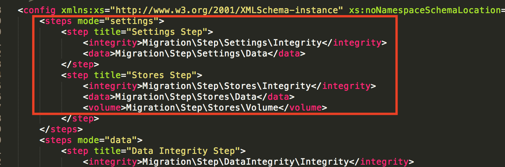
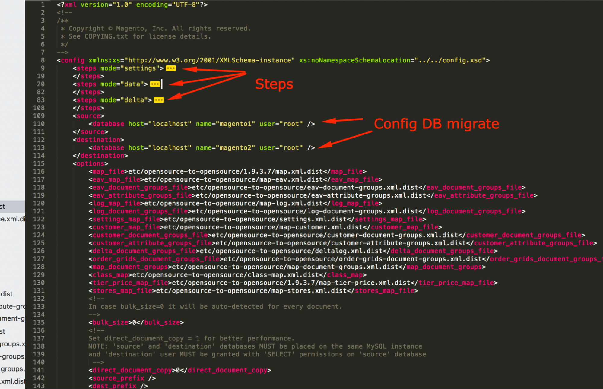
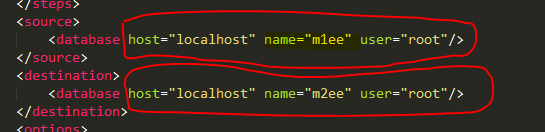
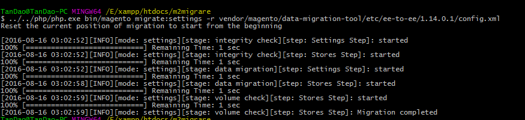
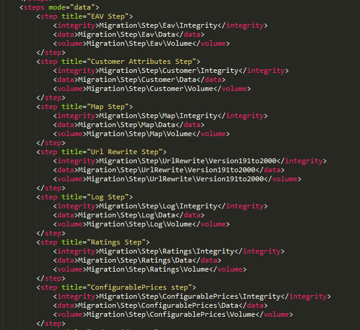
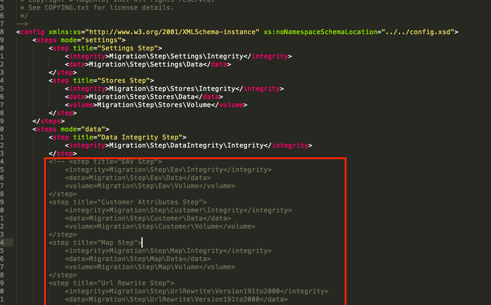
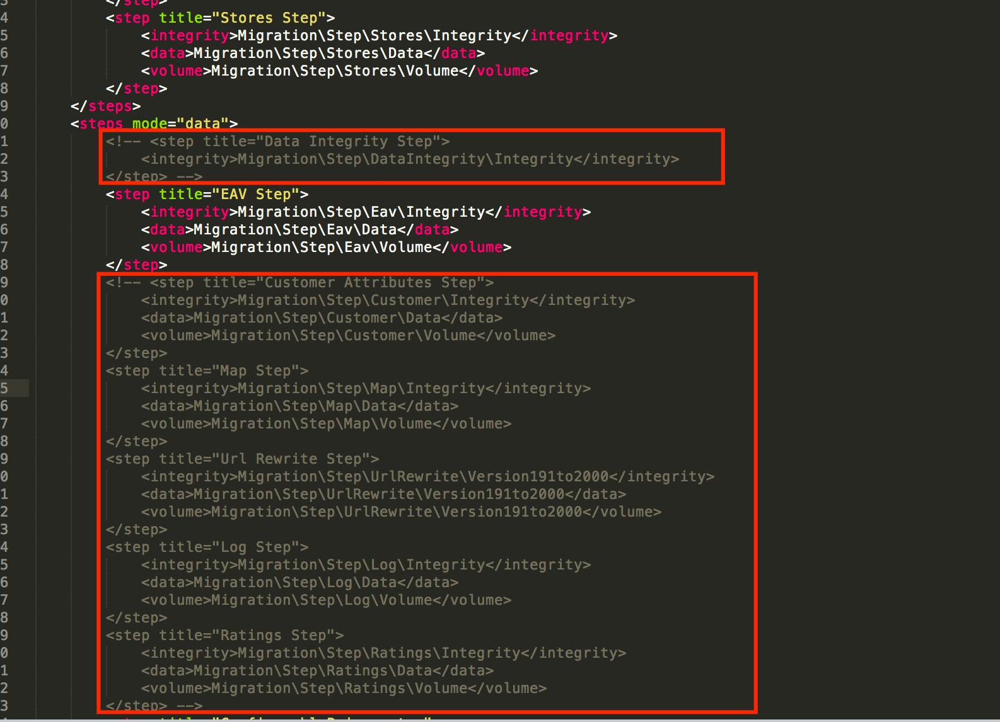
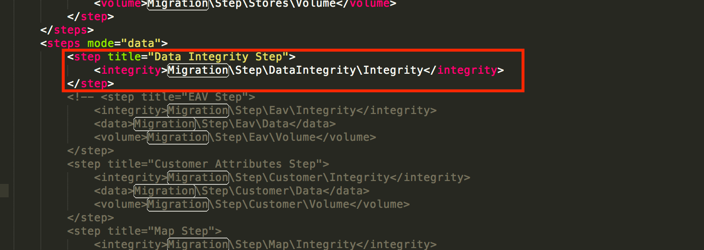

# Migrate Database M1 → M2

Hướng dẫn chi tiết migrate data từ Magento 1 lên Magento 2 bằng **Adobe Commerce Data Migration Tool**, kèm các bài học thực chiến từ dự án V570.

> **Tài liệu Adobe** (thay cho devdocs cũ đã chết):
> - Tổng quan: https://experienceleague.adobe.com/en/docs/commerce-operations/tools/data-migration/overview
> - Cài tool: https://experienceleague.adobe.com/en/docs/commerce-operations/tools/data-migration/basics/install
> - Config tool: https://experienceleague.adobe.com/en/docs/commerce-operations/tools/data-migration/basics/configure
>
> *Ảnh minh hoạ lấy từ tài liệu gốc của team; lưu trong `images/`.*

---

## 0. Tổng quan

Việc migrate chạy qua **3 lệnh chính** của tool, mỗi lệnh là một bước:

| Lệnh | Mục đích | Khi nào chạy |
|---|---|---|
| `bin/magento migrate:settings` | Migrate config admin (store, website, system config) | Đầu tiên |
| `bin/magento migrate:data` | Migrate toàn bộ dữ liệu còn lại (gồm ~13 stage con) | Sau settings |
| `bin/magento migrate:delta` | Migrate các thay đổi mới nhất từ live (dựa trên bảng `m2_cl`) | Lúc golive |

Tổng quan file `config.xml` của tool (khai báo 3 bước settings/data/delta):



Toàn bộ quy trình chia **3 giai đoạn**:
1. **Giai đoạn 1** — Chuẩn bị môi trường (dựng sẵn, tạo bảng `m2_cl`).
2. **Giai đoạn 2** — Migrate data thật trên localhost.
3. **Giai đoạn 3** — GoDev & Golive (chạy delta bê thay đổi cuối).

> 💡 **Luôn làm trên localhost** để dễ debug. Site data nặng → tổng thời gian có thể **4–5h**, nên chia nhỏ từng stage để kiểm soát lỗi.

---

## 1. Chuẩn bị & khảo sát (bắt buộc làm trước)

Trước khi đụng tool, khảo sát để giảm rủi ro:

1. **Check access M1** (ssh + db) và permission → đảm bảo có quyền import/export DB.
2. **Xác định version M1** (vd `1.9.4.1`) → quyết định version tool migrate phải cài.
3. **List toàn bộ module** bên thứ 3 + module custom đang chạy trên M1.
4. **Confirm với khách** module nào sẽ tiếp tục dùng trên M2 (lọc từ list trên).
5. Với mỗi module giữ lại, **check module nào đụng DB**:
   - **Module bên thứ 3** → check có bản cho M2 không. Có → báo khách mua + **cài lên M2 trước khi migrate**.
   - **Module custom** → **tạo lại bảng trên M2 với cấu trúc y hệt M1** trước khi migrate, để sau viết lại logic.
6. **Setup Magento 2** (version mới nhất phù hợp) + pull code để có đủ module bên t3 & custom.
7. **Cài Data Migration Tool đúng version M2**.

> ⚠️ Bước 5 hay bị bỏ sót → migrate xong mới phát hiện thiếu bảng, phải làm lại. Đừng skip.

---

## 2. Giai đoạn 1 — Chuẩn bị môi trường (bản nháp)

**Mục tiêu:** dựng sẵn môi trường + tạo bảng `m2_cl` (changelog) để sau này chạy delta. Đây là bước quyết định **thời gian downsite** khi golive, nên phải làm kỹ ở bản nháp trước.

### 2.1. Import DB & cấu hình tool

1. Export DB M1 live → download về local → **xoá bản export trên live** (bảo mật thông tin).
2. Tạo DB cho site M1 ở local (cùng môi trường với site M2 đã dựng).
3. Import DB M1 vào local (vào DB M1 vừa tạo).

> 💡 **Bảng nặng** như `core_url_rewrite` nên **export/import riêng** — trên V570 bảng này là nặng & lâu nhất, xử lý riêng để không delay các bảng còn lại *(bài học V570)*.

4. **Deploy lại M2** để nhận config/data mới nhất *(bài học V570)*.
5. Tạo module config cho tool để nó nhận biết DB M1 và DB M2 (theo link "Config tool" ở đầu guide).

   Cấu trúc thư mục tool sau khi setup (tham khảo):
   ```
   vendor/magento/data-migration-tool/etc/
   ├── opensource-to-opensource/
   │   └── <version>/        # vd 1.9.3.2 — chọn đúng version M1
   │       ├── config.xml.dist
   │       ├── map.xml.dist
   │       └── ...
   └── ee-to-ee/ ...
   ```

   

   Trong `config.xml`, khai báo DB nguồn (M1) và đích (M2) ở block `<source>` / `<destination>`:

   

### 2.2. Fix type column trên DB M1 (quan trọng)

Một số column khi migrate M1 → M2 bị đổi type / outdate → phải `ALTER TABLE` sửa **trên DB M1** trước khi chạy, nếu không tool sẽ báo lỗi integrity.

> Đây là **ví dụ thực tế từ V570** — mỗi project có bộ SQL riêng tuỳ module. Giữ script SQL của từng project kèm ticket.

```sql
-- Ví dụ: sửa type cho bảng của module aitoc (V570)
ALTER TABLE `aitoc_aitpermissions_editor_attribute`
  CHANGE `is_allow` `is_allow` smallint(6) NOT NULL AFTER `attribute_id`;

-- Ví dụ: customer_eav_attribute (nhiều cột đổi sang smallint unsigned NOT NULL)
ALTER TABLE `customer_eav_attribute`
  CHANGE `used_in_product_listing` `used_in_product_listing` smallint(5) unsigned NOT NULL AFTER `is_filterable_in_search`,
  CHANGE `is_visible_on_front` `is_visible_on_front` smallint(5) unsigned NOT NULL AFTER `sorting_order`;

-- Ví dụ: product_alert_stock
ALTER TABLE `product_alert_stock`
  CHANGE `avisado` `avisado` smallint NULL DEFAULT '0' COMMENT 'avisado' AFTER `status`;
```

Tương tự, một số bảng phải sửa / thêm cột **trên DB M2** để migrate được data (vd thêm cột custom của site, tạo bảng phụ). Giữ bộ SQL này riêng theo project.

### 2.3. Test migrate bản nháp

6. Chạy migrate settings:
   ```bash
   bin/magento migrate:settings -r <path-to>/config.xml
   # VD: bin/magento migrate:settings -r vendor/magento/data-migration-tool/etc/opensource-to-opensource/1.9.3.2/config.xml
   ```
   Kết quả chạy settings thành công (các stage Settings/Stores Step → *Migration completed*):

   

7. Sửa `config.xml`: **comment hết các stage con** trong `migrate:data`, chỉ để lại **`Data Integrity Step`** để tạo bảng `m2_cl`.

   Danh sách ~13 step con trong `<steps mode="data">` (EAV, Customer Attributes, Map, Url Rewrite, Log, Ratings, ConfigurablePrices...):

   

   Ví dụ comment để chỉ chạy stage đầu `Data Integrity Step`:

   

   Chạy xong 1 stage → comment stage vừa chạy, mở comment stage tiếp theo, lặp lại:

   

   ```bash
   bin/magento migrate:data -r <path-to>/config.xml
   ```

8. Kiểm tra DB M1 ở local đã nhận bảng **`m2_cl`** chưa. Có → **xong giai đoạn 1**.

   

> **Note:** bảng `m2_cl` dùng cho bước **migrate delta** sau này → đây là bước tạo môi trường rất quan trọng, quyết định downsite M1 bao lâu khi golive.

---

## 3. Giai đoạn 2 — Migrate data thật trên localhost

> **TIP:** sau khi xong bản nháp giai đoạn 1, giờ làm thật. Trước tiên **remove DB M1 nháp**, import lại DB M1 + M2 sạch. Mỗi lần chạy xong 1 stage nên **export backup** để khỏi phải chạy lại từ đầu khi stage sau lỗi.

### Step 1 — Downsite M1 (tạo điểm mốc `m2_cl` trên live)

1. Chuyển M1 live sang **maintenance mode** (confirm thời gian downsite với PM/PA).
2. Export DB M1 live → zip → download về local (**chưa xoá bản live** đến khi chắc chắn, phòng bất trắc còn backup).
3. Import DB M1 vừa download + DB M2 vào local.
4. Fix các lỗi DB trên local (như làm ở giai đoạn 1; không có thì bỏ qua).
5. Config file config như giai đoạn 1.
6. Chạy `migrate:settings` → `migrate:data` (giữ comment chỉ `Data Integrity Step` như cũ).
7. Kiểm tra DB M1 local đã có `m2_cl`.
8. Export DB M1 local → zip → **upload lên server live M1** → import vào live.
9. **Tắt maintenance** → check live M1 chạy bình thường.

→ Xong Step 1 — live M1 giờ đã có trigger/bảng `m2_cl` để theo dõi thay đổi.

### Step 2 — Chạy `migrate:data` qua từng stage

Mở comment **lần lượt từng stage**, chạy lại lệnh, lặp đến stage cuối:
```bash
bin/magento migrate:data -r <path-to>/config.xml
```
- Chạy từng stage với site data lớn → tránh **timeout / treo mysql**, dễ khoanh vùng stage nào lỗi.
- Có thể **bỏ qua stage không cần**, vd `<step title="Log Step">`.
- Log mỗi stage có dạng giống output `migrate:settings` ở trên (stage → *Migration completed*).

#### Lỗi thường gặp & cách fix
Tham khảo: https://support.magento.com/hc/en-us/articles/360033020451

| Triệu chứng | Cách xử lý |
|---|---|
| Field có ở **source (M1)** nhưng thiếu ở **destination (M2)** | Tạo lại field đó trên M2 |
| Field có ở **M2** nhưng thiếu ở **M1** | `ignore` field đó trong file config |
| Báo id sản phẩm không tồn tại ở bảng nào đó | Vào DB M1, tìm & **xoá các hàng data thừa/mồ côi** (không còn liên kết) |

Sau khi hết lỗi:
- Check data trên M2: order, product, customer, category...
- Cài nốt các module bên thứ 3 (nếu có).
- Develop website M2 theo yêu cầu khách.

---

## 4. Tool migrate custom theo dự án *(bài học V570)*

Trên các dự án thật, tool thường được **sửa lại khá nhiều** để fix lỗi + khớp cấu trúc site:

- File **default**: đuôi **`.xml.dist`** — file bị **custom**: chỉ **`.xml`**.
- Muốn biết đã sửa gì → **diff file `.xml` với file `.xml.dist`** cùng tên.
- Module logic phức tạp (vd **`AW_RMA`**) có thể cần **config/tool riêng** và **không có phần delta** → golive phải chạy migrate riêng cho module đó.

Ví dụ 3 lệnh chính trên V570:
```bash
# migrate settings
bin/magento migrate:settings -r vendor/magento/data-migration-tool/etc/opensource-to-opensource/1.9.3.2/config.xml

# migrate data (lỗi integrity xuất hiện nhiều nhất ở bước này)
bin/magento migrate:data -r vendor/magento/data-migration-tool/etc/opensource-to-opensource/1.9.3.2/config.xml

# migrate riêng cho module AW_RMA (logic phức tạp, có config riêng)
bin/magento migrate:data -r vendor/magento/data-migration-tool/etc/aw_rma/config.xml
```

---

## 5. Migrate thủ công role & config path *(bài học V570)*

Một số dữ liệu M1 → M2 đổi **hẳn cấu trúc**, tool không tự xử lý được → phải làm riêng bằng tool/script tự viết. Trên V570 có 2 phần:

- **Role (phân quyền admin):** cấu trúc role M1 ≠ M2 → review list thay đổi và replace tương ứng trên M2.
- **Config path:** nhiều path config đổi tên giữa M1 và M2.
  - Build **sheet map** `path_m1 → path_m2` (V570 review hơn 1000 record).
  - Replace các path ở cột M1 thành path cột M2; **path không có trong sheet thì giữ nguyên value**, không xoá.

---

## 6. Giai đoạn 3 — GoDev & Golive

### 6.1. GoDev (BẮT BUỘC làm trước Golive)

**Mục đích:** tạo **trigger đánh dấu** các record đã migrate lần cuối, để lúc golive `migrate:delta` chỉ bê **phần thay đổi** thay vì toàn bộ → giảm mạnh thời gian.

1. Export data live về → báo **maintenance**.
2. Về local import lại, **chạy lại các bước migrate** → chạy thử `migrate:delta` để tạo các trigger đánh dấu record migrate lần cuối.
3. Cầm data (đã có trigger) **import ngược lại live**. Sau này live update → trigger sẽ đánh dấu record cần bê so với lần migrate cuối.

> **Note:** tổng thời gian các bước này ~**4–5h** vì khối lượng data lớn.

### 6.2. Golive

1. Server M2 phải **sẵn sàng**: code ✓ / images ✓ / DB đã migrate ✓ / site chạy ổn — chỉ còn thiếu **data mới nhất** từ M1.
2. Bật **maintenance** trên M1.
3. Export DB M1 → import về local (môi trường đang làm migrate).
4. Chạy delta để bê thay đổi mới nhất so với lần migrate cũ:
   ```bash
   bin/magento migrate:delta -r <path-to>/config.xml
   ```
   → records trong các bảng `m2_cl` migrate hết sang M2, sau đó `m2_cl` **tự xoá hết records**.
5. Check data M2 đã nhận đầy đủ từ M1 → **chuyển server M2 thành live** → **hoàn thành**.

> ⚠️ **Phải GoDev trước** để có trigger — nếu không, delta sẽ không nhận được thay đổi.
>
> 📋 Các mục quan trọng cần để ý khi golive (config + SQL): lưu thành checklist riêng theo project.

---

## Checklist nhanh

- [ ] Access + version M1 + list module (confirm KH)
- [ ] Module t3 cài trước / module custom tạo lại bảng trên M2
- [ ] Cài M2 + Data Migration Tool đúng version
- [ ] **GĐ1:** import DB, deploy M2, SQL fix type, tách bảng nặng, tạo `m2_cl`
- [ ] **GĐ2:** downsite → migrate settings → migrate data theo từng stage → fix lỗi integrity
- [ ] Role + config path migrate thủ công (sheet map)
- [ ] Module đặc biệt (vd AW_RMA) migrate riêng
- [ ] **GĐ3:** GoDev tạo trigger → Golive chạy delta → chuyển M2 thành live
