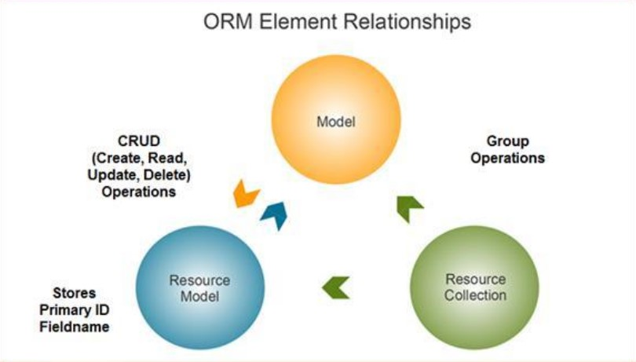
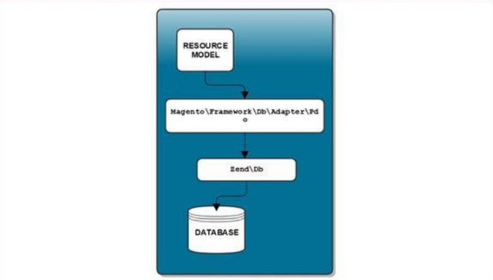
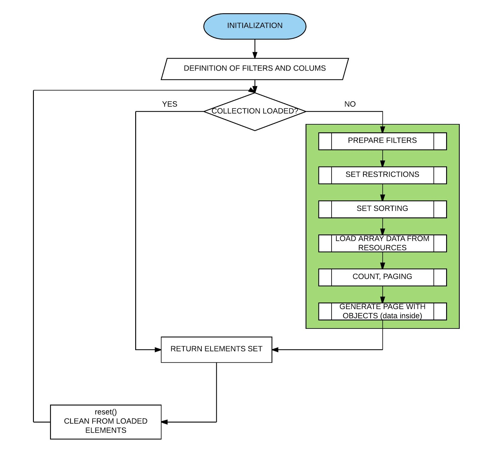

# Database in Magento 2

## Models, Resource Models, and Collections

### 1. Create Database Schemas

Since Magento 2.3, database tables are declared in `etc/db_schema.xml` (declarative schema) instead of `InstallSchema`/`UpgradeSchema` scripts. When `bin/magento setup:upgrade` runs, Magento compares the declared schema with the actual database and generates the DDL needed to sync them. Data changes (default rows, attributes, config) are done with data patches in `Setup/Patch/Data`.

Full guide: [Declarative schema](<../../../10. Knowledge Base/Best practices/Migration/Declarative schema.md>).

### 2. Models, Resource Models, and Collections

The Magento ORM is built around models, resource models, and resource collections. The Magento ORM elements are following:

- **Models** are data and behavior, representing entities.
- **Resource Models** are data mappers for the storage structure.
- **Collections** are encapsulating sets of models and related functionality, such as filtering, sorting, and paging.
- **Resources** include database connections via adapters.

The ORM gives you a possibility to create, load, update, and delete data to a database. Collections are used in Magento to store a set of objects of a specific type.



The Magento ORM concept requires that only models can contain and manipulate data. Magento has a very flexible and highly abstract concept of what a model is. Anything represented by a database table is most likely going to be a model.

When creating a new model that interfaces with the database, the model needs to know which resource model should be used. That’s why the class name of the resource model is specified by using the ***\_init()*** method in the protected function***\_construct()***. This is required to support the inherited **AbstractModel** methods ***getResource()*** and ***getCollection()***.

To create the model, you just create a class and extend it from **\Magento\Framework\Model\AbstractModel**.

```php
class Inbox extends \Magento\Framework\Model\AbstractModel
{
    protected function _construct()
    {
        $this->_init(\Bss\Helloworld\Model\ResourceModel\Inbox::class);
    }
    ....
}
----------------------------------------------------------------------------
abstract class AbstractModel extends \Magento\Framework\DataObject
{
    …

    protected function _init($resourceModel)
    {
        $this->_setResourceModel($resourceModel);
        $this->_idFieldName = $this->_getResource()->getIdFieldName();
    }

    ...
}
```

A resource model extends **\Magento\Framework\Model\ResourceModel\Db\AbstractDb**.

You need to define the table name and the primary key field name for the resource model because it’s necessary to know where to save the model state. They are specified by calling the ***\_init()*** method in the protected ***\_construct()*** method.

```php
class Inbox extends \Magento\Framework\Model\ResourceModel\Db\AbstractDb
{
    protected function _construct()
    {
        $this->_init('adminnotification_inbox', 'notification_id');
    }
    ....
}
---------------------------------------------------------------------
abstract class AbstractDb extends AbstractResource
{
    ....
 
    protected function _init($mainTable, $idFieldName)
    {
        $this->_setMainTable($mainTable, $idFieldName);
    }

    protected function _setMainTable($mainTable, $idFieldName = null)
    {
        $this->_mainTable = $mainTable;
        if (null === $idFieldName) {
            $idFieldName = $mainTable . '_id';
        }
 
        $this->_idFieldName = $idFieldName;
        return $this;
    }

    ....
}
```

The collection extends **Magento\Framework\Model\ResourceModel\Db\Collection\AbstractCollection**.

When creating a resource collection, you need to specify which model it corresponds to, so that it can instantiate the appropriate classes after loading a list of records. It’s also necessary to know the matching resource model to be able to access the database. That’s why the class names of the model and the resource model are specified by using the ***\_init()*** method in the protected ***\_construct()*** method.

```php
class Collection extends \Magento\Framework\Model\ResourceModel\Db\Collection\AbstractCollection
{
    protected function _construct()
    {
         $this->_init(\Bss\Helloworld\Model\Inbox::class, \Bss\Helloworld\Model\ResourceModel\Inbox::class);
    }
}
---------------------------------------------------------------------------
abstract class AbstractCollection extends \Magento\Framework\Data\Collection\AbstractDb
   implements SourceProviderInterface
{
    ....
 
    protected function _init($model, $resourceModel)
    {
        $this->setModel($model);
        $this->setResourceModel($resourceModel);
        return $this;
    }

    ....
}
```

The model has no direct access to the database, only the resource models. So, if you need some special data from the database, you have to create the appropriate method on the resource model.

The resource models access the database through the adapter **\Magento\Framework\DB\Adapter\Pdo\Mysql** (implements `\Magento\Framework\DB\Adapter\AdapterInterface`), which is built on top of the **Zend_Db** library. Queries are built with **\Magento\Framework\DB\Select**.



The programmatic API for collections is implemented by **\Magento\Framework\Model\ResourceModel\Db\Collection\AbstractCollection**.

```php
addFieldToFilter($field, $condition = null);
getConnection();
getSelect();
addBindParam($name, $value);
getIdFieldName();
distinct($flag);
addOrder($field, $direction = self::SORT_ORDER_DESC);
setOrder($field, $direction = self::SORT_ORDER_DESC);
unshiftOrder($field, $direction = self::SORT_ORDER_DESC);
getItems();
getSize();
getSelectCountSql();
load($printQuery = false, $logQuery = false);
resetData();
walk($callback, array $args = []);
```

Collections provide several useful functions for defining and working with a result set.



This diagram shows how a collection is loaded.

A resource collection is necessary to create a set of model instances and operate on them. Resource collections lazy load the record set they represent. The first time the item list is accessed, a collection will load automatically. After that, a collection will not load again, even if the ***load()*** method is explicitly called.

Collections are very close to the database layer. Their task is to retrieve a set of rows from the database, then iterate over them, and for each row, instantiate the matching model class.

It solves these main issues:

- Provides a container for storing collections of objects.
- Prevents unnecessary data loading.
- Keeps the loaded objects in memory, so iterating the collection again does not query the database again.
- Provides an interface for filtering and sorting entities of a specific kind.

### 3. Service contracts and repositories

Since Magento 2.1, `AbstractModel::load()`, `save()` and `delete()` are marked `@deprecated`: an entity should not be responsible for loading and saving itself. Code outside the module's persistence layer (controllers, observers, plugins, other modules) should work through a **repository**, which is part of the module's service contract:

| Element | Location | Role |
| --- | --- | --- |
| Data interface | `Api/Data/InboxInterface.php` | Getters/setters of the entity. The model implements this interface |
| Search results interface | `Api/Data/InboxSearchResultsInterface.php` | Extends `Magento\Framework\Api\SearchResultsInterface`, return type of `getList()` |
| Repository interface | `Api/InboxRepositoryInterface.php` | `save()`, `getById()`, `getList()`, `delete()`, `deleteById()` |
| Repository class | `Model/InboxRepository.php` | Implements the interface using the resource model and the collection factory |
| Preferences | `etc/di.xml` | Binds each interface to its implementation with `<preference>` |

```php
<?php
declare(strict_types=1);

namespace Bss\Helloworld\Model;

use Bss\Helloworld\Api\Data\InboxInterface;
use Bss\Helloworld\Api\Data\InboxSearchResultsInterface;
use Bss\Helloworld\Api\Data\InboxSearchResultsInterfaceFactory;
use Bss\Helloworld\Api\InboxRepositoryInterface;
use Bss\Helloworld\Model\ResourceModel\Inbox as InboxResource;
use Bss\Helloworld\Model\ResourceModel\Inbox\CollectionFactory;
use Magento\Framework\Api\SearchCriteria\CollectionProcessorInterface;
use Magento\Framework\Api\SearchCriteriaInterface;
use Magento\Framework\Exception\CouldNotSaveException;
use Magento\Framework\Exception\NoSuchEntityException;

class InboxRepository implements InboxRepositoryInterface
{
    public function __construct(
        private readonly InboxResource $resource,
        private readonly InboxFactory $inboxFactory,
        private readonly CollectionFactory $collectionFactory,
        private readonly CollectionProcessorInterface $collectionProcessor,
        private readonly InboxSearchResultsInterfaceFactory $searchResultsFactory
    ) {
    }

    public function getById(int $id): InboxInterface
    {
        $inbox = $this->inboxFactory->create();
        $this->resource->load($inbox, $id);
        if (!$inbox->getId()) {
            throw new NoSuchEntityException(__('Inbox with id "%1" does not exist.', $id));
        }

        return $inbox;
    }

    public function save(InboxInterface $inbox): InboxInterface
    {
        try {
            $this->resource->save($inbox);
        } catch (\Exception $e) {
            throw new CouldNotSaveException(__($e->getMessage()), $e);
        }

        return $inbox;
    }

    public function getList(SearchCriteriaInterface $searchCriteria): InboxSearchResultsInterface
    {
        $collection = $this->collectionFactory->create();
        $this->collectionProcessor->process($searchCriteria, $collection);

        $searchResults = $this->searchResultsFactory->create();
        $searchResults->setSearchCriteria($searchCriteria);
        $searchResults->setItems($collection->getItems());
        $searchResults->setTotalCount($collection->getSize());

        return $searchResults;
    }

    // delete(), deleteById() ...
}
```

> The sample uses constructor property promotion and `readonly` (PHP 8.1+). On PHP 7.4, declare the properties and assign them in the constructor.

```xml
<!-- etc/di.xml -->
<preference for="Bss\Helloworld\Api\Data\InboxInterface" type="Bss\Helloworld\Model\Inbox"/>
<preference for="Bss\Helloworld\Api\InboxRepositoryInterface" type="Bss\Helloworld\Model\InboxRepository"/>
<preference for="Bss\Helloworld\Api\Data\InboxSearchResultsInterface" type="Magento\Framework\Api\SearchResults"/>
```

Inside the repository, loading and saving go through the **resource model** (`$this->resource->load($inbox, $id)`), not through `$inbox->load($id)`.

### 4. Common pitfalls

- **Inject the `CollectionFactory`, not the `Collection`.** A collection is stateful (filters, loaded items), so each use needs a new instance from `$this->collectionFactory->create()`.
- **Do not load models inside a loop** (N+1 queries). Load all records at once with a collection, e.g. `addFieldToFilter('entity_id', ['in' => $ids])`.
- **`getSize()` vs `count()`:** `getSize()` runs a separate `COUNT` query and ignores the page size; `count()` loads the collection and counts the items of the current page.
- **Select only the needed columns** on large tables with `addFieldToSelect([...])`.
- **Use `setPageSize()` / `setCurPage()`** when processing large data sets (cron, import/export) to avoid loading the whole table into memory.
