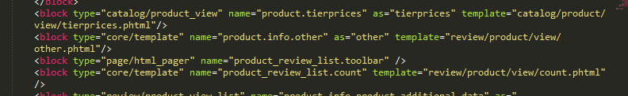
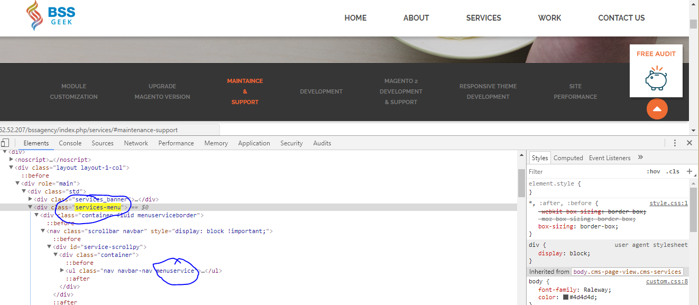
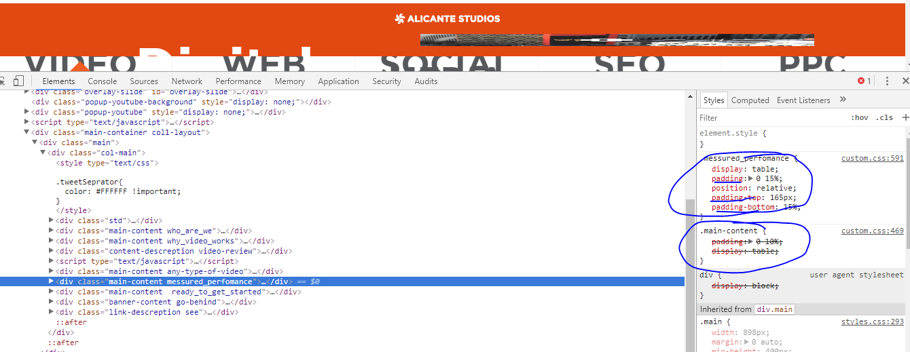
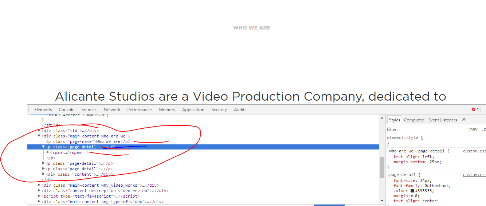

# Frontend Coding Standard (Luma)

> ⚠️ **LEGACY** — chuẩn code frontend cho theme Luma/default. Site Hyvä dùng tài liệu trong `2. Hyva/`.

Magento Frontend

1. Code standard

1. Với Block
2. Với Template
3. Với Layout/Theme
4. Với CSS/Styles/Class

2. Case study

3. Định hướng dữ liệu

4. Một số lưu ý khi làm việc với frontend trên M2

=============================&&===============================

## 1. Code Standard

### a.) Block

Khi làm việc với **Block** tạo ra các phương thức, cần viết sao cho phương thức đó có thể sau này dễ dàng extend được.

=> Chủ động truyền các tham số vào các phương thức nếu có thể.

=> Block mình viết phải được Extend từ 1 block nào đó có sẵn các phương thức mà có thể mở rộng hoạc dùng lại được trên block của mình.

=> Khi tạo mới 1 block cần check kỹ xem có cần thiết tạo hay không? Có thể cái mình cần dung đã dc sử dụng bở default magento.

=> Khi Rewrite Block, chỉ nên rewrite phương thức bạn cần thay đổi, không nên copy toàn bộ code trong file base default.

### b.) Với template

- Khi viết template trong magento cần lưu ý những điều sau

+ Viết template rõ ràng, khai báo các class/id cho các thẻ để thuận tiện cho việc styles layout **(Có thể khai báo nhiều class cho 1 element nhưng chỉ có 1 ID là duy nhất và trên toàn bộ page đấy)**

+ Tận dụng cấu trúc có sẵn của magento đễ có thể có chung 1 style cho cùng dạng template trên site.

**Ví dụ:** Khi muốn render ra 1 loại custom product trên site **(feature product, bestseller, products by category ID, …vv).** Ta có thể tận dụng cấu trúc template (HTML, CSS) của **catalog list,** Related product, Compare product,..v.v. Như vậy sẽ giúp giảm thiếu thời gian tạo template cũng như style cho chúng.

+ Không nên xử lý các các đoạn code logic phức tạp trên file template.

+ Khi Tạo các template thì tên file cũng như tên đường dẫn của file cần giống với cách khái báo của block mà template gọi tới. Điều này sẽ cho phép bạn phán đoán và tìm đến block nhanh nhất.

**Ví dụ:**

Khi tạo ra 1 template có đường dẫn là **../template/custom/product/item.phtml**

Thì block của template này cũng nên có dạng đường dẫn tương tự.

**../Custom/Block/Product/Item.php**

+ Các đoạn text, title khi viết trong template cần viết theo chuẩn magento (viết trong function dịch magento)

**Ví dụ:**

+ Nên viết:

```php
<span><?php echo __("Customer name"); ?></span>
```

+ Không nên viết:

```html
<span>Customer name</span>
```

Điều này sẽ giúp cho đoạn text có thể hoạt động linh hoạt trong nhiều store, nhiều website với các ngôn ngữ khác nhau

+ Nên khai báo Block class trong file template để có thể biết được các phương thức đang sử dụng được gọi từ Block nào.

**Ví dụ:**

Template đang sử dụng được trỏ đến Block class: **Bss\Custom\Block\product\Item**

* Trên đầu của file template khai báo như sau:

```php
/** @varBss\Custom\Block\Product\Item $block */
```

+ Nắm được cấu trúc các thẻ để tránh viết sai.

vd: thẻ div là thẻ block, thẻ a là thẻ inline. => Thể theo quy tắc khai báo cấu trúc html, thì thẻ block sẽ k được phép nằm trong thẻ inlinne, có nghĩa là thẻ div k được khai báo trong thẻ a.

### c.) Với Layout/Theme

- Những lưu ý khi làm viêc với Layout/Theme

+ Không nên sửa trực tiếp các file thuộc theme (bản thương mại) của bên thứ 3 cài vào site. Ví dụ Ultimo, Porto,… bởi vì sau này khi theme gửi bản upgrade thì sẽ rất khó để có thể upgrade vào được, nếu theme đã bị sửa trực tiếp.

=> Chúng ta nên tạo 1 theme con và extend từ theme cần sử dụng để customize nếu cần thiết phải customize.

+ Ngoài ra không được sửa các file trong core của magento (base/default, default/default, rwd/default).

+ Khi làm việc với LESS cần tạo những function có thể được dùng đi dùng lại nhiều lần, để có thể rút ngắn thời gian xử lý code đồng thời dễ dàng sửa chữa sau này.

+ Các block trên template nên đc định nghĩa trong các file layout xml để tiện cho việc kiểm soát và mở rộng.

Ở M1 các file các file layout như: local.xml, catalog.xml, reviews.xml,…v.v

Ở M2 các file như: default.xml, catalog_product_view.xml,…v.v



+ Cần xác định rõ block dc sử dung ở page nào để từ đó khai báo các block tại những file layout tương ứng cho hợp lý.

+ Tránh tình trạng định nghĩa block/container lung tung.

### d. Với CSS/Styles/Class

- Không được tao thêm các file không theo chuẩn của magento trong theme (m2):

+**Ví dụ**: custom.less custom.css,

+ Trong magento 2 ,file chuẩn đi theo module luôn là **_modules.less**, Chỉ cần khai báo file này trong đường dẫn của module ../web/css/source/_modules.less => khi render hệ thống sẽ tự động gom tất cả code ở những file như thế này và combine ra 2 file css (style-m và style-l)

-Khi sửa Style cho các thành phần trên site cần xác định rõ phần cần sửa thuộc phần nào, để từ đó sửa css và đúng module thích hợp.

+**Ví dụ**:

.) Khi sửa style cho phần review thì cần sửa file less ở module review (Magento_Review).

.) Khi sửa các thành phần thuộc page category cần sửa trong file _listing.less cua module catalog (Magento_Catalog).

.) Khi sửa style cho các thành phần thuộc page product page cần sửa trong file _modules.less thuộc module catalog (Magento_Catalog)

.) …

- Đặt tên class có thể dung chung được trên toàn bộ site

Ví dụ: Không đặt tên class theo kiểu cá nhân:

++ who_are_we

++ cms-video-production-type

++ type-video-studio

++ …

=>Chúng ta chỉ nên đặt tên class theo kiểu global, Dùng chung được nhiều nơi, đặt nhiều class cho 1 element để có thể tận dụng các thuộc tính css khác nhau của mỗi class.

**Ví dụ:**

+ container, page-container, panel-block, panel,…

- Hạn chế viết css cho ID. (Cần cần nhắc kỹ trước khi viết)

- Khi đã extend class từ các block khác, k được phép css tiếp cho class đấy, mà cần tạo thêm 1 class khác cùng cấp hoạc cho element parent để css riêng, vì css tiếp cho class được Extend nó sẽ ảnh hưởng đến các block html có chứa class đấy

## 2. Case study

### a. Cách đặt tên class

\*). Project BSS Geek, http://139.162.52.207/bssagency/index.php/services/

- menuservice

- services-menu



* 2 class trên có ý nghĩa là gì? Chúng có nhiệm vụ như thế nào đối với menu?

Sau khi check code cũng như cách style thì với 2 class này mình có thể đặt như thế này:

services-menu => nav-wrap. cách đặt tên này có nghĩa là class này sẽ khai báo nơi hiển thị của menu. Đồng thời tất cả loại menu đều có thể dung class nầy.

menuservice =>special-menu, special-nav

\*). Project V64 (Alicante) http://retroeurope.net/alicante/

- .what_are_specker_videos

- #myDropdown

- .who_are_we, …



\*\*\*. Cách viết code như trên không những k mang lại tác dụng mà còn phản tác dụng. ảnh hưởng đến cách đọc code của site.

- Quy tắc đặt tên Class:

+ Mình chỉ nên diễn đạt class theo. **Đó là cái gì**

**Ví dụ: menu, nav,header …**

**+** Không đặt tên theo kiểu mô tả nó trông như thế nào:

**Ví dụ: header-home-top-left, menu-cate-left-bottom,..v.v**

### b. Cách triển khai HTML

\* Project V64(Alicante)



* Cách triển khai html sai. K hiểu đúng ý nghĩa các thẻ.
* Đối với title chúng ta cần đặt trong các thẻ heading (H1,2,3,4,5,6)
* Đối với đoạn văn bản, ta cần đặt ở thẻ p (<p>)

\*) Project

## 3. Định hướng dữ liệu

- Khi viết nội dung và template cho page.

+ Cần phân tích được nội dung đang hiển thị đó là cái gì?

+ Nội dung đó sẽ được thêm bởi ai (dev, admin, Customer)

+ Nội dung đó có thể dc thêm ở 1 nới hay nhiều nới.

+…

* Từ đó mình có thể có những giải pháp tối ưu để xử lý template trước khi tới khách hàng. Có thể chưa là cách tốt nhất, nhưng ít nhất mình nên nghĩ dc nó đang tối ưu so với thông thường.

## 4. Một số lưu ý khi làm việc với frontend trên M2

-Đối với các task dài hơi (trên 1 tuần) Các dev cần setup grunt cho server để giảm thiểu thời gian khi render các static file (JS, css, image) – Nếu tài khoản ko đủ quyền, cần thảo luận với KH để cài.

- Hạn chế khởi tạo object lặp đi lặp lại trong template, và **không dùng `ObjectManager` trực tiếp** trong template (anti-pattern):

```php
// ❌ KHÔNG làm thế này trong template
$objectManager = \Magento\Framework\App\ObjectManager::getInstance();
$productObj = $objectManager->create(\Magento\Catalog\Model\Product::class)->load($_product->getId());
```

> ⚠️ **Cập nhật chuẩn mới (Magento 2.2+):** trước đây tài liệu này khuyên tạo **Helper** để load dữ liệu cho template. Cách đó **không còn được khuyến nghị** — Magento hiện dùng **ViewModel** (`Magento\Framework\View\Element\Block\ArgumentInterface`). Helper chỉ nên dùng cho logic dùng chung thực sự, không phải để cấp data cho template. Ngoài ra nên load product qua **`ProductRepository`** thay vì `ProductFactory->load()`.

**Cách đúng — dùng ViewModel:**

```php
<?php
namespace Bss\CatalogWidget\ViewModel;

use Magento\Framework\View\Element\Block\ArgumentInterface;
use Magento\Catalog\Api\ProductRepositoryInterface;

class ProductData implements ArgumentInterface
{
    public function __construct(
        private readonly ProductRepositoryInterface $productRepository
    ) {}

    public function getProductById(int $id)
    {
        return $this->productRepository->getById($id);
    }
}
```

Khai báo ViewModel cho block qua layout XML:

```xml
<referenceBlock name="your.block">
    <arguments>
        <argument name="product_data" xsi:type="object">
            Bss\CatalogWidget\ViewModel\ProductData
        </argument>
    </arguments>
</referenceBlock>
```

Gọi trong template:

```php
/** @var \Bss\CatalogWidget\ViewModel\ProductData $viewModel */
$viewModel = $block->getData('product_data');
$productObj = $viewModel->getProductById($productId);
```
