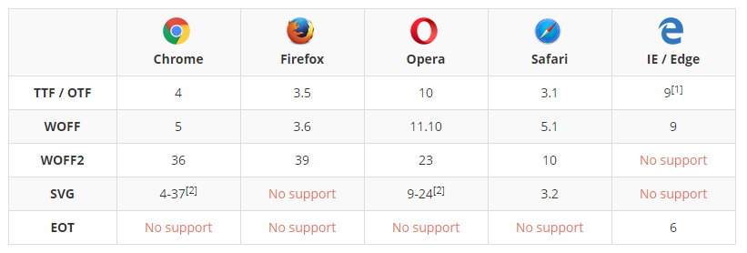
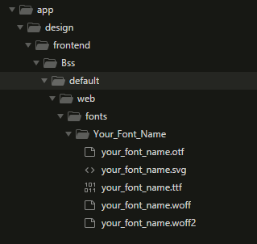
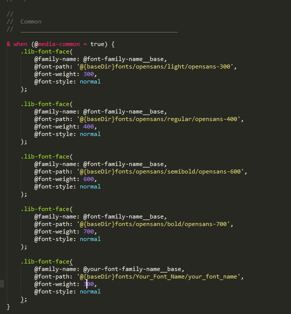
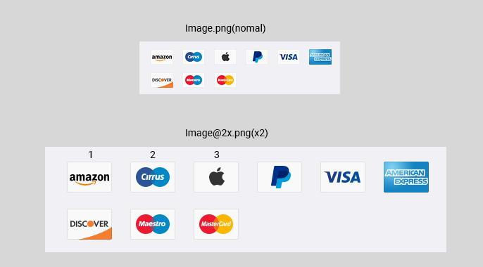
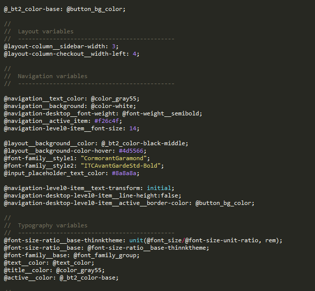

# Luma Theme — Build theme & LESS

> ⚠️ **LEGACY** — tài liệu cho theme base Luma/default (LESS, Grunt). Chỉ áp dụng cho site còn chạy Luma; dự án mới dùng Hyvä.

## MỘT SỐ BƯỚC NÊN LÀM TRƯỚC KHI BUILD THEME MỚI

### I: FONT

Thêm font vào theme của mình

Bước 1: Vào thư mục theo đường dẫn.

<your Magento install dir>app/design/frontend/<your_vendor>/<your_theme_name>/web/fonts

Upload folder fonts lên

**Chú ý:** Đây là bảng các trình duyệt hỗ trợ định dạng font



[1] Fonts only working when set to be "installable".

[2] Chrome 38 and newer support SVG fonts only on Windows Vista and XP.

Bạn có thể vào trang [https://transfonter.org/](https://transfonter.org/), [https://onlinefontconverter.com/](https://onlinefontconverter.com/) để convert sang các định dạng font.

> 💡 **Cập nhật:** hiện chỉ cần **`.woff2`** (fallback `.woff`) — mọi trình duyệt hiện đại đều hỗ trợ; `.eot/.svg/.ttf` đã lỗi thời, không cần tạo nữa.

**Lời khuyên:**

Đầy đủ các định dạng để đảm bảo được hỗ trợ trên các trình duyệt.



Bước 2: Tạo file _typography.less theo đường dẫn

<your Magento install dir>app/design/frontend/<your_vendor>/<your_theme_name>/web/css/source/_typography.less



**Lưu ý:**

@font-weight: 300 sẽ không có tác dụng khi bộ font của bạn không có định dạng font-weight 300.

Bước 3: Khai báo font family name base của bạn tại _variables.less

```less
@your-font-family-name__base: 'font-family-name';

@font-family__base: @your-font-family-name__base;
```

Trong đó:

@font-family__base: Sẽ ghi đè lên font family default (nếu có).

Bước 4: Sử dụng font family mà mình vừa khai báo.

Trong file .less của theme

```less
.class_name {

font-family: @your-font-family-name__base;

}
```

Chú ý:

* Để sử dụng font family chung cho toàn site và chỉ cần khai báo 1 lần. Chúng ta viết vào file _theme.less nằm trong folder web/css/source/ của theme đang active. Nếu theme đang active được kế thừa từ 1 theme cha nào đó sẽ tự động ghi đè lên.
* Cũng có thể khai báo trên các file .less để đảm bảo rằng font family của bạn nhận được trên site.

### II: COMPILE IMAGE ICON

#### 1: Tác dụng của việc compile image icon

Với trường hợp trên site nhiều hình ảnh có kích thước nhỏ, để tránh có nhiều requests, tốn dung lượng bộ nhớ dẫn đến giảm tốc độ tải trang. Đây là một phương pháp giải quyết được việc đó.

#### 2: Hướng dẫn compile

Bạn nên tạo 1 hình ảnh có kích thước lớn hơn để chứa tất cả các hình ảnh nhỏ. Công cụ để bạn compile là các phần mềm xử lý hình ảnh như Photoshop, Illustrator, XD…



*Hình ảnh: Compile logo payments.*

#### 3: Sử dụng image icon khi đã compile

* Thêm 2 file định dạng .png của image icons khi đã compile trong <your_vendor>/<your_theme/web/images/
* Tạo file _icons.less trong <your_vendor>/<your_theme/web/css/source/

Trong file _icons.less

```less
// /**

// * Copyright © 2016 Magento. All rights reserved.

// * See COPYING.txt for license details.

// */

& when (@media-common = true) {

.lib-font-face(

@family-name: @icons__font-name,

@font-path: @icons__font-path,

@font-weight: normal,

@font-style: normal

);

}

@_sprite-icon-image: '@{baseDir}images/Image.png';

@_sprite-icon-image2x: '@{baseDir}images/Image@2x.png';

@_sprite-icon-image-position-x: 0;

@_sprite-icon-image-position-y: 0;

& when (@media-common = true) {

.sprite-icons {

background: url(@_sprite-icon-image) no-repeat @_sprite-icon-image-position-x @_sprite-icon-image-position-y;

};

}

@media

only screen and (-webkit-min-device-pixel-ratio: 2),

only screen and ( min--moz-device-pixel-ratio: 2),

only screen and ( -o-min-device-pixel-ratio: 2/1),

only screen and ( min-device-pixel-ratio: 2),

only screen and ( min-resolution: 192dpi),

only screen and ( min-resolution: 2dppx) {

.sprite-icons {

background-image: url(@_sprite-icon-image2x);

background-size: width height;

};

}
```

width,height: chiều rộng và chiều cao của ảnh bình thường(Image.png)

sprite-icons: tên class chứa hình ảnh

* Bạn có thể sử dụng hình ảnh này ở tất cả các file .less trong theme bằng cách thêm đoạn dưới đây ở file cần sử dụng.

```less
.image {

&:extend(.sprite-icons all);

...

}
```

Và thêm thuộc tính “background-position: *value*;”

**Lưu ý:**

* chúng ta chỉ nên compile icons khi chúng có định dạng k phải là file svg, nếu icons là file svg thì nên giữ nguyên icon là file svg, vì về cơ bản file svg rất nhẹ và cực nét trên mọi loại màn hình, có thể tuỳ chỉnh về kích thước tuỳ theo loại màn hình mà k lo về vấn đề giảm độ phân giải.
* File compile icon nên tối ưu độ rộng, chỉ nên tạo file với kích thước vừa đủ để chứa các icon bên trong nó. tránh tính trạng diện tích cần sử dụng chỉ là 3x250px, mà mình tạo tạo tới 700x1000px => làm cho pagesize nặng -> tốn thời gian tải.

### III: CSS/LESS

#### 1: Setup Grunt

Để tối ưu thời gian build theme và tăng hiệu suất bạn nên sử dụng tool khá phổ biến đó là [Grunt](https://gruntjs.com/).. Grunt sẽ giúp cho việc debug, và tìm chính xác đến source file cần edit 1 cách nhanh chóng. Magento 2 tích hợp Grunt để render từ .less sang css.

**Cách** [**setup Grunt**](https://developer.adobe.com/commerce/frontend-core/guide/) **.**

Grunt là một bộ xử lý dựa trên ngôn ngữ javascript, nó làm đơn giản hóa công việc lặp đi lặp lại. Trong trường hợp này sẽ là: xem, biên dịch, dọn dẹp…

Với những lệnh cơ bản.

* grunt clean:<theme> - lệnh này sẽ xóa tất cả các file css và js trong các thư mục pub/static
* grunt exec:<theme> - Tạo lại thư mục với các liên kết symlink để chứa các file .less ở bên trong pub/static/
* grunt less:<theme> - lệnh này biên dịch tất cả các file css của bạn với các liên kết symlink tượng trưng trong vị trí này pub/static/frontend/<Vendor>/<theme>/<vị trí file .less>
* grunt watch:theme_name.
* Khi sử dụng lệnh này để theo dõi các thay đổi trong file .less, và tự động biên dịch lại style.
* Bạn có thể cài tool [LiveReload](http://livereload.com/extensions/) để không cần phải tải lại trình duyệt khi sử dụng lệnh grunt watch

Một vài lưu ý nhỏ khi chạy grunt

* Nếu chỉ thay đổi các file .less có sẵn rồi thì chỉ cần chạy lệnh grunt less:theme_name
* Trường hợp tạo mới file hoặc xóa file đi thì cần chạy lệnh grunt exec:theme_name mà không cần phải chạy lệnh grunt clean:theme_name. Sau đó chạy lệnh grunt less:theme_name
* Chạy lệnh grunt watch:theme_name để grunt auto render dạng less vào folder pub, khi có bất cứ thay đổi nào của file .less

#### 2: Sử dụng LESS

* Tạo file _theme.less trong folder theme của bạn theo đường dẫn your_theme/web/css/source/. File này chứa các biến đặc trưng của theme, và được sử dụng nhiều lần.
* Tạo file _variables.less cùng cấp với file _theme.less trong folder your_theme/web/css/source. File này chứa các biến để ghi đè lên theme cha hoặc biến core trong folder lib

Mục đích của việc tạo biến

* Sử dụng được nhiều lần
* Dễ dàng thay đổi, bảo trì
* Đồng bộ hóa code, khoa học

Một số ví dụ khi sử dụng Less.

* Khai báo biến:

```less
@width: 10px;
@height: @width + 10px;

#header {
 width: @width;
 height: @height;
}
```

Khi render ra css

```css
#header {
 width: 10px;
 height: 20px;
}
```

* Mixins:

```less
.bordered {
 border-top: dotted 1px black;
 border-bottom: solid 2px black;
}

#menu a {
 color: #111;
 .bordered();
}

.post a {
 color: red;
 .bordered();
}
```

* Import file.less

Mặc định LESS @import sẽ import nội dung những file cần dùng vào bên trong file hiện tại. Nó cho phép bạn phân chia style thành các file nhỏ hợp lý hơn:

```less
@import "modules/global.less";
```



*Hình ảnh: Minh họa về khai báo biến trong less*

Chi tiết: http://lesscss.org/

Bạn cũng có thể kết hợp SASS với Gulp.

Nguồn tham khảo: [http://lesscss.org](http://lesscss.org), https://developer.adobe.com/commerce/frontend-core/guide/

---

# LESS trong Magento 2 (chi tiết)

# LESS IN MAGENTO 2
 © 2018 Bss Geek Team | http://bssgeek.com

# Custom theme Magento 2
Để tùy theme trong Magento 2, chúng ta cần phải tạo 1 custom theme. Sau đó, chúng ta có thể sử dụng một trong các cách sau:
1. Kế thừa từ Blank theme hoặc Luma theme của Magento => để thay đổi cần ghi đè lên các tệp LESS mặc định.
2. Tạo các tệp LESS của riêng mình và sử dụng bộ tiền xử lý có sẵn.
3. Tạo các tệp CSS của riêng mình, có thể biên dịch bằng cách sử dụng bộ tiền xử lý CSS của bên thứ ba.

=> Document này chỉ đề cập tới cách 1.

# How Magento stylesheet files are organized
Trong Folder Theme, file style được lưu trữ ở các vị trí sau:
      + /<Namespace>_<Module>/web/css
      + /web/css
print.less: dùng cho printer style.
_styles.less: tệp tổng hợp, bao gồm tất cả các tệp LESS được sử dụng trong theme.
styles-m.less: sử dụng cho style mobile, includes _styles.less
styles-l.less: sử dụng cho style desktop, includes _styles.less.
/source: thư mục con này chứa các file LESS mixin từ Magento UI library
/source/_theme.less: ghi đè các giá trị biến mặc định của theme.

### Notes:
Dấu gạch dưới ("_") trong tên tệp thông thường có nghĩa là một tệp không được sử dụng độc lập, nhưng được bao gồm trong các tệp khác.

# Include CSS
Trong Magento 2, file css được include qua file layout.
Tạo file:
app/design/frontend/<Vendor>/<Theme>/Magento_Theme/layout/default_head_blocks.xml
Cú pháp add 1 file css:

```html
<css src="<path>/<file>" media="print|<option>"/>
```

# CSS preprocessing
Các file less mà từ đó các file css được include trong layout được biên dịch được gọi là các file nguồn. (Root source files)
Ví dụ:
css/styles-m.css
css/styles-l.css
css/print.css
Các Root Source file là:
<theme_dir> /web/css/styles-m.less
<theme_dir> /web/css/styles-l.less
<theme_dir> /web/css/print.less

# LESS compilation modes
Server-side LESS compilation.Đây là default compilation mode. Biên dịch được thực hiện trên máy chủ, sử dụng thư viện LESS PHP. Production mode chỉ có duy nhất chế độ này.
Client-side LESS compilation. Sử dụng được khi ở developer mode, sử dụng thư viện less.js để biên dịch
    Để enable Cliend-side mode: vào Stores > Configuration > ADVANCED > Developer

# LESS compilation modes
Với server side Less compilation mode:
-  Khi site đang ở default hoặc developer mode thì các file css sẽ tự sinh ra mà ko cần deploy hay grunt. (*)

# GRUNT
Grunt
Cài đặt và sử dụng: Tham khảo https://developer.adobe.com/commerce/frontend-core/guide/
Ưu điểm: Debug dễ hơn. Nhìn được source map file less.

# Magento UI library
Magento UI library là thư viện frontend của Magento dựa trên LESS được thiết kế để hỗ trợ các nhà phát triển theme Magento. Nó chủ yếu cung cấp một tập hợp các mixin cho các base elements để dễ dàng phát triển và tùy biến chủ đề giao diện người dùng.
Components được cung cấp bởi Magento UI library
actions-toolbar
breadcrumbs
buttons
drop-downs
forms
icons
layout
loaders

# Magento UI library(cont)
messages
pagination
popups
ratings
sections
tabs and accordions
tables
tooltips
typography
list of theme variables

# Magento UI library(cont)

# Magento UI library(cont)
Thư mục chứa: vendor/magento/magento2-base/lib/web/css

# Predefined variables
Rewrite 1 file trong theme. (Theme phải kế thừa theme Magento Blank hoặc Luma)
Để ghi đè bất cứ file nào trong thư mục vendor/magento/magento2-base/lib/web/css/source tạo 1 file tương ứng trong <theme_dir>/web/css/lib/web/css/source
Trong trường hợp chỉ cần thay đổi biến giá trị của biến truyền vào thì có thể tạo file <theme_dir>/web/css/source/_theme.less để ghi đè giá trị biến.

# Predefined variables(cont)
Ví dụ:
Để thay đổi màu sắc link (thẻ a) trong theme custom.
Example Work Flow:
+ Xác định vị trí style thẻ a qua file less. (Grunt less để xác định)
+ Nếu style được định nghĩa qua một mixin thì tìm xem mixin đó định nghĩa ở đâu. Như ví dụ ta tìm thấy được định nghĩa trong file: vendor/magento/magento2-base/lib/web/css/source/lib/_typrography.less

# Predefined variables(cont)
Xác định biến value default truyền vào mixin:

Ghi đè vào file: <theme_dir>/web/css/source/_theme.less
```less
@link__color: @color-red; // @color-red - Màu đỏ
```
Sau khi compilation:

# Popular Mixins
Giới thiệu một số mixins

```less
.lib-css() ;
```
+ Định nghĩa trong file: source/lib/_utilities.less
+ Sử dụng:
```less
a {
.lib-css(color, red);
}
```
Output
```css
a {
color: red;
}
```
Tìm hiểu tác dụng của .lib-css();
```less
.lib-breadcrumbs();
```
+ Định nghĩa trong file: source/lib/_breadcrumbs.less
+ Style cho breadcrumbs.

# Popular Mixins(cont)
```less
. lib-button();
```
+ Định nghĩa trong file: source/lib/_buttons.less
+ Style cho button.

```less
.lib-icon-font();
```
+ Định nghĩa trong file: source/lib/_icons.less
+ Style icon.

```less
.lib-layout-width();
```
+ Định nghĩa trong file: source/lib/_layout.less
+ Dàn trang, layout.

# Popular Mixins(cont)
```less
.lib-loader();
```
+ Định nghĩa trong file: source/lib/_loaders.less
+ Style cho loader image và layer thường sử dụng cho popup.

```less
.lib-typography();
.lib-typography__base();
```
+ Định nghĩa trong file: source/lib/_typography.less
+ Style font và font cho toàn trang.

```less
.lib-font-size();
```
+ Định nghĩa trong file: source/lib/_typography.less
+ Convert font-size relative theo đơn vị rem. (tìm hiểu rem là gì)

# Popular Mixins(cont)
```less
.lib-table();
```
+ Định nghĩa trong file: source/lib/_table.less
+ Style cho table.

```less
.lib-main-navigation();
```
+ Định nghĩa trong file: source/lib/_navigation.less
+ Style cho table.

=>  Tìm hiểu thêm các file còn lại trong source/lib/_navigation.less

# Reference
https://developer.adobe.com/commerce/frontend-core/guide/

Tham khảo conding standard:
https://developer.adobe.com/commerce/php/coding-standards/

# END.
Thank you!
