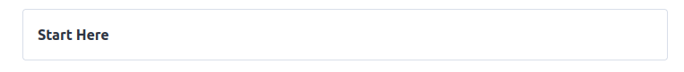
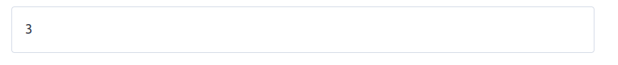
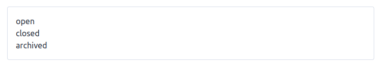
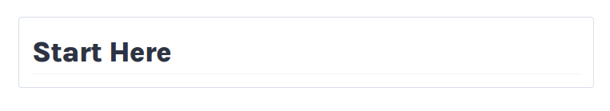
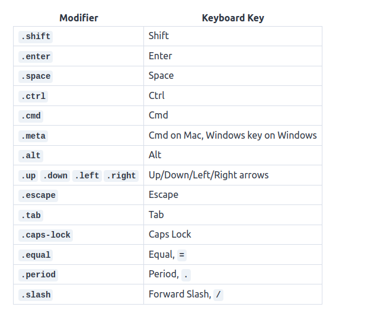
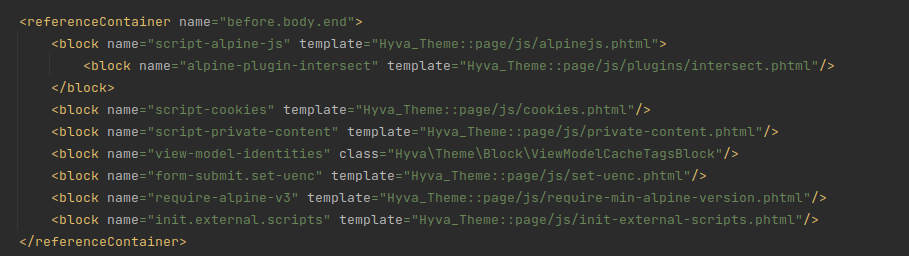
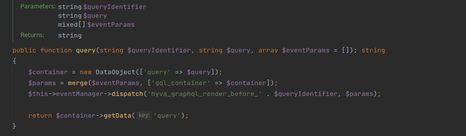

# Alpine.js trong Hyvä

> Alpine.js v3 — framework JS nhẹ dùng trong Hyvä. Phần cuối là tích hợp với Hyvä (ViewModel Registry, form validation, GraphQL).

# I. Alpine.js là gì?

Theo như trang web chính thức của Alpine.js [https://alpinejs.dev/](https://alpinejs.dev/)

Alpine.js là một framework nhỏ giúp tạo ra một trang web reactive, đại khái là một trang web sử dụng cơ chế tự động cập nhật giao diện mỗi khi luồng thông tin thay đổi, khi người dùng tương tác với giao diện…như cách mà React js, Vue js, Angular đang áp dụng.

Alpine js có thể được coi là Jquery của thời hiện đại, với dung lượng rất nhỏ mà không cần đóng gói (bundling), chỉ vỏn vẹn **21.9kB** với bản minimized và **7.1kB** bản gzipped. Tuy nhiên, những gì mà Alpine js đem lại còn lớn hơn nhiều, và bạn sẽ thích nó.

# II. Cài đặt Alpine.js

Tham khảo: [https://alpinejs.dev/essentials/installation](https://alpinejs.dev/essentials/installation)

Ta có 2 cách để cài đặt Alpine.js. Tuy nhiên, thông qua thẻ <script> là cách đơn giản nhất:

```html
<html>
<head>
...
<script defer src="https://cdn.jsdelivr.net/npm/alpinejs@3.x.x/dist/cdn.min.js"></script>
</head>
...
</html>
```

Luôn nhớ đặt thuộc tính **defer** ở thẻ <script>

Lưu ý link cdn trên sẽ luôn tải về version 3 mới nhất của Alpine.js. Nếu bạn muốn một phiên bản ổn định hơn, bạn có thể sửa lại **x.x** thành một version cụ thể. Ví dụ:

```html
<script defer src="https://cdn.jsdelivr.net/npm/alpinejs@3.11.1/dist/cdn.min.js"></script>
```

Sẽ tải về bản **3.11.1** của Alpine js

Tham khảo các [version](https://cdn.jsdelivr.net/gh/alpinejs/alpine%403.10.3/) để lựa chọn phiên bản phù hợp.

# III. Alpine.js

## 3.1. State

Tham khảo: [https://alpinejs.dev/essentials/state](https://alpinejs.dev/essentials/state)

State (trạng thái) là nền tảng cốt lõi của tất cả những gì bạn xây dựng với Alpine. Bạn có thể cung cấp trạng thái cho một thành phần html (Local state), hoặc biến nó thành trạng thái toàn cục (Global State) của một trang web, bằng cách sử dụng **x-data** và **Alpine.store()**.

### Local State

Alpine cho phép bạn khai báo trạng thái cục bộ cho một khối html thông qua **x-data.**

**x-data** nhận vào thông tin khởi tạo, toàn bộ thông tin này sẽ là trạng thái của toàn khối.

```html
<div x-data="{ open: false }">
...
</div>
```

Xong! Vậy là bất cứ các thành phần nào nằm trong khối này đều có thể truy cập đến trạng thái đã khai báo đó, cụ thể ta có thể sử dụng giá trị của **open** để đóng mở một cửa sổ popup chẳng hạn:

```html
<div x-data="{ open: false }">
  //A popup component
  <div x-show=”open “>
    …
  </div>
</div>
```

Đọc thêm về [x-data](https://alpinejs.dev/directives/data)

### Nesting data

Alpine cho phép khai báo lồng các trạng thái, tưởng tượng chúng như scope trong ngôn ngữ lập trình Javascript vậy.

Cách viết này:

```html
<div x-data="{ open: false }">
  <div x-data="{ label: 'Content:' }">
    <span x-text="label"></span>
    <span x-show="open"></span>
  </div>
</div>
```

Có thể hiểu như:

```js
let open = false;

{
  let label = “content";
  console.log(label);
  if (open)
    …showing
}
```

### Single-element data

Alpine còn có thể cho phép thành phần khai báo **x-data** sử dụng giá trị cho chính nó:

```html
<button x-data="{ label: 'Click Here' }" x-text="label"></button>
```

### Data-less Alpine

Đôi khi bạn muốn sử dụng chức năng của Alpine mà không phải khai báo rườm rà, bạn chỉ cần viết **x-data** là đủ:

```html
<button x-data @click="alert('I\'ve been clicked!')">Click Me</button>
```

Tìm hiểu thêm về [Alpine.data()](https://alpinejs.dev/globals/alpine-data)

### Global state

Nếu như bạn muốn sử dụng trạng thái cho bất cứ đâu mà không phụ thuộc vào block scope nơi chúng được khai báo, sử dụng **Alpine.store()**

Bạn sẽ phải khai báo một “store" sử dụng **Alpine.store()** và truy cập đến nó thông qua biến **$store,** được khởi tạo sẵn bởi Alpine.

```js
Alpine.store('tabs', {
  current: 'first',
  items: ['first', 'second', 'third'],
})
```

Từ bây giờ bạn có thể truy cập đến giá trị đó ở bất cứ đâu trong đoạn code của mình:

```html
<div x-data>
  <template x-for="tab in $store.tabs.items">
    ...
  </template>
</div>
```

```html
<div x-data>
  <button @click="$store.tabs.current = 'first'">First Tab</button>
  <button @click="$store.tabs.current = 'second'">Second Tab</button>
  <button @click="$store.tabs.current = 'third'">Third Tab</button>
</div>
```

Tìm hiểu thêm về [Alpine.store()](https://alpinejs.dev/globals/alpine-store)

## 3.2. Templating

Tham khảo [https://alpinejs.dev/essentials/templating](https://alpinejs.dev/essentials/templating)

Alpine cung cấp đầy đủ các directives (x-data, x-if, x-for,....) để tùy biến DOM trên trang web.

Dưới đây là tóm lược một số các directives được sử dụng phổ biến, các phần còn lại bạn có thể xem qua mục **Directives** ở sidebar của link tham khảo trên.

### x-text

Cho phép hiển thị nội dung text của thành phần html:

```html
<div x-data="{ title: 'Start Here' }">
  <h1 x-text="title"></h1>
</div>
```



Cũng như mọi directives, bạn có thể áp dụng các biểu thức tùy ý:

```html
<span x-text="1 + 2"></span>
```



Đọc thêm về [x-text](https://alpinejs.dev/directives/text)

### x-show

Loại bỏ html element khỏi giao diện bằng cách thêm “display: none" vào css style nếu như giá trị nó nhận là **false**;

```html
<div x-data="{ open: false }">
  <button @click="open = ! open">Expand</button>
  <div x-show="open">
    Content...
  </div>
</div>
```

Đọc thêm về [x-show](https://alpinejs.dev/directives/show)

Nếu như bạn muốn loại bỏ hoàn toàn một thành phần trên giao diện (bằng cách xóa hẳn khỏi DOM của trình duyệt) mà không sử dụng css style như cách làm của x-show, bạn có thể sử dụng **x-if**

### x-if

Thay đổi **x-show** thành **x-if** từ ví dụ trên, ta có:

```html
<div x-data="{ open: false }">
  <button @click="open = ! open">Expand</button>
  <template x-if="open">
    <div>
      Content...
    </div>
  </template>
</div>
```

…cũng cho ra kết quả tương tự.

Một lưu ý là khi dùng **x-if** bạn phải khai báo chúng ở thẻ **<template>** nhé!

Đọc thêm về [x-if](https://alpinejs.dev/directives/if)

### x-model

x-model cho phép bạn đồng bộ dữ liệu từ các thẻ nhập dữ liệu vào giá trị của Alpine data.

Đây là ví dụ đơn giản:

```html
<div x-data="{ message: '' }">
  <input type="text" x-model="message">
  <span x-text="message">
</div>
```

Điểm đặc biệt là khi dữ liệu input thay đổi, giá trị của Alpine cũng thay đổi.

Ngược lại, khi giá trị của Alpine thay đổi, input cũng sẽ thay đổi.

Đọc thêm về [x-model](https://alpinejs.dev/directives/model)

### x-transition

Một directive khá hay cho phép áp dụng transition để tạo ra các hiệu ứng động đẹp mắt:

```html
<div x-data="{ open: false }">
  <button @click="open = ! open">Toggle</button>
  <span x-show="open" x-transition>
    Hello 👋
  </span>
</div>
```

Đọc thêm về [x-transition](https://alpinejs.dev/directives/transition)

### Binding attributes

Bạn có thể áp dụng các thay đổi lên thuộc tính của một thành phần bằng **x-bind** directive

```html
<button
  x-data="{ red: false }"
  x-bind:class="red ? 'bg-red' : ''"
  @click="red = ! red"
>
  Toggle Red
</button>
```

Bạn cũng có thể viết gọn lại bằng cách loại bỏ x-bind và thay thế bằng dấu **:** (hai chấm)

```html
<button ... :class="red ? 'bg-red' : ''">
```

Đối với thuộc tính class, đôi khi ta cũng muốn dựa vào các dữ liệu của Alpine để thay đổi class theo điều kiện:

```html
<div x-data="{ open: true }">
  <span :class="{ 'hidden': ! open }">...</span>
</div>
```

Khi open là **false**, class **hidden** sẽ được thêm vào class list của thẻ span và ngược lại.

Đọc thêm về [x-bind](https://alpinejs.dev/directives/bind)

### x-for

Alpine cho phép áp dụng vòng lặp để render các phần tử có cấu trúc giao diện giống nhau, như Product list, Accordion, Breadcrumbs,...bằng cách sử dụng **x-for**

```html
<div x-data="{ statuses: ['open', 'closed', 'archived'] }">
  <template x-for="status in statuses">
    <div x-text="status"></div>
  </template>
</div>
```



Tương tự như x-if, **x-for** phải khao báo ở thẻ **<template>** !!!

Một lưu ý nữa là nội dung template của x-for **chỉ được phép sử dụng duy nhất một thành phần html**:

```html
<div x-data="{ statuses: ['open', 'closed', 'archived'] }">
  <template x-for="status in statuses">
    <div x-text="status"></div>
    <div x-show=”status == ‘open’ ”>
      ❌ You can't do this
    </div>
    <template x-if=”status == closed ”>
      ❌ You can't even use x-if with <template> since it’s still counted as a html element
    </template>
  </template>
</div>
```

Đọc thêm về [x-for](https://alpinejs.dev/directives/for)

### x-html

Cho phép hiển thị nội dung html trong thành phần:

```html
<div x-data="{ title: '<h1>Start Here</h1>' }">
  <div x-html="title"></div>
</div>
```



Đọc thêm về [x-html](https://alpinejs.dev/directives/html)

## 3.3. Events

Tham khảo: [https://alpinejs.dev/essentials/events](https://alpinejs.dev/essentials/events)

Alpine đơn giản hóa việc xử lý các sự kiện của trình duyệt thông qua **x-on**

### Lắng nghe một sự kiện đơn giản

Sử dụng **x-on**, bạn có thể lắng nghe sự kiện xảy ra trong một thành phần.

Dưới đây là ví dụ xử lý sự kiện nhấp chuột của một button:

```html
<button x-on:click="console.log('clicked')">...</button>
```

Bạn cũng có thể viết gọn **x-on** thành kí tự **@**

```html
<button @click="...">...</button>
```

Không chỉ mỗi **@click**, bạn còn có thể áp dụng **x-on** cho tất cả các sự kiện khác như **@mouseenter**, **@keyup**,...

### Lắng nghe sự kiện từ bàn phím

Giả dụ bạn muốn lắng nghe sự kiện khi gõ phím **enter** trên một thẻ **<input>**

Alpine có thể xử lý điều đó giúp bạn, bằng cách thêm hậu tố **.enter** như sau:

```html
<input @keyup.enter="...">
```

Bạn còn có thể lắng nghe sự kiện của một tổ hợp phím, ví dụ như gõ phím **enter** trong lúc bấm giữ **shift** chẳng hạn:

```html
<input @keyup.shift.enter="...">
```

Bạn có thể tham khảo các phím khác thông qua bảng hậu tố sau:



### Preventing default

Khi tương tác với sự kiện của trình duyệt, đôi khi ta cần loại bỏ các hành động mặc định của trình duyệt như việc reload trang khi submit một form, hay sang trang mới khi click vào hyperlink,...

Với cách làm truyền thống, ta sử dụng **event.preventDefault()** để giải quyết vấn đề, nhưng Alpine sẽ loại bỏ bước làm này giúp bạn, bằng cách sử dụng hậu tố **.prevent**

```html
<form @submit.prevent="...">...</form>
```

Ngoài **.prevent**, bạn cũng có thể sử dụng **.stop** thay thế cho **event.stopPropagation()**

```html
<div @click="console.log('I will not get logged')">
  <button @click.stop>Click Me</button>
</div>
```

Bên cạnh đó, còn có rất nhiều modifier khác mà bạn có thể tham khảo: [https://alpinejs.dev/directives/on#modifiers](https://alpinejs.dev/directives/on#modifiers)

### Truy cập thông tin sự kiện

Bạn có thể nhận thông tin của sự kiện thông qua biến **$event** do Alpine cung cấp

```html
<button @click="$event.target.remove()">Remove Me</button>
```

### Dispatch event

Bên cạnh việc lắng nghe các sự kiện, bạn cũng có thể dispatch chúng. Điều này rất hữu ích cho việc trao đổi thông tin với các thành phần Alpine khác hoặc kích hoạt các sự kiện chỉ có thể được xử lý bởi các thư viện nằm ngoài sự quản lý của Alpine.

Alpine cung cấp cho chúng ta hàm **$dispatch** để làm điều đó:

```html
<div @foo="console.log('foo was dispatched')">
  <button @click="$dispatch('foo')"></button>
</div>
```

Như ví dụ trên, mỗi khi nhấn vào button, Alpine sẽ dispatch sự kiện có tên **‘foo’**, và ta cũng sẽ lắng nghe xử lý sự kiện đó thông qua directive **@foo**

### Lắng nghe sự kiện từ window

Luồng đi của sự kiện trong trình duyệt luôn bắt đầu từ chính thành phần phát sinh ra sự kiện, và sẽ di chuyển dần lên vị trí cao nhất - window. Cơ chế này sẽ cho phép các thành phần giao tiếp và xử lý sự kiện của nhau từ mọi nơi.

```html
<div x-data>
  <button @click="$dispatch('foo')"></button>
</div>

<div x-data @foo.window="console.log('foo was dispatched')">...</div>
```

Ở ví dụ trên, nếu như ta click vào button, Alpine sẽ dispatch sự kiện **‘foo'**

, và vì luồng đi của sự kiện là sẽ di chuyển dần lên cho đến mức cao nhất là window, một thành phần khác sẽ bắt lấy sự kiện này rồi in ra màn hình console với dòng chữ ‘foo was dispatched'.

Đọc thêm về [x-on](https://alpinejs.dev/directives/on)

## 3.4. Vòng đời của Alpine.js (Alpine.js Lifecycle)

Tham khảo [https://alpinejs.dev/essentials/lifecycle](https://alpinejs.dev/essentials/lifecycle)

Alpine cung cấp các kỹ thuật cần thiết để bạn có thể thêm các logic cho từng giai đoạn trong vòng đời của nó.

### Giai đoạn khởi tạo

Sử dụng **x-init,** đoạn code nằm trong directive này sẽ được khởi chạy khi Alpine khởi tạo thông tin cho một thành phần.

```html
<button x-init="console.log('Im initing')">
```

Ngoài phương pháp dùng **x-init** directive, bạn cũng có thể thêm một hàm **init()** vào dữ liệu khởi tạo thông qua **Alpine.data()**. Alpine sẽ thực thi bất kỳ hàm **init()** nào nằm trong dữ liệu đó:

```js
Alpine.data('dropdown', () => ({
  init() {
    // I get called before the element using this data initializes.
  }
}));
```

### Sau khi một trạng thái thay đổi

Alpine cho phép bạn thực thi lệnh khi một phần dữ liệu (gọi là trạng thái) được khai báo qua **x-data** thay đổi. Nó cung cấp cho bạn 2 API để thực hiện công đoạn này: **$watch** và **x-effect**

#### $watch

```html
<div x-data="{ open: false }" x-init="$watch('open', value => console.log(value))">
```

Như ví dụ trên, mỗi khi **open** thay đổi giá trị, cửa sổ console của trình duyệt sẽ in giá trị thay đổi của nó.

Đọc thêm về [$watch](https://alpinejs.dev/magics/watch)

#### x-effect

x-effect sử dụng cơ chế giống như $watch nhưng khác biệt về cách sử dụng.

Thay vì xác định trạng thái mà bạn cần phải theo dõi như $watch, x-effect sẽ tự động thực thi lệnh một cách khôn ngoan thông qua việc xác định các trạng thái được đề cập tới trong chính nội dung thực thi lệnh đó.

```html
<div x-data="{ open: false }" x-effect="console.log(open)">
```

Điểm khác biệt chính khi dùng **x-effect** so với sử dụng **$watch**:

|  | x-effect | $watch |
| --- | --- | --- |
| Chạy lần đầu | Có | Chỉ chạy mỗi khi dữ liệu thay đổi |
| Có thể truy cập đến giá trị cũ trước khi thay đổi | Không | Có thể truy cập thông qua callback được cung cấp |

Đọc thêm về [x-effect](https://alpinejs.dev/directives/effect)

### Giai đoạn chuẩn bị

Là giai đoạn sau khi nội dung framework Alpine đã tải xong, nhưng ngay TRƯỚC công đoạn làm việc chính của Alpine.

Bước này cho phép bạn đăng ký khai báo một số dữ liệu tùy biến, custom directives, magics ,...trước khi Alpine bắt đầu công việc chính của nó.

Bạn có thể thực hiện công đoạn này ở event **alpine:init** dispatch bởi Alpine:

```js
document.addEventListener('alpine:init', () => {
  Alpine.data(...)
})
```

Sau khi xong mọi công đoạn chuẩn bị, Alpine sẽ dispatch một event mang tên **alpine:initialized**

```js
document.addEventListener('alpine:initialized', () => {
  //Do something
})
```

## 3.5. Plugins

* Mask: [https://alpinejs.dev/plugins/mask](https://alpinejs.dev/plugins/mask)
* Intersect: [https://alpinejs.dev/plugins/intersect](https://alpinejs.dev/plugins/intersect)
* Persist: [https://alpinejs.dev/plugins/persist](https://alpinejs.dev/plugins/persist)
* Focus: [https://alpinejs.dev/plugins/focus](https://alpinejs.dev/plugins/focus)
* Collapse: [https://alpinejs.dev/plugins/collapse](https://alpinejs.dev/plugins/collapse)
* Morph: [https://alpinejs.dev/plugins/morph](https://alpinejs.dev/plugins/morph)

## 3.6. Nâng cao

* Reactivity: [https://alpinejs.dev/advanced/reactivity](https://alpinejs.dev/advanced/reactivity)
* Async: [https://alpinejs.dev/advanced/async](https://alpinejs.dev/advanced/async)
* Extending (writing plugins): [https://alpinejs.dev/advanced/extending](https://alpinejs.dev/advanced/extending)
* CSP (Content-Security Policy): [https://alpinejs.dev/advanced/csp](https://alpinejs.dev/advanced/csp)

# IV. Làm việc với Hyva Theme

Overview: [https://docs.hyva.io/hyva-themes/writing-code/patterns/index.html](https://docs.hyva.io/hyva-themes/writing-code/patterns/index.html)

So với Luma, Hyva theme hiện tại chưa đưa ra được một mô hình phát triển, xây dựng giao diện tiêu chuẩn dựa trên sự phối hợp các công nghệ Alpine.js, GraphQL,... của họ. Tuy nhiên họ có đề xuất một số giải pháp, hướng xử lý nhất định cho từng khía cạnh vấn đề mà ta có thể áp dụng.

## 4.1. Làm việc với ViewModel

So với các Block class, ViewModel được ưa chuộng sử dụng hơn bởi khả năng tái sử dụng và tổng hợp của chúng. Bạn có thể thêm nhiều view model vào bất cứ block nào thông qua xml.

Sau khi chuẩn bị rất nhiều các view model hữu dụng, đội ngũ Hyva theme đã bắt đầu cảm thấy mệt mỏi với việc tinh chỉnh các file xml không cần thiết nên đã nghĩ ra một giải pháp đơn giản hơn: View Model Registry.

### View Model Registry

Tham khảo: [https://docs.hyva.io/hyva-themes/writing-code/working-with-view-models/index.html](https://docs.hyva.io/hyva-themes/writing-code/working-with-view-models/index.html)

Trong Hyva theme, ở mỗi template sẽ có sẵn một biến **$viewModels**, biến này được khởi tạo bởi module **hyva-themes/magento2-theme-module**, giống với biến **$block** và **$escaper** do Magento 2 cung cấp. Bạn có thể sử dụng biến này để khởi tạo bất kỳ các view model (những class implement **ArgumentInterface**) trong hệ thống.

Ví dụ:

```php
/** @var \Hyva\Theme\Model\ViewModelRegistry $viewModels */
$currentProduct = $viewModels->require(\Hyva\Theme\ViewModel\CurrentProduct::class);
```

Vậy là bạn không cần phải khai báo các view model trong file xml nữa. Yeah!!!

## 4.2. Làm việc với Hyva trên Frontend

Để cho phép các đoạn mã Javascript của bạn có thể sử dụng các tính năng do Hyva theme cung cấp (bao gồm các helper function, form validation,....) bạn cần phải **đảm bảo toàn bộ các đoạn mã của Hyva theme được chạy trước khi thực thi các đoạn mã của bạn**.

Để làm được điều này, bạn có thể lựa chọn lắng nghe event **DOMContentLoaded**.

```js
document.addEventListener("DOMContentLoaded", function() {
  // Your code here
  // This will be executed only after the HTML document has been completely loaded and parsed
});
```

Bạn có thể tìm hiểu lý do tại đây:

[https://www.kirupa.com/html5/running_your_code_at_the_right_time.htm](https://www.kirupa.com/html5/running_your_code_at_the_right_time.htm)



Nếu như bạn muốn tách nội dung js riêng biệt với template, bạn có thể viết vào một file template khác, sau đó khai báo chúng ở container **before.body.end** trong xml layout.

### window.hyva

Tham khảo: [https://docs.hyva.io/hyva-themes/writing-code/the-window-hyva-object.html](https://docs.hyva.io/hyva-themes/writing-code/the-window-hyva-object.html)

Là các helper functions do Hyva theme khởi tạo.

### Sử dụng fetch()

Tham khảo: [https://docs.hyva.io/hyva-themes/writing-code/using-fetch.html](https://docs.hyva.io/hyva-themes/writing-code/using-fetch.html)

Hyva theme không đi kèm jquery, vậy nên để thực hiện request, bạn có thể sử dụng hàm fetch() có sẵn do trình duyệt cung cấp.

### Form validation

Tham khảo: [https://docs.hyva.io/hyva-themes/writing-code/form-validation/index.html](https://docs.hyva.io/hyva-themes/writing-code/form-validation/index.html)

Để sử dụng Form validation của Hyva theme, bạn cần khai báo trên xml layout nơi chứa block template của form, áp dụng layout handle **hyva_form_validation**

```xml
<page xmlns:xsi="http://www.w3.org/2001/XMLSchema-instance"
      xsi:noNamespaceSchemaLocation="urn:magento:framework:View/Layout/etc/page_configuration.xsd">
  <update handle="hyva_form_validation"/>
</page>
```

Sử dụng **x-data="hyva.formValidation($el)"** để khởi tạo dữ liệu cho thành phần

```html
<form x-data="hyva.formValidation($el)">
```

Nếu bạn muốn kết hợp thêm với data của mình, sử dụng hàm [Object.assign()](https://developer.mozilla.org/en-US/docs/Web/JavaScript/Reference/Global_Objects/Object/assign) hoặc [spreading syntax](https://developer.mozilla.org/en-US/docs/Web/JavaScript/Reference/Operators/Spread_syntax) của Javascript

```html
<form x-data="Object.assign(initMyCustomComponent(), hyva.formValidation($el))">

<form x-data="{...initMyCustomComponent(), ...hyva.formValidation($el)}">
```

Bạn có thể thực hiện validate một form bằng cách sử dụng **@submit** và phương thức **onSubmit()**

```html
<form x-data="hyva.formValidation($el)" @submit="onSubmit">
```

Bạn cũng có thể validate từng trường dữ liệu bằng cách sử dụng **@change** và phương thức **onChange()**

```html
<div class="field field-reserved">
  <input name="example" data-validate='{"required": true}' @change="onChange" />
</div>
```

Bạn sẽ cần 2 class name là **field** và **field-reserved** cùng với 1 wrapper element để tạo ra khoảng trống phía dưới input element kia, mục đích là để tránh hiện tượng [giật layout](https://web.dev/cls/) khi hiển thị validate message.

#### Validation rule

Các trường dữ liệu của form sẽ có thể yêu cầu thêm các validation rule khác nhau, bạn có thể thêm validation rule sử dụng thuộc tính **data-validate** hoặc sử dụng các API của trình duyệt:

// Sử dụng data-validate

```html
<div class="field field-reserved">
  <input type="number" data-validate='{"min": 2, "required": true}' />
</div>
```

// Sử dụng của trình duyệt

```html
<div class="field field-reserved">
  <input type="number" min="2" required />
</div>
```

Tham khảo danh sách các validation rule có sẵn để tìm hiểu thêm: [https://docs.hyva.io/hyva-themes/writing-code/form-validation/javascript-form-validation.html#available-validators](https://docs.hyva.io/hyva-themes/writing-code/form-validation/javascript-form-validation.html#available-validators)

### Hiển thị thông báo

Tham khảo: [https://docs.hyva.io/hyva-themes/writing-code/window-dispatchmessages.html](https://docs.hyva.io/hyva-themes/writing-code/window-dispatchmessages.html)

Hyva cung cấp một phương thức cho phép hiển thị thông báo đến người dùng, đó là **window.dispatchMessages()**

Phương thức nhận 1 hoặc 2 tham số

Tham số đầu tiên là một mảng các đối tượng thông báo, mỗi đối tượng có 2 thuộc tính là **type** và **text.**

Type có thể là 1 trong số các giá trị sau: **success**, **notice**, **warning**, và **error**

Text là nội dung thông báo, ta có thể viết nội dung theo cấu trúc html.

Tham số thứ 2 là khoảng thời gian hiển thị thông báo, khi hết thời gian thông báo sẽ tự động biến mất. Nếu như bạn không truyền giá trị cho tham số này, thông báo sẽ hiển thị cho đến khi người dùng chủ động tắt nó.

```js
dispatchMessages([
  {
    type: "success",
    text: "Well done! Make haste, my friend, because this message as ephemeral all good things are!"
  }
], 2000);
```

### Làm việc với sectionData

Tham khảo: [https://docs.hyva.io/hyva-themes/writing-code/working-with-sectiondata.html](https://docs.hyva.io/hyva-themes/writing-code/working-with-sectiondata.html)

### PDP Printing

Tham khảo: [https://docs.hyva.io/hyva-themes/writing-code/pdp-pricing-logic.html](https://docs.hyva.io/hyva-themes/writing-code/pdp-pricing-logic.html)

### Customizing GraphQL

Tham khảo: [https://docs.hyva.io/hyva-themes/writing-code/customizing-graphql.html](https://docs.hyva.io/hyva-themes/writing-code/customizing-graphql.html)

Hyva default theme thỉnh thoảng có sử dụng GraphQL queries, ví dụ như ở cart page.

Các queries hoặc mutations đều tạo ở templates hoặc trong view models như **\Hyva\Theme\ViewModel\Cart\GraphQlQueriesWithVariables**

Đôi khi ta sẽ cần tùy biến thêm một số trường dữ liệu, hoặc thay đổi và thêm tham số cho GraphQL request data. Thay vì phải ghi đè lên template hoặc sử dụng plugin cho các phương thức của view model, các query của GraphQL có thể thay đổi thông qua event observers của Magento.

Giải pháp này do module [hyva-themes/magento2-graphql-view-model](https://github.com/hyva-themes/magento2-graphql-view-model/blob/main/README.md) thực hiện.

Ở trong các template file **.phtml**, queries và mutations được đưa vào trong phương thức **GraphqlViewModel::query()**

Một ví dụ đơn giản:

```php
<?php $gqlViewModel = $viewModels->require(\Hyva\GraphqlViewModel\ViewModel\GraphqlViewModel::class); ?>

<?= $gqlViewModel->query("product_list_query", "
products(filter: {} pageSize: 20) {
  items {
    {$type}_products {
      sku
      id
      small_image {
        url
      }
    }
  }
}", ['type' => $type])
?>
```

Phương thức **GraphqlViewModel::query()** nhận 3 tham số

* Tham số đầu tiên **$queryIdentifier** là tên của sự kiện.
* Tham số thứ 2 **$query** là query hoặc mutation dưới dạng chuỗi ký tự
* Tham số thứ 3 **$eventParams** là tùy chọn, nếu được truyền vào, sẽ được gộp với event arguments của Magento.

Bạn có thể xem qua ảnh dưới đây để hiểu rõ hơn hoạt động của hàm:



Để xác định tên event mà bạn sẽ lắng nghe được dispatch từ **GraphqlViewModel::query()**

Bạn sử dụng tiền tố **hyva_graphql_render_before_** + tên sự kiện mà bạn truyền vào **$queryIdentifier**

Ở ví dụ trên thì tên đầy đủ của sự kiện sẽ là **hyva_graphql_render_before_product_list_query**

#### Làm thế nào để thay đổi queries và mutations?

Để thực hiện thay đổi một query trong event observer, ta sẽ sử dụng **\Hyva\GraphqlViewModel\Model\GraphqlQueryEditor**

**GraphqlQueryEditor** cung cấp 2 phương thức:

* addFieldIn(string $query, array $path, string $field)
* addArgumentIn(string $query, array $path, string $key, $value)

2 phương thức này đều có các điểm tương đồng:

* Tham số đầu tiên chính là query hoặc mutation cần thay đổi.
* Tham số thứ 2 là vị trí dữ liệu cần thực hiện thay đổi, truy vấn.
* Tham số thứ 3 là trường dữ liệu bổ sung. Đối với phương thức **addArgumentIn,** tham số thứ 4 chính là giá trị của trường dữ liệu bổ sung đó.

Ví dụ:

```php
public function execute(Observer $event)
{
    $gqlEditor = new GraphqlQueryEditor(); // or use dependency injection

    // Get the query or mutation from the event
    $queryString = $event->getData('gql_container')->getData('query');

    // Get additional data if available or required.
    // The link type in this example is only available for product sliders
    $linkType = $event->getData('type');

    // The path into the query
    $path = ['products', 'items', ($linkType ? "{$linkType}_products" : 'products'), 'small_image'];

    // Add a field to the requested result object
    $queryString = $gqlEditor->addFieldIn($queryString, $path, 'url_webp');

    // Set updated query back on container
    $event->getData('gql_container')->setData('query', $queryString);
}
```

Kết quả của phương thức…

```php
$gqlEditor->addFieldIn(
    $queryString,
    ['products', 'items', 'products', 'small_image'],
    'label url_webp'
)
```

…sẽ trở thành:

```graphql
products {
  items {
    products {
      small_image {
        label
        url_webp
      }
    }
  }
}
```

Phương thức **addArgumentIn** có thể sử dụng để thêm mới arguments cho queries hoặc mutations, hoặc để áp dụng thay đổi giá trị đã tồn tại của arguments đó.

Ngoài ra còn rất nhiều các nội dung khác mà bạn có thể xem tại trang [document chính thức](https://docs.hyva.io/) của Hyva theme. Happy coding!
