# Overview - Tổng quan về Hyva Theme

# 1. Hyva theme?

Hyva là một frontend theme được xây dựng hoàn toàn từ đầu mà không dựa trên các theme có sẵn của magento (như Luma theme) với đặc điểm tối ưu, thân thiện với người dùng và cung cấp giải pháp xây dựng giao diện hoàn toàn mới cho các lập trình viên.

Sự ra đời của Hyva là để khắc phục các nhược điểm của người anh Luma, bằng cách loại bỏ hoàn toàn các thư viện, framework mà Luma sử dụng. Thay vào đó Hyva sử dụng duy nhất hai frontend framework là Alpine js và Tailwind Css để xây dựng giao diện Magento 2.

# 2. Ưu, nhược điểm của Hyva

## A. Ưu điểm:

### 2.1. Tốc độ xử lý trang web

Hyva hoạt động tốt ở bất kỳ loại thiết bị nào, ngay cả với tốc độ tải chậm.

### 2.2. Trải nghiệm người dùng.

Với tiêu chuẩn thời gian tải trang là không quá 2 giây ở trên desktop, 4 giây ở mobile; Hyva đã rút ngắn thời gian tải của mình gần như ngay lập tức ở tất cả các nền tảng, với điểm số 100/100 trên Google PageSpeed (trong điều kiện tối ưu nhất).

### 2.3. Thời gian tung sản phẩm ra thị trường

Sự đơn giản của kiến trúc xây dựng giao diện mà Hyva đem lại sẽ giúp cho lập trình viên có thể dễ dàng thêm các tính năng mới, phát hiện và bảo trì lỗi với sự trợ giúp của các công cụ phát triển web tiêu chuẩn và hiện đại.

### 2.4. Khả năng tương thích

Mặc dù được phát triển không lâu, Hyva đã và đang được các extensions bên thức ba lựa chọn hỗ trợ tương thích. Vậy nên ta có thể tin tưởng mức độ ổn định và khả năng tương thích tốt của module này với Magento 2 trong tương lai.

## B. Nhược điểm:

### 2.5. Yêu cầu về phiên bản

Hyva theme yêu cầu Magento 2.4 hoặc cao hơn,...

### 2.6. Thanh toán (Checkout page)

Hyva theme hỗ trợ fallback chức năng thanh toán về Luma, nghĩa là bạn không phải lo vấn đề tương thích với các extensions bên thứ 3 liên quan đến checkout, payment,...

> ✅ **Cập nhật:** **Hyvä Checkout** (dựa trên **Magewire**) đã ra mắt và là giải pháp checkout chính thức thay cho Luma-checkout fallback. Giải pháp React checkout cũng từng được thử nghiệm. Dự án mới nên cân nhắc dùng Hyvä Checkout.

*Cả hai đều là ứng cử viên sáng giá cho giải pháp thay thế chức năng Checkout của trang web, và đều tương thích tốt với Hyva theme.*

### 2.7. Hỗ trợ từ bên thứ ba

Hiện tại số lượng các extensions bên thứ 3 hỗ trợ Hyva theme chưa nhiều, bạn sẽ cần một hoặc nhiều hơn các lập trình viên để xử lý vấn đề tương thích với các extensions đó. Cụ thể như sau:

Phần lớn các module của Magento được viết dựa trên kiến trúc của LUMA theme (theme mặc định của Magento 2), vậy nên chúng sẽ không thể hoạt động với Hyva Theme được.

Khi sử dụng Hyva Theme (với công nghệ áp dụng và kiến trúc khác LUMA), tất cả các file javascript, templates và css sẽ cần phải viết lại.

[Hyvä Themes compatibility module library](https://gitlab.hyva.io/hyva-public/module-tracker/-/boards) => Đây thực chất là danh sách giúp theo dõi tất cả các extensions đã tương thích, được đệ trình tới cộng đồng mã nguồn mở Hyva theme. Bạn có thể theo dõi danh sách này, lựa chọn cập nhật extension mình đang dùng mà đã có bản cập nhật tương thích với Hyva theme.

# 3. Khi nào nên sử dụng Hyva Theme?

Dựa trên ưu và nhược điểm hiện tại của Hyva theme, ta có thể đưa ra một số lý do để lựa chọn, như:

* Khi trang web cần SEO, tốc độ, trải nghiệm người dùng tốt.
* Chi phí và thời gian phát triển, bảo trì.
* Khi frontend hiện tại của Magento không đáp ứng các yêu cầu chức năng mà bạn mong đợi, nhưng Hyva thì có.
* Hỗ trợ từ cộng đồng.
* Dự án có quy mô vừa và nhỏ. Không cần nhiều tính năng phức tạp
* ….

# 4. Hyva theme system requirement?

Các bước setup đều được hướng dẫn ở document chính thức của Hyva theme:

[https://docs.hyva.io/hyva-themes/getting-started/index.html](https://docs.hyva.io/hyva-themes/getting-started/index.html)

Trước khi cài, bạn cần chuẩn bị môi trường như sau:

* Phiên bản Magento 2.4.0 hoặc cao hơn
* Cần có private packagist key cho Hyva Theme
* **Node.js** bản LTS (hiện tại 18/20) để chạy Tailwind compiler — xem yêu cầu cập nhật ở docs.hyva.io *(tài liệu gốc ghi Node 12.13.0 đã EOL)*

# Làm việc với Hyva Theme

# 1. Alpine JS và Tailwind CSS

* Trước khi mình bắt đầu với hyva theme thì cùng xem qua các tech stack chính được sử dụng cho hyva theme là gì. Hãy check document ở đây nhé
* Alpine JS: [https://shorturl.at/iu013](https://shorturl.at/iu013)
* Tailwind Css: [https://shorturl.at/pstQS](https://shorturl.at/pstQS)

# 2. Kiến trúc code theme Hyva

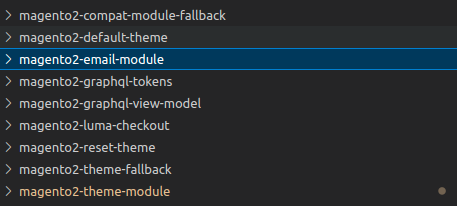

**- magento2-compat-module-fallback**

+ là module base cho các module compatible với hyva theme

**- magento2-default-theme**

+ là theme default hiển thị của hyva

**- magento2-email-module**

+ Xử lý style cho email

**- magento2-graphql-tokens**

+ Thêm GraphQL tokens đến CustomerData sections, cho phép call graphQl từ template magento

**- magento2-graphql-view-model**

+ Là module sử dụng để customize grapHql queries

**- magento2-luma-checkout**

+ Sử dụng để enable luma checkout default trên hyva theme

**- magento2-reset-theme**

+ Theme này dùng để remove template,css,js kiến trúc cũ của magento theme default

**- magento2-theme-fallback**

+ Cho phép enable các theme khác nhau dựa vào url path

**- magento2-theme-module**

+ Module core của Hyva theme

# 3. Customize

| **Một số trường hợp chú ý khi làm việc với Hyva thực tế** | | |
| --- | --- | --- |
| Case | Part | Implement |
| Customize lại module custom | Layout handle xml | - Overwrite lại file trong theme (/layout/override/base/<handle>.xml)  vd: override lại file default.xml của module catalog /Magento_Catalog/layout/override/base/default.xml |
| Template | - Copy file template của module vào theme rồi sửa như bình thường |
| css | - Các phần custom css/js đều nên viết luôn vào theme. |
| Code logic khác (Block/controller/model/...) | - Vẫn viết vào module như bình thường |
| Customize lại module bên thứ 3 | Layout handle xml | - Tạo các handle mới với prefix là hyva_\*.xml  vd: default.xml => hyva_default.xml |
| Template | - Copy file template của module vào module custom cho hyva rồi sửa như bình thường |
| css | - Các phần custom css/js nên viết vào theme. |
| Code logic khác (Block/controller/model/...) | - Tạo module khác để rewrite. Tên module sẽ là Hyva_<OriginModule> |
| Viết mới logic module | Layout handle xml | - Viết như bình thường  Tạo các handle mới với prefix là hyva_\*.xml  vd: default.xml => hyva_default.xml |
| Template | - Viết như bình thường |
| css | - Tạo event theo docs của hyva để add file style cho module |
| Code logic khác (Block/controller/model/...) | - Viết như bình thường |

# Các vấn đề khi code

# 1. Styles CSS

Dùng file **tailwind.config.js** để tùy biến các unit value và color value.

[https://tailwindcss.com/docs/configuration](https://tailwindcss.com/docs/configuration)

### 1.1. Theme

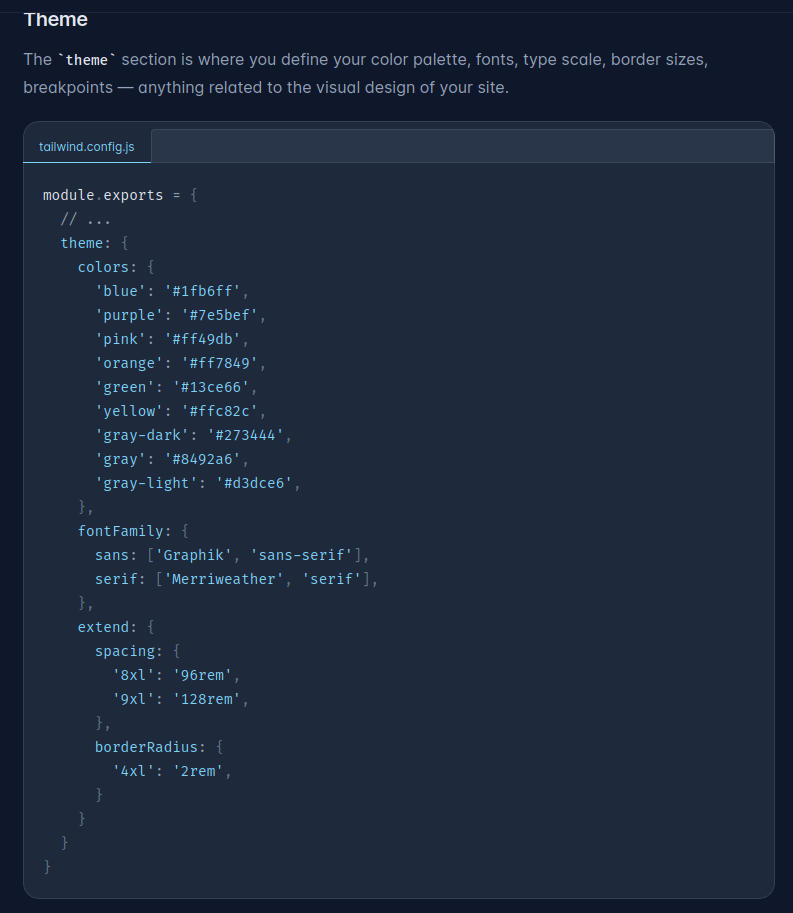

Dùng để tùy biến tất cả các đơn vị màu sắc, khoảng cách,...Config này có các key như **screens**, **colors**, **spacing**.

### 1.2. Screens

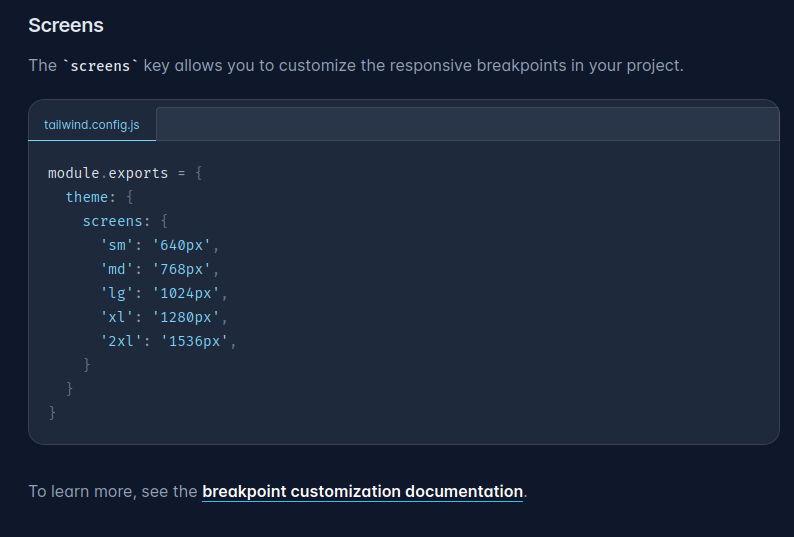

**screens** cho phép tùy biến hoặc thêm các breakpoint class trong project. Sử dụng config này để định nghĩa các breakpoint nếu như các breakpoint mặc định của tailwind không phù hợp với bạn.

[https://tailwindcss.com/docs/screens](https://tailwindcss.com/docs/screens)

### 1.3. Colors

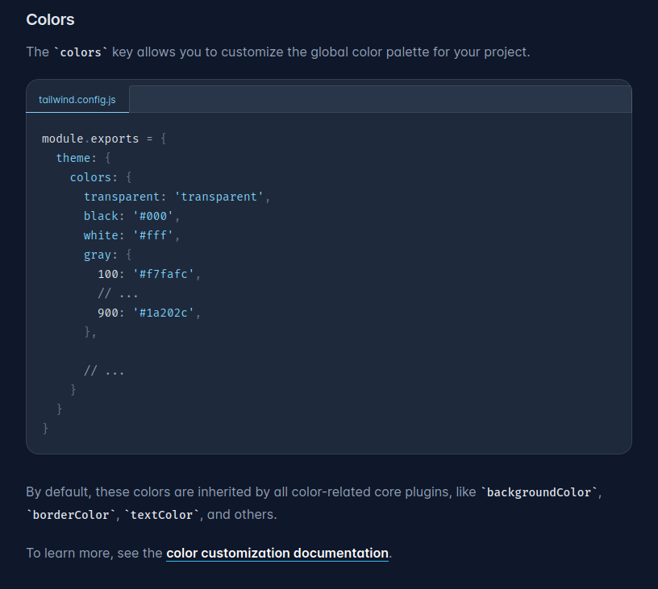

**colors** cho phép bạn tùy biến hoặc thêm các đơn vị màu sắc khác. Tailwind sẽ sử dụng các đơn vị này và tạo thêm các class áp dụng cho cả background color, border,...

VD: định nghĩa **red** sẽ tự generate các class như **text-red**, **bg-red**, **border-red**,...

[https://tailwindcss.com/docs/customizing-colors](https://tailwindcss.com/docs/customizing-colors)

### 1.4. Spacing

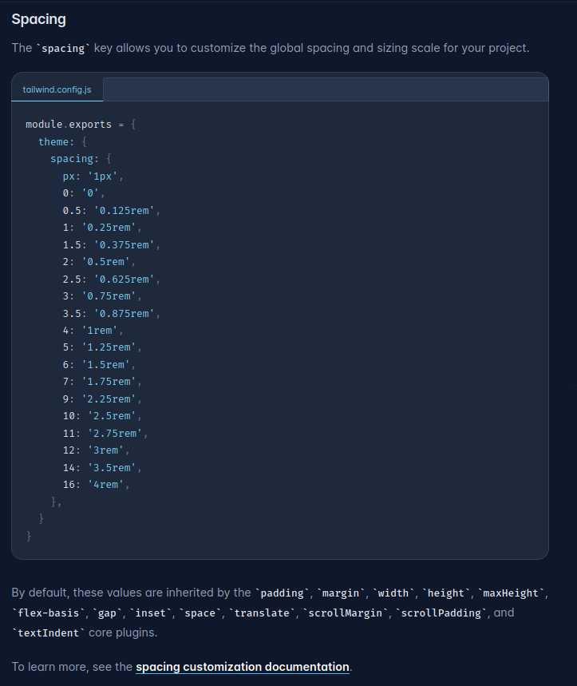

**spacing** dùng để tùy biến hoặc thêm mới các đơn vị về khoảng cách dùng trong margin, height, width,...

Cũng như **colors**, khi ta định nghĩa các đơn vị này tailwind cũng sẽ generate các class liên quan có sử dụng đơn vị đó.

VD: định nghĩa **40** sẽ tạo ra các class **m-40**, **mt-40**, **w-40**, **h-40**, **gap-40**,...

*Lưu ý một điều là nếu như ta sửa các key này của theme, toàn bộ các giá trị mặc định của theme trong tailwind sẽ được* ***thay thế hoặc loại bỏ hoàn toàn*** *bằng các config mới.*

*Nếu như ta chỉ muốn tùy biến các đơn vị mà vẫn giữ lại các config mặc định của tailwind thì hãy sử dụng* ***extend****.*

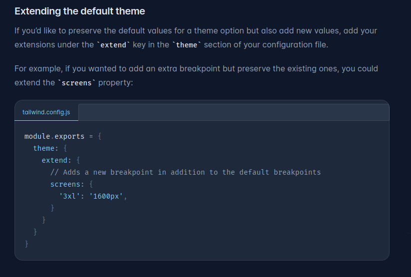

### 1.5. Thư mục theme và component

Để định nghĩa các class mới trong Hyva, ta sẽ khai báo ở trong 2 thư mục là **components** và **theme** của thư mục tailwind**.**

Component nên chứa các class thành phần như button, radio, slider, form,...

Theme sẽ chứa các class của toàn bộ site layout, hoặc của một layout phức tạp.

Để merge các tailwind config của custom module, tham khảo: [https://docs.hyva.io/hyva-themes/compatibility-modules/tailwind-config-merging.html](https://docs.hyva.io/hyva-themes/compatibility-modules/tailwind-config-merging.html)

Check thuộc tính class tailwind ở đây [https://nerdcave.com/tailwind-cheat-sheet](https://nerdcave.com/tailwind-cheat-sheet)

# 2. Js

## 2.1. Inline javascript

Hyva Theme có câu trả lời về vấn đề inline js.

[https://docs.hyva.io/hyva-themes/faqs/can-we-use-babel-move-inline-js.html](https://docs.hyva.io/hyva-themes/faqs/can-we-use-babel-move-inline-js.html)

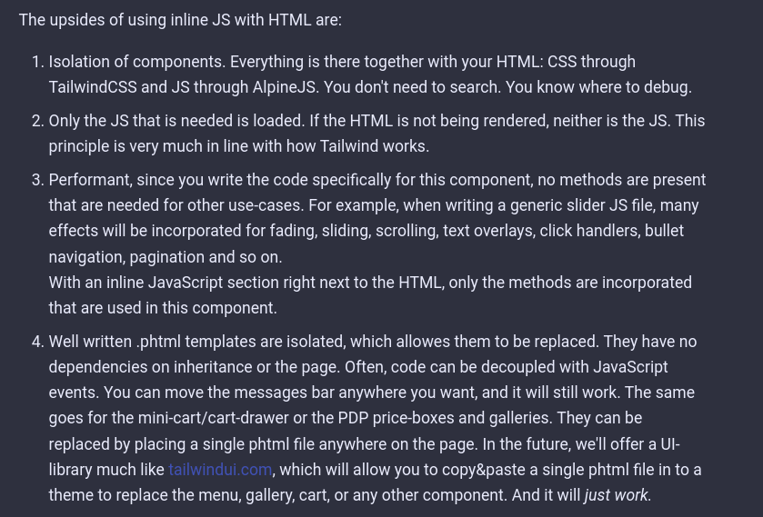

Cách làm của Hyva có ưu điểm sau:

- Khả năng tách biệt code thành các file template khác nhau, vì vậy ta có thể debug dễ hơn.

- Website chạy nhanh hơn do không phải tải các file javascript không cần thiết. Vì các component chỉ chứa những đoạn mã javascript nằm trong chính nó => nâng cao điểm SEO.

- Khả năng tái sử dụng component nếu như áp dụng mô hình builder như của Hyva Modal.

Nhưng nhược điểm là **theo thời gian** html file sẽ rất lớn, do source code không được mã hóa. Hyva **không ép buộc** phải viết inline js, vì thế ta cần phải cân nhắc khi nào thì cần viết inline js, khi nào thì không trong trường hợp cần tối ưu source code của mình.

*Đối với những đoạn code javascript dành cho việc khởi tạo x-data trong alpine (VD: như hyva.modal, hyva.formValidation, …) mà* ***không phụ thuộc*** *vào**các logic từ template thì có thể viết vào file javascript riêng.*

*Trường hợp phụ thuộc các dữ liệu từ template như việc template sử dụng các logic nào đó để* ***thay đổi*** *các nội dung code javascript, ta* ***nên*** *viết code javascript ở template.*

## 2.2. Khi làm việc với Alpine js

Với Hyva, ta sẽ sử dụng rất nhiều chức năng của alpine js, bởi vì alpine js được coi là “tailwind của javascript". Vậy nên ta cần lưu ý tuân theo các pattern và best practice của Alpine js để phát huy hết được các tính năng của nó.

Tuy nhiên Hyva theme có viết một số các đoạn inline js lên attribute của các html element. Cách viết này có khả năng sẽ phải thay đổi trong những đợt update sắp tới của Alpine js, do một báo cáo về bảo mật **CSP (Content-Security Policy)** từ phía plugin csp.

### 2.2.1. Vấn đề CSP (Content-Security Policy)

> ⚠️ **Cập nhật quan trọng:** CSP không còn là "chuyện tương lai/tham khảo". **Alpine CSP** (bản không cần `unsafe-eval`) nay **bắt buộc cho PCI-DSS** trên trang payment. Xem hướng dẫn migrate đầy đủ ở **[hyva-practice.md](hyva-practice.md)** → mục *Alpine CSP*. Đoạn mô tả bên dưới giữ lại để tham khảo bối cảnh.

Được đề cập tới ở plugin [CSP](https://alpinejs.dev/advanced/csp) tại thời điểm viết tài liệu này, Alpine sử dụng một kỹ thuật cho phép bạn viết nội dung code javascript ở trên thuộc tính html (vd: x-on:click=”console.log()” )

Kỹ thuật này vấp phải một vấn đề bảo mật của CSP: “unsafe-eval". Vậy nên, ở những phiên bản tới, **nếu như** plugin CSP được tích hợp vào Alpine. Ta **có thể** sẽ phải viết lại code theo một cấu trúc khác, bắt đầu với các khai báo x-data sẽ phải sử dụng **Alpine.data()** API và thay vì viết logic lên html attribute, ta sẽ phải gom chúng vào các function khác nhau ở trong **Alpine.data()**.

Khi sử dụng **Alpine.data()** để khai báo dữ liệu, data name phải là duy nhất, tránh override các khai báo cùng tên khác.

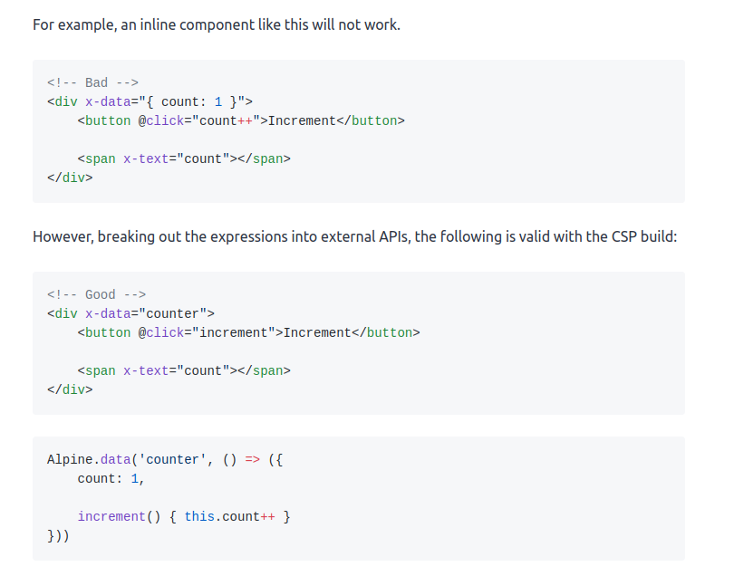

***Note:*** *Trên* [*github*](https://github.com/alpinejs/alpine/issues/237) *đã bàn về vấn đề này rất kĩ. Giải pháp trên là những gì mà họ sẽ áp dụng chỉ dành cho những trường hợp yêu cầu về bảo mật. Hyva Theme vốn đã viết inline js ở các html element (nghĩa là đã vi phạm CSP) nên dev chỉ coi vấn đề này mang tính tham khảo là chủ yếu.*

### 2.2.2. Data scope

Mặc định dữ liệu khai báo từ x-data sẽ được merge từ cấp root (nơi khai báo x-data toàn cục) cho đến element có khai báo x-data gần nhất. Alpine hỗ trợ truy cập giá trị đó thông qua **$data**.

Nhưng nếu như ta muốn truy cập x-data từ một nơi khác thì sao?

**$data** thực chất là một tổ hợp các function sau:

```js
Alpine.mergeProxies(Alpine.closestDataStack(node));
```

hoặc

```js
Alpine.$data(node)
```

**node** ở đây là một html element cần access. Nếu như sử dụng với querySelector, ta có thể truy cập x-data từ mọi vị trí khác.

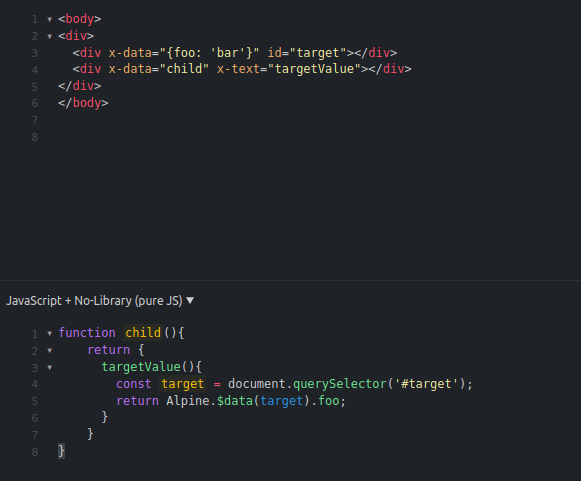

Link demo: [https://jsfiddle.net/bouetp71/](https://jsfiddle.net/bouetp71/)

### 2.2.3. Sử dụng Alpine.reactive và Alpine.effect

**Alpine.effect()** và **Alpine.reactive()** là 2 chức năng quan trọng trong mô hình reactivity của Alpine js. Vậy nên ta cần phải nắm rõ cách thức hoạt động của nó.

Một điều thú vị là toàn bộ module reactivity của Alpine js không do họ tự xây dựng, mà lại đến từ package [@vue/reactivity](https://github.com/vuejs/core/tree/main/packages/reactivity#readme). Mình sẽ share lại một bài viết để mọi người biết thêm được cách Vuejs thực sự hoạt động. Từ đó hình dung ra được Alpine js hoạt động như thế nào.

[https://deepsource.io/blog/reactivity-in-vue/](https://deepsource.io/blog/reactivity-in-vue/)

**Alpine.reactive()** cho phép bạn tạo ra một object có thể “reactive", nghĩa là mọi sự thay đổi lên object này sẽ tác động đến những object khác. Để thực hiện reactive giữa các object, ta phải dùng đến **Alpine.effect()**.

Bắt đầu với ví dụ sau:

[https://jsfiddle.net/ktwjy81z/1/](https://jsfiddle.net/ktwjy81z/1/)

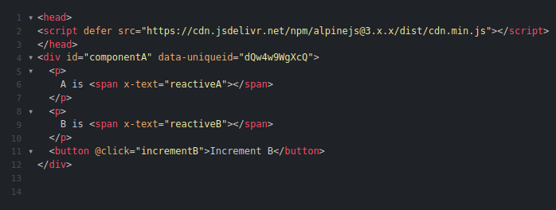

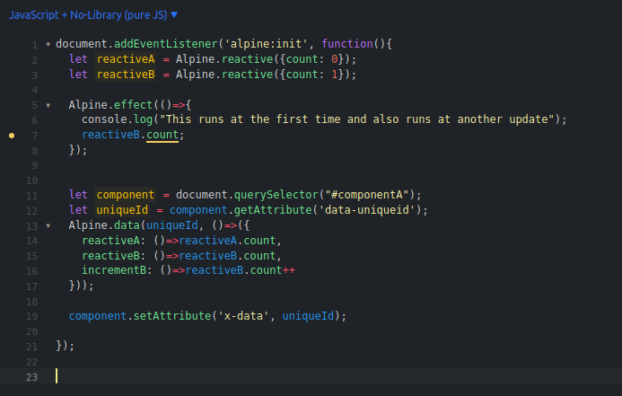

Như ở trên, ta khai báo 2 biến là reactiveA và reactiveB. Đây là 2 reactive object.

Dòng 5 ta sử dụng **Alpine.effect()**. Callback nằm trong **Alpine.effect()** sẽ được gọi ngay lần đầu tiên.

Dòng 7, ta chỉ thực hiện “truy vấn” đến thuộc tính count của reactiveB.

Chỉ bằng cách này, mỗi khi giá trị count của reactiveB thay đổi, callback effect đó sẽ được gọi lại lần nữa.

*Nguyên lý của hiệu ứng này nằm ở việc khi bạn gọi effect, Alpine sẽ tự động nhớ callback mà bạn đưa vào, sau đó nó thực hiện chạy callback một lần. Trong lúc thực thi callback, các reactive object khi được truy cập đến thuộc tính của nó sẽ thực hiện lưu lại callback tại thời điểm đó. Và như thế, mỗi khi thuộc tính của chúng thay đổi, reactive object sẽ tự động gọi tới chính callback này!*

**Vậy cách làm này có lợi ích gì?**

Để trao đổi dữ liệu giữa các component, ta dispatch các event kèm theo dữ liệu cần thiết cho các component khác. Bằng cách dispatch các reactive object này, ta có thể thực hiện sửa đổi ngay trên các reactive object từ mọi nơi và kết quả sẽ được update tức thì ngay trên component đó mà không phải dispatch thêm bất kỳ event nào cả.

Nhược điểm của effect là luôn chạy lần đầu. Bạn có thể thêm 1 flag check và ngăn hành vi mặc định này của effect. [https://jsfiddle.net/w731frLm/2/](https://jsfiddle.net/w731frLm/2/)

***Lưu ý khi dùng Alpine.effect()***

*Khi dùng effect, sẽ có trường hợp bạn muốn thôi sử dụng một effect nào đó. Để làm được điều này, Alpine sẽ trả về một tham chiếu của effect mỗi khi bạn gọi* ***Alpine.effect()****. Khi bạn cần loại bỏ effect, chỉ cần gọi* ***Alpine.release(effectRef)*** *với* ***effectRef*** *là tham chiếu trả về từ* ***Alpine.effect().***

**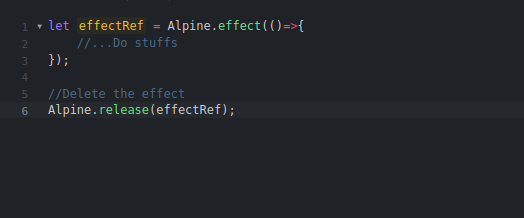**

### 2.2.4. Evaluate

Bạn có biết phương thức evaluate của Alpine js chứ?

[https://alpinejs.dev/advanced/extending#evaluating-expressions](https://alpinejs.dev/advanced/extending#evaluating-expressions)

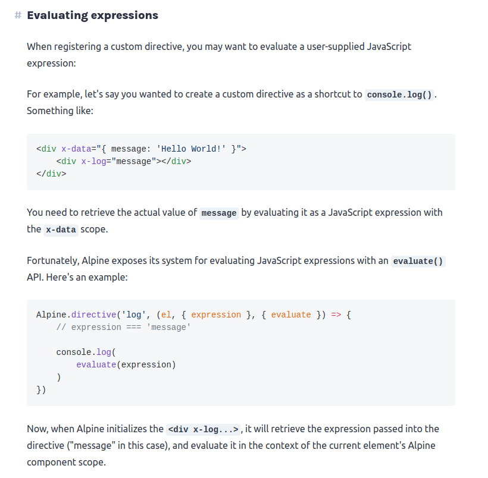

Phương thức này cho phép ta thực thi một biểu thức dưới dạng một chuỗi. Nó hoạt động gần giống như eval() trong javascript vậy. Và chính Alpine thời buổi đầu đã thực sự dùng eval() trong framework của mình…khá là nguy hiểm 🙂. Ở các bản cập nhật sau họ mới bắt đầu dùng đến các phương pháp an toàn hơn như dùng [Function](https://developer.mozilla.org/en-US/docs/Web/JavaScript/Reference/Global_Objects/Function/Function) và [AsyncFunction](https://developer.mozilla.org/en-US/docs/Web/JavaScript/Reference/Global_Objects/AsyncFunction). Nhưng giải pháp đó cũng [chẳng an toàn](https://docs.qualityclouds.com/qcd/javascript-avoid-use-of-function-constructors-31719691.html) là bao.

Tuy doc của Alpine chỉ đề cập đến việc sử dụng **evaluate** và **evaluateLater** ở trong **Alpine.directive()** nhưng thật ra ta có thể sử dụng chúng cả ở bên ngoài.

Cụ thể là 2 method **Alpine.evaluate()** và **Alpine.evaluateLater().**

Điểm khác biệt giữa 2 method này với 2 method trong Alpine.directive() đó là chúng cần thêm một tham số là một **html element.** Lý do là bởi vì **Alpine.evaluateLater()** và **Alpine.evaluate()** đều cần phải biết được scope thực thi biểu thức của chúng nằm ở đâu.

Trường hợp sử dụng trong Alpine.directive(), 2 method không yêu cầu truyền vào một element nữa là do chính Alpine.directive() đã xác định cho chúng scope cần thiết rồi.

Nếu sử dụng 2 method này, ta có thể thực hiện tính toán dữ liệu của **bất kì component ở bất kì vị trí nào khác**.

Mình sẽ demo để các bạn có thể hiểu rõ hơn: [https://jsfiddle.net/0x3wnbj5/](https://jsfiddle.net/0x3wnbj5/)

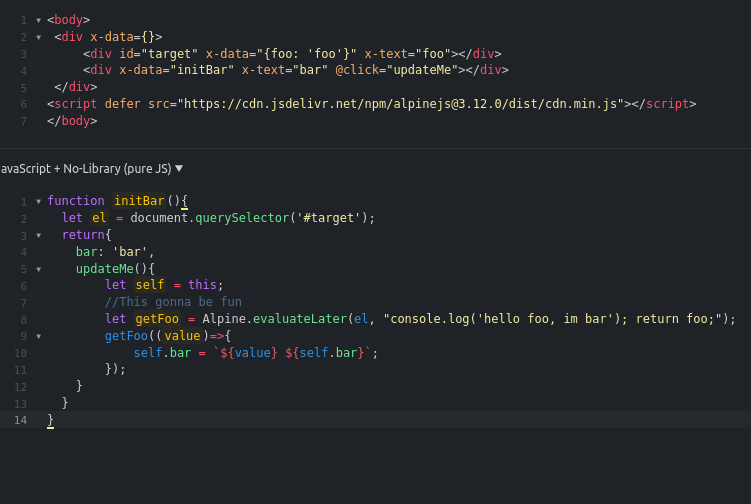

Như ở đoạn code trên, khi khởi tạo Bar. Bar thực hiện query select tới Foo để sử dụng thành phần này làm tham số của **Alpine.evaluateLater().**

Mỗi khi ta click vào Bar, Bar sẽ thực thi phương thức getFoo để bắt đầu evaluate chuỗi biểu thức kia.

Biểu thức này thực hiện log ra console dòng chữ **“hello foo, im bar",** sau đó trả về giá trị **foo** của Foo. Cuối cùng Bar sẽ update text của nó với kết quả sau khi đã thực thi biểu thức đó.

Đây là cách làm khá thú vị nếu như ta muốn thực hiện tính toán luôn dữ liệu của một component khác thay vì phải sử dụng **Alpine.$data()** để lấy dữ liệu và tính toán.

### 2.2.5. Giao tiếp giữa các component

Có rất nhiều cách để cho phép các component giao tiếp với nhau. Nhưng để chọn ra được phương pháp hợp lý, ta phải hiểu rõ thế nào là một component trong Alpine js.

Điều đầu tiên phải nhắc tới đó là data của một component. Khi khai báo x-data từ phiên bản v3 trở đi, data của component sẽ được **gộp với tất cả** data của các component cha cho đến tận root component.

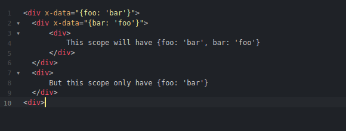

Khái niệm component của alpine khác so với chúng ta nghĩ. Theo React, một component có các **thuộc tính** và **trạng thái**. Các thuộc tính có thể nhận từ cha, **hoặc không**; các trạng thái do chính component khởi tạo**.** Tuy nhiên đối với Alpine không hề có khái niệm thuộc tính hay trạng thái, component của Alpine thực chất **không phải là một component**, mà chỉ là một **block scope của code javascript** đơn thuần.

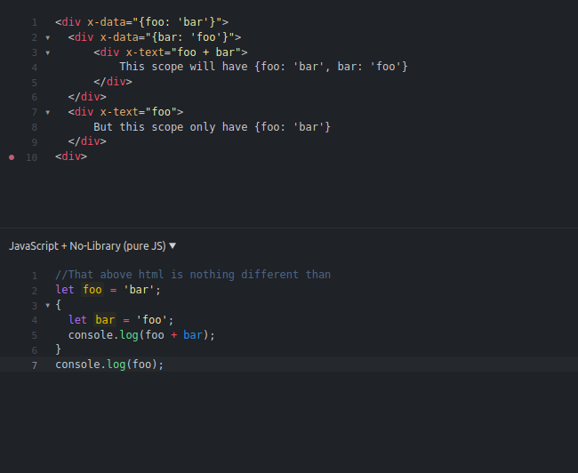

Vậy nên khi ta nhắc tới component trong Alpine, thực chất ta chỉ nhắc tới **block scope** của nó.

#### # Giao tiếp giữa component cha và con.

Vì bản chất component trong Alpine là một block scope, đương nhiên ta có thể truy cập được thuộc tính của component cha và thực hiện sửa đổi trực tiếp ở component con mà không phải làm gì thêm.

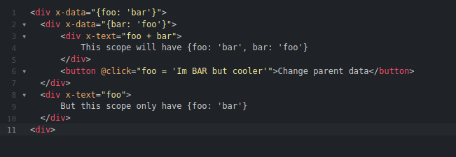

Điều duy nhất mà ta cần phải lưu ý đó là đặt tên biến cần tránh xung đột với biến cha. Với một nested layout chứa nhiều x-data, việc đặt tên ngày càng khó khăn hơn (yup..Hyva có nói tới vấn đề đặt tên, là phải đặt tên cho thật ~~dài~~ **unique** vào 😀) .

Để giao tiếp từ component cha, ta có thể gán cho component con một id hoặc attribute để component cha có thể sử dụng **querySelector** kết hợp với **Alpine.$data()** tham chiếu đến data của component con.

#### # Giao tiếp giữa 2 component cùng cấp

Lấy ví dụ như sau:

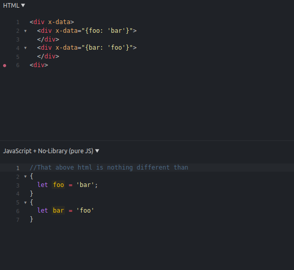

Làm thế nào để cả 2 component cùng cấp này có thể nói chuyện với nhau?

Ở javascript, ta có thể cho phép chúng nói chuyện với nhau bằng cách khai báo chúng ở scope cao hơn.

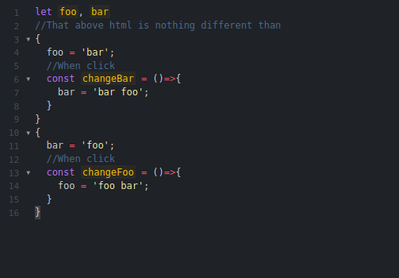

Ở Alpine sẽ khó hơn một chút. Do scope cao hơn của component trong Alpine là của component cha, đồng nghĩa với việc ta phải khai báo giá trị của component con ở component cha. Sẽ có một số trường hợp ta không thể làm như vậy, nhất là khi component cha lại do script của bên thứ 3 khởi tạo.

May thay, Alpine có một cách giúp xử lý vấn đề này, đó là sử dụng **x-ref** và **$refs**.

Cách làm như sau:

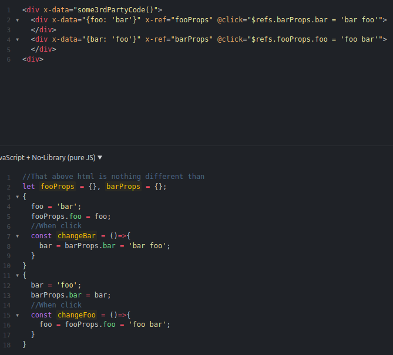

Dùng **x-ref** sẽ tạo một object data ở component cha, và dùng **$refs** để truy cập các biến đó.

***Lưu ý****: Ở ví dụ này,* ***fooProps*** *và* ***barProps*** *tuy khai báo ở scope cao hơn nhưng trong Alpine nó* ***không phải là data của component cha****.**Mà là một loại data của component cha* ***chỉ có thể truy cập thông qua $refs.***

Một lần nữa, các giá trị của x-ref phải là duy nhất để tránh xung đột với các khai báo khác.

#### # Giao tiếp giữa 2 component không cùng cấp

Phần này sẽ phức tạp hơn, hãy bắt đầu với ví dụ sau:

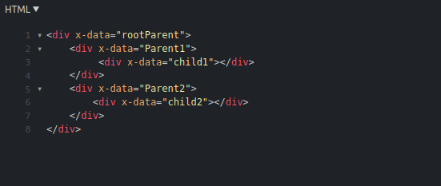

Ta có thể thấy **child1** và **child2** không cùng cấp với nhau. Nếu chuyển thành code js, nó sẽ có dạng:

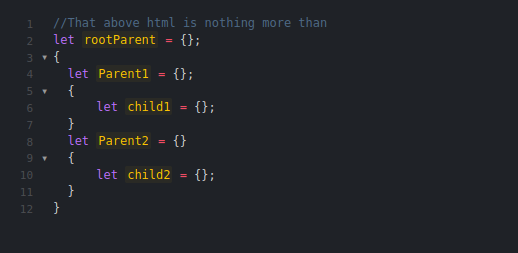

Nếu như nhìn code này, ta dễ dàng nhận thấy để **child1** có thể truy cập đến **child2**, ta phải khai báo 2 biến này ở scope của **rootParent**. Nhưng chúng ta không thể lúc nào cũng làm như vậy ở Alpine được.

Chúng ta cũng không thể sử dụng **x-ref** và **$refs** bởi chúng không cùng cấp.

**Vậy chúng ta phải xử lý như thế nào đối với trường hợp đặc biệt này?**

Một giải pháp mà dev đề xuất đó là sử dụng mô hình **publisher/subscriber**:

[https://jsfiddle.net/4xzLthru/6/](https://jsfiddle.net/4xzLthru/6/)

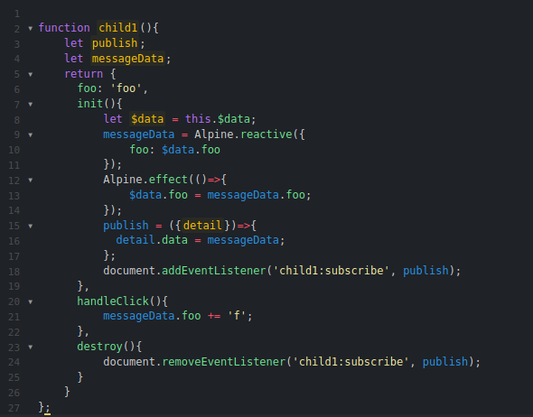

Ở demo trên, ta tạo component **child1**. Khi component được khởi tạo, phương thức init() luôn được gọi đầu tiên và thực hiện lắng nghe sự kiện **child1:subscribe**. Ở đây **child1** được gọi là một **publisher.**

Ta sang bước tiếp theo của **child2** - subscribe.

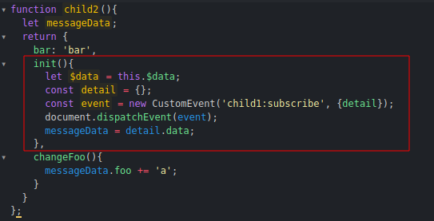

Ở đoạn code phía trên, để thực hiện đồng bộ dữ liệu, **child2** tạo một object là **detail** và dispatch event kèm dữ liệu này tới **child1.**

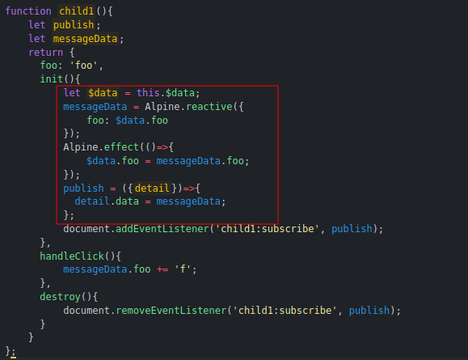

Để ý kĩ phần xử lý subscribe của **child1.** Sau khi bắt được một subscribe, **child1** thực hiện gán data vào object đi kèm event này, data đó là **messageData** - một **reactive object.**

Ngoài ra **child1** còn tạo một effect thực hiện đồng bộ dữ liệu của nó với **messageData**. Nghĩa là mỗi khi **child2** thực hiện thay đổi **messageData** ở scope của nó, dữ liệu ở **child1** sẽ được cập nhật ngay tức thì. Ở đây **child2** được gọi là 1 **subscriber**.

Sau khi đã thực hiện subscribe, cả 2 thành phần này có thể tiếp tục thực hiện thay đổi **messageData** để trao đổi, đồng bộ thông tin mà không cần phải dispatch thêm các event khác nữa.

Một lưu ý đó là nếu như **child1** bị loại khỏi DOM, **messageData** mà nó truyền tới các component khác vẫn còn. Để tránh các component sử dụng **messageData** cũ, **child1** nên thông báo cho các component khác thực hiện unsubscribe.

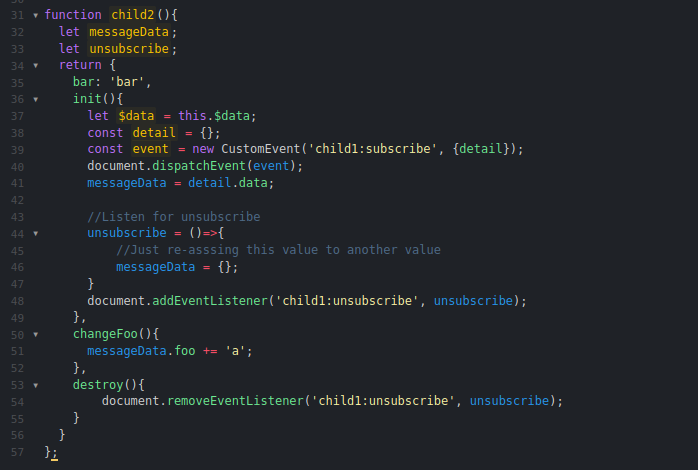

Bằng cách gắn lại **messageData** với giá trị mới thì khi tất cả các component khác đều unsubscribe, giá trị cũ sẽ được garbage collector của trình duyệt loại bỏ.

### 2.2.6. On-demand javascript

Hyva theme không có module manager như RequireJs, vậy nên ta có nhiều lựa chọn giải pháp tối ưu code js. Phương pháp hay dùng là lazy load on demand (cần đến đâu tải đến đó). Cụ thể là khi page load xong, có thể sẽ có một số component không sử dụng tới, như comment, like, read more, những component nằm ngoài viewport…Vậy nên ta không load các file js của component đó làm gì cả. Thay vì thế ta sẽ thực hiện lazy load các đoạn script này khi người dùng thực sự tương tác với chúng.

Có rất nhiều các phương pháp thực hiện lazy loading, bạn có thể tham khảo thông qua doc chính thức của Hyva Theme.
[https://docs.hyva.io/hyva-themes/writing-code/patterns/loading-external-javascript.html](https://docs.hyva.io/hyva-themes/writing-code/patterns/loading-external-javascript.html)

### 2.2.7. Sử dụng plugins.

Alpine js có một số plugins tiện ích rất hữu dụng mà ta có thể sử dụng. Tham khảo site chính thức của Alpine để học cách áp dụng các plugin này cho project của mình.

#### # x-mask

[https://alpinejs.dev/plugins/mask](https://alpinejs.dev/plugins/mask)

Dùng để format dữ liệu nhập form.

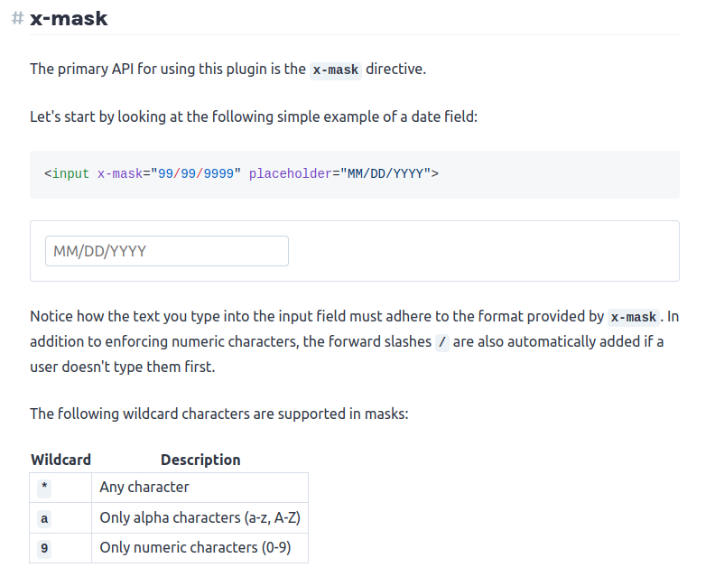

Ta sử dụng plugin bằng cách thêm attribute **x-mask** vào html element và gán giá trị một format nhất định. Mỗi khi người dùng nhập, plugin tự động format lại phần hiển thị của giá trị.

Để ý bảng phía trên có 3 kí hiệu dùng trong format này.

| **Kí hiệu** | **Mô tả** |
| --- | --- |
| **\*** | Bất kỳ kí tự nào |
| **a** | Chỉ chấp nhận bảng chữ cái (a-z, A-Z) |
| **9** | Chỉ chấp nhận số (0-9) |

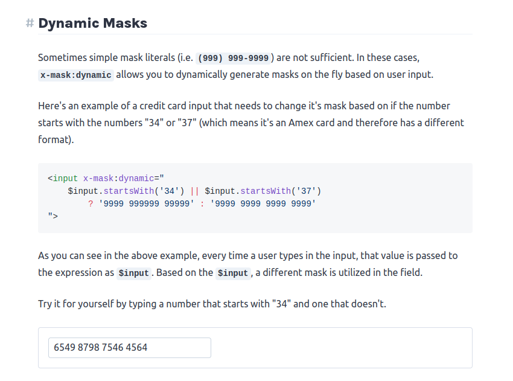

Dynamic masks cho phép thay đổi format linh hoạt nào đó mỗi khi người dùng nhập dữ liệu thay vì cố định như trước đó.

#### # x-collapse

[https://alpinejs.dev/plugins/collapse](https://alpinejs.dev/plugins/collapse)

Như cái tên nói lên, directive này dùng để tạo collapse box. Phù hợp với các thành phần như readmore,...

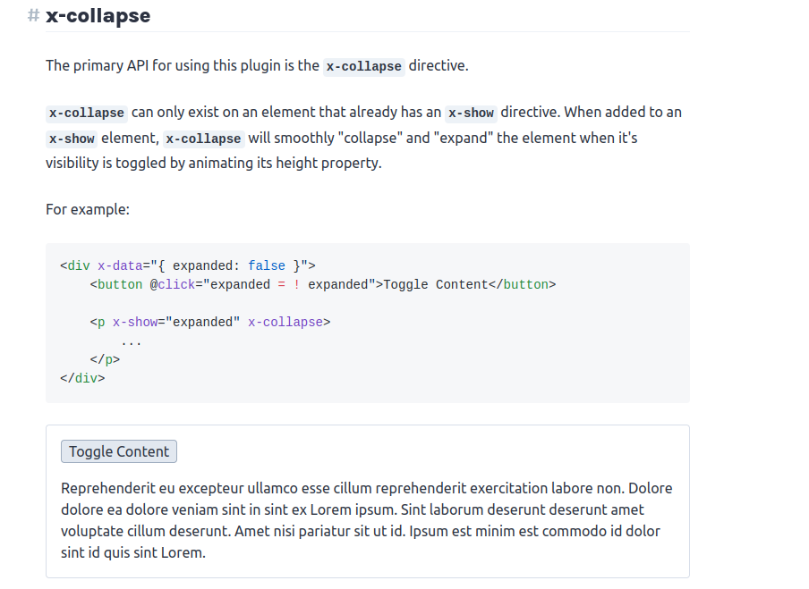

#### # x-morph

[https://alpinejs.dev/plugins/morph](https://alpinejs.dev/plugins/morph)

Rất quan trọng vì directive này cho phép thay đổi html của một element với một nội dung html dưới dạng plain-text. Ta có thể fetch từ server nhận html để render lên DOM bằng cách này. Ngoài ra x-morph cũng có thể dùng để áp dụng SSR với layout phức tạp.

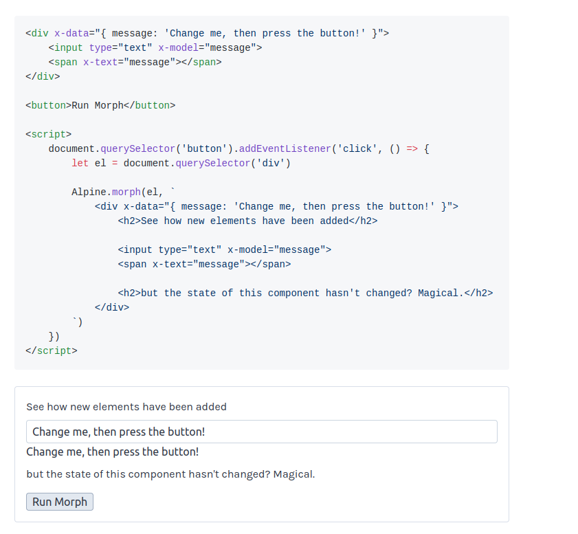

#### # $persist

[https://alpinejs.dev/plugins/persist](https://alpinejs.dev/plugins/persist)

Cho phép lưu trữ giá trị ở localStorage để không bị mất khi refresh cửa sổ trình duyệt. Tốt cho caching.

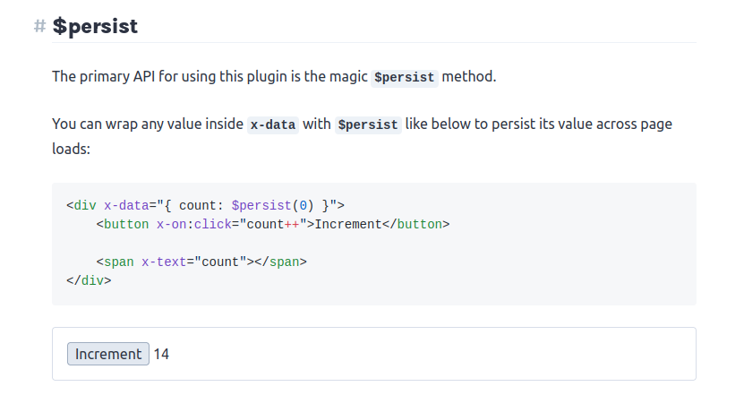

# 3. Khi customize một tính năng đã có.

## 3.1. GraphQL View Model

Hyva có module **GraphQL View Model** cho phép chúng ta thay đổi query trước khi render query lên template. Khi sử dụng GraphQL, nhớ kết hợp với chức năng của module này để hỗ trợ tùy biến các query khi cần thiết.

## 3.2. Alpine js

Đối với các alpine component nên tự thêm một số event listener để cho phép các component bên ngoài thay đổi kết quả dữ liệu của mình. VD như ở Alpine js có các event như “alpine:init", “alpine:initialized",... Tuy nhiên không nên lắng nghe nhiều loại event quá, chỉ sử dụng phương pháp kết hợp với reactive object là đủ.

# 4. Khi tính năng có thể sử dụng ở 1 số template khác

## 4.1. Component Builder

Để có thể tái sử dụng các component. Ta có thể tham khảo mô hình **component builder** mà Hyva hiện đang thực hiện.

Lấy ví dụ Modal trong Hyva theme:

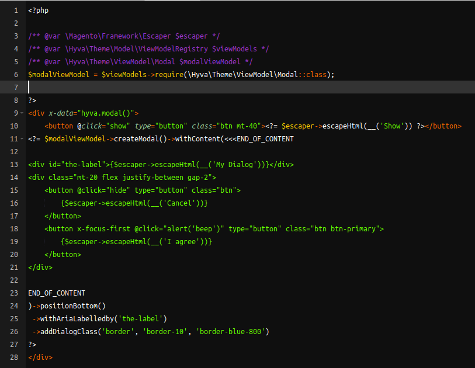

Có 2 loại class mà ta cần phải tạo: 1 **ViewModel** và 1 **component builder**

**component builder** cho phép thay đổi, thêm một số class, attributes,...do ta tự định nghĩa. Mục đích là để cho phép customize giao diện dựa trên config của builder.

**component builder** cần 2 phương thức để thực hiện render html, đó là **render()** và **__tostring()**

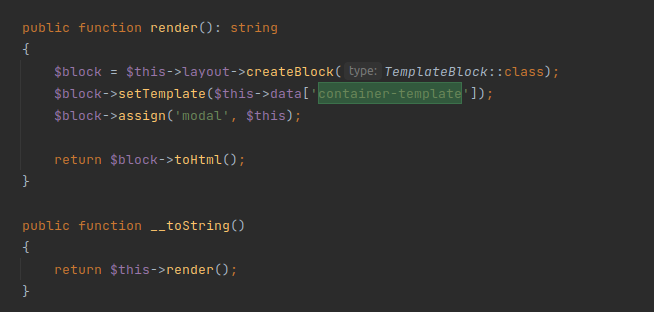

Mọi block khai báo trong phương thức render của **component builder** cần assign một biến, ở đây là **modal (ta có thể thay đổi tên tùy vào component ta đang tạo)**, mục đích là để template của chúng ta có thể tham chiếu tới chính **component builder** đó.

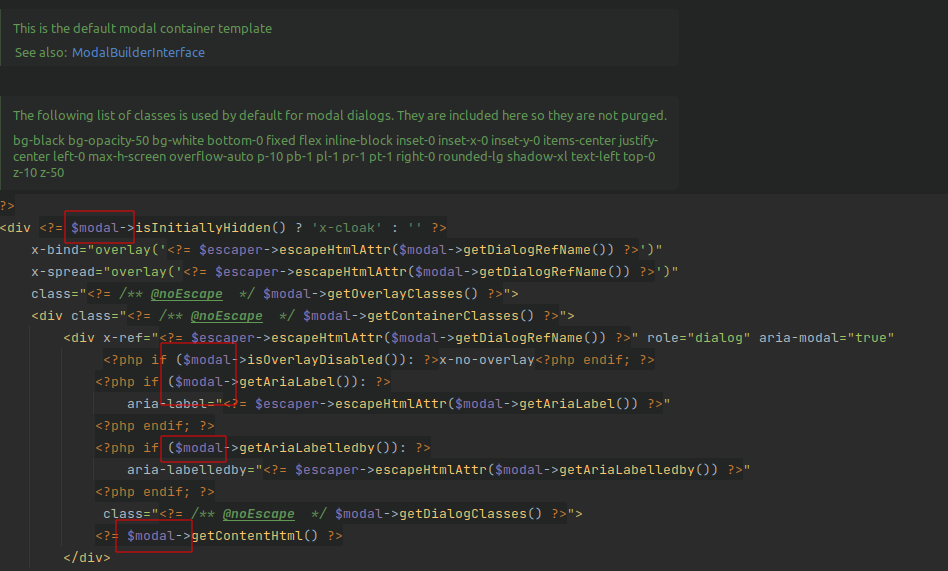

**ViewModel** sẽ cung cấp **component builder** cho người dùng cần customize.

## 4.2. Tái sử dụng code javascript

Hyva hiện tại đang sử dụng format IIFE, và họ thường viết các function khởi tạo x-data và gán chúng làm thuộc tính của window (VD: hyva.modal, hyva.formValidate,...). Ta có thể tái sử dụng các function này như sau:

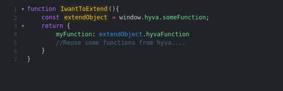

IIFE cho phép viết closed-scope code, tránh xung đột với các global variables.

[https://developer.mozilla.org/en-US/docs/Glossary/IIFE](https://developer.mozilla.org/en-US/docs/Glossary/IIFE)

# 5. Các lưu ý, tiêu chuẩn khi code

* Sử dụng Eslint để đảm bảo code của bạn luôn tuân theo javascript coding standard. Eslint cũng đã được tích hợp vào bss-cli nên ta không cần cài đặt gì thêm.
* Luôn code theo format IIFE để tránh xung đột biến toàn cục.
* Luôn khai báo các alpine plugin script trước alpine script.

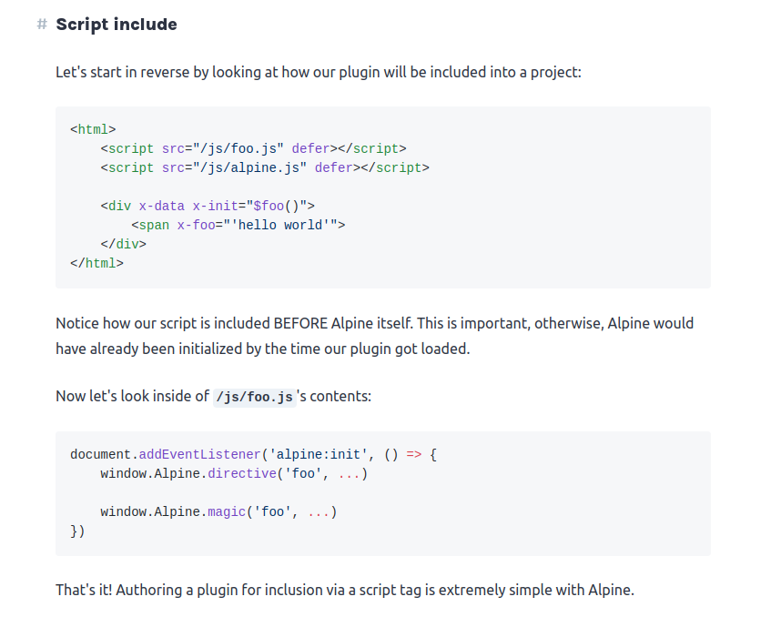

* Lazy loading là một lợi thế, nhưng kĩ thuật này khá khó vì nó đòi hỏi khả năng phân tích thứ tự ưu tiên các chức năng của mọi thành phần trong ứng dụng, từ đó phân chia các file js hợp lý. Hyva không nhắc nhiều về kỹ thuật này nên nó cũng không quan trọng lắm. Mọi người chỉ nên áp dụng trong trường hợp thực sự cần tối ưu site và không nên lạm dụng quá, khó debug.
* Không nên tạo nhiều event listener. Nếu như các component trao đổi dữ liệu cho nhau thường xuyên, bạn nên cho chúng sử dụng reactive object. Reactive object mà các component trao đổi nên tách biệt với những component đó. Vì có một số dữ liệu mà ta sẽ không muốn component khác thay đổi dẫn đến các side-effects ngoài mong muốn.

Ví dụ về cách áp dụng kỹ thuật: [https://jsfiddle.net/w731frLm/2/](https://jsfiddle.net/w731frLm/2/)

* Tuân theo các quy tắc của Hyva theme khi tạo mới 1 module: [https://docs.hyva.io/hyva-themes/compatibility-modules/index.html](https://docs.hyva.io/hyva-themes/compatibility-modules/index.html)
