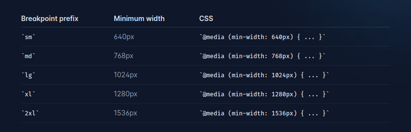
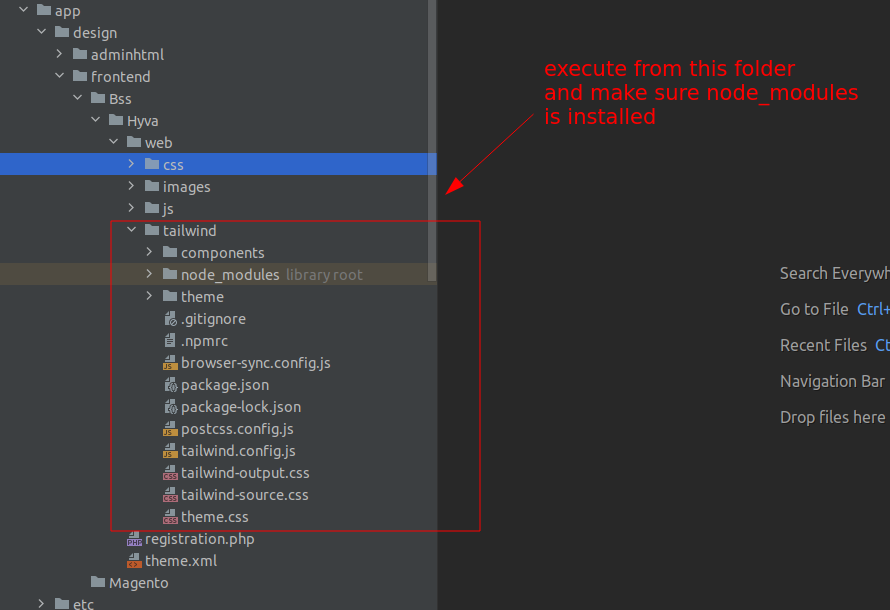

# Tailwind CSS trong Hyvä

> ℹ️ Hyvä hiện dùng **Tailwind v3** (config qua `tailwind.config.js` như mô tả dưới). Tailwind v4 (2025) chuyển sang CSS-first config — khi Hyvä nâng lên v4 cần cập nhật lại phần cấu hình.

## 1. Nguyên tắc cơ bản của Tailwind - Utility-First

Tham khảo: [https://tailwindcss.com/docs/utility-first](https://tailwindcss.com/docs/utility-first)

Nguyên tắc của tailwind là buộc developer phải viết style của các thành phần html thông qua class, sử dụng các class tiện ích mà tailwind cung cấp.

Bằng cách này, ta hoàn toàn có thể tùy biến html một cách dễ dàng mà không phải viết thêm bất cứ dòng nào qua inline-style, style, css,…

Lí do tailwind lựa chọn tiếp cận theo hướng sử dụng các class tiện ích là bởi:

* **Không phải khởi tạo những class name dài dòng và khó nhớ**: Nếu như một component có thiết kế đơn giản, với cách làm truyền thống ta lại phải thêm dòng css cùng với tên class dài dòng và khó nhớ. Nhưng với tailwind, chỉ cần sử dụng các class có sẵn là bạn đã có kết quả không khác gì so với cách làm truyền thống kia. Một lợi thế là một khi bạn đã làm quen với tailwind, bạn sẽ bắt kịp rất nhanh với các project tương tự có sử dụng tailwind.
* **Tránh css ngày một “phình to" hơn”:** Theo cách làm truyền thống, nếu như giao diện của một site ngày một phát triển thì css của bạn cũng vậy. Với tailwind, các class tiện tích luôn có khả năng tái sử dụng, vậy nên bạn hầu như không phải thêm bất cứ dòng css nào mỗi khi phát triển tính năng cho một giao diện.
* **Mọi sự thay đổi luôn nằm trong kiểm soát:** Với cách làm truyền thống, bạn sẽ bắt gặp những đoạn **nested css,** nói cách khác, là những đoạn css lồng nhau. Điều này ảnh hưởng rất lớn sau này nếu như những dòng css của bạn trở nên dài dòng và bị phân tán. Khi gặp bug trên giao diện, bạn sẽ phải tìm lại những đoạn css đó và mất nhiều thời gian để có thể bảo trì chúng. Với tailwind, các class tiện ích chỉ ảnh hưởng ở chính thành phần mà nó được sử dụng, cho nên bạn hoàn toàn có thể yên tâm thay đổi style của một phần giao diện, mà không lo lỡ tay phá hỏng các thành phần xung quanh.

Tuy nhiên, nếu như bạn áp dụng nguyên tắc của tailwind cho một layout như thế [này](https://tailwindui.com/components/application-ui/application-shells/stacked). Liệu bạn có thể bảo trì nó? :))

Câu trả lời phụ thuộc vào bạn. Nhưng đối với tailwind, [Component và Template](https://tailwindcss.com/docs/reusing-styles#extracting-components-and-partials) là giải pháp duy nhất.

Bằng cách tách giao diện thành các thành phần giao diện nhỏ hơn, bạn có thể dễ dàng quản lý các css class của tailwind tốt hơn, thậm chí có thể bạn sẽ thích cách xây dựng giao diện theo hướng này rất nhiều. Đó là lý do tại sao tailwind css rất được các framework nổi tiếng như Reactjs, Vue, Svelte hay các template engine như Blade, ERB, Twig, Nunjucks yêu thích sử dụng.

Dưới đây là một số bài viết trải nghiệm về tailwind css của các nhà phát triển:

* [By The Numbers: A Year and a Half with Atomic CSS](https://medium.com/%40johnpolacek/by-the-numbers-a-year-and-half-with-atomic-css-39d75b1263b4) by John Polacek
* [Building a Scalable CSS Architecture](https://blog.algolia.com/redesigning-our-docs-part-4-building-a-scalable-css-architecture/) by Sarah Dayan of Algolia
* [No, Utility Classes Aren’t the Same As Inline Styles](https://frontstuff.io/no-utility-classes-arent-the-same-as-inline-styles) by Sarah Dayan of Algolia
* [Diana Mounter on using utility classes at GitHub](http://www.fullstackradio.com/75), a podcast interview

## 2. Các class tiện ích - Utility classes

Rất nhiều, rất nhiều tailwind css class để bạn có thể áp dụng trong project của mình,

Tham khảo [Tailwind Cheat Sheet](https://nerdcave.com/tailwind-cheat-sheet) để chọn ra các class phù hợp cho bạn.

Với Hyva theme thì sao?

Bản thân Hyva cũng tuân theo nguyên tắc Utility-First của tailwind nên phần lớn css class mà họ áp dụng đều là từ tailwind, các custom class đều rất ít. Và có thể tìm thấy ở thư mục **tailwind,** sẽ được nói tới ở các phần sau.

## 3. Hover, Focus và hơn nữa

Trong css, ta làm được như thế này:

```css
.example:hover{
color: red;
}
```

Vậy đối với tailwind, ta áp dụng trong class name như thế nào?

Đơn giản, ta dùng prefix. Cụ thể với ví dụ trên có thể viết thành **hover:text-red**

**text-red** là một class chức năng, và **hover:** chính là prefix để áp dụng chức năng cho trường hợp mỗi khi user hover vào một element.

Ngoài **hover:** ra, ta còn có các prefix tương tự trong css như **after:** **focus:** **before:** v..v.

Cách viết đều tương tự nhau.

Tham khảo [Handling Hover, Focus and other States](https://tailwindcss.com/docs/hover-focus-and-other-states) để tìm hiểu thêm.

## 4. Responsive trong tailwind:

Có 5 mốc breakpoints dành cho responsive trong tailwind:



Ta có thể thực hiện áp dụng một số class chỉ trong một số breakpoint nhất định theo cấu trúc **<breakpoint>:<class>**

VD: **lg:w-48**, **md:w-32**, **sm:text-rose-300,**...

### Làm việc với Mobile-first

Tailwind sử dụng phương pháp tiếp cận, xây dựng giao diện cho các thiết bị di động đầu tiên. Sau đó là Tablet và Desktop,...

Bằng cách tiếp cận này, ta có thể dễ dàng thiết kế mở rộng giao diện, ít phải tùy biến các css class.

Mặc định các css class ở một breakpoint nhất định vẫn sẽ áp dụng cho các breakpoint về sau. Nếu như ta chỉ muốn áp dụng cho 1 khoảng breakpoint cụ thể, ta có thể thêm **max-\*** vào sau prefix breakpoint, với **\*** là 1 trong 5 breakpoint theo bảng tham khảo trên.

VD: Nếu như ta chỉ muốn áp dụng text color với breakpoint từ **sm** cho đến **xl** thì viết lại thành: **sm:max-xl:text-red**

### Các class liên quan đến responsive?

Tailwind có hỗ trợ các class với các unit khác nhau, rất tiện cho responsive như

[text](https://tailwindcss.com/docs/font-size), [padding](https://tailwindcss.com/docs/padding), [margin](https://tailwindcss.com/docs/margin),... Vì các giá trị của class được tailwind tính toán và chọn lọc kỹ càng nên ta cần phải tận dụng hết có thể. Tránh tùy biến lại các unit mới sẽ khiến việc quản lý các class gặp khó sau này.

## 5. Sử dụng tailwind trong Hyva

Hyva theme có thư mục tên **tailwind**, sẽ là nơi chứa tất cả các code tùy biến tailwind css của theme.

Có 2 thư mục nằm trong tailwind mà ta sẽ viết css, đó là **components** và **theme.**

Thư mục **components** chứa các class dành cho các thành phần chức năng (xuất hiện nhiều lần trong 1 site) như button, cart, slider,...

Sau khi tạo mới file css ở thư mục này, cần import file ở **tailwind-source.css**

Thư mục **theme** chứa các thành phần lớn hơn (dạng layout, hoặc xuất hiện ít trên trang) như header, footer, navbar,....

Sau khi tạo mới file css ở thư mục này, cần import file ở **theme.css**

Cách làm việc với hyva css sẽ khác với luma. Sau khi thay đổi nội dung css, ta chỉ cần chạy **npm run build** sau đó refresh lại trang là xong. Tiện hơn nữa, ta có thể chạy **npm run watch** để tailwindcss tự động compile css mỗi khi file css được sửa.

Lưu ý chạy npm trong thư mục **tailwind** của theme.



Nếu như bạn muốn chạy npm ở thư mục khác, có thể thêm đường dẫn tailwind đó đằng sau --prefix

VD:

```bash
npm run watch --prefix /app/design/frontend/Vendor/Theme/web/tailwind
```

### Kết hợp với browser-sync:

B1: Sử dụng docker mà bss cung cấp, thêm một container (nếu chưa có) với nội dung như sau vào file **docker-compose.yml**:

```yaml
browser-sync:
  image: rogerdz/browser-sync
  labels:
    - traefik.enable=true
    # HTTP traffic
    - traefik.http.routers.browser-sync-${COMPOSE_PROJECT_NAME}.rule=Host(`bs.${VIRTUAL_HOST}`)
    - traefik.http.routers.browser-sync-${COMPOSE_PROJECT_NAME}.entrypoints=http
    - traefik.http.routers.browser-sync-${COMPOSE_PROJECT_NAME}.service=browser-sync-${COMPOSE_PROJECT_NAME}
    - traefik.http.services.browser-sync-${COMPOSE_PROJECT_NAME}.loadbalancer.server.port=80
    # HTTPS traffic
    - traefik.http.routers.browser-sync-${COMPOSE_PROJECT_NAME}-https.rule=Host(`bs.${VIRTUAL_HOST}`)
    - traefik.http.routers.browser-sync-${COMPOSE_PROJECT_NAME}-https.entrypoints=https
    - traefik.http.routers.browser-sync-${COMPOSE_PROJECT_NAME}-https.service=browser-sync-${COMPOSE_PROJECT_NAME}-https
    - traefik.http.services.browser-sync-${COMPOSE_PROJECT_NAME}-https.loadbalancer.server.port=443
    - traefik.http.services.browser-sync-${COMPOSE_PROJECT_NAME}-https.loadbalancer.server.scheme=https
  networks:
    - proxy
    - internal
  environment:
    BROWSER_SYNC_PROXY: https://${VIRTUAL_HOST}
    BROWSER_SYNC_FILES: 'app/**/*.phtml, app/**/*.xml, app/**/*.css, app/**/*.js, vendor/**/*.css, vendor/**/*.js'
    VIRTUAL_HOST: bs.${VIRTUAL_HOST}
  volumes:
    - ${WORK_DIR}:/src:cached
    - ${CA_STORE:-/usr/local/share/ca-certificates}:/usr/local/share/ca-certificates:ro
  init: true
  external_links: *php-external-links
  restart: *restart
  logging: *logging
```

B2: Chạy **docker compose up -d**

B3: Truy cập đến domain của project + tiền tố **bs.** để vào trang Hyva theme đã được tích hợp browser-sync.

B4: Chạy lệnh **npm run watch** trong thư mục **tailwind** như đã đề cập ở trên để tự động cập nhật css.

B4: Thực hiện thay đổi css và so sánh trên site.

**Lưu ý:** Đối với trường hợp thay đổi nội dung template mà giao diện vẫn không thay đổi, đó là do cơ chế full page cache của Magento 2.

## 6. Ứng dụng thực tế của Tailwind Css:

[https://tailwindcss.com/showcase](https://tailwindcss.com/showcase)

Mục tiêu của tailwind là nhằm tạo ra các class có thể sử dụng lại nhiều lần một cách linh hoạt và hỗ trợ tối ưu tốc độ tải trang web. Vậy ứng dụng duy nhất mà ta có thể nghĩ tới là những trang web yêu cầu tốc độ phản hồi cao và SEO tốt, như các trang blog, tin tức, thương mại điện tử,...
