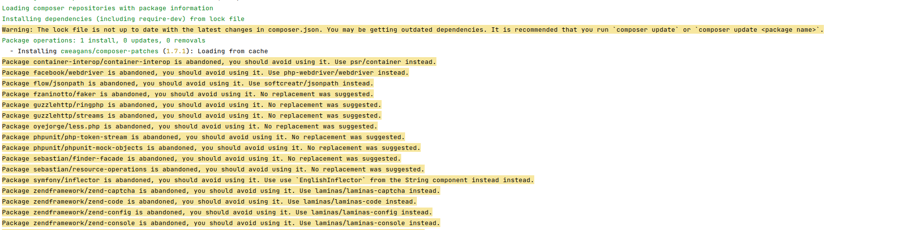
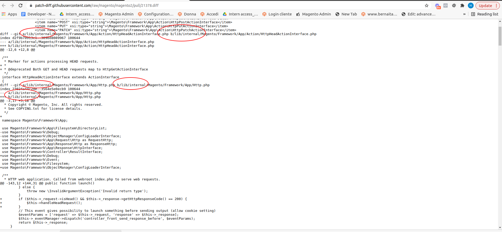
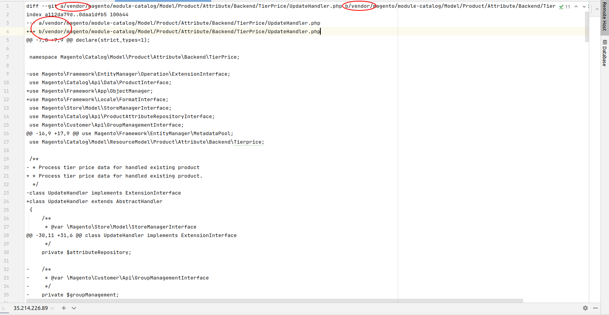
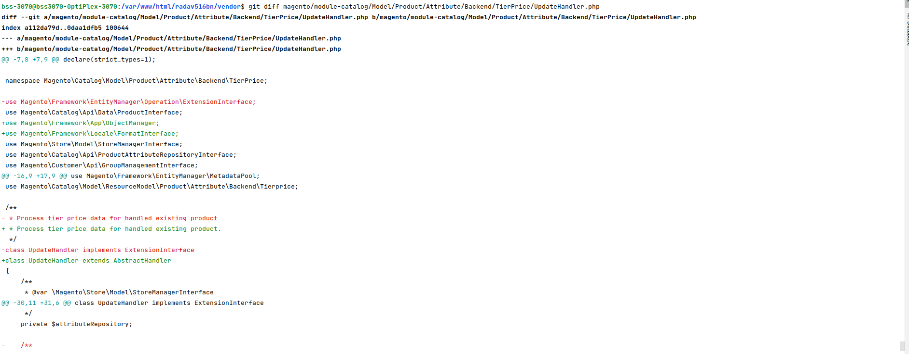
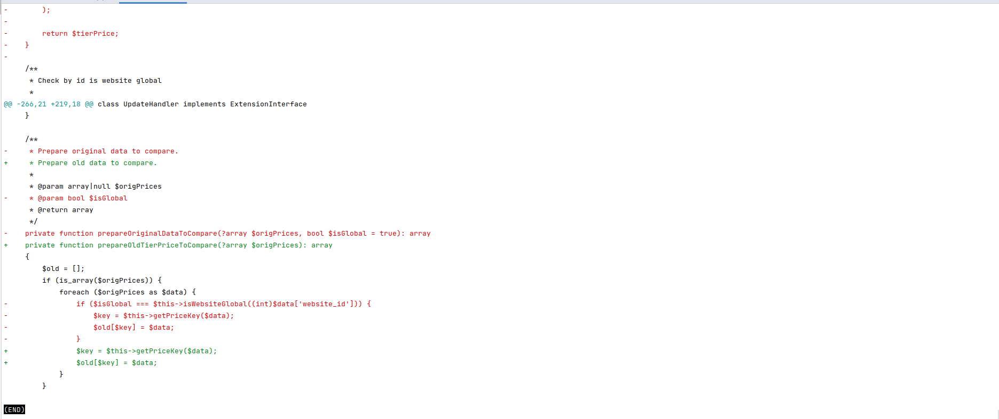
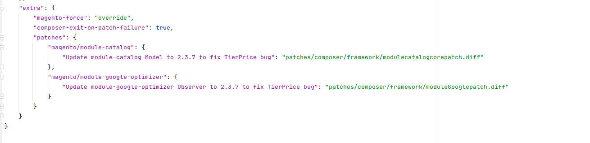
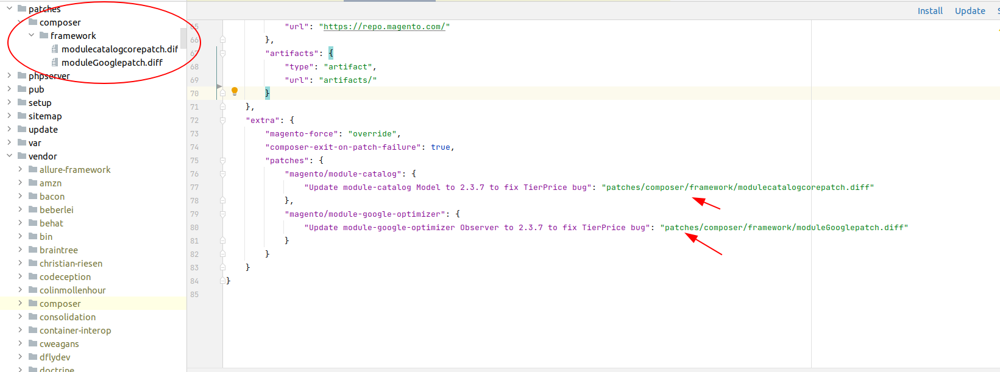
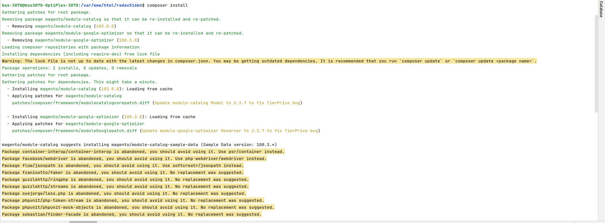
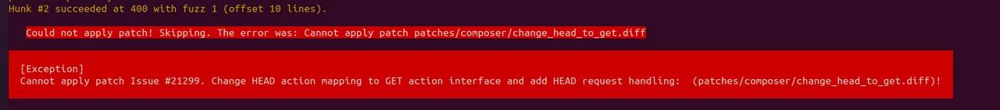

# Hotfix trong core magento bằng cách tạo patches

Hotfix trong core magento bằng cách tạo patches tránh được việc cài lại vendor sẽ bị mất phần hotfix. **Khi upgrade magento lên bản mới cần kiểm tra lại patch xem đã có trên bản mới chưa, nếu có rồi thì sẽ xóa file patch đi.**

## Step 1: Cài đặt cweagans/composer-patches bằng composer

```bash
composer require cweagans/composer-patches
```



## Step 2: Tạo folder patches/composer

Trong folder root magento, tạo folder patches/composer. Đây là folder chứa các file đuôi .diff hoặc .patch để lưu thay đổi code của core để apply patches. Nên sử dụng đuôi .diff để file size nhỏ hơn.

**Trường hợp 1:** khi đã có sẵn pull request

Thêm .diff vào cuối link pull request để có thể lấy được phần thay đổi.

VD: <https://patch-diff.githubusercontent.com/raw/magento/magento2/pull/21378.diff> ( patch cho module magento/module-framework )

- Copy phần sửa đổi ở PR này vào file .diff ( Lưu ý phần thay đổi có thể bỏ qua các class Test, chỉ lưu phần thay đổi class core vào file .diff )
- trên nó sửa 1 số file trong lib do là bản magento develop, cần sửa lại đúng file tương ứng trong vendor



- Sửa lại path của file match với path file cần sửa ở core trong project



**Trường hợp 2:** khi chưa có sẵn pull request, chưa có bản fix trên github

- Cần cd vào vendor, chạy `git init`, `git add -A`, `git commit -m "xyz"` để lưu code vendor hiện tại lại
- Add phần code sửa vào file core rồi `git diff` và scroll đến phần (END) để lấy ra phần code thay đổi





- copy tất cả phần thay đổi khi `git diff` và copy vào file .diff
- Nếu là file tạo mới, để lấy phần diff thì có thể sử dụng command này: `git diff --no-index /dev/null <file_path>`
- Sau khi xong cần xóa `.git` trong folder vendor.

**Note:** Trường hợp rewrite nhiều module trong core thì cần tạo nhiều file patches .diff để sử dụng

## Step 3: Khai báo patch trong composer.json

Sau khi lấy ra được các thay đổi và lưu vào patches thì cần sửa file composer.json để khai báo module core và patch apply

- VD:





Trong file composer.json cần khai báo :

- Path và tên module apply core
- Nội dung của phần apply patch để fix lỗi module core
- Path đường dẫn đến file lưu phần sửa đổi đã tạo ở Step 2
- Mỗi module core rewrite sẽ được apply patch sửa riêng qua từng file .diff ( VD như trên ảnh là apply patch cho 2 module magento/module-catalog và magento/module-google-optimizer )

Để apply patches dùng command: `composer install`

Nếu apply patches thành công thì sẽ hiển thị thế này là code đã đc update, recheck lại code ở core xem phần thay đổi đã có chưa



Nếu apply patches fail sẽ có hiển thị thế này



Nếu apply patches success, commit composer.json, composer.lock và folder patches lên.
