# Web Cache — Ý nghĩa & ứng dụng

## **Mục Lục**

1. Tổng quan

Các loại cache phổ biến được ứng dụng

* 1. Browser Cache
  2. Proxy Cache
  3. Server Cache
     1. Object caching
     2. Opcode caching
     3. CDN caching
     4. *(Warm-up cache)*
     5. *(Litespeed cache)*

1. Ứng dụng của từng loại
2. Best practice - ứng dụng thực tế với server cache
3. Cache thủ công (manual cache)
4. FAQ

##

##

##

##

##

##

##

##

##

## **Tổng quan về Web Cache**

Web Cache là dữ liệu trên website được lưu vào bộ nhớ để phục vụ cho các yêu cầu từ phía khách hàng request dữ liệu lên server,

**Flow của bộ nhớ đệm web cache phổ biến như sau:**

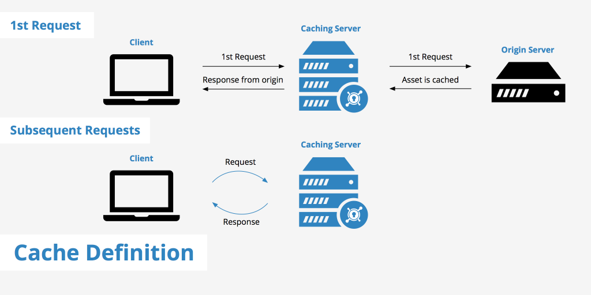

* Web cache tạo ra bản sao y hệt web nguồn nhưng được phân tán để giúp người dùng dễ dàng kết nối với web của bạn hơn
* Hạn chế độ tốn kém của băng thông. Để đáp ứng cho nhu cầu khách truy cập tăng cao nhưng lượng băng thông cần trả quá cao thì doanh nghiệp cần nghĩ đến giải pháp đó là Web cache để tối ưu hóa.
* Nhưng nó không chỉ quan trọng đối với người dùng, **Google còn thưởng cho những trang có hiệu suất tối ưu** , ảnh hưởng đến kết quả của công cụ tìm kiếm.

*Mô hình máy chủ xử lý khi không có cache*

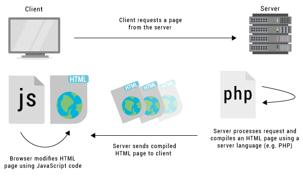

**Các loại web cache được ứng dụng hiện nay:**

* Browser Cache
* Proxy Cache
* Server Cache
  + Object caching
    - Redis
    - Memcached
    - Varnish
  + Opcode caching
  + CDN caching

##

##

##

## **Ứng dụng của từng loại cache**

### **Browser Cache**

Cache của trình duyệt là loại cache phía máy khách, nó cũng là một loại cache trang web, là một hệ thống bộ nhớ cache được tích hợp trong trình duyệt.

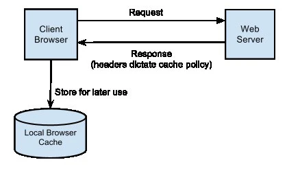

Cache của trình duyệt tạm thời lưu các loại nội dung:

* HTML
* File CSS
* file JavaScript
* Hình ảnh
* Các loại nội dung đa phương tiện khác (video, mp3,...)

### **Proxy Cache**

Nếu như Browser cache là ứng dụng lưu trữ cá nhân hóa thì Proxy cache lại đáp ứng cho hàng trăm người truy cập cùng nội dung. Proxy cache do các Tổ chức ISPs (các nhà cung cấp mạng giống kiểu FPT,VNPT,...) cài đặt để giảm băng thông

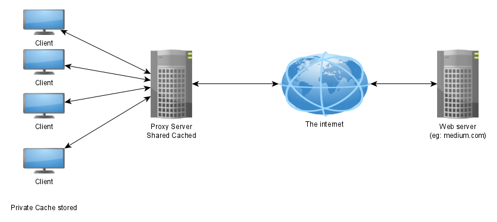

### **Server cache**

Server cache được triển khai theo mô hình máy chủ 2 lớp. Trong đó, 1 lớp có vai trò là front-end (xử lý các file tĩnh như html, css,…), còn 1 lớp giữ nhiệm vụ back-end (xử lý các nội dung động – dynamic data).

Server cache được cài đặt bởi quản trị viên nên chúng ta có thể kiểm soát và điều khiển được nó, hoàn toàn ngược lại với browser cache và proxy cache.

**Một số loại cache thường được sử dụng trên server**

1. **Object caching**

Object caching lưu trữ các truy vấn cơ sở dữ liệu trong bộ đệm phía máy chủ để truy xuất nhanh các lần tải trang tiếp theo.

Một số Object caching nổi tiếng là **Redis, Memcached và Varnish**

**1.1 Redis cache**

**Redis cache** là một bộ opensource dùng để tạo ra một máy chủ được sử dụng như một bộ nhớ đệm.

Việc dùng redis cache phù hợp với những hệ thống có dữ liệu được người dùng truy cập thường xuyên, nó giúp tốc độ truy xuất dữ liệu diễn ra nhanh hơn.

Redis có thể được sử dụng như một database được lưu trữ trong ram để tăng tốc độ xử lý

Redis sử dụng kiến trúc primary-replica và hỗ trợ sao chép không đồng bộ, dữ liệu có thể được sao chép sang nhiều máy chủ khác nhau. Điều này giúp hiệu suất đọc được cải thiện (vì các yêu cầu có thể được phân chia giữa các máy chủ) và phục hồi nhanh hơn khi máy chủ chính gặp sự cố ngừng hoạt động. Để duy trì, Redis hỗ trợ sao lưu point-in-time backups (sao chép dữ liệu Redis vào đĩa).

***Nhược điểm khi sử dụng Redis Cache***

Giới hạn bộ nhớ: Do Redis hoạt động lưu trữ dữ liệu trên bộ nhớ chính (RAM) và dung lượng lưu trữ sẽ bị giới hạn bởi bộ nhớ có sẵn trên hệ thống. Nếu dữ liệu lớn hơn dung lượng bộ nhớ có sẵn sẽ gặp vấn đề về hiệu suất. Khi đó cần phải xem xét nâng cấp bộ nhớ hệ thống.

***Sử dụng Redis cache như thế nào?***

* check hướng dẫn chi tiết tại đây [<u>https://www.freecodecamp.org/news/how-to-use-redis-with-php/</u>](https://www.freecodecamp.org/news/how-to-use-redis-with-php/)
* hoạc làm 1 vài ví dụ như ở đây https://vietnix.vn/redis-lam-cache-cho-mysql-bang-php-tren-ubuntu-20-04/
* Cấu trúc lưu trữ dữ liệu của Redis có thể check ở đây https://viblo.asia/p/redis-co-ban-57rVRq5OR4bP

**1.2 Memcached**

Memcached là một hệ thống lưu trữ bộ nhớ đệm hiệu suất cao.

Nó **có thể** lưu trữ dữ liệu nhỏ như một **con số** hoặc lớn như một trang HTML đã render hoàn toàn.

Khi hết dung lượng, dữ liệu cũ sẽ bị ghi đè => do vậy nó được coi là bộ đệm tạm thời (không liên tục)

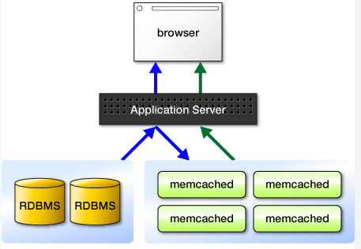

***Sử dụng Memcached như thế nào?***

* Có thể check 1 số ví dụ được làm sample ở link sau: [<u>https://www.tutorialspoint.com/php/php\_memcache\_functions.htm</u>](https://www.tutorialspoint.com/php/php_memcache_functions.htm)
* Docs về các method được sử dụng trong memcached https://www.geeksforgeeks.org/php-imageline-function/?ref=ml\_lbp

***Đọc qua cái mô tả này thì lú thật. => Vậy memcached và redis có gì khác nhau???***

* Ở mặt giống thì:
  + Memcached và redis cache đều sử dụng RAM để lưu trữ dữ liệu.
  + Hệ thống lưu trữ dữ liệu dạng key-value (NoSql)
* Khác nhau là:
  + Redis cho phép replication còn memcached thì không.
  + Memcached thì rất đơn giản, chỉ có dạng key-value cho tất cả dữ liệu lưu trong RAM. Lưu ý là Memcached chỉ là tầng cache, ko có tính persistent (toàn vẹn dữ liệu), tức là khó backup dữ liệu, và dữ liệu có thể mất.
  + Redis thì đa dạng phức tạp hơn, có thể lưu được nhiều kiểu dữ liệu như string, hashes, sets, sorted sets, transaction, pub/sub v.v

| **Memcache** | **Redis** |
| --- | --- |
| Memcached chỉ caching thông tin. | Redis cũng thực hiện cache thông tin nhưng có các tính năng bổ sung như persistence and replication |
| Khi tràn bộ nhớ, cái dữ liệu chưa sử dụng gần đây (ít được sử dụng gần đây nhất) sẽ bị xóa | Bạn có thể đặt timeout cho mọi thứ, khi bộ nhớ đầy, nó sẽ xem xét ba key ngẫu nhiên và xóa key gần nhất với thời hạn sử dụng |
| Trong Memcached, bạn phải serialize các đối tượng hoặc mảng để lưu chúng và để đọc lại chúng, bạn phải unserialize chúng. | Redis có cấu trúc dữ liệu mạnh hơn; nó có thể xử lý các chuỗi, hash, list, set, v.v. |
| có độ dài tối đa của key/value 250 byte/**1MB** | Có độ dài key/value tối đa **512MB** |

*Reference https://www.imaginarycloud.com/blog/redis-vs-memcached/*

**Sử dụng bộ nhớ (**Ở điểm này thì **Redis tốt hơn.)**

* memcached: Bạn chỉ định kích thước bộ nhớ để lưu trữ dữ liệu. Tất cả các key của bạn có thể hết hạn, bạn có thể xóa data trong CSDL và nó vẫn sẽ sử dụng toàn bộ khối RAM mà bạn đã định dạng.
* redis: Cài đặt kích thước tối đa là tùy thuộc vào bạn. Redis sẽ không bao giờ sử dụng nhiều hơn nó phải có và sẽ trả lại cho bạn bộ nhớ mà nó không còn sử dụng nữa.

***VD***: khi lưu trữ dữ liệu vào bộ nhớ khoảng ~ 200MB. Sử dụng RAM Memcached tăng lên ~ 225MB. Sử dụng lại RAM Redis đã tăng lên ~ 228 MB. Sau khi xóa cả hai, redis giảm xuống ~ 29MB và memcached vẫn ở mức ~ 225MB. Chúng có hiệu quả tương tự trong cách chúng lưu trữ dữ liệu, nhưng chỉ có một cái có khả năng lấy lại dữ liệu.

**1.3 Varnish**

“Varnish is an HTTP reverse proxy” → Được sử dụng để tăng tốc độ website, ***giảm tải cho toàn bộ web server.***

Nó hoạt động như một reverse proxy cache, tức là nó đặt trước các yêu cầu của người dùng đến máy chủ web và lưu trữ phiên bản tạm thời của các trang web được truy cập.

**Varnish** cung cấp các tính năng như cache nội dung tĩnh, điều chỉnh tài nguyên, xử lý yêu cầu nhanh, và cân bằng tải

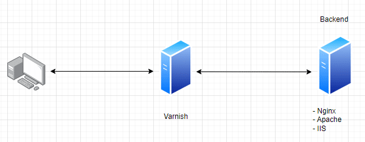

***Đọc đến đây lại thâý sao nó giống redis thế*** =))). Cả 2 đều có chung mục đích là cache và tăng trải nghiệm người dùng.

=> OK vậy mình cùng chi tiết xem chúng khác nhau điểm gì.

**a. Data Storage**

Varnish cache được tạo ra và hoạt động như một proxy caching, nó được **đặt trước tầng application**. và được sử dụng mục đích chính là để cache nội dung (content) của web. => để tăng tốc truy cập và giảm tải cho máy chủ ứng dụng.

Trong khi đó Redis và Memcached là các hệ thống lưu trữ dữ liệu trong bộ nhớ được sử dụng để lưu trữ và truy xuất dữ liệu tạm thời, => thường được sử dụng để tăng tốc độ truy xuất dữ liệu từ hệ thống cơ sở dữ liệu chính.

**b. Data Structure**

Redis hỗ trợ các cấu trúc dữ liệu khác nhau như strings, sets, lists, hashes,, v.v., mang lại sự linh hoạt trong mô hình hóa dữ liệu. Mặt khác, Varnish không có cấu trúc dữ liệu phức tạp và chủ yếu tập trung vào việc cache và phân phối nội dung tĩnh một cách hiệu quả.

**c. HTTP Optimization**

Varnish bao gồm các tính năng tối ưu hóa HTTP tích hợp như nén nội dung, viết lại yêu cầu/phản hồi và cân bằng tải. Nó có thể lưu trữ và phục vụ các nội dung tĩnh như hình ảnh, CSS và tệp JS một cách hiệu quả. Tuy nhiên, Redis không cung cấp các tối ưu hóa dành riêng cho HTTP này và chủ yếu tập trung vào lưu trữ và truy xuất dữ liệu.

**d. Storage Capacity**

Redis bị giới hạn bởi dung lượng bộ nhớ khả dụng và có thể xử lý một lượng dữ liệu đáng kể miễn là nó vừa với bộ nhớ. Mặt khác, Varnish có thể lưu trữ lượng dữ liệu lớn hơn vì nó có thể được cấu hình để sử dụng bộ lưu trữ trên đĩa khi bộ nhớ khả dụng đã cạn kiệt.

**e. Configuration Complexity**

Redis có cấu hình tương đối đơn giản hơn và có thể dễ dàng tích hợp vào các ứng dụng. Mặt khác, Varnish đòi hỏi nhiều chuyên môn hơn về quản trị và cấu hình máy chủ web do tính chất proxy cache và cache phức tạp hơn.

*Reference* [*<u>https://stackshare.io/stackups/redis-vs-varnish</u>*](https://stackshare.io/stackups/redis-vs-varnish)

1. **Opcode caching**

Mỗi khi bạn thực thi một tập lệnh PHP, tập lệnh này cần được biên dịch thành bytecode. OPcache tận dụng bộ nhớ cache, để cache cho bytecode này, vì vậy lần sau nếu vẫn là tập lệnh đó, nó không phải biên dịch lại lần nữa.

Điều này có thể tiết kiệm một số thời gian thực hiện quý giá và do đó làm cho ứng dụng của bạn nhanh hơn (và có thể tiết kiệm một số chi phí máy chủ).

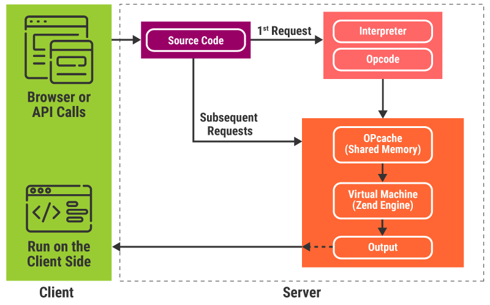

1. **Bộ nhớ đệm CDN – Edge caching**

Mạng phân phối nội dung (**CDN**) là một cụm máy chủ có vị trí địa lý trên toàn thế giới. Họ lưu trữ nội dung mà bộ đệm đã tải bằng cách sử dụng máy chủ mà gần với người dùng cuối nhất để cho thời gian tải web nhanh hơn.

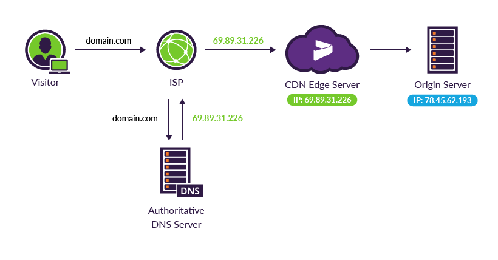

**Cơ chế hoạt động:**

**CDN** hoạt động bằng cách đưa content đến gần vị trí người dùng cuối. Điều này được thực hiện bằng cách thông qua các data center được định vị được gọi là Points of Presence (PoPs). Đây là các data center nằm trên khắp thế giới và bên trong mỗi PoP là hàng nghìn caching server. Cả PoP và server đều giúp cải thiện kết nối và tăng tốc độ phân phối content đến end user.

**Ví dụ** một user ở Singapore đang cố tải trang web của một nhà cung cấp dịch vụ phát trực tuyến. User gửi yêu cầu đến web server của doanh nghiệp để truy xuất tất cả các thành phần của trang. Trang có thể bao gồm văn bản, images, [<u>HTML</u>](https://vietnix.vn/html-la-gi/) và dynamic content. Server gốc (origin server) có thể được đặt ở bất kỳ đâu trên thế giới. Giả sử nó ở Bắc Mỹ. Giờ đây, server gốc này lưu trữ tất cả content trên trang web và phải phân phối content đó đến trình duyệt của user trên toàn cầu. Thực tế là khoảng cách địa lý này có thể tạo ra sự delay và các vấn đề về hiệu suất.

## **Best practice - ứng dụng thực tế với server cache**

(Ở đây mình sẽ ưu tiên nói về magento 2)

A. Redis cache

Với redis cache thì có cách cấu hình và sử dụng khá đơn giản, Các cấu hình của redis có thể Được tìm thấy ở app/etc/env.php

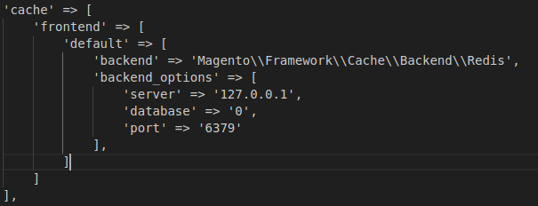

=> điều mình cần lưu ý ở đây là khi mình muốn sử dụng Redis cho cả default cache và full page cache. thi ta phải define database number cho từng loại. mặc định là 0.

Vd. bên trên mình chỉ config redis cho default cache. nên mặc định để là 0. Nếu muốn dùng redis cho các phần khác như full page cache hay session cache thì cần chỉ định database number cho từng loại khác nhau. Như hình dưới chẳng hạn

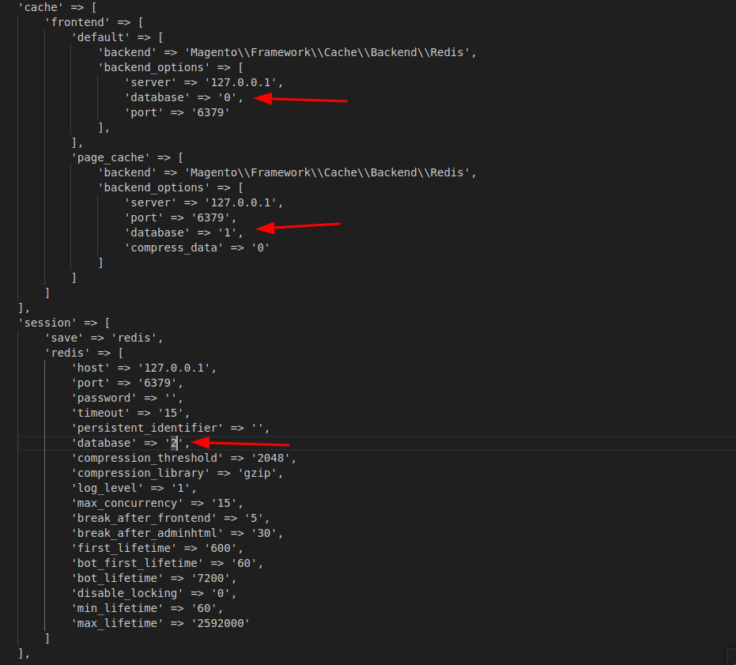

=> Nếu mình k define cho từng loại khác nhau sẽ gây conflict trong quá trình sử dụng cache.

B. Memcached

So với redis thì Memcached ít phổ biến hơn, nhưng vẫn là 1 lựa chọn tốt trong việc cache data. Hiện tại memcached trong magento 2 được support để sử dụng để cache session trong Magento.

=> Do vậy để cache session thì ta có 1 lựa chọn tốt dc magento suggestion là Memcached

https://experienceleague.adobe.com/docs/commerce-operations/configuration-guide/storage/session-storage/memcached.html

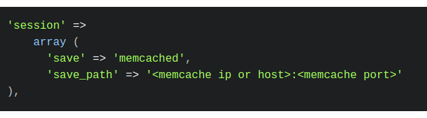

C. Varnish cache

* Để sử dụng được varnish cache thì cần nhiều kiến thức hơn. và cũng yêu cầu thao tác nhiều hơn các loại cache đã đề cập bên trên.
* https://experienceleague.adobe.com/docs/commerce-operations/configuration-guide/cache/configure-varnish-commerce.html?lang=en

- advance: khi sử dụng varnish thì nên enable health check để kiểm tra thường xuyên tình trạng server có ổn định hay không.

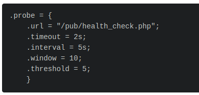

Hiện Magento đã hỗ trợ script **health\_check**.**php** ở trong thư mục pub để config với varnish.

* *ở đoạn config trên thì Cứ sau 5 giây, thì đoạn config này sẽ gọi script pub/health\_check.php. Script sẽ check về tình trạng hoạt động của server, từng cơ sở dữ liệu và Redis (nếu được cài đặt). script phải trả về phản hồi trong vòng 2 giây. Nếu xác định rằng bất kỳ tài nguyên nào trong số này không hoạt động, script sẽ trả về lỗi 500 HTTP. Nếu sáu trong số mười lần thử nhận được mã lỗi này thì phần server được xem là k ổn định.*

**Tối ưu hóa file config** *https://www.varnish-software.com/developers/tutorials/configuring-varnish-magento/#optimized-magento-vcl-file*

Ý nghĩa của redis và varnish được ứng dụng trong magento 2

[<u>https://magento.stackexchange.com/questions/357244/whats-is-major-impact-when-implements-redis-cache-and-varnish-cache-on-magento-2</u>](https://magento.stackexchange.com/questions/357244/whats-is-major-impact-when-implements-redis-cache-and-varnish-cache-on-magento-2)

⇒ với 3 phương pháp cache bên trên thì theo suggestion của magento cũng như đại đa số ng sử dụng thì mình có thể tạm chia từng phần cache như sau:

* Session cache => sử dụng memcached/redis
* Cache default / backend cache => Sử dụng redis
* FPC => sử dụng varnish

*Mặc dù từ tài liệu hướng dẫn setup của Magento ta thấy Redis vẫn hỗ trợ setup dùng cho cả FPC, trong TH webiste k setup varnish cache*

## **Cache thủ công (manual cache)**

* Thực hiện cache lại nội dung của những block it thay đổi, nhưng có logic render phức tạp (vd menu)

## **FAQ**

—------
