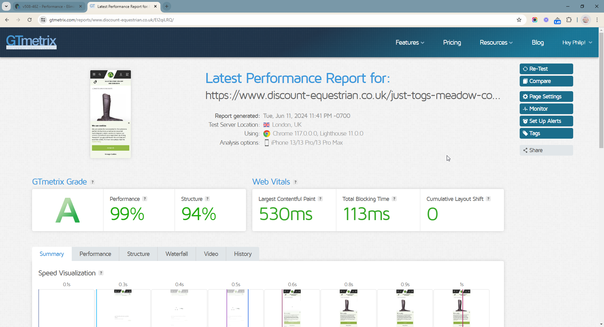
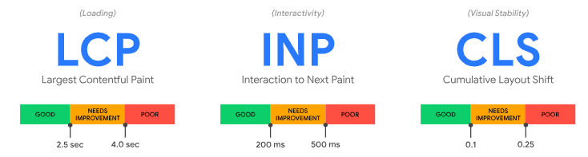
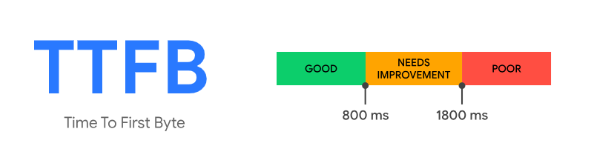
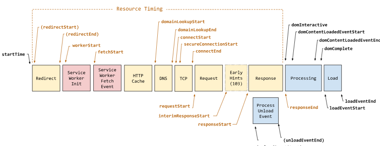
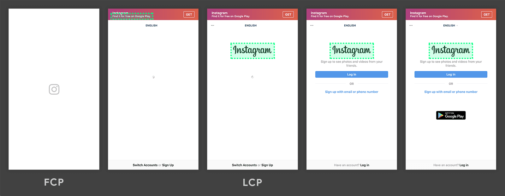

# Magento 2 Speed & Performance Optimization

## ‌Magento 2 Speed Optimization

****

- Một website chuyên nghiệp ngoài việc có giao diện, đồ họa tốt thì tốc độ load trang phải nhanh. Tốc độ chậm sẽ anh hưởng rất nhiều tới hiệu quả của website nên việc tăng tốc website là yêu cầu bắt buộc.

- Người dùng sẽ không đủ kiên nhẫn chờ website của bạn load 7-8 giây, họ sẽ rời khỏi trang web trước khi thông tin và hình ảnh tuyệt vời của trang web hiển thị lên.

- Google sẽ ưu tiên hiển thị trang có tốc độ cao lên trên trang kết quả tìm kiếm.

## CORE WEB VITALS

**-** Core Web Vitals là những chỉ số được đo lường bởi Chrome UX Report và Google Search Console để đánh giá hiệu suất website và SEO. Mỗi chỉ số sẽ đánh giá một mặt nào đó về trải nghiệm người dùng cho một trang web nào đó, tương ứng với các yếu tố xếp hạng như:

Loading: Tốc độ tải trang

Interactivity: Khả năng tương tác

Visual stability: Tính ổn định của trang web

- Các chỉ số của Core Web Vitals

LCP https://web.dev/articles/lcp

INP https://web.dev/articles/inp

CLS [https://web.dev/articles/cls](https://web.dev/articles/cls)



Bên trên là 3 metrics quan trọng nhất để đánh giá thứ hạng của website, ảnh hưởng trực tiếp đến SEO của website đó. Và để có thể tối ưu được quy trình optimize của 3 thông số trên, ta cần thực hiện optimize thông số **TTFB** đầu tiên. Đây là chỉ số k phải là tiêu chí đánh gía của google, nhưng nó là điểm mấu chốt để optimize các metrics còn lại.



TTFB là chỉ số đo thời gian từ khi gửi request cho đến khi byte đầu tiên của response time bắt đầu trả .

****

TTFB là chỉ số hiệu suất web cơ bản nó sẽ được tính toán trước mọi chỉ số trải nghiệm người dùng khác. Điều này có nghĩa là giá trị TTFB cao sẽ giúp cho số liệu của tác metrics khác theo sau nó cũng sẽ tốt hơn.

vd. TTFB có time đo được là 0.8s FCP có time là 1.4s, LCP có time là 1.8s

=> Nếu TTFB đo dc là 1.5s thì rất có thể các metrics như FCP hay LCP cũng cao hơn.

=> Do vậy việc tối tưu TTFB là chỉ số ưu tiên ban đầu, nhằm tiền đề để optimize các chỉ số khác đằng sau nó.

Ref: https://web.dev/articles/optimize-ttfb

## ‌FORM ELEMENTS

**-** Để tối ưu Speed cho 1 website, có rất nhiều yếu tố cấu thành để có được 1 kết quả tối ưu sau cùng.

+ Cần chọn nhà cung cấp hosting uy tín, có cấu hình riêng biệt cho Magento là 1 lợi thế, .... (vd: AWS, Cloudway, nexcess, Godady,...)

+ Server in multi-locations

+ Application

+ coding

+ External resource

+ Network

### ‌Server Configuration Standard

‌ + Magento latest version

* Nginx for webserver
* ElasticSearch or OpenSearch
* Mysql - Mariadb
* Php Latest (dependency on M2 version)
* Caching (Varnish, redis, memcache, Opcache,..)
* Compress (Gzip, brotli)

=> Cần chuẩn bị môi trường tốt ban đầu là điều kiện cần cho mọi yếu tố optimize về sau.

* Luôn update các phiên bản ở version mới nhất có thể
* Lựa chọn các service được recommend của nhà cung cấp ứng dụng
* Enable service cache
* setup compress plugin (recommend **brotli**)
* Review setup expire header cho server


* Thay đổi các thông số của từng config ở mỗi service để phù hợp nhất với hệ thống của mình (vd: mysql, php, Search,...)

- **reference Mysql configuration**: https://magento.stackexchange.com/questions/338043/how-to-optimize-mysql-for-best-magento-2-performance-and-increase-indexing-speed

### ‌PHP

* Limit php ext. (The presence of any profiling and debugging extensions can negatively impact the response time of your pages. As an example, an active xDebug module without any debug session can increase the page response time by up to 30%.)
* Enable Opcode caching

```ini
opcache.memory_consumption=512 <todo>
opcache.max_accelerated_files=60000 // Max 1000000
```

{ 223, 463, 983, 1979, 3907, 7963, 16229, 32531, 65407, 130987, 262237, 524521, 1048793 }

```ini
opcache.consistency_checks=0
opcache.validate_timestamps=0
opcache.enable_cli=1
```

* Sử dụng các syntax code được đánh giá tối ưu hơn về speed
  + Compared to count(), strlen(), and sizeof(), [isset()](https://php.net/manual/en/function.isset.php) is a faster and simpler way to determine if a value is greater than 0.
  + Since === only checks for a closed range, it is faster than using == for comparisons
  + Sử dụng single quotes thay vì double quotes
  + …
* Reference: [https://experienceleague.adobe.com/en/docs/commerce-operations/performance-best-practices/software](https://experienceleague.adobe.com/en/docs/commerce-operations/performance-best-practices/software)
* Có 1 số thông số khi config server ta cần lưu ý như sau:
* **Đối với PHP setting** (php.ini)

```ini
memory_limit=1G // Đấy giá trị trung bình mà magento suggest, tuy nhiên đối với những site có nhiều tác vụ, hoạc cần xử lý các request có khối lượn công việc lớn thì nên để 2GB => A suggest là nên để 2GB

//Realpath_cache //Sử dụng để lưu lại path thực của file php vào cache, thay vì mỗi lần thực hiện logic nó sẽ duyệt qua folder code để tìm đúng đường dẫn file.

realpath_cache_size=10M
realpath_cache_ttl=7200
```

**Note**: https://www.php.net/manual/en/ini.core.php#ini.realpath-cache-size

=> Nếu **safe_mode** or **open_basedir** được enabled trong php.ini, thì realpath_cache is not used. => do vậy hãy đảm bảo là mình đã check config file php.ini trước.

* Setup APCU extension (Option hỗ trợ cho opcode caching)

Check /etc/php/(version like 7.2)/cli/conf.d directory and find 20-apcu.ini. If you dont see it there, You need to install it. To install follow bellow command:

```bash
sudo apt-get install php7.2-apcu
```

Thêm dòng dưới đây vào php.ini.

```ini
extension=apcu.so
```

Sau khi setup APCU, thì nên sử dụng với composer để cho hiệu suất tối đa.

[https://experienceleague.adobe.com/en/docs/commerce-operations/performance-best-practices/deployment-flow#preprocess-dependency-injection-instructions](https://experienceleague.adobe.com/en/docs/commerce-operations/performance-best-practices/deployment-flow#preprocess-dependency-injection-instructions)

### ‌Use Varnish for FPC

### Use redis for default and session cache

### CDN

*Tham khảo lại phần cache ở document này Để sử dụng cache 1 cách hiệu quả, cũng sẽ có những TH chúng ta không phải lúc nào cũng dùng cdn, Tùy vào nhu cầu bán hàng thực tế của website để đưa ra option tối ưu hơn.*

[*https://docs.google.com/document/d/1Y6-52Z-pUGDra_mBov17M2yUlNrxzUI1MZST-mRrXgU/edit#heading=h.xuzmf9b7m10h*](https://docs.google.com/document/d/1Y6-52Z-pUGDra_mBov17M2yUlNrxzUI1MZST-mRrXgU/edit#heading=h.xuzmf9b7m10h)

CDN không phải lúc nào cũng cần setup, cũng sẽ tùy vào điều kiện cụ thể.

**Ví dụ.** Site chỉ bán hàng tại 1 quốc gia, hoạc 1 kh vực nhỏ, và server đặt tại khu vực đấy thì k cần CDN.

https://experienceleague.adobe.com/en/docs/commerce-operations/performance-best-practices/software

### ‌Optimize Log

+ setup logrotate (max 7 days)

+ Limit logging in the production environment

+ schedule review and clean db logging, Enable Slow query,...

*Việc ghi log cũng sẽ ảnh hưởng tới performance của server*

*- Log file ghi liên tục*

*- log file chiếm bộ nhớ server*

*- OPtimize query / Giảm số lượng query db k thật sự cần thiết.*

*- Clean db log.*

### ‌Appication - optimize

‌- Review module/extendsion

+ remove or disable unused extension

+ Clean database log with schedule (cron)

- Review Store/Website

- Review Attributes

- Asynchronous Setting

- Asynchronous email notifications: Stores > Settings > Configuration > Sales > Sales Emails > General Settings > Asynchronous Sending

- Asynchronous configuration save:

```bash
bin/magento setup:config:set --config-async 1
bin/magento queue:consumers:start saveConfigProcessor --max-messages=1
```

- Deferred stock update: Stores > Settings > Configuration > Catalog > Inventory > Product Stock Options > Use Deferred Stock Update (work with back order only)

- Limit Grid records

*Configuration Best practices:* [*https://experienceleague.adobe.com/en/docs/commerce-operations/performance-best-practices/configuration*](https://experienceleague.adobe.com/en/docs/commerce-operations/performance-best-practices/configuration)

*Detect unuse resource:* [*https://docs.google.com/document/d/1yCXAqQyIFwOfZZwZ0gH2OeB4J1gQykx-dZGz-9fYh7k/edit*](https://docs.google.com/document/d/1yCXAqQyIFwOfZZwZ0gH2OeB4J1gQykx-dZGz-9fYh7k/edit)

## ‌CORE WEB VITALS -- LCP https://web.dev/articles/lcp



‌Defer offscreen images (Lazy loading)

- Properly size images


- Preload, preconnect, ...

- Ensure text remains visible during webfont load

**Font Display:** Fallback, Swap, Block

‌([https://www.creativebloq.com/advice/control-web-typography-with-css-font-display](https://www.creativebloq.com/advice/control-web-typography-with-css-font-display))

‌- Remove JS không sử dụng trên site

- Remove CSS không sử dụng trên site, hoạc nếu sử dụng cho block page cụ thể, thì tạo file riêng cho mình page đó.

- Convert image sang dạng webp

- Eliminate render-blocking resources

Defer

Bundle

Reduce size

CSP

Don’t use CSS imports

Load conditional CSS with media attributes

Load custom fonts locally

(ref: [https://blog.logrocket.com/11-best-practices-eliminate-render-blocking-resources/](https://blog.logrocket.com/11-best-practices-eliminate-render-blocking-resources/))

- critical CSS

- Sử dụng preload để load truoc content cho các page quan trọng.

Example:

```html
< link rel=”preload” as=”image” href=”important.png”/ >
< link rel=”preload” as=”style” href=”combined.css” >
```

**EX**: Xử lý TH module page builder.

- Issue: Module load resource everywhere. (js/css/font)

=> bài toán khác phục:

- Remove những resource không càn thiết.

- Chỉ call resource khi có page sử dụng đến

[https://bitbucket.org/bssdev03/v549/commits/d4787c82be09a2348f6ce8b613e20dfb3bbadc8c](https://bitbucket.org/bssdev03/v549/commits/d4787c82be09a2348f6ce8b613e20dfb3bbadc8c)

(task xử lý [https://pms.bssgroup.vn/default/viewtaskdetail/v549-397](https://pms.bssgroup.vn/default/viewtaskdetail/v549-397))

## ‌CORE WEB VITALS -- CLS https://web.dev/articles/cls


‌ - Image elements do not have explicit width and height

‌ - Avoid large layout shifts

- Nguyên nhân là do đâu:

=> Using images without specifying their dimensions

=> Embeds, banner advertisements, and iframes with no dimensions

=> Any material that is dynamically injected

=> Using fonts incorrectly, resulting in a flash of invisible text (FOIT) or a flash of unstyled text (FOUT)

Actions that wait for a network response before modifying the DOM

=> Vậy cần xử lý như thế nào?

Image: define w/h and set ratio for element, (mobile first)

Iframe, video:

Font => Cân nhắc khi sử dụng font, sử dụng font display để giảm cls, preload,...

content modify dom => sử dụng block holder để giữ chỗ conent.


## ‌CORE WEB VITALS -- INP https://web.dev/articles/inp


* Theo Google thì Interaction to Next Paint (INP) là chỉ số đánh giá khả năng phản hồi tổng thể của một trang đối với các tương tác của người dùng bằng cách quan sát độ trễ của tất cả các tương tác nhấp, nhấn và gõ bàn phím xảy ra trong suốt thời gian người dùng truy cập vào một trang. Giá trị INP cuối cùng tương ứng với lượt tương tác dài nhất quan sát được.
* Hiểu một cách đơn giản thì INP đo lường thời gian phản hồi các tương tác của khách truy cập trong suốt thời gian họ ở trên website của bạn (thay vì chỉ đo thời gian phản hồi của tương tác đầu tiên như FID). Nếu thời gian phản hồi lâu thì website sẽ bị đánh giá là phản hồi kém.

=> Có nhiều yếu tố khác nhau ảnh hưởng đến chỉ số INP. Tuy nhiên, nhìn chung, nếu muốn website của bạn phản hồi nhanh với các tương tác thì cần đảm bảo mã nguồn của nó nhẹ nhất có thể và host của bạn đủ nhanh. INP sẽ đo lường toàn thời gian, do đó các thủ thuật để qua mặt Google nhằm tăng điểm, chẳng hạn như delay, hầu như không còn tác dụng nữa.

* Lựa chọn host tốt là yếu tố đầu tiên cần được xét đến. Nếu host mà bạn đang dùng quá yếu, không đáp ứng được nhu cầu của website, hãy nâng cấp cấu hình hoặc chuyển qua sử dụng host của nhà cung cấp khác.
* Lựa chọn theme nhẹ (ưu tiên ít sử dụng JS) và có code được tối ưu tốt. Tránh sử dụng các module/extension có sử dụng quá nhiều resource để render như page builder.
* Xóa bỏ những plugin, tính năng, hiệu ứng màu mè và rườm rà… không thực sự cần thiết với website của bạn. Hạn chế sử dụng ảnh GIF, icon font (Font Awesome…), web font nói chung và Google Fonts nói riêng.
* Đừng để quá nhiều nội dung hiển thị trên cùng một trang (DOM quá lớn).. Nếu như content cần hiển thị nhiều thì nên phân trang

## ‌External Resource

‌Là các resource mà website cần tải về từ các bên thứ 3 như:

**Google recaptcha**

‌**Assets (font, image, styles, Js..)**

‌**GTM**

**…**

- External resource là 1 issue cố hữu và hầu như website này cũng sẽ có. Vd, site sử dụng GTM, Su dung recaptcha,...

- **vd1**. xử lý load script recaptcha: script recaptcha sẽ k load cho đến khi nào cái form có chưa recaptcha dc gọi. NGhĩa là mình sẽ bắt event input focus thì mới bắt đầu load script recaptcha

- **vd2**. Xử lý theme liên quan đến amazon payment method. Module amazone payment file template config.phtml. sử dụng để render button ở mọi page (minicart) nhưng 1 số design của kh sẽ k cần thiết render thằng này. do vậy, thay vì ẩn button thì mình nên xử lý lại dể remove hoàn toàn việc render button ở mỗi page đi. Chỉ render resource trên page cần thiết (checkout, cart page)

## ‌Coding Tips

### 1 Số ví dụ thực tế trong code

**(Ở Slide sharing)**

[https://workdrive.zohopublic.com/show/publish/rl69pc1b2cf1659ad47db97d59c1fcbc6ab52](https://workdrive.zohopublic.com/show/publish/rl69pc1b2cf1659ad47db97d59c1fcbc6ab52)

## ‌Reference

‌https://experienceleague.adobe.com/en/docs/commerce-operations/performance-best-practices/configuration

https://magento.stackexchange.com/questions/338043/how-to-optimize-mysql-for-best-magento-2-performance-and-increase-indexing-speed

https://www.mgt-commerce.com/docs/mgt-developer-toolbar/magento2/installation

https://onilab.com/blog/magento-2-performance-speed-optimization-guide
