# Blackfire — Profiling & Phân tích hiệu năng

Blackfire là tool profiling để tìm bottleneck (SQL, memory, thời gian thực thi) trong request Magento.

- Giới thiệu: https://blackfire.io/docs/introduction
- Cài đặt: https://blackfire.io/docs/up-and-running/installation
- Metrics built-in cho Magento: https://blackfire.io/magento

> Server cloud của BSS đã cài sẵn Blackfire. Trên dev-site M2 chỉ cần hoàn thiện cài đặt theo link trên.

---

## 1. Config CLI (chỉ làm lần đầu trên mỗi dev-site)

Lấy **Client ID** và **Token**:
1. Login Blackfire: https://blackfire.io/my/settings/credentials (dùng tài khoản BSS — **lấy credential từ Vault/1Password**, không ghi vào tài liệu).
2. Vào *Account Dashboard > Settings* để lấy Client ID & Token.

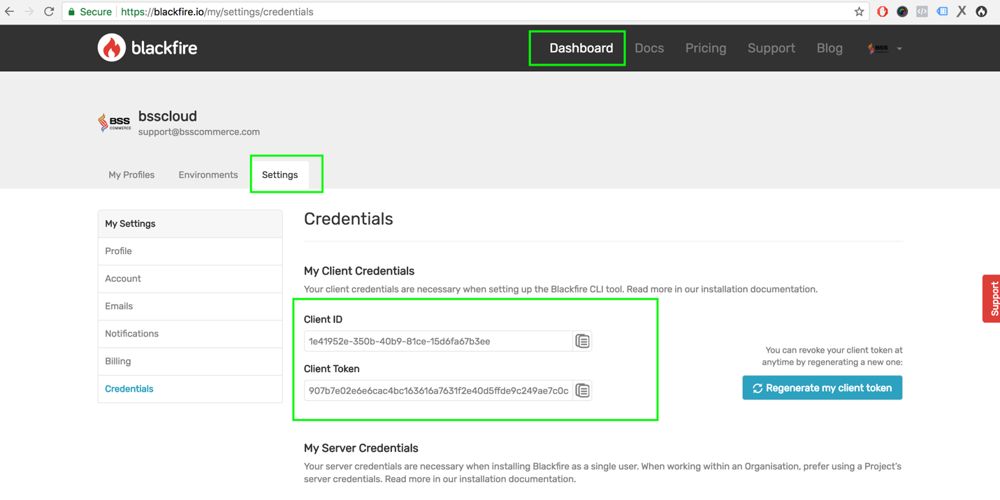

3. SSH vào dev-site, chạy:
   ```bash
   blackfire config
   ```
   Điền Client ID & Token → hoàn tất CLI config.

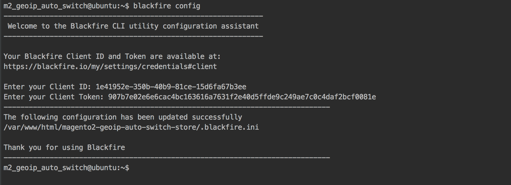

Cài add-on trình duyệt để profiling qua browser:
- Chrome: https://blackfire.io/docs/integrations/chrome
- Firefox: https://blackfire.io/docs/integrations/firefox

---

## 2. Profiling

### 2.1. Qua CLI command
```bash
blackfire run <command>
# VD:
blackfire run php bin/magento setup:upgrade
```
Kết quả hiển thị trên Blackfire:

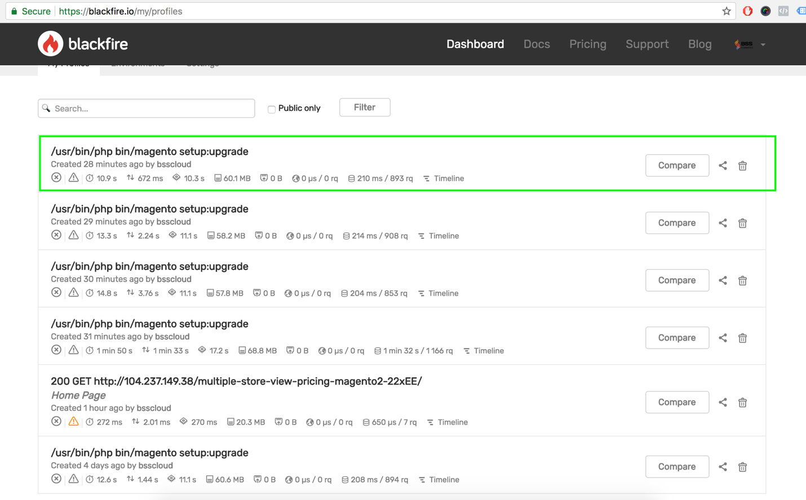

### 2.2. Qua browser (Chrome/Firefox)
Load trang Magento → click icon Blackfire → **Profile!**


Đợi profiling hoàn tất:


Kết quả:

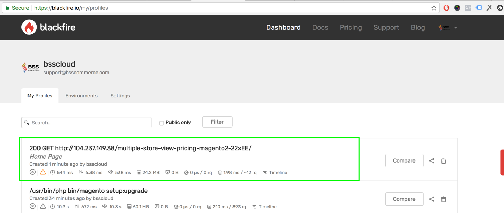

### 2.3. Profiling một POST request
Gửi POST form qua trình duyệt (vd contact form):

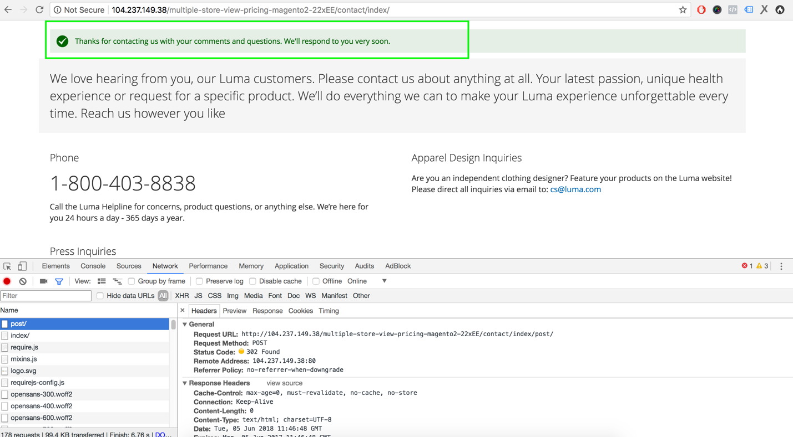

Chọn POST request → **copy as cURL**:

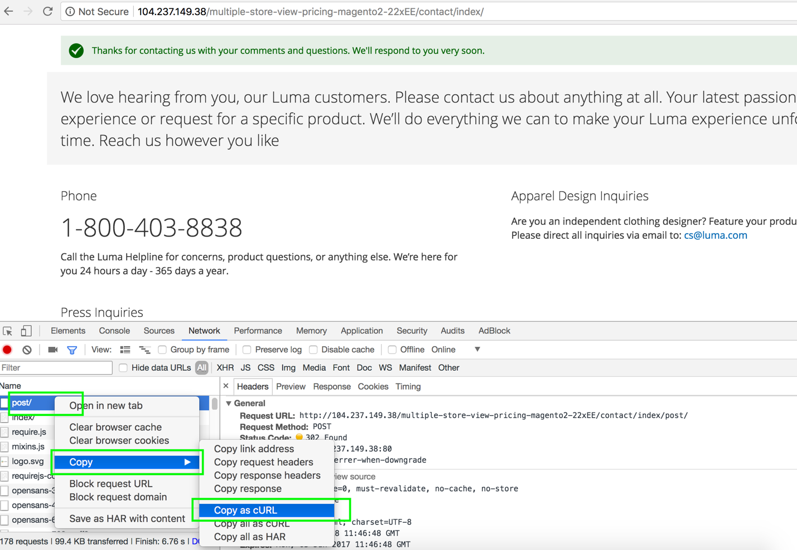

Profiling qua SSH bằng cURL:
```bash
blackfire --samples=1 curl <content>
```

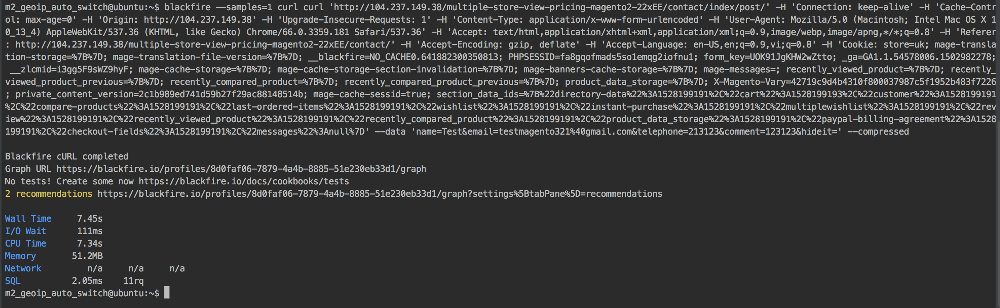

Kết quả:

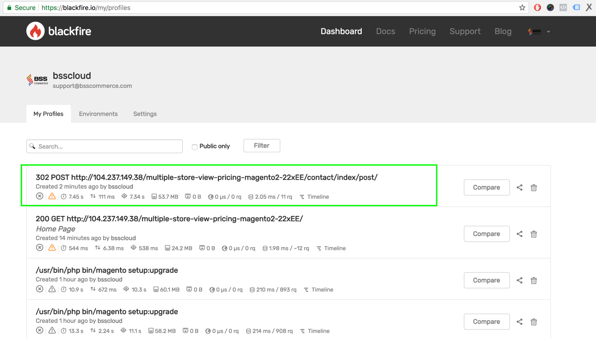

---

## 3. Phân tích Call Graphs

### Khái niệm — Metrics
Metrics = tập các giá trị tài nguyên tiêu tốn (memory, network in/out, time, io...) của một function.
- Built-in metrics: https://blackfire.io/docs/reference-guide/metrics#magento-built-in-metrics (vd `metrics.sql.queries`, `metrics.redis`...)
- Giá trị gồm: `count`, `wall_time`, `cpu_time`, `memory`, `peak_memory`, `network_in/out`, `io`.
  - VD: `metrics.sql.queries.count` = số SQL queries của 1 request; `main.peak_memory` = memory 1 request dùng.
- Có thể tự tạo custom metrics.

### Blackfire Interface — 3 phần
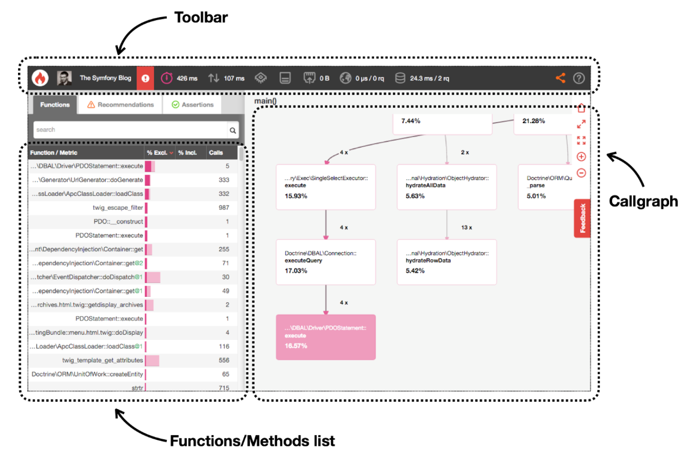

- **Toolbar**: tóm lược thông tin chính (compare profile, chọn metric hiển thị).
- **Call Graph**: sơ đồ các function được thực thi, mỗi node là 1 function.
- **Functions/Methods list**: danh sách đầy đủ function kèm exclusive/inclusive time, số lần gọi.

### Hot Paths
Phần hoạt động nhiều nhất trong profile — thường tiêu thụ nhiều tài nguyên nhất. Blackfire bôi **đỏ** (càng đậm càng quan trọng).

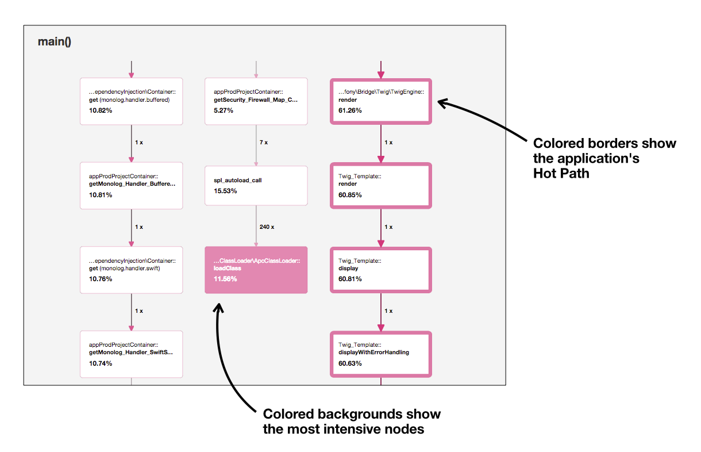

Đôi khi hot path là bình thường (logic phức tạp, nhiều vòng lặp, save/load nhiều model). Nhưng đa số hot path = hiệu suất kém → **luôn kiểm tra hot path trước**.

Sau đó xem **Functions/Methods list**:
- **Exclusive time**: thời gian chạy function, *không* tính function con.
- **Inclusive time**: thời gian chạy function, *có* tính function con.
- Nhìn tỷ lệ exclusive/inclusive → tìm function hoạt động không hiệu quả.

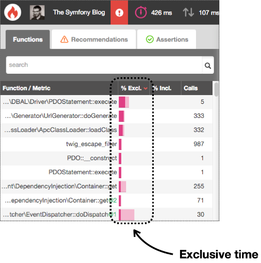

### Phát hiện function trục trặc
Cột **Calls** (số lần function được gọi) giúp phát hiện code chạy nhiều hơn cần thiết (save/load model trong vòng lặp, khởi tạo class nặng không cần...).

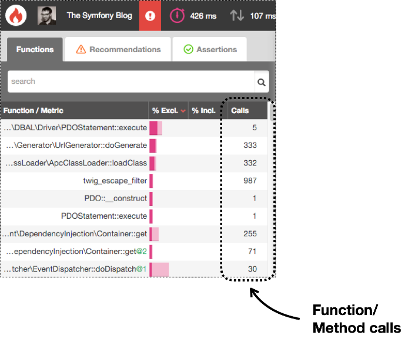

## 4. Phân tích Timelines

Blackfire lọc hàm không quan trọng, tự nhận diện thư viện PHP và hiển thị dưới dạng metrics cột trái. Click metric để filter hàm liên quan; hover "call bar" xem tài nguyên tiêu thụ + đối số function.

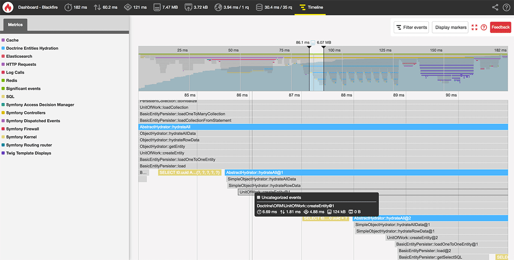

"Memory usage" hiển thị bằng đồ thị xanh — tăng đột ngột gợi ý function tiêu thụ nhiều tài nguyên.

### Markers
Đánh dấu điểm dừng rõ ràng trong code:
```php
\BlackfireProbe::addMarker(string $markerName);
```

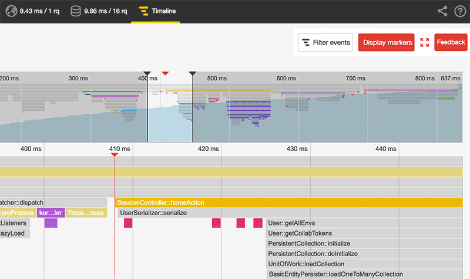

→ dùng marker để debug và theo dõi thứ tự function được gọi trong profile.
