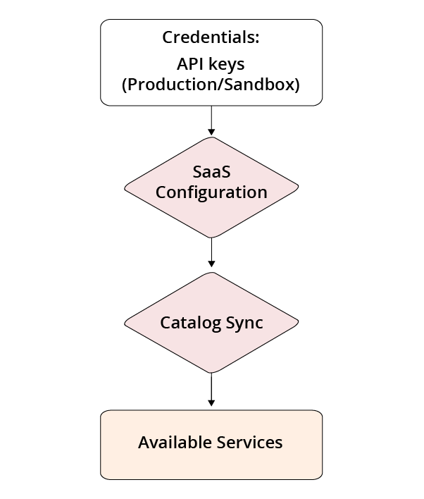
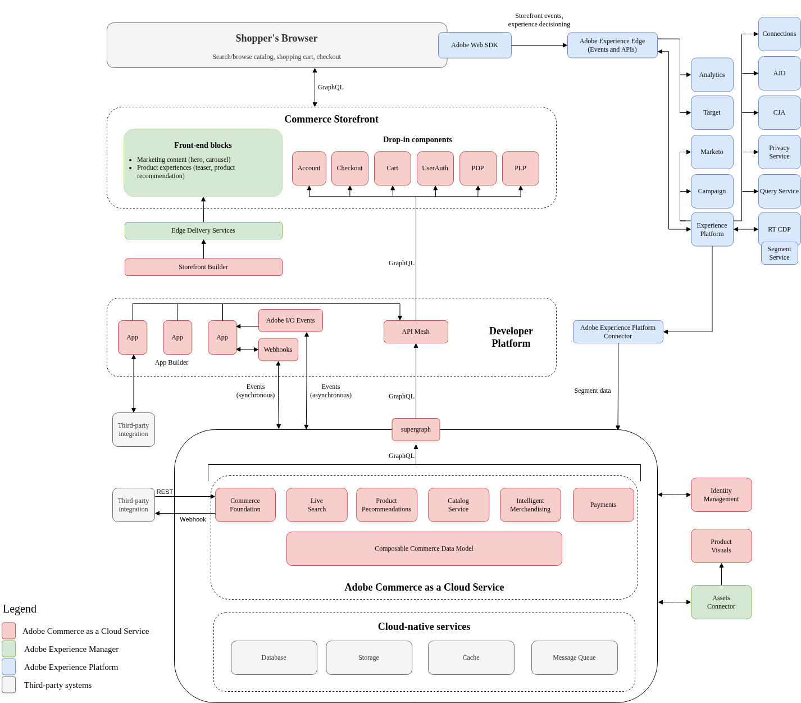
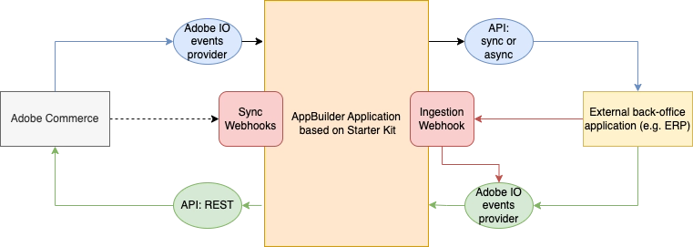
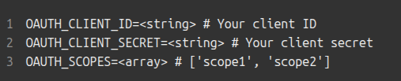

<a id="_35bxo6u5nbrw"></a>

# MỤC LỤC

[**I. Giới thiệu chung về SaaS trong Magento 2**](#_sykmpxwvji72)

[**II. Commerce Services Connector Architecture**](#_llvczlv0xacx)

[*II.1 Credentials*](#_p06lrzgcf1jy)

[*II.2 SaaS Configuration*](#_3l94p42pvdc)

[*II.3 Catalog Sync*](#_hj8y1isve13f)

[*II.4 Available Service:*](#_8a1pbogssevh)

[**III. Adobe Commerce as a Cloud Service**](#_fcomzae2qbmh)

[*III.1 Tổng quan:*](#_uv9xtrmvmiku)

[*III.2 Architecture:*](#_am9zkpsj2hg)

[*III.2.1 Commerce Storefront (Frontend Layer):*](#_dnccvt6rakc)

[*III.2.2 Merchandising Services (Business Services)*](#_21ch6j2p87x0)

[*III.2.3 Product Visuals powered by AEM Assets*](#_mzvjwgqh0p5g)

[*III.2.4 Developer Platform (Extensibility Layer)*](#_u5xd0798d6w5)

[*III.2.5 Commerce Foundation*](#_mkgwf3w90wjh)

[**IV. Feature Comparison**](#_wxk9iyohjpxn)

[*IV.1 Tổng quan SaaS vs PaaS*](#_y1vyal6y08i8)

[*IV.2 Mapping feature*](#_6avr75oqjqz0)

[*IV.3 Extensibility*](#_2dx2p2ctghbc)

[*IV.4 Data & Storage*](#_rojmk4y3usdi)

[*IV.5 Kiến trúc tổng thể*](#_asdgpu2y5aiz)

[*IV.6 Lựa chọn SaaS vs PaaS*](#_dv3kxrcxeyd8)

[**V. Install Adobe Commerce integration starter kit**](#_qnfutyqcxtru)

[V.1 Big Picture Architecture](#_fbku7whyie6q)

[V.2 Prerequisites](#_yjpdmwhz0jah)

[V.3 Create integration (step-by-step)](#_sctxd2x8vjwr)

[V.4 Starter Kit Setup](#_1ne6pk7qax9k)

[V.5 Ưu / Nhược điểm](#_wd3dwv1tp0po)

<a id="_sykmpxwvji72"></a>

# I. Giới thiệu chung về SaaS trong Magento 2

SaaS (Software as a Service) trong Magento 2 là mô hình cung cấp các dịch vụ mở rộng do Adobe vận hành, giúp Magento Commerce tích hợp các tính năng nâng cao mà không cần tự triển khai hạ tầng phức tạp. Các dịch vụ này hoạt động độc lập với core Magento nhưng kết nối chặt chẽ thông qua API và cơ chế đồng bộ dữ liệu.

**Các khái niệm chính:**

- SaaS Service: Dịch vụ chạy trên hạ tầng Adobe Cloud
- API-based Integration: Giao tiếp qua REST/GraphQL
- Data Sync: Đồng bộ dữ liệu catalog, order, customer
- API Key & Token: Xác thực giữa Magento và SaaS
- Multi-tenant: Một dịch vụ phục vụ nhiều merchant

<a id="_llvczlv0xacx"></a>

# II. Commerce Services Connector Architecture

Credentials -> SaaS Configuration -> Catalog Sync -> Available Services:



<a id="_p06lrzgcf1jy"></a>

## II.1 Credentials

Khái niệm & Tính chất:

- API key (production & sandbox) được tạo từ Commerce account của license owner, xác định bằng Commerce ID (MageID).
- License owner có quyền tạo API key cho các dịch vụ như Product Recommendations hoặc Live Search, miễn là tài khoản còn hiệu lực.
- API key có thể chia sẻ cho SI/dev team theo nguyên tắc “need-to-know” để quản lý project và môi trường.
- Developer chỉ có Shared Access không thể tự tạo API key

Generate API key:

- Login Commerce account tại <https://account.magento.com/>
- Ở tab API Portal, chọn Production hoặc Sanbox, điền API key name sau đó chọn “Add new”: [2026-02-03\_14-32.png](https://drive.google.com/file/d/1Dpp_0fWxBsy06R4hytXw_-zwY8qI1RUz/view)
- Confirm và copy/download private key để lưu lại: [2026-02-03\_14-35.png](https://drive.google.com/file/d/19Oj71YnDpIYRMTI_s16VkqMV1J7f5hGz/view)

<a id="_3l94p42pvdc"></a>

## II.2 SaaS Configuration

SaaS configuration là bước khai báo SaaS project và SaaS data space trong Adobe Commerce để đảm bảo dữ liệu từ store được gửi đến đúng nơi trên Adobe SaaS backend.

- space SaaS Project:
  - Là group các data space trong Adobe Commerce Services.
  - Adobe Commerce instance phải được link tới một SaaS project để biết dữ liệu của instance sẽ đi vào đâu.
  - Mỗi project có thể chứa 1 production data space + 2 test data spaces.
- SaaS space:
  - Là nơi lưu catalog data + user behavioral data
  - Dữ liệu trong data space được các dịch vụ như Live Search hoặc Product Recommendations sử dụng để phục vụ API trả về kết quả.

<a id="_hj8y1isve13f"></a>

## II.3 Catalog Sync

Sync data từ Adobe Commerce sang Commerce Services (SaaS) để các dịch vụ như Live Search, Product Recommendations, Catalog Service hoạt động chính xác

Các loại sync data:

- Full sync:
  - Chạy khi lần đầu connect SaaS services hoặc khi thay đổi data space.
  - Sync toàn bộ catalog từ Adobe Commerce sang Commerce Service
  - Có thể mất thời gian với catalog lớn -> chỉ nên dùng cho lần đầu
  - Command: `bin/magento saas:resync`
- Partial Sync
  - Sync theo thay đổi nhỏ (ví dụ: tên sản phẩm, giá, trạng thái).
  - Thực hiện tự động dựa trên cron, không cần thao tác thủ công.
  - Giảm tải, cập nhật nhanh data mới với tần suất cao.
- Retry Failed
  - Gửi lại các mục sync bị lỗi trước đó (do lỗi mạng hoặc xử lý)
  - Thực hiện tự động dựa trên cron

<a id="_8a1pbogssevh"></a>

## II.4 Available Service:

Catalog Service:

- Availability: Adobe Commerce
- Lưu dữ liệu sản phẩm, optimized cho headless & API
- Không còn phụ thuộc MySQL như Magento 2 truyền thống. Phục vụ GraphQL nhanh hơn core Magento
- Phù hợp cho multi-channel, product catalog lớn

Live Search:

- Availability: Adobe Commerce
- Thay thế OpenSearch truyền thống, không cần tự quản lý Elasticsearch/OpenSearch nữa
- AI-powered search
- Tính năng: Autocomplete, Behavioral ranking, Real-time analytics

Product Recommendations:

- Availability: Adobe Commerce
- Recommendation engine dựa trên Adobe Sensei (AI)
- Các loại recommend: Viewed this, viewed that / Similar products / Trending / Frequently bought together
- Hoạt động dạng service độc lập, embed qua API.

Payment Services:

- Availability: Adobe Commerce and Magento Open Source
- Là giải pháp thanh toán đượctích hợp sẵn cho Adobe Commerce / Magento cho phép merchant quản lý payment + order data trong cùng một dashboard của Commerce Admin.

Data Connection:

- Availability: Adobe Commerce
- Là extension trong Adobe Commerce dùng để kết nối dữ liệu Commerce với Adobe Experience Platform (AEP) và Experience Platform Edge Network
- Mục tiêu: thu thập data user behavior, data hệ thống, . . . gửi sang Adobe Experience Platform. Từ đó admin có thể phân tích và tối ưu hóa trải nghiệm user

<a id="_fcomzae2qbmh"></a>

# III. Adobe Commerce as a Cloud Service

<a id="_uv9xtrmvmiku"></a>

## III.1 Tổng quan:

Adobe Commerce as a Cloud Service là phiên bản SaaS commerce platform của Adobe, được xây dựng theo kiến trúc cloud-native + headless + composable commerce.

Mục tiêu của nền tảng này:

- Auto scale theo traffic, order, catalog
- Headless architecture
- Composable services ( microservices )
- Continuous upgrade ( không cần upgrade thủ công )

Nó cho phép doanh nghiệp triển khai và mở rộng hệ thống thương mại điện tử nhanh mà không phải quản lý infrastructure

<a id="_am9zkpsj2hg"></a>

## III.2 Architecture:



<a id="_dnccvt6rakc"></a>

### III.2.1 Commerce Storefront (Frontend Layer):

- Commerce Storefront được xây dựng fully headless, frontend tách rời backend, các dữ liệu được truy cập thông qua QraphQL layer.
- Frontend có thể sử dụng đa dạng framework: React, [Next.js](http://next.js), Angular, . . .
- Note: Cloud Serivce ko support Luma storefronts theme

<a id="_21ch6j2p87x0"></a>

### III.2.2 Merchandising Services (Business Services)

Adobe cung cấp nhiều service để hỗ trợ business goals, bao gồm cả APIs.

Chi tiết các service đã có ở [**II.4 Available Service**](#_8a1pbogssevh)

<a id="_mzvjwgqh0p5g"></a>

### III.2.3 Product Visuals powered by AEM Assets

Sử dụng Digital Asset Management (DAM) integrate với Adobe Experience Manage (AEM) để quản lý media content

Product Visuals có sẵn ở Adobe Commerce as a Cloud Service, cung cấp một vài tính năng của AEM assets

Dùng Product Visuals nếu:

- Chỉ cần: product images basic media
- Không có team marketing lớn
- Không cần workflow approval
- Muốn setup nhanh

Dùng AEM Assets nếu:

- Có: nhiều brand / region nhiều channel (web, app, ads)
- Cần: workflow approval asset governance reuse content
- Team marketing lớn

<a id="_u5xd0798d6w5"></a>

### III.2.4 Developer Platform (Extensibility Layer)

Adobe cung cấp ecosystem để extend commerce.

Các công cụ chính:

- App builder: Build và deploy web app extend các function từ Commerce và integrate với third-party
- API Mesh: Combine nhiều API, GraphQL, REST thành 1 GraphQL endpoint
- Event: Dùng event trigger để tương tác với các development tools khác
- Webhooks: Dùng webhooks để triggers tương tác giữa commerce với các 3rd party 1 cách tự động
- Integration Starter Kit: Template để integrate với commerce

<a id="_mkgwf3w90wjh"></a>

### III.2.5 Commerce Foundation

Commerce Foundation là core commerce engine

- Simplified onboarding: Mọi thứ business cần, bao gồm Merchandising Services, headless Commerce instance, App Builder được auto config và tích hợp sẵn
- Seamless upgrades: Không cần manual upgrades features
- Third-party integrations: Có thể dùng GraphQL và REST API để integrate Commerce Foundation với 3rd party

<a id="_wxk9iyohjpxn"></a>

# IV. Feature Comparison

<a id="_y1vyal6y08i8"></a>

## IV.1 Tổng quan SaaS vs PaaS

| Tiêu chí | SaaS (Cloud Service) | PaaS |
| --- | --- | --- |
| Ownership | Adobe control gần như toàn bộ | Merchent control nhiều |
| Customization | Hạn chế (API-based) | Full (PHP Core) |
| Upgrade | Auto | Manual |
| Architecture | Multi-tenant | Single-tenant |

Summary:

- SaaS: Ít control, scale tốt, ít maintain
- PaaS: Full controll, phải tự manage

<a id="_6avr75oqjqz0"></a>

## IV.2 Mapping feature

SaaS không remove feature, mà chỉ replace bằng service riêng

| PaaS | SaaS |
| --- | --- |
| Media Gallery | Product Visuals |
| CMS/Page Builder | Storefront Builder |
| Visual Merchandiser | Catalog Service |
| Payment modules | Payment Services |
| B2B module | Built-in |

<a id="_2dx2p2ctghbc"></a>

## IV.3 Extensibility

- Model extensibility: SaaS không customize logic core được, chỉ extend và customize thông qua API
- Data Model: SaaS bị giới hạn khi customize database, chỉ custom được các attribute, không custom được entity. SaaS chỉ extend, không modify

<a id="_rojmk4y3usdi"></a>

## IV.4 Data & Storage

| Feature | PaaS | SaaS |
| --- | --- | --- |
| DB access | Full | Không access DB |
| File Storage | Full | Limited |
| Queue/Cache | Full | Không access |
| Search | Native | 3rd-party |

=> Critical limitation của SaaS: không access được DB, không custom storage nên khó với 1 số case nặng về data logic, custom tables

<a id="_asdgpu2y5aiz"></a>

## IV.5 Kiến trúc tổng thể

**PaaS**

```text
Magento (PHP monolith)
├── DB
├── Modules (custom)
├── Theme
└── Extensions
```

**SaaS**

```text
Storefront (Headless)
↓
API Layer (GraphQL / API Mesh)
↓
SaaS Services
├── Catalog Service
├── Payment Service
├── Product Visuals
└── App Builder (custom logic)
```

<a id="_dv3kxrcxeyd8"></a>

## IV.6 Lựa chọn SaaS vs PaaS

Chọn SaaS khi:

- Muốn scale lớn (enterprise)
- Không muốn maintain infra
- Có thể chấp nhận:
  - API-first
  - Hạn chế custom

Chọn PaaS khi:

- Cần customize sâu (Magento style)
- Có nhiều business logic phức tạp
- Cần:
  - custom DB
  - custom checkout
  - override core

<a id="_qnfutyqcxtru"></a>

# V. Install Adobe Commerce integration starter kit

<a id="_fbku7whyie6q"></a>

## V.1 Big Picture Architecture



- Adobe Commerce: Source dữ liệu, emit event
- App Builder: Xử lý logic integration, mapping data
- Adobe IO events: Event bus (pub/sub), kết nối commerce <-> App Builder
- Back-office systems (ERP/CRM/OMS): Nhận, sync data

<a id="_yjpdmwhz0jah"></a>

## V.2 Prerequisites

Cần có:

- Adobe Developer Console account với quyền System Admin hoặc Developer Role
- Access App Builder
- Adobe Commerce instance

<a id="_sctxd2x8vjwr"></a>

## V.3 Create integration (step-by-step)

- Tạo project trên Adobe Developer Console
  - Tạo project từ template (App Builder)
  - Tạo workspace (Stage/custom)
  - Thêm service: I/O events, I/O Management API, . . .
- Authentication
  - Recommended dùng OAuth Server-to-Server
  - JWT (deprecated - dealine 2025)

-> Project cũ dùng JWT thì cần migrate

- Download workspace config: Export JSON config từ Console, dùng để config Commerce Admin
- PaaS integration:
  - Admin path: System > Extensions > Integrations
  - Điền thông tin, generate consumer\_key, consumer\_secret, access\_token, access\_token\_secret
- SaaS integration:
  - Dùng OAuth Server-to-Server
  - Config thông qua .env:



<a id="_1ne6pk7qax9k"></a>

## V.4 Starter Kit Setup

- Clone repo: `git clone git@github.com:adobe/commerce-integration-starter-kit.git`
- Setup env: `cd <download-directory> && cp env.dist .env` -> sửa lại value ở env
- Install:
  - Install npm dependencies: `npm install`
  - Connect Starter Kit với App Builder:

    ```bash
    aio login
    aio console org select
    aio console project select
    aio console workspace select
    ```

  - Sync data: `aio app use --merge`
- File `app.config.yaml`: define các packages -> có thể disable các packages không cần đến
- Deploy project: `aio app deploy`

<a id="_wd3dwv1tp0po"></a>

## V.5 Ưu / Nhược điểm

- Ưu điểm:
  - Chuẩn hóa integration
  - Event drivent real-time
  - Scaleable (serverless)
  - Tách biệt core Magento
- Nhược điểm:
  - Phụ thuộc App Builder
  - Debug khó hơn
- Nên dùng khi:
  - integrate ERP/OMS/CRM lớn
  - Cần real-time sync
  - Project định hướng SaaS/headless
- Không nên dùng khi: Integration đơn giản, project nhỏ
