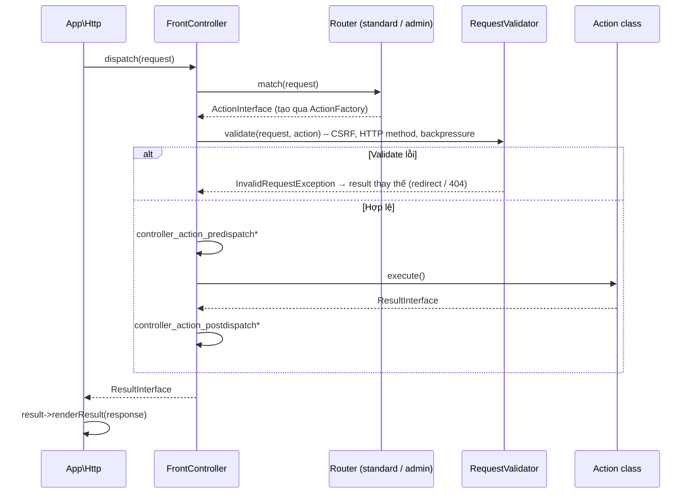

# Controller

> **Techstack:** Magento 2.4.x (Adobe Commerce / Magento Open Source). Đối chiếu source 2.4.8-p5.

Trong Magento, "controller" có hai tầng:

- **Front controller**: mỗi area có đúng một class implement `Magento\Framework\App\FrontControllerInterface::dispatch()`, được chọn qua `preference` trong `di.xml` của area.
- **Action controller** (Action class): class implement `Magento\Framework\App\ActionInterface`, chứa logic xử lý một URL cụ thể. Chỉ area `frontend` và `adminhtml` dùng loại này.

Bài này tập trung vào **action controller**, theo [Routing – Action class](https://developer.adobe.com/commerce/php/development/components/routing#action-class) của Adobe. Vòng lặp router trong `FrontController` xem [Routing trong Magento Commerce](../Routing%20trong%20Magento%20Commerce.md). Chi tiết xử lý của front controller REST xem [REST](REST.md).

## 1. Front controller theo area

| Area | Front controller | Preference | Xử lý tiếp bởi |
|---|---|---|---|
| `frontend`, `adminhtml` | `Magento\Framework\App\FrontController` | `app/etc/di.xml` (global) | Router → **Action class** |
| `webapi_rest` | `Magento\Webapi\Controller\Rest` | `Magento/Webapi/etc/webapi_rest/di.xml` | `RequestProcessorPool` → service contract khai báo trong `webapi.xml` |
| `webapi_soap` | `Magento\Webapi\Controller\Soap` | `Magento/Webapi/etc/webapi_soap/di.xml` | Service contract khai báo trong `webapi.xml` |
| `graphql` | `Magento\GraphQl\Controller\GraphQl` | `Magento/GraphQl/etc/graphql/di.xml` | Resolver khai báo trong `schema.graphqls` |

> [!NOTE]
> Web API (REST, SOAP, GraphQL) **không** dùng `routes.xml` và Action class. Muốn thêm endpoint thì khai báo service contract trong `webapi.xml` (xem [REST](REST.md)) hoặc resolver trong schema GraphQL (xem [Graphql](Graphql.md)).



*Hình 1: Action class trong luồng `App\Http::launch()` → `FrontController::dispatch()` → `processRequest()` (frontend/adminhtml)*

## 2. Khai báo route – `routes.xml`

`routes.xml` map một `frontName` (segment đầu tiên sau base URL) tới module chứa controller. Vị trí file quyết định area:

- `etc/frontend/routes.xml`: router `standard` (storefront)
- `etc/adminhtml/routes.xml`: router `admin`

```xml
<!-- Magento/LoginAsCustomerFrontendUi/etc/frontend/routes.xml -->
<config xmlns:xsi="http://www.w3.org/2001/XMLSchema-instance" xsi:noNamespaceSchemaLocation="urn:magento:framework:App/etc/routes.xsd">
    <router id="standard">
        <route id="loginascustomer" frontName="loginascustomer">
            <module name="Magento_LoginAsCustomerFrontendUi"/>
        </route>
    </router>
</config>
```

- `router id`: router xử lý route (`standard` cho storefront, `admin` cho admin).
- `route id`: id duy nhất của route. Đây cũng là phần đầu của tên layout handle: `<routeId>_<controller>_<action>.xml`.
- `frontName`: segment đầu tiên của URL.
- `module`: module chứa thư mục `Controller`.

**Before / after:** thêm module vào một route có sẵn để override hoặc mở rộng controller. Router tìm Action class trong module `before` trước:

```xml
<!-- Magento/Cms/etc/adminhtml/routes.xml -->
<router id="admin">
    <route id="cms" frontName="cms">
        <module name="Magento_Cms" before="Magento_Backend" />
    </route>
</router>
```

## 3. URL → Action class

URL storefront có dạng `/<frontName>/<controller path>/<action>`. Thiếu segment nào thì dùng giá trị mặc định `index` (`Magento\Framework\App\DefaultPath\DefaultPath` trong `app/etc/di.xml`).

`Magento\Framework\App\Router\ActionList::get()` ghép tên class theo quy tắc:

```text
<Vendor>\<Module>\Controller\[Adminhtml\]<ControllerPath>\<Action>
```

| URL | Action class |
|---|---|
| `/loginascustomer/login/index` | `Magento\LoginAsCustomerFrontendUi\Controller\Login\Index` |
| `/admin/cms/page/index` | `Magento\Cms\Controller\Adminhtml\Page\Index` |
| `/admin/cms/page/new` | `Magento\Cms\Controller\Adminhtml\Page\NewAction` |

> [!NOTE]
> Nếu tên action là từ khoá PHP (`new`, `list`, `default`, `print`…, xem `ActionList::$reservedWords`), Magento tự thêm hậu tố `Action`. Vì vậy URL `.../new` map tới class `NewAction`.

## 4. Action class

Mọi Action class implement `Magento\Framework\App\ActionInterface` với một method duy nhất là `execute()`. Ngoài ra nên implement một hoặc nhiều **marker interface** `Http<Method>ActionInterface` để khai báo HTTP method mà action chấp nhận:

- `HttpGetActionInterface` (nhận cả HEAD vì `HttpMethodMap` trong `app/etc/di.xml` map `HEAD` → `HttpGetActionInterface`; implement riêng `HttpHeadActionInterface` thì **không** nhận HEAD)
- `HttpPostActionInterface`
- `HttpPutActionInterface`
- `HttpDeleteActionInterface`

Source 2.4.8-p5 còn có `HttpPatchActionInterface`, `HttpOptionsActionInterface`, `HttpConnectActionInterface`, `HttpPropfindActionInterface` và `HttpTraceActionInterface` trong `Magento\Framework\App\Action\`.

> [!WARNING]
> `Magento\Framework\App\Action\Action` và `AbstractAction` đã bị đánh dấu `@deprecated 103.0.0 Inheritance in controllers should be avoided in favor of composition`. Controller storefront mới nên implement interface trực tiếp và inject dependency qua constructor. Ngoại lệ là controller admin, vẫn phải extend `Magento\Backend\App\Action` (xem mục 6).

**Ví dụ** (frontend, composition):

```php
<?php
declare(strict_types=1);

namespace Vendor\Module\Controller\Index;

use Magento\Framework\App\Action\HttpGetActionInterface;
use Magento\Framework\Controller\ResultFactory;
use Magento\Framework\Controller\ResultInterface;

class Index implements HttpGetActionInterface
{
    public function __construct(
        private readonly ResultFactory $resultFactory
    ) {
    }

    public function execute(): ResultInterface
    {
        $page = $this->resultFactory->create(ResultFactory::TYPE_PAGE);
        $page->getConfig()->getTitle()->set(__('My page'));

        return $page;
    }
}
```

Core cũng viết theo kiểu này, ví dụ `Magento\LoginAsCustomerFrontendUi\Controller\Login\Index`: class implement `HttpGetActionInterface`, inject `ResultFactory` và `RequestInterface`.

Muốn chuyển xử lý sang action khác mà không redirect thì trả về `Magento\Framework\Controller\Result\Forward` và gọi `forward('<action>')` (có thể kèm `setModule()` / `setController()`).

## 5. Validate request: HTTP method & CSRF

Trước khi gọi action, `FrontController::processRequest()` gọi `Magento\Framework\App\Request\ValidatorInterface::validate($request, $action)` một lần. Interface này có preference là virtualType `RequestValidator` (`CompositeValidator`) trong `app/etc/di.xml`, gồm 3 validator:

| Validator | Kiểm tra | Khi lỗi |
|---|---|---|
| `csrf_validator` → virtualType `CsrfRequestValidator` = `CsrfValidator` (admin: `Magento\Backend\App\Request\BackendValidator`) | Form key cho request POST | Frontend: redirect 302 về referer kèm message "Invalid Form Key. Please refresh the page." Admin: xem mục 6 |
| `http_method_validator` → `HttpMethodValidator` | HTTP method có khớp marker interface không (map trong `HttpMethodMap`) | `InvalidRequestException(NotFoundException)` → 404 |
| `backpressure` → `BackpressureValidator` | Rate limit (frontend / adminhtml) | Throw `LocalizedException('Too Many Requests')` |

**HTTP method:** nếu action **không** implement marker interface nào thì mọi method đều qua (cách cũ). Nếu action có implement thì method phải khớp, không khớp thì trả 404.

**CSRF** (`CsrfValidator::validateRequest()`): code chỉ chạy ở area `frontend` / `adminhtml`, nhưng ở `adminhtml` virtualType `CsrfRequestValidator` bị thay bằng `BackendValidator` (`Magento/Backend/etc/adminhtml/di.xml`). Vì vậy logic dưới đây thực tế chỉ áp dụng cho **storefront**. Request được coi là hợp lệ khi:

- không phải POST, **hoặc**
- là AJAX (`X-Requested-With: XMLHttpRequest`), **hoặc**
- có `form_key` hợp lệ.

Form key được `lib/web/mage/common.js` tự thêm vào form. Phía backend có thể lấy qua `Magento\Framework\Data\Form\FormKey`.

> [!WARNING]
> Trang [CSRF](https://developer.adobe.com/commerce/php/development/security/cross-site-request-forgery) của Adobe viết CSRF protection "active for controllers that expect any HTTP method other than GET". Trong source 2.4.8-p5, `CsrfValidator` (storefront) mặc định chỉ kiểm form key với **POST không phải AJAX**. PUT/DELETE và AJAX POST không bị kiểm, nên action loại này phải tự bảo vệ nếu thay đổi dữ liệu. Admin thì khác: AJAX POST vẫn phải có form key (xem mục 6).

**Tuỳ chỉnh CSRF:** implement `Magento\Framework\App\CsrfAwareActionInterface`, ví dụ với webhook nhận request từ hệ thống khác:

- `validateForCsrf(RequestInterface $request): ?bool`: `true` cho qua, `false` từ chối, `null` dùng logic mặc định.
- `createCsrfValidationException(RequestInterface $request): ?InvalidRequestException`: tuỳ chỉnh response khi fail.

Ví dụ core: `Magento\Customer\Controller\Account\LoginPost`. `validateForCsrf()` trả `null` để giữ logic mặc định, còn `createCsrfValidationException()` redirect về `*/*/` thay vì về referer.

## 6. Admin controller & ACL

Theo [Authorization](https://developer.adobe.com/commerce/php/development/security/authorization) của Adobe:

- Controller storefront đặt trong `<Vendor>\<Module>\Controller\**`.
- Controller admin đặt trong `<Vendor>\<Module>\Controller\Adminhtml\**`, **extend `Magento\Backend\App\Action`** và override hằng `ADMIN_RESOURCE` bằng ACL resource.

```php
// Magento\Cms\Controller\Adminhtml\Page\Index
class Index extends \Magento\Backend\App\Action implements HttpGetActionInterface
{
    const ADMIN_RESOURCE = 'Magento_Cms::page';
    // ...
}
```

`Magento\Backend\App\AbstractAction`:

- `ADMIN_RESOURCE` mặc định là `Magento_Backend::admin`.
- `_isAllowed()` gọi `$this->_authorization->isAllowed(static::ADMIN_RESOURCE)`.
- `dispatch()`: nếu không có quyền thì set status **403**. Chưa login thì redirect `*/auth/login`, đã login thì render layout `adminhtml_denied`.
- CSRF ở admin do `BackendValidator` xử lý. Với action extend `AbstractAction`, nó gọi `$action->_processUrlKeys()`: khi admin đã login thì request **POST** (kể cả AJAX) phải có form key hợp lệ, còn request **không phải POST** phải có secret key trong URL (nếu bật *Add Secret Key to URLs*). Lỗi thì set `FLAG_NO_DISPATCH`, redirect về startup page của admin, hoặc trả JSON `{"error": true, "message": ...}` nếu URL có param `isAjax` / `ajax`.
- Action admin **không** extend `AbstractAction` thì `BackendValidator` dùng logic dự phòng tương tự. Lỗi thì AJAX nhận 401 body rỗng, request thường bị redirect về startup page kèm message "Invalid security or form key. Please refresh the page."

Với page storefront dành cho customer đã đăng nhập, Adobe khuyến nghị tự kiểm qua `Magento\Authorization\Model\UserContextInterface` (`getUserType()` / `getUserId()`) và throw `AuthorizationException` nếu chưa đăng nhập.

## 7. Result object

Action class nên trả về một result object (`Magento\Framework\Controller\ResultInterface`), tạo qua `Magento\Framework\Controller\ResultFactory::create($type)` hoặc factory riêng (`JsonFactory`, `RedirectFactory`, `ForwardFactory`, `PageFactory`…).

| Hằng `ResultFactory` | Mô tả (theo Adobe) |
|---|---|
| `TYPE_JSON` (`json`) | Set `Content-Type: application/json` và trả JSON encode của mảng dữ liệu |
| `TYPE_RAW` (`raw`) | Trả dữ liệu nguyên như đã set, không set `Content-Type` |
| `TYPE_REDIRECT` (`redirect`) | Redirect ra ngoài, browser gửi request mới |
| `TYPE_FORWARD` (`forward`) | Gọi `execute()` của action khác ngay trong request hiện tại, URL không đổi |
| `TYPE_LAYOUT` (`layout`) | Render layout chung thành response body |
| `TYPE_PAGE` (`page`) | Như `layout` nhưng kèm page type, page config và layout handle, render ra HTML |

## 8. Event quanh action

`FrontController` dispatch các event sau với tham số `controller_action` và `request`:

| Thời điểm | Event (theo thứ tự) |
|---|---|
| Trước `execute()` | `controller_action_predispatch` → `controller_action_predispatch_<routeName>` → `controller_action_predispatch_<fullActionName>` |
| Sau `execute()` | `controller_action_postdispatch_<fullActionName>` → `controller_action_postdispatch_<routeName>` → `controller_action_postdispatch` |

`fullActionName` có dạng `<routeId>_<controller>_<action>`, ví dụ `cms_page_index`. Observer có thể chặn action bằng cách set flag `ActionInterface::FLAG_NO_DISPATCH`, hoặc bỏ postdispatch bằng `FLAG_NO_POST_DISPATCH`.

## Tham khảo

**Tài liệu chính thức**

- [Routing](https://developer.adobe.com/commerce/php/development/components/routing): `routes.xml`, Action class, Result object
- [Cross-site request forgery (CSRF)](https://developer.adobe.com/commerce/php/development/security/cross-site-request-forgery)
- [Authorization](https://developer.adobe.com/commerce/php/development/security/authorization): admin controller, `ADMIN_RESOURCE`
- [Technical Guidelines](https://developer.adobe.com/commerce/php/coding-standards/technical-guidelines)

**Source code**

- [`Magento\Framework\App\FrontController`](https://github.com/magento/magento2/blob/2.4-develop/lib/internal/Magento/Framework/App/FrontController.php)
- [`Magento\Framework\App\ActionInterface`](https://github.com/magento/magento2/blob/2.4-develop/lib/internal/Magento/Framework/App/ActionInterface.php)
- [`Magento\Framework\App\Router\ActionList`](https://github.com/magento/magento2/blob/2.4-develop/lib/internal/Magento/Framework/App/Router/ActionList.php)
- [`Magento\Framework\App\Request\CsrfValidator`](https://github.com/magento/magento2/blob/2.4-develop/lib/internal/Magento/Framework/App/Request/CsrfValidator.php)
- [`Magento\Framework\App\Request\HttpMethodValidator`](https://github.com/magento/magento2/blob/2.4-develop/lib/internal/Magento/Framework/App/Request/HttpMethodValidator.php)
- [`Magento\Framework\Controller\ResultFactory`](https://github.com/magento/magento2/blob/2.4-develop/lib/internal/Magento/Framework/Controller/ResultFactory.php)
- [`Magento\Backend\App\AbstractAction`](https://github.com/magento/magento2/blob/2.4-develop/app/code/Magento/Backend/App/AbstractAction.php)

**Bài liên quan trong Knowledge Base**

- [Routing trong Magento Commerce](../Routing%20trong%20Magento%20Commerce.md)
- [REST](REST.md)
- [Graphql](Graphql.md)
- [HTTP & Exception](HTTP%20%26%20Exception.md)
