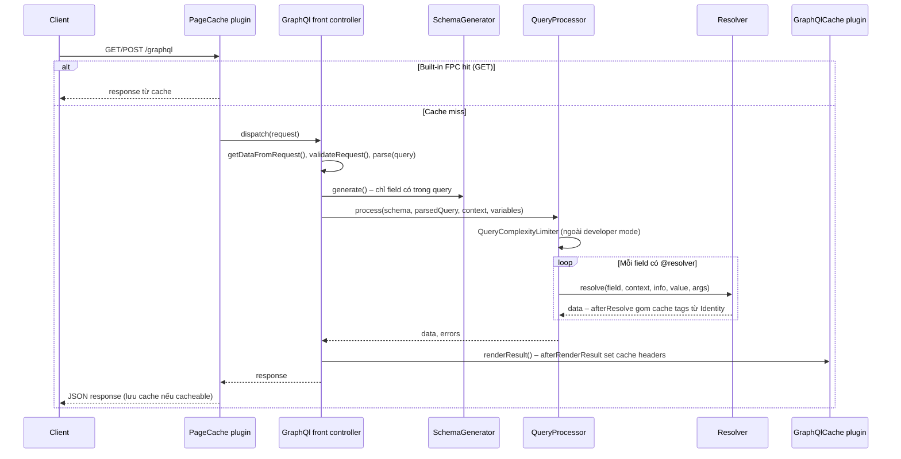
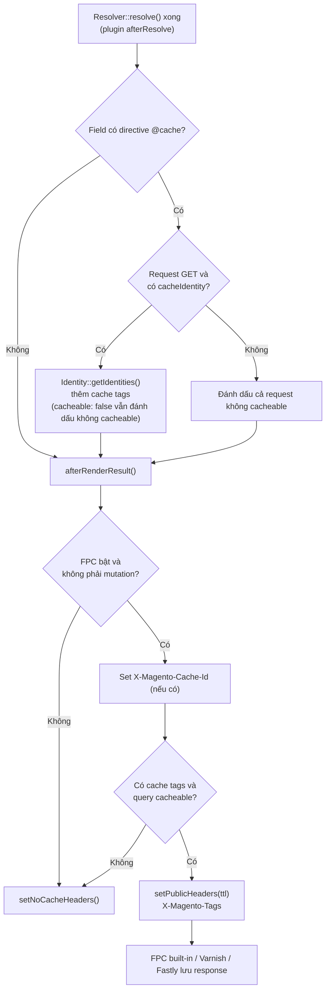

# GraphQL trong Magento 2

> **Techstack:** Magento 2.4.x (Adobe Commerce / Magento Open Source)

> [!NOTE]
> Flow của REST front controller (`Magento\Webapi\Controller\Rest`, `RequestProcessorPool`, sync/async processor) được trình bày ở [Controller](Controller.md) và [REST](REST.md). Bài này chỉ tập trung vào GraphQL.

## 1. Tổng quan

GraphQL là query language cho API: client chỉ định **chính xác các field cần lấy**, server trả về đúng cấu trúc đó trong một request. Magento dùng GraphQL làm API chính cho headless / PWA Studio / storefront hiện đại.

So với REST trong Magento:

| Tiêu chí | REST | GraphQL |
|---|---|---|
| Endpoint | Nhiều URL (`/rest/V1/...`) | Một endpoint `/graphql` |
| Khai báo | `webapi.xml` → service contract | `etc/schema.graphqls` → resolver |
| Area | `webapi_rest` | `graphql` |
| Over/under-fetching | Trả về cả DTO | Client chọn field |
| Cache | Không cache FPC | Query GET có thể cache bằng FPC/Varnish/Fastly |
| Đối tượng chính | Admin/integration | Storefront (guest/customer) |

## 2. Thành phần chính

| Thành phần | Vai trò |
|---|---|
| `Magento_GraphQl` | Module nền: front controller, context, schema generator |
| `Magento\Framework\GraphQl` | Lib: schema config reader, resolver interfaces, exceptions, query processor (dựa trên `webonyx/graphql-php`) |
| `*GraphQl` modules | `CatalogGraphQl`, `CustomerGraphQl`, `QuoteGraphQl`… – mỗi module nghiệp vụ có module GraphQl riêng |
| `etc/schema.graphqls` | Khai báo type, query, mutation, input, interface, directive |
| `etc/graphql/di.xml` | DI chỉ áp dụng cho area `graphql` |

### 2.1. Front controller flow – `Magento\GraphQl\Controller\GraphQl::dispatch()`

**Source:** `Magento\GraphQl\Controller\GraphQl::dispatch()` (rút gọn)

```php
$this->areaList->getArea(Area::AREA_GRAPHQL)->load(Area::PART_TRANSLATE);
$data  = $this->getDataFromRequest($request);          // GET: query string, POST: JSON body
$query = $data['query'] ?? '';
$this->requestProcessor->validateRequest($request);     // validate header/content-type...
if ($request->isGet() || $request->isPost()) {
    $parsedQuery = $this->queryParser->parse($query);
    $this->queryFields->setQuery($parsedQuery, $data['variables'] ?? null);
    $schema = $this->schemaGenerator->generate();       // chỉ build các field có trong query
    $result = $this->queryProcessor->process(
        $schema,
        $parsedQuery,
        $this->contextFactory->create(),                // ContextInterface dùng chung cho mọi resolver
        $data['variables'] ?? []
    );
}
// exception -> handleGraphQlException(); render JSON {data, errors}
```

1. URL `/graphql` được map sang area `graphql` qua `frontName` khai báo cho `Magento\Framework\App\AreaList` trong `Magento/GraphQl/etc/di.xml`, không qua router hay `routes.xml`. Trong area này, `FrontControllerInterface` có preference là `Magento\GraphQl\Controller\GraphQl` (xem [Magento Area](../Magento%20Area%20%26%20Nh%E1%BB%AFng%20g%C3%AC%20Magento%20x%E1%BB%AD%20l%C3%BD%20trong%20m%E1%BB%97i%20area.md)).
2. Schema từ tất cả `schema.graphqls` được merge và cache trong Configuration cache.
3. `QueryProcessor` validate (giới hạn depth/complexity – chỉ áp dụng khi không ở developer mode) rồi execute; mỗi field có `@resolver` gọi tới class PHP tương ứng.
4. Body luôn là JSON (`data` và/hoặc `errors`). HTTP status mặc định 200, nhưng là 400 khi lỗi cú pháp hoặc lỗi input lúc parse, 401/403 khi lỗi thuộc category `graphql-authentication` / `graphql-authorization`, và 500 với lỗi khác ném ra trước khi execute.



*Hình 1: Luồng xử lý một request GraphQL từ page cache, front controller, schema tới resolver*

### 2.2. Schema – `schema.graphqls`

**Ví dụ:** khai báo query với resolver và cache identity

```graphql
# app/code/Vendor/Module/etc/schema.graphqls
type Query {
    vendorBrand(id: Int! @doc(description: "Brand ID")): VendorBrand
        @resolver(class: "Vendor\\Module\\Model\\Resolver\\Brand")
        @cache(cacheIdentity: "Vendor\\Module\\Model\\Resolver\\Brand\\Identity")
        @doc(description: "Get brand by ID")
}
```

Directive hay dùng:

- `@resolver(class: "...")` – class xử lý field.
- `@doc(description: "...")` – mô tả, hiển thị khi introspection.
- `@cache(cacheIdentity: "...")` – query được cache, class Identity trả về cache tags.
- `@cache(cacheable: false)` – đánh dấu field không được cache. Request chứa field này sẽ bị bỏ cache toàn bộ (core dùng cho `cart`, `customer`).
- Mở rộng schema module khác: `extend type ProductInterface { ... }`, `extend type Query { ... }`.

### 2.3. Resolvers

| Interface | Khi nào dùng |
|---|---|
| `Magento\Framework\GraphQl\Query\ResolverInterface` | Mặc định, resolve từng field một |
| `Magento\Framework\GraphQl\Query\Resolver\BatchResolverInterface` | Gom nhiều request của cùng 1 field (VD `related_products` trên list product) để load 1 lần → tránh N+1 |
| `Magento\Framework\GraphQl\Query\Resolver\BatchServiceContractResolverInterface` | Giống batch nhưng ủy quyền cho một batch service contract; resolver chỉ convert request → DTO và kết quả → response |

**Source:** `Magento\Framework\GraphQl\Query\ResolverInterface::resolve()` (chú thích thêm)

```php
public function resolve(
    Field $field,              // Magento\Framework\GraphQl\Config\Element\Field
    $context,                  // ContextInterface
    ResolveInfo $info,         // Magento\Framework\GraphQl\Schema\Type\ResolveInfo
    ?array $value = null,      // dữ liệu của parent field
    ?array $args = null        // arguments của field
);
```

Trả về `array` / scalar, hoặc `Magento\Framework\GraphQl\Query\Resolver\Value` (deferred value, dùng với `ValueFactory`).

### 2.4. Context & context extensions

`Magento\GraphQl\Model\Query\ContextInterface` (extends `Magento\Framework\GraphQl\Query\Resolver\ContextInterface`) – **một instance dùng chung cho mọi resolver** trong request:

- `getUserId(): ?int`, `getUserType(): ?int` (customer, guest, admin, integration – hằng số trong `Magento\Authorization\Model\UserContextInterface`).
- `getExtensionAttributes()` – dữ liệu do các module bổ sung, VD `CustomerGraphQl` thêm `is_customer`, `customer_group_id`; `StoreGraphQl` thêm `store`.

Thêm dữ liệu vào context:

1. Khai báo `extension_attributes.xml` cho `Magento\GraphQl\Model\Query\ContextInterface`.
2. Tạo class implement `Magento\GraphQl\Model\Query\ContextParametersProcessorInterface::execute(ContextParametersInterface $params)` và gọi `$params->addExtensionAttribute('code', $value)`.
3. Đăng ký vào argument `contextParametersProcessors` của `Magento\GraphQl\Model\Query\ContextFactory` trong `etc/graphql/di.xml`.

### 2.5. Authentication

- Customer: mutation `generateCustomerToken(email, password)` → token; gửi kèm header `Authorization: Bearer <token>`. Revoke bằng `revokeCustomerToken`.
- Admin / integration token cũng dùng được với header `Authorization: Bearer`.
- Header khác: `Store: <store_code>`, `Content-Currency`, `X-Magento-Cache-Id`.
- Resolver tự kiểm tra quyền: `false === $context->getExtensionAttributes()->getIsCustomer()` → throw `GraphQlAuthorizationException`.

### 2.6. Caching

- Chỉ query gửi bằng **HTTP GET** mới được cache (FPC built-in, Varnish, Fastly). POST và mutation không cache.
- Query có `@cache(cacheIdentity: ...)` → Identity class implement `Magento\Framework\GraphQl\Query\Resolver\IdentityInterface::getIdentities(array $resolvedData): array` trả về cache tags (VD `cat_p_1`). Khi entity save, tag bị clean → cache invalidated.
- Nếu một request chứa bất kỳ query không cacheable nào → bỏ qua cache cho cả request. "Không cacheable" ở đây là field có `@cache` nhưng `cacheable: false` hoặc thiếu `cacheIdentity`; field **không** khai báo `@cache` thì không ảnh hưởng (`Magento\GraphQlCache\Model\CacheableQueryHandler`).
- `X-Magento-Cache-Id` (từ 2.4.4): response header là hash theo context customer (store, currency, customer group, …). Client gửi lại header này để Varnish/Fastly cache cho customer đã login. Chỉ tương thích Varnish/Fastly, không dùng tin cậy với built-in FPC. Thêm factor qua argument `idFactorProviders` trong `di.xml`.
- Ngoài FPC còn có cache type `graphql_query_resolver_result` (xem [Magento Cache](../Magento%20Cache.md)).



*Hình 2: Cách `Magento_GraphQlCache` quyết định response GraphQL có được cache hay không*

### 2.7. Errors

Exception trong `Magento\Framework\GraphQl\Exception` (implement `GraphQL\Error\ClientAware` → message được trả cho client):

| Class | Category |
|---|---|
| `GraphQlInputException` | `graphql-input` |
| `GraphQlNoSuchEntityException` | `graphql-no-such-entity` |
| `GraphQlAuthorizationException` | `graphql-authorization` |
| `GraphQlAuthenticationException` | `graphql-authentication` |
| `GraphQlAlreadyExistsException` | `graphql-already-exists` |

Exception không phải `ClientAware` chỉ hiện chi tiết ở developer mode; production ghi vào `var/log/exception.log` và trả "Internal server error".

Ngoài developer mode, response chỉ chứa lỗi đầu tiên trong mảng `errors` (vì lý do hiệu năng, xem `Magento\Framework\GraphQl\Query\ErrorHandler::handle()`).

### 2.8. Query complexity / depth

`Magento\Framework\GraphQl\Query\QueryComplexityLimiter` có 2 argument cấu hình trong `Magento/GraphQl/etc/di.xml`:

- `queryDepth` – mặc định 20.
- `queryComplexity` – source 2.4.8-p5 set `1000` (`Magento/GraphQl/etc/di.xml`). Trang [Security configuration](https://developer.adobe.com/commerce/webapi/graphql/usage/security-configuration) của Adobe vẫn ghi 300; giá trị 300 chỉ còn trong `Magento/GraphQlServer/etc/adminhtml/di.xml`.

Limiter này còn gắn rule `DisableIntrospection`, bật bằng `'graphql' => ['disable_introspection' => true]` trong `app/etc/env.php` (`Magento\Framework\GraphQl\Query\IntrospectionConfiguration`). Cả depth, complexity và introspection chỉ được kiểm khi **không** ở developer mode (`QueryProcessor::process()` bỏ qua limiter nếu `ExceptionFormatter::shouldShowDetail()` = true).

Ngoài developer mode, `QueryProcessor::process()` còn kiểm độ dài query, số alias và số field (`validateQueryLength` / `validateAliasCount` / `validateFieldCount`) trước khi chạy limiter.

Override bằng `di.xml` của module custom nếu cần siết lại (chống DoS).

## 3. Ví dụ code – query `vendorBrand`

`etc/module.xml` cần `<sequence>` `Magento_GraphQl`.

**Ví dụ:** schema cho query `vendorBrand`

```graphql
# app/code/Vendor/Module/etc/schema.graphqls
type Query {
    vendorBrand(id: Int! @doc(description: "Brand ID")): VendorBrand
        @resolver(class: "Vendor\\Module\\Model\\Resolver\\Brand")
        @cache(cacheIdentity: "Vendor\\Module\\Model\\Resolver\\Brand\\Identity")
        @doc(description: "Return a brand by ID")
}

type VendorBrand @doc(description: "Brand information") {
    brand_id: Int
    name: String
}
```

**Ví dụ:** resolver `Model/Resolver/Brand.php`

```php
<?php
// app/code/Vendor/Module/Model/Resolver/Brand.php
declare(strict_types=1);

namespace Vendor\Module\Model\Resolver;

use Magento\Framework\Exception\NoSuchEntityException;
use Magento\Framework\GraphQl\Config\Element\Field;
use Magento\Framework\GraphQl\Exception\GraphQlInputException;
use Magento\Framework\GraphQl\Exception\GraphQlNoSuchEntityException;
use Magento\Framework\GraphQl\Query\ResolverInterface;
use Magento\Framework\GraphQl\Schema\Type\ResolveInfo;
use Vendor\Module\Api\BrandRepositoryInterface;

class Brand implements ResolverInterface
{
    public function __construct(
        private readonly BrandRepositoryInterface $brandRepository
    ) {
    }

    public function resolve(Field $field, $context, ResolveInfo $info, ?array $value = null, ?array $args = null)
    {
        $id = (int)($args['id'] ?? 0);
        if ($id <= 0) {
            throw new GraphQlInputException(__('"id" must be a positive integer.'));
        }

        try {
            $brand = $this->brandRepository->getById($id);
        } catch (NoSuchEntityException $e) {
            throw new GraphQlNoSuchEntityException(__($e->getMessage()), $e);
        }

        return [
            'brand_id' => $brand->getBrandId(),
            'name'     => $brand->getName(),
        ];
    }
}
```

**Ví dụ:** identity class `Model/Resolver/Brand/Identity.php`

```php
<?php
// app/code/Vendor/Module/Model/Resolver/Brand/Identity.php
declare(strict_types=1);

namespace Vendor\Module\Model\Resolver\Brand;

use Magento\Framework\GraphQl\Query\Resolver\IdentityInterface;

class Identity implements IdentityInterface
{
    private const CACHE_TAG = 'vendor_brand';

    public function getIdentities(array $resolvedData): array
    {
        return empty($resolvedData['brand_id'])
            ? []
            : [self::CACHE_TAG, self::CACHE_TAG . '_' . $resolvedData['brand_id']];
    }
}
```

> [!IMPORTANT]
> Model `Brand` nên implement `Magento\Framework\DataObject\IdentityInterface` và trả cùng tag `vendor_brand_<id>` để khi save brand, cache GraphQL được clean.

Repository dùng ở trên: xem [Service contracts](../Service%20contracts.md).

**Ví dụ:** request GET (có thể cache)

```bash
curl -g 'https://example.com/graphql?query={vendorBrand(id:1){brand_id name}}' \
  -H 'Store: default'
```

Response:

```json
{
  "data": {
    "vendorBrand": { "brand_id": 1, "name": "Nike" }
  }
}
```

Lỗi không tìm thấy:

```json
{
  "errors": [
    {
      "message": "Brand with id \"99\" does not exist.",
      "extensions": { "category": "graphql-no-such-entity" },
      "locations": [{ "line": 1, "column": 2 }],
      "path": ["vendorBrand"]
    }
  ],
  "data": { "vendorBrand": null }
}
```

## 4. Best practices & lưu ý

- Resolver nên mỏng: gọi service contract/repository, không viết SQL trong resolver.
- Field con của list (VD thuộc tính trên từng product) → dùng `BatchResolverInterface` hoặc deferred `Value` để tránh N+1 query.
- Luôn throw `GraphQl*Exception` cho lỗi nghiệp vụ đã dự đoán; không trả message của exception nội bộ ra client.
- Query public, ít thay đổi theo user → thêm `@cache(cacheIdentity: ...)` và cho client gọi bằng **GET**. Data cá nhân (cart, customer) → khai báo `@cache(cacheable: false)` để chắc chắn request không bị cache public.
- Dùng `uid` (ID dạng base64 string) cho entity mới thay vì `id` integer theo convention hiện tại của core schema.
- DI chỉ cho GraphQL đặt trong `etc/graphql/di.xml`, không đặt global.
- Schema được cache trong Configuration cache → sửa `schema.graphqls` phải `bin/magento cache:clean config`.
- Production: cân nhắc tắt introspection (`graphql/disable_introspection` trong `env.php`) và siết `queryDepth` / `queryComplexity` (xem mục 2.8).
- Debug: dùng Altair / GraphiQL; xem log `var/log/exception.log`, `var/log/system.log`.

## Tham khảo

**Tài liệu chính thức**

- [GraphQL overview](https://developer.adobe.com/commerce/webapi/graphql)
- [GraphQL development overview](https://developer.adobe.com/commerce/webapi/graphql/develop/)
- [Extend an existing GraphQL schema](https://developer.adobe.com/commerce/webapi/graphql/develop/extend-existing-schema)
- [Resolvers](https://developer.adobe.com/commerce/webapi/graphql/develop/resolvers)
- [Identity class](https://developer.adobe.com/commerce/webapi/graphql/develop/identity-class)
- [Exceptions](https://developer.adobe.com/commerce/webapi/graphql/develop/exceptions)
- [Caching](https://developer.adobe.com/commerce/webapi/graphql/usage/caching)
- [Authorization tokens](https://developer.adobe.com/commerce/webapi/graphql/usage/authorization-tokens)
- [Security configuration](https://developer.adobe.com/commerce/webapi/graphql/usage/security-configuration) – depth/complexity

**Source code**

- [`Magento\GraphQl\Controller\GraphQl`](https://github.com/magento/magento2/blob/2.4-develop/app/code/Magento/GraphQl/Controller/GraphQl.php)
- [`Magento\Framework\GraphQl\Query\ResolverInterface`](https://github.com/magento/magento2/blob/2.4-develop/lib/internal/Magento/Framework/GraphQl/Query/ResolverInterface.php)
- [`Magento\GraphQlCache\Controller\Plugin\GraphQl`](https://github.com/magento/magento2/blob/2.4-develop/app/code/Magento/GraphQlCache/Controller/Plugin/GraphQl.php)
- [`Magento/GraphQl/etc/di.xml`](https://github.com/magento/magento2/blob/2.4-develop/app/code/Magento/GraphQl/etc/di.xml) – `queryDepth`, `queryComplexity`

**Bài liên quan trong Knowledge Base**

- [REST](REST.md)
- [Controller](Controller.md)
- [Magento Cache](../Magento%20Cache.md)
- [Service contracts](../Service%20contracts.md)
