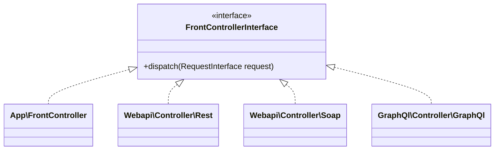
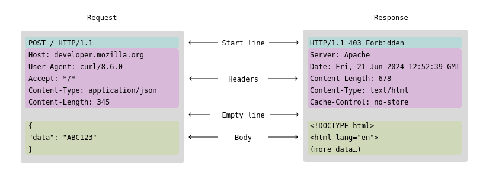
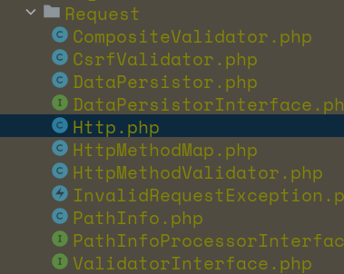
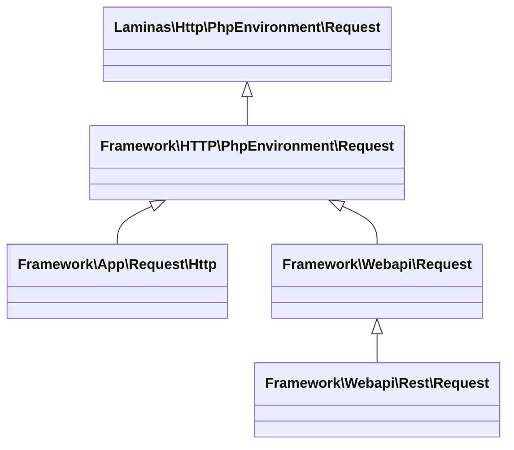
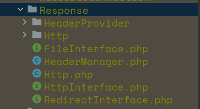
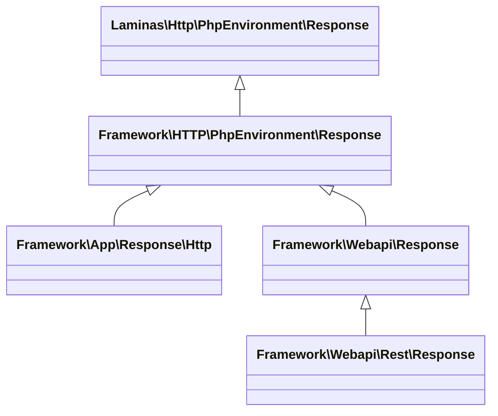
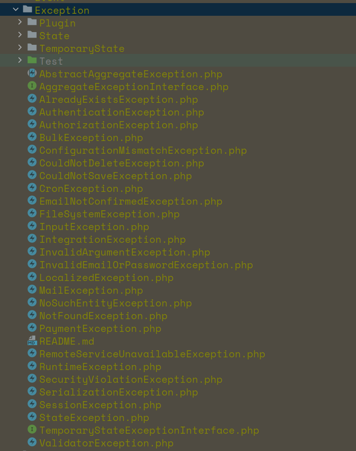
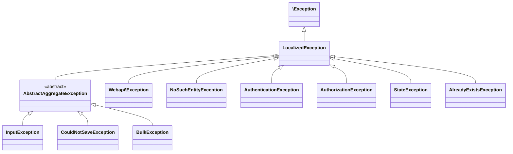

# HTTP & Exception

> **Techstack:** Magento 2.4.x (Adobe Commerce / Magento Open Source)

## 1. Request Flow

[Routing trong Magento Commerce](../Routing%20trong%20Magento%20Commerce.md)

Mỗi HTTP request được `Magento\Framework\App\Http::launch()` chuyển cho front controller của area tương ứng. Các front controller này implement interface `Magento\Framework\App\FrontControllerInterface` và được chọn qua `preference` trong `di.xml` của area (xem [Controller](Controller.md)):

- `Magento\Framework\App\FrontController`
- `Magento\Webapi\Controller\Rest`
- `Magento\Webapi\Controller\Soap`
- `Magento\GraphQl\Controller\GraphQl`

*Hình 1: Các front controller implement `Magento\Framework\App\FrontControllerInterface` (storefront/admin, REST, SOAP, GraphQL)*

Mỗi HTTP sẽ bao gồm:

- Request
- Response

*Hình 2: Cấu trúc một HTTP request và HTTP response (nguồn: MDN)*

### 1.1. Request

Các yêu cầu được gửi từ phía client,  với Magento HTTP Request  được base từ `\Laminas\Http\PhpEnvironment\Request`

Request sẽ xử lý validate, cookies, header, allow-deny access, parse input body, parse query, match url, cache … Ta có thể thấy cách magento xử lý Request App bên trong `magento/framework`

App/Request:

*Hình 3: Các class xử lý Request trong `magento/framework/App/Request`*

*Hình 4: Cây kế thừa Request của Magento từ `\Laminas\Http\PhpEnvironment\Request`*

### 1.2. Response

Kết quả phản hồi từ server được gửi trả lại client, Magento base Response từ `\Laminas\Http\PhpEnvironment\Response`. Response sẽ xử lý format data response, header

*Hình 5: Các class xử lý Response trong `magento/framework/App/Response`*

*Hình 6: Cây kế thừa Response của Magento từ `\Laminas\Http\PhpEnvironment\Response`*

Tại `Magento\Framework\App\Response\Http` (dùng cho storefront, admin và GraphQL), Magento set cookie và header phục vụ cache: cookie `COOKIE_VARY_STRING` (`X-Magento-Vary`) cho Full Page Cache, và header time-to-live (`setPublicHeaders($ttl)` → `Cache-Control: max-age`, hoặc `setNoCacheHeaders()`).

> [!NOTE]
> REST/SOAP dùng `Magento\Framework\Webapi\Response`, không kế thừa `App\Response\Http` nên không có cookie `X-Magento-Vary`. Response của REST/SOAP luôn bị gắn `Cache-Control: no-store` bởi plugin `Magento\PageCache\Plugin\AppendNoStoreCacheHeader` (xem [REST](REST.md)).

Và, Redirect Url

Format content response & exception data response

### 1.3. HTTP Status

[HTTP response status codes](https://developer.mozilla.org/en-US/docs/Web/HTTP/Status)

### 1.4. Exception

Base Exception sẽ được thấy trong `magento/framework/Exception`

*Hình 7: Các exception class trong `magento/framework/Exception`*

*Hình 8: Một phần cây kế thừa exception – hầu hết exception của framework kế thừa `LocalizedException`*

## Tham khảo

**Tài liệu chính thức**

- [Status Codes and Responses](https://developer.adobe.com/commerce/webapi/get-started/gs-web-api-response) – HTTP status và format lỗi của Web API
- [Routing](https://developer.adobe.com/commerce/php/development/components/routing) – front controller và router

**Source code**

- [`Magento\Framework\App\FrontControllerInterface`](https://github.com/magento/magento2/blob/2.4-develop/lib/internal/Magento/Framework/App/FrontControllerInterface.php)
- [`Magento\Framework\App\Request\Http`](https://github.com/magento/magento2/blob/2.4-develop/lib/internal/Magento/Framework/App/Request/Http.php)
- [`Magento\Framework\App\Response\Http`](https://github.com/magento/magento2/blob/2.4-develop/lib/internal/Magento/Framework/App/Response/Http.php)
- [`Magento\Framework\Exception\LocalizedException`](https://github.com/magento/magento2/blob/2.4-develop/lib/internal/Magento/Framework/Exception/LocalizedException.php)

**Bài viết khác**

- [MDN – HTTP messages](https://developer.mozilla.org/en-US/docs/Web/HTTP/Messages)
- [MDN – HTTP response status codes](https://developer.mozilla.org/en-US/docs/Web/HTTP/Status)

**Bài liên quan trong Knowledge Base**

- [Routing trong Magento Commerce](../Routing%20trong%20Magento%20Commerce.md)
- [Controller](Controller.md)
- [REST](REST.md)
