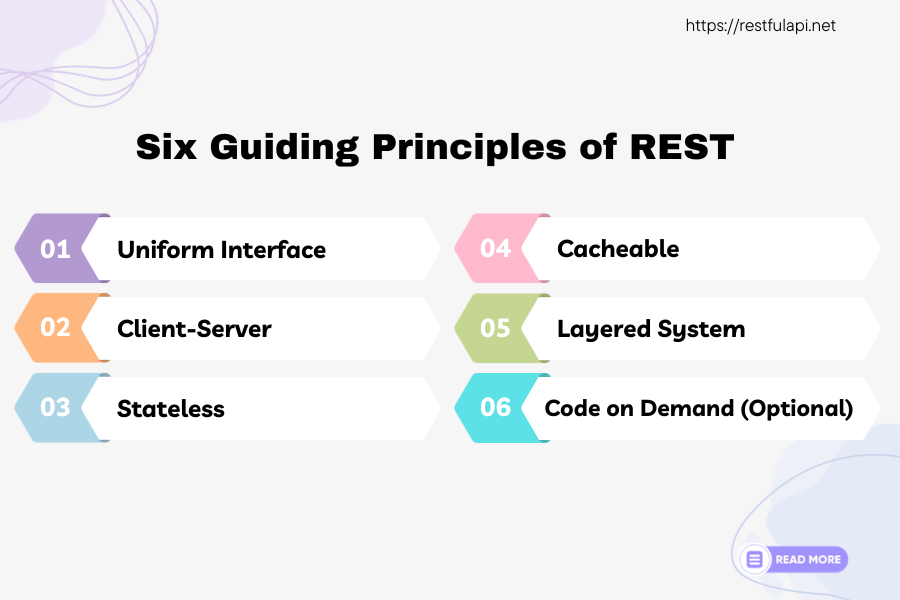
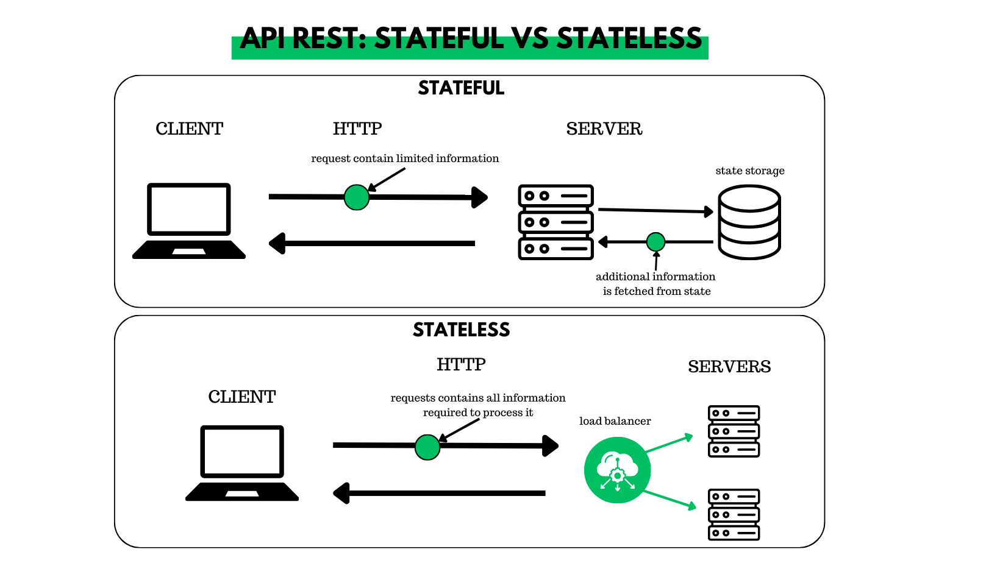
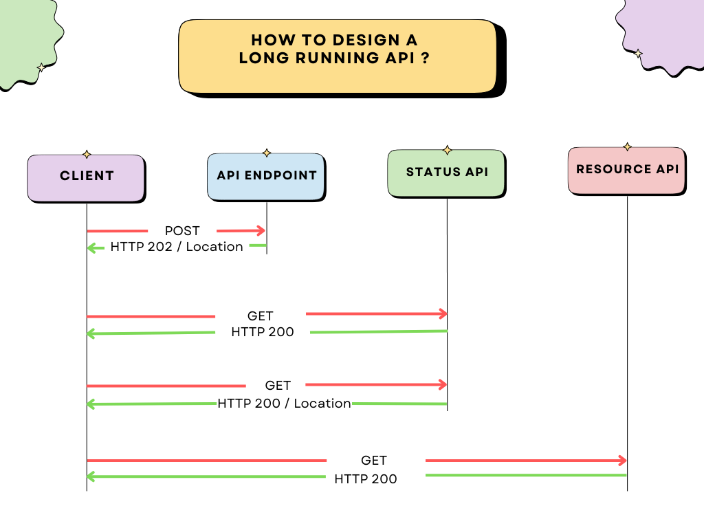
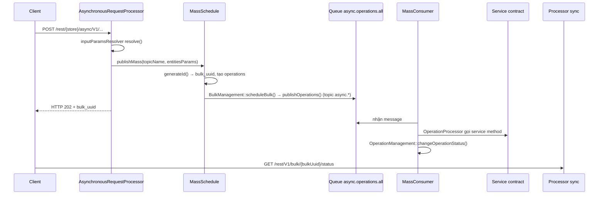
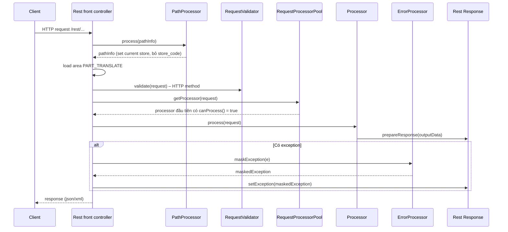
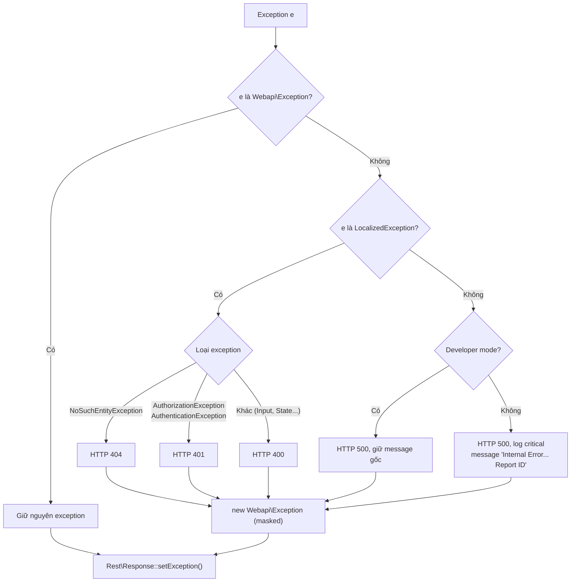
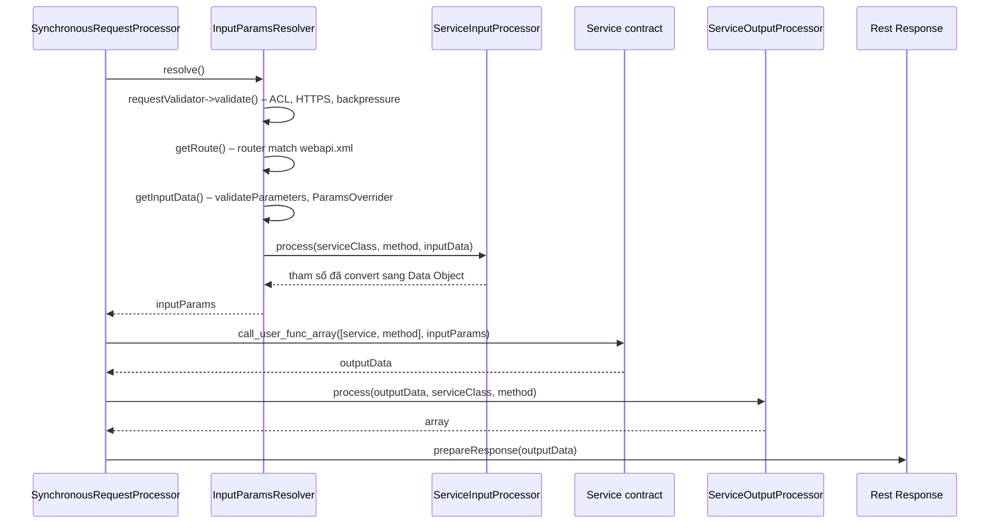

# REST

> **Techstack:** Magento 2.4.x (Adobe Commerce / Magento Open Source)

## 1. Rest trong magento

Đầu tiên trở lại với định nghĩa về Rest API

Rest ko phải một giao thức, hay một tiêu chuẩn. Rest là một phong cách kiến trúc (architectural style) viết API

`REpresentational State Transfer`

Rest sẽ có những nguyên tắc, tiêu chuẩn và ràng buộc riêng để thực hiện



*Hình 1: Six Guiding Principles of REST (nguồn: restfulapi.net)*

Tham khảo:

- [Roy Fielding – Representational State Transfer (REST), Chapter 5](https://ics.uci.edu/~fielding/pubs/dissertation/rest_arch_style.htm)
- [restfulapi.net](https://restfulapi.net/)

## 2. REST API

### 2.1. REST xây dựng dựa trên 6 nguyên tắc

#### Uniform Interface

Mọi tương tác giữa client và server đi qua một interface chung, gồm 4 ràng buộc:

> "REST is defined by four interface constraints: identification of resources; manipulation of resources through representations; self-descriptive messages; and, hypermedia as the engine of application state." — [Fielding §5.1.5](https://ics.uci.edu/~fielding/pubs/dissertation/rest_arch_style.htm)

- **Identification of resources**: mỗi resource có URI riêng, VD `/V1/products/{sku}`.
- **Manipulation through representations**: client thao tác resource bằng cách gửi/nhận representation (JSON, XML) thay vì truy cập trực tiếp dữ liệu.
- **Self-descriptive messages**: message tự mô tả cách xử lý qua HTTP method, `Content-Type`, `Accept`, status code.
- **HATEOAS**: response chứa link để client đi tiếp tới state kế.

Trong Magento: resource và method khai báo trong `webapi.xml`, representation là JSON/XML chọn theo `Accept` / `Content-Type`. Magento **không** trả hypermedia link, nên REST API của Magento không thoả HATEOAS. Swagger (`/swagger`) chỉ là tài liệu mô tả interface, không phải bản thân ràng buộc Uniform Interface.

#### Client - Server

Tách biệt client-server, sự thay đổi code ở client và server ko ảnh hưởng tới nhau, chỉ ảnh hưởng nhau ở API Interface

> "Separation of concerns is the principle behind the client-server constraints. [...] The separation allows the components to evolve independently, thus supporting the Internet-scale requirement of multiple organizational domains." — [Fielding §5.1.2](https://ics.uci.edu/~fielding/pubs/dissertation/rest_arch_style.htm)

#### Stateless

Tương tác giữa client-server là ko lưu trữ trạng thái, Server sẽ ko lưu trữ thông tin về http request của client `no history, no session`

> "...each request from client to server must contain all of the information necessary to understand the request, and cannot take advantage of any stored context on the server. Session state is therefore kept entirely on the client." — [Fielding §5.1.3](https://ics.uci.edu/~fielding/pubs/dissertation/rest_arch_style.htm)

Stateless sẽ giúp ứng dụng dễ dàng mở rộng, và triển khai đồng thời tại nhiều server

> [!NOTE]
> Trong Magento: REST stateless khi gọi bằng token (Bearer/OAuth). Nhưng Magento vẫn chấp nhận session cookie của customer/admin (session-based authentication cho JS cùng domain, xem `CustomerSessionUserContext` / `AdminSessionUserContext` trong `etc/webapi_rest/di.xml` của `Magento_Customer` / `Magento_User`), khi đó request phụ thuộc session lưu trên server. Xem [Authentication](https://developer.adobe.com/commerce/webapi/get-started/authentication/).

So sánh Stateless và Stateful



*Hình 2: API REST – Stateful vs Stateless*

| Tiêu chí | Stateless | Stateful |
|---|---|---|
| Định nghĩa | Là trạng thái không lưu các dữ liệu của client trên server | Là trạng thái lưu dữ liệu của client trên server |
| Ví dụ | HTTP, DNS, UDP | FTP, Telnet |
| Hạn chế máy chủ | Máy chủ không cần lưu giữ thông tin máy khách hoặc các chi tiết cho phiên của nó | Máy chủ được lưu giữ để yêu cầu duy trì trạng thái hiện tại & thông tin phiên làm việc |
| Sự phụ thuộc | Máy chủ và máy khách được kết hợp lỏng lẻo, có thể hoạt động độc lập | Máy chủ và máy khách có sự ràng buộc chặt chẽ |
| Thiết kế | Thiết kế máy chủ đơn giản | Thiết kế máy chủ phức tạp & khó thực hiện |
| Sự cố | Khi có sự cố, máy chủ dễ dàng khởi động lại | Máy chủ phải lưu giữ nhiều thông tin khác nhau nên rất khó quản lý sự cố |
| Tốc độ | Máy chủ xử lý nhanh chóng các giao dịch | Tốc độ khá chậm |

#### Cacheable

Mỗi response phải được đánh dấu rõ (tường minh hoặc ngầm định) là cacheable hay non-cacheable, để client và các tầng trung gian biết có được dùng lại hay không. Ràng buộc này không yêu cầu mọi response đều phải cache được.

> "Cache constraints require that the data within a response to a request be implicitly or explicitly labeled as cacheable or non-cacheable." — [Fielding §5.1.4](https://ics.uci.edu/~fielding/pubs/dissertation/rest_arch_style.htm)

- GET requests should be cachable by default – until a special condition arises. Usually, browsers treat all GET requests as cacheable.
- POST chỉ cacheable khi response có thông tin freshness tường minh (`Cache-Control: max-age` / `Expires`) **và** header `Content-Location` trùng với URI của request ([RFC 9110 §9.3.3](https://www.rfc-editor.org/rfc/rfc9110.html#section-9.3.3)). Thực tế gần như không cache POST.
- Responses to PUT and DELETE requests are not cacheable at all.

Header liên quan đến cache:

- Freshness: `Cache-Control`, `Expires`
- Validation (dùng cho conditional request `If-None-Match` / `If-Modified-Since`): `ETag`, `Last-Modified` ([RFC 9110 §8.8 Validator Fields](https://www.rfc-editor.org/rfc/rfc9110.html#section-8.8))

> [!NOTE]
> Trong Magento, REST/SOAP response **không** được cache: plugin `Magento\PageCache\Plugin\AppendNoStoreCacheHeader` (khai báo trong `Magento/PageCache/etc/webapi_rest/di.xml` và `etc/webapi_soap/di.xml`) gắn `Cache-Control: no-store` vào mọi response.
>
> `X-Magento-Vary` là **cookie** (`Magento\Framework\App\Response\Http::COOKIE_VARY_STRING`) mà Full Page Cache dùng để tách bản cache trang storefront theo context (store, currency, customer group…), không áp dụng cho REST. Cache phía server cho API chỉ có ở GraphQL (GET + header `X-Magento-Cache-Id`), xem [Graphql](Graphql.md).

#### Layered System

Hệ thống có thể gồm nhiều tầng trung gian giữa client và server (CDN, Varnish, reverse proxy, load balancer, API gateway). Mỗi tầng chỉ biết tầng kề nó: client không biết mình đang nói chuyện trực tiếp với server gốc hay qua trung gian.

> "...each component cannot 'see' beyond the immediate layer with which they are interacting." — [Fielding §5.1.6](https://ics.uci.edu/~fielding/pubs/dissertation/rest_arch_style.htm)

Với Magento: `CDN / Load balancer → nginx → PHP-FPM (area webapi_rest)`.

> [!NOTE]
> Presentation / Domain / Persistence là layered architecture **bên trong** ứng dụng (trong Magento: Controller → Service contract → Repository / ResourceModel), không phải ràng buộc Layered System của REST.

#### Code on Demand

Server có thể gửi code (script, applet) để client tải về và chạy, mở rộng chức năng client. Đây là ràng buộc **tuỳ chọn** duy nhất trong 6 ràng buộc.

> "REST allows client functionality to be extended by downloading and executing code in the form of applets or scripts. [...] However, it also reduces visibility, and thus is only an optional constraint within REST." — [Fielding §5.1.7](https://ics.uci.edu/~fielding/pubs/dissertation/rest_arch_style.htm)

REST API của Magento chỉ trả dữ liệu JSON/XML, không dùng Code on Demand.

### 2.2. REST Resource

The state of the resource, at any particular time, is known as the resource representation. The resource representations consist of:

- the data
- the metadata describing the data
- and the hypermedia links that can help the clients transition to the next desired state.

Resource Methods:

GET, POST, PUT, DELETE

Resource naming: [REST Resource Naming Guide](https://restfulapi.net/resource-naming/)

Quy định các cách đặt tên, tương tác với API

Magento sẽ thấy định nghĩa resource bên trong modules `etc/webapi.xml`

```xml
<route url="/V1/products" method="POST">
```

[REST API Best Practices](https://restfulapi.net/rest-api-best-practices/)

### 2.3. Rest Security

[REST API Security Essentials](https://restfulapi.net/security-essentials/)

Auth

### 2.4. Design REST API Asynchronous for Long-Running Tasks



*Hình 3: How to design a long running API*

[REST API Design for Long-Running Tasks](https://restfulapi.net/rest-api-design-for-long-running-tasks/)

Trong Magento thiết kế này cũng khá tương tự, với các request long running Magento sẽ tạo ra các `bulk_uuid` sau đó có  thể sử dụng `bulk API` để check status.

- [Asynchronous web endpoints](https://developer.adobe.com/commerce/webapi/rest/use-rest/asynchronous-web-endpoints)
- [Bulk operation status endpoints](https://developer.adobe.com/commerce/webapi/rest/use-rest/operation-status-endpoints)
- [Bulk endpoints](https://developer.adobe.com/commerce/webapi/rest/use-rest/bulk-endpoints)



*Hình 4: Asynchronous API trong Magento – request được đưa vào message queue, client check status bằng `bulk_uuid`*

## 3. Triển khai REST trong Magento

Front controller for WebAPI REST area `Magento\Webapi\Controller\Rest`

**Source:** `Magento\Webapi\Controller\Rest::dispatch()`

```php
/**
 * Handle REST request
 */
public function dispatch(\Magento\Framework\App\RequestInterface $request)
{
    $path = $this->_pathProcessor->process($request->getPathInfo());
    $this->_request->setPathInfo($path);
    $this->areaList->getArea($this->_appState->getAreaCode())
        ->load(\Magento\Framework\App\Area::PART_TRANSLATE);
    try {
        $this->requestValidator->validate($this->_request);
        $processor = $this->requestProcessorPool->getProcessor($this->_request);
        $processor->process($this->_request);
    } catch (\Exception $e) {
        $maskedException = $this->_errorProcessor->maskException($e);
        $this->_response->setException($maskedException);
    }

    return $this->_response;
}
```



*Hình 5: Luồng xử lý request trong `Magento\Webapi\Controller\Rest::dispatch()`*

### 3.1. Match request

- Request PathInfo : string between the BaseUrl and QueryString
- `$this->_pathProcessor->process()` (`Magento\Webapi\Controller\PathProcessor`) sử dụng để build PathInfo multiple store
  - set current store
  - remove store_code trong pathInfo
  - store code `all` → set current store là admin store

> [!NOTE]
> mỗi request sẽ được xử lý thông qua một requestProcessorPool `Magento\Webapi\Controller\Rest\RequestProcessorPool`

RequestProcessorPool sẽ gồm một tập hợp danh sách processor sử dụng với WebAPI REST, Chúng ta sẽ có 2 loại:

- `Synchronous`: dành cho các request có kết quả ngay trực tiếp
- `Asynchronous`: dành cho các request mà quá trình xử lý mất nhiều thời gian or bulk actions

Có thể thấy setting ProcessorPool trong di.xml của area `webapi_rest`. Pool duyệt processor theo `sortOrder` và lấy processor **đầu tiên** có `canProcess()` = true. Không processor nào nhận thì trả 400 "Specified request cannot be processed."

```xml
<!-- Magento/Webapi/etc/webapi_rest/di.xml (các processor async được thêm trong Magento/WebapiAsync/etc/webapi_rest/di.xml) -->
<type name="Magento\Webapi\Controller\Rest\RequestProcessorPool">
    <arguments>
        <argument name="requestProcessors" xsi:type="array">
            <item name="syncSchema" xsi:type="object" sortOrder="50">Magento\Webapi\Controller\Rest\SchemaRequestProcessor</item>
            <item name="sync" xsi:type="object" sortOrder="100">Magento\Webapi\Controller\Rest\SynchronousRequestProcessor</item>
        </argument>
    </arguments>
</type>
```

Vì Rest là HTTP nên chúng ta sẽ có cấu tạo từ 2 phần cơ bản:

- `Magento\Framework\Webapi\Rest\Request`: Request sẽ xử lý các phương thức hệ thống chấp nhận, accept_types , parse content data,
- `Magento\Framework\Webapi\Rest\Response`: Response sẽ xử lý send data trả về client, format exception, format data response, render dữ liệu trả về là xml or json

### 3.2. Validate request

- HTTP Validator :

```php
$this->requestValidator->validate($this->_request);
```

Allow method : GET, POST, PUT, DELETE

Exception : 405

> [!NOTE]
> REST có **hai lớp validate** với hai class trùng tên, dễ nhầm:
>
> | Bước | Class | Kiểm tra | Lỗi |
> |---|---|---|---|
> | `Rest::dispatch()` | `Magento\Framework\Webapi\Rest\RequestMethodValidator` (preference của `Magento\Framework\Webapi\Rest\RequestValidatorInterface` trong `Magento/Webapi/etc/di.xml`) | HTTP method qua `Request::getHttpMethod()` | 405 |
> | `InputParamsResolver::resolve()` (bên trong processor) | `Magento\Webapi\Controller\Rest\RequestValidator` | ACL (`checkPermissions`), HTTPS cho route secure (`onlyHttps`), rate limit (`checkBackpressure`) | 401 / 400 / 429 |

> [!NOTE]
> 4xx là mã lỗi dành để thông báo client error, nghĩa là user đã thực hiện sai request, or truy cập vào các request ko đc cho phép ….

- API trong Magento sẽ được `ServiceInputProcessor` implement `ServicePayloadConverterInterface`: được sử dụng để `Convert data from array to Data Object representation if type is Data Object or array of Data Objects`.

`ServiceInputProcessor` sẽ help Magento convert & validate input data trong API

**Ví dụ:**

```xml
<route url="/V1/products" method="POST">
    <service class="Magento\Catalog\Api\ProductRepositoryInterface" method="save"/>
    <resources>
        <resource ref="Magento_Catalog::products" />
    </resources>
</route>
```

Trong `ProductRepositoryInterface` chúng ta sẽ thấy

```php
interface ProductRepositoryInterface
{
    /**
     * Create product
     *
     * @param \Magento\Catalog\Api\Data\ProductInterface $product
     * @param bool $saveOptions
     * @return \Magento\Catalog\Api\Data\ProductInterface
     */
    public function save(\Magento\Catalog\Api\Data\ProductInterface $product, $saveOptions = false);
```

`ServiceInputProcessor` sẽ giúp chúng ta validate data input của parameter `$product`

```php
\Magento\Catalog\Api\Data\ProductInterface $product
```

`Magento\Framework\Reflection\TypeProcessor::processSimpleAndAnyType()`

Convert the value to the requested simple or any type

### 3.3. Exception

`Magento\Framework\Webapi\Exception`

Tại đây sẽ thấy base exceptions và status Webapi sẽ xử lý

**Source:** `Magento\Framework\Webapi\Exception`

```php
/**#@+
 * Error HTTP response codes.
 */
public const HTTP_BAD_REQUEST = 400;

public const HTTP_UNAUTHORIZED = 401;

public const HTTP_FORBIDDEN = 403;

public const HTTP_NOT_FOUND = 404;

public const HTTP_METHOD_NOT_ALLOWED = 405;

public const HTTP_NOT_ACCEPTABLE = 406;

public const HTTP_TOO_MANY_REQUESTS = 429;

public const HTTP_INTERNAL_ERROR = 500;
```

429 do `Magento\Webapi\Controller\Rest\RequestValidator::checkBackpressure()` ném khi vượt rate limit.

Các WebAPIException được xử lý trong `Magento\Framework\Webapi\ErrorProcessor`

#### Render Exception

`Magento\Framework\Webapi\Rest\Response`

Nếu trong quá trình xử lý request có lỗi, exception được lưu vào property `$exceptions` của Response (`setException()`). Khi render, `Rest\Response::_renderMessages()` đưa mỗi exception qua `maskException()` và trả về body là một **object** theo format:

```text
{
  "message": "...",                                    // luôn có
  "errors": [{"message": "...", "parameters": []}],   // chỉ khi exception có errors (AggregateException)
  "code": 0,                                           // chỉ khi code != 0
  "parameters": [],                                    // chỉ khi có details (parameters của LocalizedException)
  "trace": "..."                                       // chỉ developer mode: WebapiException → StackTrace, khác → TraceAsString
}
```

Ví dụ với `InputException::requiredField('sku')` (`Magento\Framework\Exception\InputException::REQUIRED_FIELD`): `{"message": "\"%fieldName\" is required. Enter and try again.", "parameters": {"fieldName": "sku"}}`

> [!NOTE]
> Nếu có nhiều exception, chỉ exception **cuối cùng** được render vào body và quyết định HTTP status code.

- Mask Exception : Che giấu ngoại lệ thực tế vì lý do bảo mật trong trường hợp ngoại lệ đó không được tiết lộ cho các máy khách API

Exception được xử lý theo 3 nhánh:

- `WebapiException`: giữ nguyên.
- `LocalizedException`: **giữ nguyên** raw message và parameters, chỉ được chuyển thành `WebapiException` với HTTP code tương ứng (`NoSuchEntityException` → 404, `AuthorizationException` / `AuthenticationException` → 401, còn lại → 400).
- Exception khác: trả 500. Ở chế độ không phải developer, message bị thay bằng `Internal Error. Details are available in Magento log file. Report ID: ...` (log critical), `code = 0`.

```php
// Magento\Framework\Webapi\ErrorProcessor

public function maskException(\Exception $exception)
{
    ……
}
```



*Hình 6: Cách `Magento\Framework\Webapi\ErrorProcessor::maskException()` chuyển exception thành `Webapi\Exception`*

### 3.4. Cùng tìm hiểu về các processors trong WebAPI REST

Trong tài liệu này sẽ chủ yếu đề cập tới cách thức hoạt động của Synchronous API còn Asynchronous API & Bulk Action sẽ nói rõ hơn trong các tài liệu về Asynchronous, Queue

[Xem lại về Asynchronous API](#24-design-rest-api-asynchronous-for-long-running-tasks)

#### sync

Executes the corresponding service contract.

- Class: `Magento\Webapi\Controller\Rest\SynchronousRequestProcessor`
- EntryPoint: `/rest/V1/...` (hoặc `/rest/<store_code>/V1/...`)
- URL pattern: `/^\/V\d+/` (`SynchronousRequestProcessor::PROCESSOR_PATH`)
- Order : 100
- config: `webapi.xml`
- InputValidator: `Magento\Framework\Webapi\ServiceInputProcessor`

InputParamsResolver:

```php
// Magento\Webapi\Controller\Rest\SynchronousRequestProcessor::process()

$inputParams = $this->inputParamsResolver->resolve(); // Magento\Webapi\Controller\Rest\InputParamsResolver
```

sẽ match request => route

**Source:** `Magento\Webapi\Controller\Rest\InputParamsResolver::getRoute()`

```php
/**
 * Retrieve current route.
 *
 * @return Route
 */
public function getRoute()
{
    if (!$this->route) {
        $this->route = $this->router->match($this->request);
    }
    return $this->route;
}
```

Trong đó list routes sẽ được tìm từ config `<Module_Name>/etc/webapi.xml` files để match và tạo route.

**Source:** `Magento\Webapi\Model\Rest\Config::getRestRoutes()`

```php
//Magento\Webapi\Model\Rest\Config::getRestRoutes()

// Nhánh exact match: pathInfo trùng nguyên văn URL trong webapi.xml.
// URL có tham số (VD /V1/products/:sku) đi nhánh sau: lấy mọi route cùng service base URL (VD /V1/products)
// và cùng HTTP method, rồi Magento\Webapi\Controller\Rest\Router::match() so pattern từng route.
$routes[] = $this->_createRoute(
    [
        self::KEY_ROUTE_PATH => $request->getPathInfo(),
        self::KEY_CLASS => $methodInfo[Converter::KEY_SERVICE][Converter::KEY_SERVICE_CLASS],
        self::KEY_METHOD => $methodInfo[Converter::KEY_SERVICE][Converter::KEY_SERVICE_METHOD],
        self::KEY_IS_SECURE => $methodInfo[Converter::KEY_SECURE],
        self::KEY_ACL_RESOURCES => array_keys($methodInfo[Converter::KEY_ACL_RESOURCES]),
        self::KEY_PARAMETERS => $methodInfo[Converter::KEY_DATA_PARAMETERS],
        self::KEY_INPUT_ARRAY_SIZE_LIMIT => $methodInfo[Converter::KEY_INPUT_ARRAY_SIZE_LIMIT],
    ]
);
```

tương ứng với config trong webapi.xml:

```xml
<!-- Magento/Quote/etc/webapi.xml -->
<route url="/V1/carts/mine/order" method="PUT">
    <service class="Magento\Quote\Api\CartManagementInterface" method="placeOrder"/>
    <resources>
        <resource ref="self" />
    </resources>
    <data>
        <parameter name="cartId" force="true">%cart_id%</parameter>
    </data>
</route>
```

cũng trong, `Magento\Webapi\Controller\Rest\InputParamsResolver` sẽ đóng vai trò resolve input parameters

Validate, Convert, Override Parameters



*Hình 7: Processor `sync` resolve input, gọi service contract và chuẩn bị response*

**Chúng ta có thể override params trong DI.**

```xml
<!-- Magento/Quote/etc/di.xml (global) -->

<type name="Magento\Webapi\Controller\Rest\ParamsOverrider">
    <arguments>
        <argument name="paramOverriders" xsi:type="array">
            <item name="%cart_id%" xsi:type="object">Magento\Quote\Model\Webapi\ParamOverriderCartId\Proxy</item>
        </argument>
    </arguments>
</type>
```

Param overrider thường được khai báo qua `\Proxy`. Proxy là class sinh tự động, chỉ phụ thuộc ObjectManager. Object thật (`ParamOverriderCartId`, kéo theo `UserContextInterface` và `CartManagementInterface`) chỉ được tạo khi `getOverriddenValue()` được gọi lần đầu. `ParamsOverrider` được khởi tạo ở mọi request REST, nên dùng Proxy giúp tránh dựng `CartManagement` cho những route không dùng `%cart_id%`. Xem thêm: [Proxies](https://developer.adobe.com/commerce/php/development/components/proxies).

**Validate Parameters**

`Magento\Webapi\Controller\Rest\InputParamsResolver::getInputData()`

```php
$this->validateParameters($serviceClassName, $serviceMethodName, array_keys($route->getParameters()));
```

#### syncSchema

Delivers the schema needed for generating Swagger documentation.

- Class: `Magento\Webapi\Controller\Rest\SchemaRequestProcessor`
- URL pattern: `schema`
- Order: 50

#### async

- Class: `Magento\WebapiAsync\Controller\Rest\AsynchronousRequestProcessor`
- URL pattern: `/^\/async(\/V.+)/`
- Order: 150
- Config: route trong `webapi.xml`. `Magento\WebapiAsync\Model\Config` tự sinh endpoint async cho **mọi route non-GET**, với topic dạng `async.<interface FQCN viết thường, \ thay bằng .>.<method>.<http method>`, VD `async.magento.catalog.api.productrepositoryinterface.save.post`. `webapi_async.xml` là tuỳ chọn, chỉ để khai alias route. Core có 2 alias: `POST async/V1/products` → `asyncProducts` (`Magento/WebapiAsync/etc/webapi_async.xml`) và `PUT async/bulk/V1/products/bySku` → `async/bulk/V1/products` (`Magento/Catalog/etc/webapi_async.xml`).

> [!WARNING]
> GET không hỗ trợ async: `AsynchronousRequestProcessor::canProcess()` trả false cho GET, nên request `GET /async/V1/...` bị pool trả 400 "Specified request cannot be processed."

Performs an asynchronous API request. It executes `Magento\AsynchronousOperations\Model\MassSchedule::publishMass`, which places a single message in the queue.

Format data input sẽ tương tự như `sync` đều dựa trên `inputParamsResolver`

`Magento\WebapiAsync\Controller\Rest\Asynchronous\InputParamsResolver`

#### asyncSchema

Delivers the schema needed for generating Swagger documentation for asynchronous endpoints.

- Class: `Magento\WebapiAsync\Controller\Rest\AsynchronousSchemaRequestProcessor`
- URL pattern: `async/schema`
- Order: 60

#### asyncBulk

- Class: `Magento\WebapiAsync\Controller\Rest\VirtualType\AsynchronousBulkRequestProcessor`
- URL pattern: `/^\/async\/bulk(\/V.+)/`
- Order: 200
- Config: giống `async`, tự sinh từ route non-GET trong `webapi.xml`

Performs a bulk API request by executing `Magento\AsynchronousOperations\Model\MassSchedule::publishMass`, which places multiple messages in the queue.

#### asyncBulkSchema

Currently not used. Reserved for future use.

- Class: `Magento\WebapiAsync\Controller\Rest\VirtualType\AsynchronousBulkSchemaRequestProcessor`
- URL pattern: `async/bulk/schema`
- Order: 180

### 3.5. Auth ACL & Resource Context

> [!NOTE]
> Nội dung đang được cập nhật.

## Tham khảo

**Tài liệu chính thức**

- [REST API Overview](https://developer.adobe.com/commerce/webapi/rest)
- [Construct a Request](https://developer.adobe.com/commerce/webapi/get-started/gs-web-api-request)
- [Status Codes and Responses](https://developer.adobe.com/commerce/webapi/get-started/gs-web-api-response)
- [Configure Services as Web APIs](https://developer.adobe.com/commerce/php/development/components/web-api/services) – cấu hình `webapi.xml`
- [Asynchronous web endpoints](https://developer.adobe.com/commerce/webapi/rest/use-rest/asynchronous-web-endpoints)
- [Bulk operation status endpoints](https://developer.adobe.com/commerce/webapi/rest/use-rest/operation-status-endpoints)
- [Bulk endpoints](https://developer.adobe.com/commerce/webapi/rest/use-rest/bulk-endpoints)
- [Bulk Operations](https://developer.adobe.com/commerce/php/development/components/message-queues/bulk-operations)
- [Request Processors Pool](https://developer.adobe.com/commerce/php/development/components/web-api/request-processor-pool)

**Source code**

- [`Magento\Webapi\Controller\Rest`](https://github.com/magento/magento2/blob/2.4-develop/app/code/Magento/Webapi/Controller/Rest.php)
- [`Magento\Webapi\Controller\Rest\RequestProcessorPool`](https://github.com/magento/magento2/blob/2.4-develop/app/code/Magento/Webapi/Controller/Rest/RequestProcessorPool.php)
- [`Magento\Webapi\Controller\Rest\SynchronousRequestProcessor`](https://github.com/magento/magento2/blob/2.4-develop/app/code/Magento/Webapi/Controller/Rest/SynchronousRequestProcessor.php)
- [`Magento\Webapi\Controller\Rest\InputParamsResolver`](https://github.com/magento/magento2/blob/2.4-develop/app/code/Magento/Webapi/Controller/Rest/InputParamsResolver.php)
- [`Magento\WebapiAsync\Controller\Rest\AsynchronousRequestProcessor`](https://github.com/magento/magento2/blob/2.4-develop/app/code/Magento/WebapiAsync/Controller/Rest/AsynchronousRequestProcessor.php)
- [`Magento\AsynchronousOperations\Model\MassSchedule`](https://github.com/magento/magento2/blob/2.4-develop/app/code/Magento/AsynchronousOperations/Model/MassSchedule.php)
- [`Magento\Framework\Webapi\Exception`](https://github.com/magento/magento2/blob/2.4-develop/lib/internal/Magento/Framework/Webapi/Exception.php)
- [`Magento\Framework\Webapi\ErrorProcessor`](https://github.com/magento/magento2/blob/2.4-develop/lib/internal/Magento/Framework/Webapi/ErrorProcessor.php)
- [`Magento\Framework\Webapi\ServiceInputProcessor`](https://github.com/magento/magento2/blob/2.4-develop/lib/internal/Magento/Framework/Webapi/ServiceInputProcessor.php)

**Bài viết khác**

- [Roy Fielding – Representational State Transfer (REST)](https://ics.uci.edu/~fielding/pubs/dissertation/rest_arch_style.htm)
- [restfulapi.net](https://restfulapi.net/)
- [REST API Best Practices](https://restfulapi.net/rest-api-best-practices/)
- [REST API Design for Long-Running Tasks](https://restfulapi.net/rest-api-design-for-long-running-tasks/)

**Bài liên quan trong Knowledge Base**

- [Controller](Controller.md)
- [HTTP & Exception](HTTP%20%26%20Exception.md)
- [Graphql](Graphql.md)
- [Service contracts](../Service%20contracts.md)
