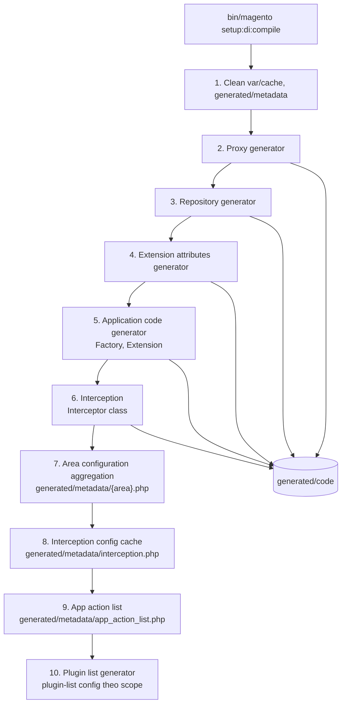
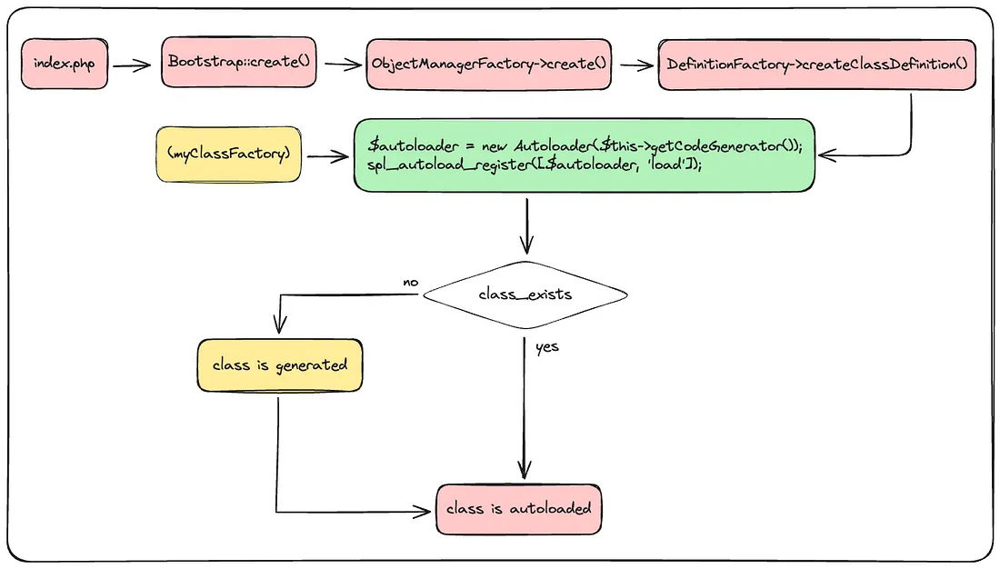
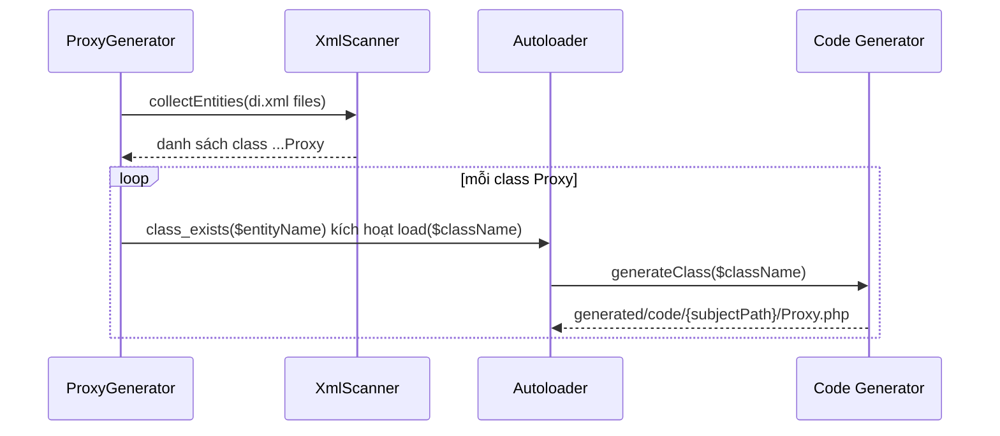
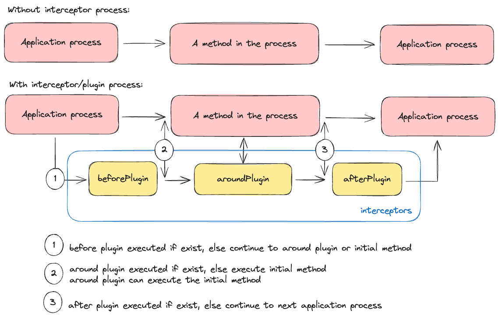
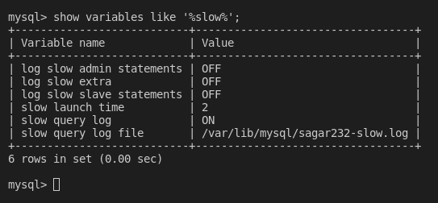

# Code generation & Optimal development environment

> **Techstack:** Magento 2.4.x (Adobe Commerce / Magento Open Source)

## 1. Code Generation

Tìm hiểu cách thức magento thực hiện compile và những gì sẽ được generated

`Magento\Setup\Console\Command\DiCompileCommand`

**Operations thực hiện 10 steps:**



*Hình 1: 10 bước của `setup:di:compile` – các bước 2–6 sinh class vào `generated/code`, các bước 7–10 ghi config vào `generated/metadata`*

### 1.1. Clean files system cache, generated

**Source:** `Magento\Setup\Console\Command\DiCompileCommand::execute()`

```php
$this->cleanupFilesystem(
    [
        DirectoryList::CACHE,
        DirectoryList::GENERATED_METADATA,
    ]
);
```

### 1.2. Proxy Generator

Action sẽ được thực hiện:
`\Magento\Setup\Module\Di\App\Task\Operation\ProxyGenerator::doOperation()`

Proxy là một code generator `\Magento\Framework\Code\Generator`



*Hình 2: Autoloader đăng ký code generator, class chưa tồn tại (vd. `myClassFactory`) sẽ được generate rồi mới autoload*

Proxy generator sẽ scan tất cả các file di.xml trong project sau đấy thực hiện tìm kiếm các class được khai báo Proxy

Chúng ta có thể xem lại đoạn code:

```php
// Magento\Setup\Module\Di\Code\Scanner\XmlScanner::collectEntities()

$regex = '/^(.*)\\\(.*)Proxy$/';
$query = "/config/preference[ php:functionString('preg_match', '{$regex}', @type) > 0]/@type | " .
    "//argument[@xsi:type='object' and php:functionString('preg_match', '{$regex}', text()) > 0] |" .
    "//item[@xsi:type='object' and php:functionString('preg_match', '{$regex}', text()) > 0] |" .
    "/config/virtualType[ php:functionString('preg_match', '{$regex}', @type) > 0]/@type";
```

Vậy những config sau sẽ được generator

```xml
<preference for="Magento\Framework\App\RequestInterface" type="Magento\Framework\App\Request\Http\Proxy" />
<!-- or —---- -->
<type name="Magento\Backend\Model\Widget\Grid\Row\UrlGenerator">
    <arguments>
        <argument name="backendUrl" xsi:type="object">Magento\Backend\Model\UrlInterface\Proxy</argument>
    </arguments>
</type>
<!-- or —---- -->
<virtualType name="DirectoryHelperDataProxy" type="Magento\Directory\Helper\Data\Proxy">
    <arguments>
        <argument name="instanceName" xsi:type="string">Magento\Directory\Helper\Data</argument>
    </arguments>
</virtualType>
```

Generated sẽ tạo ra các class Proxy, thông qua Autoloader
Xem lại đoạn mã sau chúng ta sẽ thấy Magento sẽ

**Source:** `Magento\Setup\Module\Di\App\Task\Operation\ProxyGenerator::doOperation()`

```php
// collect all proxy entities in di.xml
$proxies = $this->proxyScanner->collectEntities($files);
foreach ($proxies as $entityName) {
    class_exists($entityName);
}
```

Khi thực hiện check, M2 sẽ sử dụng autoloader

**Source:** `Magento\Framework\Code\Generator\Autoloader::load()`

```php
// Magento\Framework\Code\Generator\Autoloader

public function load($className)
{
    if (! class_exists($className)) {
        try {
            $this->_generator->generateClass($className);
        } catch (\Exception $exception) {
            $this->tryToLogExceptionMessageIfNotDuplicate($exception);
        }
    }
}
```



*Hình 3: Proxy generator scan `di.xml`, gọi `class_exists()` để Autoloader generate class Proxy*

`Magento\Framework\ObjectManager\Code\Generator\Proxy`

Trong này sẽ định nghĩa template của file, class, methods …. sẽ đc generate

Kết quả:

```text
/**
 * Clone proxied instance
 */
path: code/{subjectPath}/Proxy.php
=> class: \{subjectClass}\Proxy extends \{subjectClass}
```

Vậy Proxy là gì? Tại sao Magento lại generate các class này:

Proxy của Magento được xây dựng trên proxy pattern, về cơ bản Proxy giống như một đại diện của class chính đc ủy quyền trước khi logic chính của class được khởi tạo (các logic này thường được thực hiện chậm or phụ thuộc vào nhiều service khác).
Thay vì chờ tất cả các hành động của logic chính được khởi tạo hoàn thành, thì lớp ủy quyền (Proxy) sẽ được tạo ra các khai báo, khi cần sử dụng thì object chính sẽ tạo ra.

Ưu điểm:

- Lazy loading các hàm và hành động khởi tạo
- Tăng performance
- Giảm thiểu lưu trữ vào bộ nhớ khi chưa cần sử dụng

Chúng ta có thể tham khảo thêm về proxy pattern tại [Proxy](https://refactoring.guru/design-patterns/proxy), và tìm hiểu kỹ hơn trong các bài viết về Proxy

### 1.3. Repository generator

Tương tự như `Proxy Generator` thì hành động này cũng là một code generator

Với action này đã `@deprecated` Magento hiện chỉ dùng action cho codebase của họ.

- `Magento\Setup\Module\Di\App\Task\Operation\RepositoryGenerator`
- `Magento\Setup\Module\Di\Code\Scanner\RepositoryScanner`
- `Magento\Framework\ObjectManager\Code\Generator\Repository`

Sẽ generator một vài kiểu class cho `RepositoryInterface`

- InterfacePersistor
- InterfaceFactory
- SearchResultInterfaceFactory

Tìm trong thẻ `<preference>` của `di.xml` cho type implement `RepositoryInterface`

Hầu hết các repository hiện tại của base cũng đã đc replace thành các class đc khởi tạo bên trong module

### 1.4. Extension Attributes Generator

`Magento\Setup\Module\Di\App\Task\Operation\ServiceDataAttributesGenerator`

Sẽ generator Class Extension cho các `extension_attributes`:

scan tất cả các files: `extension_attributes.xml` và thực hiện tạo class

**Source:** `Magento\Setup\Module\Di\Code\Scanner\ServiceDataAttributesScanner::collectEntities()`

```php
/** @var $node \DOMNode */
foreach ($xpath->query('//extension_attributes') as $node) {
    $forType = $node->attributes->getNamedItem('for')->nodeValue;
    $extensionClasses[] = str_replace('Interface', 'ExtensionInterface', $forType);
    $extensionClasses[] = str_replace('Interface', 'Extension', $forType);
}
```

Generate: `Magento\Framework\Api\Code\Generator\ExtensionAttributesGenerator`

Cùng xem một ví dụ:

```xml
<!-- magento/vendor/magento/module-sales/etc/extension_attributes.xml -->

<extension_attributes for="Magento\Sales\Api\Data\OrderInterface">
    <attribute code="payment_additional_info" type="Magento\Payment\Api\Data\PaymentAdditionalInfoInterface[]" />
</extension_attributes>
```

`Magento\Sales\Api\Data\OrderInterface` => `Magento\Sales\Api\Data\OrderExtension`

đồng thời sẽ add thêm các phương thức get, set data

```php
/**
 * @return \Magento\Payment\Api\Data\PaymentAdditionalInfoInterface[]|null
 */
public function getPaymentAdditionalInfo()
{
    return $this->_get('payment_additional_info');
}

/**
 * @param \Magento\Payment\Api\Data\PaymentAdditionalInfoInterface[] $paymentAdditionalInfo
 * @return $this
 */
public function setPaymentAdditionalInfo($paymentAdditionalInfo)
{
    $this->setData('payment_additional_info', $paymentAdditionalInfo);
    return $this;
}
```

### 1.5. Application Code Generator

Được thực hiện tại `Magento\Setup\Module\Di\App\Task\Operation\ApplicationCodeGenerator`

Thay vì scan xml di, application code sẽ scan php files

PHP scan sẽ sử dụng reflection để tìm trong hàm `__construct`:

- Missing Factories classes
- Missing Extension attributes classes

```php
// Magento\Setup\Module\Di\Code\Scanner\PhpScanner::collectEntities

foreach ($files as $file) {
    $classes = $this->getDeclaredClasses($file);
    foreach ($classes as $className) {
        $reflectionClass = new \ReflectionClass($className);
        $output[] = $this->_fetchFactories($reflectionClass, $file);
        $output[] = $this->_fetchMissingExtensionAttributesClasses($reflectionClass, $file);
    }
}
```

Code Generator:

`factory => \Magento\Framework\ObjectManager\Code\Generator\Factory`

Factory là một design pattern (Creational Patterns) được sử dụng để tạo object, thay vì việc sử dụng toán tử `new` để khởi tạo.

khi sử dụng toán tử `new` sẽ có những vấn đề sau:

- Khó thể xác định chính xác các parameter
- Rất nhiều config đc thiết lập tương tự nhau
- Performance

Factory sẽ tạo trước các config, các lớp cần thiết sẽ được khởi tạo trước và 1 lần để sử dụng lại .

trong trường hợp này, ClassFactory sẽ khởi tạo các lớp cần thiết thông qua `object_manager`

Ex: `Magento\Sales\Model\OrderFactory` cho `Magento\Sales\Model\Order`

```php
/**
 * Create class instance with specified parameters
 *
 * @param array $data
 * @return \Magento\Sales\Model\Order
 */
public function create(array $data = [])
{
    return $this->_objectManager->create($this->_instanceName, $data);
}
```

ObjectManager sẽ giúp khởi tạo trước các depend object trước
Ví dụ:

`\Magento\Sales\Model\Order\Config $orderConfig,`

Nếu sử dụng toán tử new thì chúng ta phải khởi tạo `$orderConfig` trước, và thiết lập đúng vị trí của tham số khi thực hiện `new Order`.

### 1.6. Interception

Interception sẽ thực hiện generator `Interceptor class`



*Hình 4: Thứ tự thực thi before, around, after plugin của interceptor*

Task:

`\Magento\Setup\Module\Di\App\Task\Operation\Interception`

Thực hiện tìm kiếm config plugin trong di.xml và tạo interceptor class

**Source:** `Magento\Setup\Module\Di\Code\Generator\InterceptionConfigurationBuilder::getInterceptionConfiguration()`

```php
/**
 * Builds interception configuration for all defined classes
 *
 * @param array $definedClasses
 * @return array
 */
public function getInterceptionConfiguration($definedClasses)
{
    $interceptedInstances = $this->getInterceptedClasses($definedClasses);
    $inheritedConfig = $this->getPluginsList($interceptedInstances);
    $mergedAreaPlugins = $this->mergeAreaPlugins($inheritedConfig);
    $interceptedMethods = $this->getInterceptedMethods($mergedAreaPlugins);

    return $interceptedMethods;
}
```

Code Generator:
`\Magento\Framework\Interception\Code\Generator\Interceptor`

Trong `generated/code` chúng ta sẽ thấy các class trong file `**/**/Interceptor.php`

**Ví dụ:**

```xml
<!-- di.xml -->
<type name="Magento\Sales\Model\Order">
    <plugin name="express_order_invoice" type="Magento\Paypal\Plugin\OrderCanInvoice"/>
</type>
```

```php
class OrderCanInvoice
{
    public function afterCanInvoice(Order $order, bool $result): bool
    {
        …
    }
}
```

=> Interceptor Code

```php
namespace Magento\Sales\Model\Order;

/**
 * Interceptor class for @see \Magento\Sales\Model\Order
 */
class Interceptor extends \Magento\Sales\Model\Order implements \Magento\Framework\Interception\InterceptorInterface
{
    use \Magento\Framework\Interception\Interceptor;

    public function __construct() {
        …
    }

    /**
     * {@inheritdoc}
     */
    public function canInvoice()
    {
        $pluginInfo = $this->pluginList->getNext($this->subjectType, 'canInvoice');
        return $pluginInfo ? $this->___callPlugins('canInvoice', func_get_args(), $pluginInfo) : parent::canInvoice();
    }
}
```

Chúng sẽ tìm hiểu chi tiết về cách thức hoạt động và tác dụng của interceptor plugin

### 1.7. Area configuration aggregation

Tổng hợp data DI configuration của tất cả class sau đó generated và tạo ra metadata config, cho tất cả các area.

`Magento\Setup\Module\Di\App\Task\Operation\Area`

metadata files: `generated/metadata`

- `global.php`
- `frontend.php`
- `adminhtml.php`
- `webapi_soap.php`
- `webapi_rest.php`
- `graphql.php`

### 1.8. Interception config cache

Bước này sẽ tạo ra file:
`generated/metadata/interception.php`

Tất cả các class có áp dụng Plugin sẽ đc set trong này, cải thiện performance để check class có thực hiện plugin khi sử dụng ko?

### 1.9. Pregenerates actions for Magento

`Magento\Setup\Module\Di\App\Task\Operation\AppActionListGenerator`

Bước này sẽ tạo ra file:
`generated/metadata/app_action_list.php`

Mô tả mapping: action => Controller Class

### 1.10. Plugin list configuration writer and loader for scopes

Task: `Magento\Setup\Module\Di\App\Task\Operation\PluginListGenerator`

Writes plugin list configuration data per scope to generated metadata.

`Magento\Framework\Interception\PluginListGenerator`

Hành động này sẽ generate class configs cho plugin-list trong:

`generated/metadata/**|plugin-list.php`

## 2. Config & Env environment

> [!NOTE]
> Nội dung đang được cập nhật.

## 3. Cache

> [!NOTE]
> Nội dung đang được cập nhật.

## 4. Logging

> [!NOTE]
> Nội dung đang được cập nhật.

## 5. Optimal development environment

- Enable Developer mode
- To speed up frontend development, turn off merging of CSS and JavaScript.
- Make sure caching is turned on, only turn of `page_cache, block_html`
- install and enable PHP OPcache

BSS Docker: [Docker và ứng dụng để build môi trường chạy site magento](https://docs.google.com/document/d/1KLqLoKnM7RbItqMBPwp5zuuY6_nQG0ibWpKnOpCSYm4)

BSS_Cli: [3.1 Setup validate code với Bss Docker](https://docs.google.com/document/d/1wQEzlTy8vfI5zbO-ougK3pBWCp3kgrMqBPHDg8RwK0Y/)

[Development Environment Recommendations | Adobe Commerce](https://experienceleague.adobe.com/en/docs/commerce-operations/performance-best-practices/development-environment)

## 6. Profiler & Slow Query DB

### 6.1. Application Profiler

```bash
bin/magento dev:profiler:enable html
```

> [!NOTE]
> Layout cache:
>
> **Source:** `Magento\Framework\View\Layout::isCacheable()`
>
> ```php
> // Magento\Framework\View\Layout::isCacheable()
>
> $elements = $this->getXml()->xpath('//' . Element::TYPE_BLOCK . '[@cacheable="false"]');
> ```
>
> Bất kỳ element nào set `cacheable='false'` thì toàn bộ layout sẽ disable cache

### 6.2. Configure the database profiler

#### Chỉnh sửa `env.php`

```php
// app/etc/env.php
'db' => [
    'table_prefix' => '',
    'connection' => [
        'default' => [
            'host' => 'localhost',
            'dbname' => 'magento',
            'profiler' => [
                'class' => '\Magento\Framework\DB\Profiler',
                'enabled' => true,
            ]
        ]
    ]
],
```

#### Enable query log

```bash
php bin/magento dev:query-log:enable
```

log sẽ thấy trong `/var/debug/db.log`

#### Select the database

```sql
use magento_database;
SET GLOBAL slow_query_log = 'ON';
SET GLOBAL long_query_time = X;
show variables like '%slow%';
```



*Hình 5: Kiểm tra cấu hình slow query log trong MySQL*

#### Explain DB

- [Explaining MySQL queries | Exoscale](https://www.exoscale.com/syslog/explaining-mysql-queries/)
- [How to read MySQL EXPLAINs | PlanetScale](https://planetscale.com/blog/how-read-mysql-explains)

## Tham khảo

**Tài liệu chính thức**
- [Code compiler | Adobe Commerce](https://experienceleague.adobe.com/en/docs/commerce-operations/configuration-guide/cli/code-compiler)
- [Code Generation | Commerce PHP Extensions](https://developer.adobe.com/commerce/php/development/components/code-generation)
- [Proxies | Commerce PHP Extensions](https://developer.adobe.com/commerce/php/development/components/proxies)
- [Factories | Commerce PHP Extensions](https://developer.adobe.com/commerce/php/development/components/factories)
- [Add extension attributes | Commerce PHP Extensions](https://developer.adobe.com/commerce/php/development/components/add-attributes)
- [Plugins | Commerce PHP Extensions](https://developer.adobe.com/commerce/php/development/components/plugins)
- [Application modes | Adobe Commerce](https://experienceleague.adobe.com/en/docs/commerce-operations/configuration-guide/setup/application-modes)
- [Development Environment Recommendations | Adobe Commerce](https://experienceleague.adobe.com/en/docs/commerce-operations/performance-best-practices/development-environment)
- [Configure the database profiler | Adobe Commerce](https://experienceleague.adobe.com/en/docs/commerce-operations/configuration-guide/storage/db-profiler)

**Source code**
- [`Magento\Setup\Console\Command\DiCompileCommand`](https://github.com/magento/magento2/blob/2.4-develop/setup/src/Magento/Setup/Console/Command/DiCompileCommand.php)
- [`Magento\Setup\Module\Di\App\Task\OperationFactory`](https://github.com/magento/magento2/blob/2.4-develop/setup/src/Magento/Setup/Module/Di/App/Task/OperationFactory.php)
- [`Magento\Framework\Code\Generator\Autoloader`](https://github.com/magento/magento2/blob/2.4-develop/lib/internal/Magento/Framework/Code/Generator/Autoloader.php)
- [`Magento\Framework\ObjectManager\Code\Generator\Proxy`](https://github.com/magento/magento2/blob/2.4-develop/lib/internal/Magento/Framework/ObjectManager/Code/Generator/Proxy.php)
- [`Magento\Framework\Interception\Code\Generator\Interceptor`](https://github.com/magento/magento2/blob/2.4-develop/lib/internal/Magento/Framework/Interception/Code/Generator/Interceptor.php)

**Bài viết khác**
- [Refactoring.Guru – Proxy](https://refactoring.guru/design-patterns/proxy)
- [Docker và ứng dụng để build môi trường chạy site magento](https://docs.google.com/document/d/1KLqLoKnM7RbItqMBPwp5zuuY6_nQG0ibWpKnOpCSYm4)
- [3.1 Setup validate code với Bss Docker](https://docs.google.com/document/d/1wQEzlTy8vfI5zbO-ougK3pBWCp3kgrMqBPHDg8RwK0Y/)

**Bài liên quan trong Knowledge Base**
- [Proxies](SOLID%20principles%20%26%20Patterns%20in%20Magento/Proxies.md)
- [Factories Patterns](SOLID%20principles%20%26%20Patterns%20in%20Magento/Factories%20Patterns.md)
- [Dependency injection configuration](DI%20%26%20Interceptors/Dependency%20injection%20configuration.md)
- [Explain & Profile query](DB%20%26%20Data%20Object/Explain%20%26%20Profile%20query.md)
