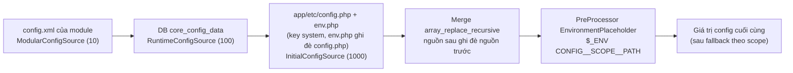

# Config & Env trong Magento

> **Techstack:** Magento 2.4.x (Adobe Commerce / Magento Open Source)

## 1. Directory List

**Source:** `Magento\Framework\App\Filesystem\DirectoryList::getDefaultConfig()`

```php
/** Magento\Framework\App\Filesystem\DirectoryList */
public static function getDefaultConfig()
{
    $result = [
        self::ROOT => [parent::PATH => ''],
        self::APP => [parent::PATH => 'app'],
        self::CONFIG => [parent::PATH => 'app/etc'],
        self::LIB_INTERNAL => [parent::PATH => 'lib/internal'],
        self::VAR_DIR => [parent::PATH => 'var'],
        self::VAR_EXPORT => [parent::PATH => 'var/export'],
        self::CACHE => [parent::PATH => 'var/cache'],
        self::LOG => [parent::PATH => 'var/log'],
        self::DI => [parent::PATH => 'generated/metadata'],
        self::GENERATION => [parent::PATH => Io::DEFAULT_DIRECTORY],
        self::SESSION => [parent::PATH => 'var/session'],
        self::MEDIA => [parent::PATH => 'pub/media', parent::URL_PATH => 'pub/media'],
        self::STATIC_VIEW => [parent::PATH => 'pub/static', parent::URL_PATH => 'pub/static'],
        self::PUB => [parent::PATH => 'pub', parent::URL_PATH => 'pub'],
        self::LIB_WEB => [parent::PATH => 'lib/web'],
        self::TMP => [parent::PATH => 'var/tmp'],
        self::UPLOAD => [parent::PATH => 'pub/media/upload', parent::URL_PATH => 'pub/media/upload'],
        self::TMP_MATERIALIZATION_DIR => [parent::PATH => 'var/view_preprocessed/pub/static'],
        self::TEMPLATE_MINIFICATION_DIR => [parent::PATH => 'var/view_preprocessed'],
        self::SETUP => [parent::PATH => 'setup/src'],
        self::COMPOSER_HOME => [parent::PATH => 'var/composer_home'],
        self::GENERATED => [parent::PATH => 'generated'],
        self::GENERATED_CODE => [parent::PATH => Io::DEFAULT_DIRECTORY],
        self::GENERATED_METADATA => [parent::PATH => 'generated/metadata'],
    ];
    return parent::getDefaultConfig() + $result;
}
```

## 2. Configuration

Sensitive and system-specific settings

### 2.1. Sensitive values

Sensitive configuration values hold restricted or confidential information.

Examples of sensitive information include:

- Keys (such as API keys)
- Usernames and passwords
- E-mail addresses
- Any personally identifiable information (e.g., address, phone number, date of birth, government identification number, etc.)

In keeping with current security and privacy best practices, be sure you are aware of any potential legal and security risks associated with the storage of customers' full date of birth (month, day, year) along with other personal identifiers, such as full name, before collecting or processing such data.

### 2.2. Environment or system-specific values

Environment or system-specific values are unique to the system where the application is deployed.

Examples of environment or system-specific values include:

- URLs
- IP addresses
- Ports
- Hostnames
- Domain names
- Paths (e.g., custom paths, proxy host, proxy port)
- "modes" (e.g, sandbox mode, debug mode, test mode)
- SSL (only for non-payment)
- E-mail recipients
- Administrative settings between systems (e.g., password expiration limits)

[Sensitive and environment-specific settings](https://developer.adobe.com/commerce/php/development/configuration/sensitive-environment-settings)

- System specific config
- Sensitive config
- Encrypted config

Configuration trong Magento

- Sensitive and environment-specific settings
- Set configuration values

## 3. ENV

Set configuration với env

### 3.1. Variable names

The general format of system settings variable names follows:

`<SCOPE>__<SYSTEM__VARIABLE__NAME>`

`<SCOPE>` can be either:

- Global scope (that is, the global setting for all scopes)

  Global scope variables have the following format:

  `CONFIG__DEFAULT__<SYSTEM__VARIABLE__NAME>`

- A specific scope (that is, the setting affects only a specified store view or website)

  Store view scope variables, for example, have the following format:

  `CONFIG__STORES__ <STORE_VIEW_CODE>__<SYSTEM__VARIABLE__NAME>`

For more information about scopes, see:

- Step 1: Find the website or store view scope value
- Commerce User Guide topic on scope
- Scope quick reference

### 3.2. How to use environment variables

Set configuration values as variables using PHP’s `$_ENV` associate array. You can set the values in any PHP script that runs when Commerce runs.

> [!TIP]
> Setting variable values in `index.php` or `pub/index.php` does not always function as expected since different application entry points can be used depending on the web server configuration. By placing `$_ENV` directives in the `app/bootstrap.php` file, regardless of different application entry points, the `$_ENV` directives always execute since the `app/bootstrap.php` file loads as part of the Commerce architecture.

**Ví dụ:** An example of setting two `$_ENV` values follows:

```php
$_ENV['CONFIG__DEFAULT__CATALOG__SEARCH__ELASTICSEARCH_SERVER_HOSTNAME'] = 'http://search.example.com';
$_ENV['CONFIG__DEFAULT__GENERAL__STORE_INFORMATION__MERCHANT_VAT_NUMBER'] = '1234';
```

[Override configuration settings | Adobe Commerce](https://experienceleague.adobe.com/en/docs/commerce-operations/configuration-guide/paths/override-config-settings#environment-variables)

Tổng hợp configuration: [Sensitive and system-specific paths | Adobe Commerce](https://experienceleague.adobe.com/en/docs/commerce-operations/configuration-guide/paths/config-reference-sens)

[Set configuration values | Adobe Commerce](https://experienceleague.adobe.com/en/docs/commerce-operations/configuration-guide/cli/configuration-management/set-configuration-values)

### 3.3. Thứ tự ưu tiên giá trị system config



*Hình 1: Thứ tự gộp các nguồn system config – theo virtualType `systemConfigSourceAggregated` (`Magento/Config/etc/di.xml`) và `EnvironmentPlaceholder`; biến môi trường `CONFIG__…` có độ ưu tiên cao nhất, sau đó là `env.php`, `config.php`, DB và `config.xml`*

## Tham khảo

**Tài liệu chính thức**

- [Sensitive and environment-specific settings | Commerce PHP Extensions](https://developer.adobe.com/commerce/php/development/configuration/sensitive-environment-settings)
- [Override configuration settings | Adobe Commerce](https://experienceleague.adobe.com/en/docs/commerce-operations/configuration-guide/paths/override-config-settings)
- [Sensitive and system-specific paths | Adobe Commerce](https://experienceleague.adobe.com/en/docs/commerce-operations/configuration-guide/paths/config-reference-sens)
- [Set configuration values | Adobe Commerce](https://experienceleague.adobe.com/en/docs/commerce-operations/configuration-guide/cli/configuration-management/set-configuration-values)
- [env.php reference | Adobe Commerce](https://experienceleague.adobe.com/en/docs/commerce-operations/configuration-guide/files/config-reference-envphp)
- [config.php reference | Adobe Commerce](https://experienceleague.adobe.com/en/docs/commerce-operations/configuration-guide/files/config-reference-configphp)

**Source code**

- [`Magento\Framework\App\Filesystem\DirectoryList`](https://github.com/magento/magento2/blob/2.4-develop/lib/internal/Magento/Framework/App/Filesystem/DirectoryList.php)
- [`Magento/Config/etc/di.xml`](https://github.com/magento/magento2/blob/2.4-develop/app/code/Magento/Config/etc/di.xml) – `systemConfigSourceAggregated`
- [`Magento\Config\Model\Config\Processor\EnvironmentPlaceholder`](https://github.com/magento/magento2/blob/2.4-develop/app/code/Magento/Config/Model/Config/Processor/EnvironmentPlaceholder.php)
- [`Magento\Framework\App\DeploymentConfig\Reader`](https://github.com/magento/magento2/blob/2.4-develop/lib/internal/Magento/Framework/App/DeploymentConfig/Reader.php)

**Bài liên quan trong Knowledge Base**

- [Magento Cache](Magento%20Cache.md)
- [Magento Area & Những gì Magento xử lý trong mỗi area](Magento%20Area%20%26%20Nh%E1%BB%AFng%20g%C3%AC%20Magento%20x%E1%BB%AD%20l%C3%BD%20trong%20m%E1%BB%97i%20area.md)
- [Code generation & Optimal development environment](Code%20generation%20%26%20Optimal%20development%20environment.md)
