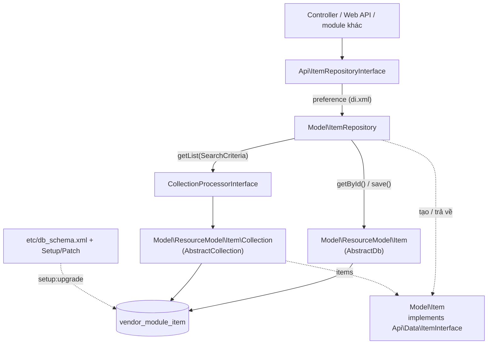

# Custom Data

> **Techstack:** Magento 2.4.x (Adobe Commerce / Magento Open Source)

## 1. Tổng quan

"Custom Data" là cách một module tự định nghĩa và lưu trữ dữ liệu riêng (bảng riêng, entity riêng) thay vì nhét vào bảng core. Trong Magento 2.4, chuẩn hiện tại gồm 3 lớp:

1. **Schema** – khai báo bảng bằng *declarative schema* (`etc/db_schema.xml`) + *patch* (data/schema patch). `InstallSchema`/`UpgradeSchema` là cách cũ, không dùng cho code mới.
2. **Persistence layer** – bộ ba `Model` / `ResourceModel` / `Collection` (Active Record kiểu Magento).
3. **Service contract** – `Api/Data/*Interface` (Data Interface) + `Api/*RepositoryInterface` để module khác, Web API, GraphQL dùng mà không phụ thuộc vào Model.

Khi cần gắn thêm dữ liệu vào entity **của module khác** (order, product, customer…) mà không sửa bảng core, dùng **extension attributes**.

Luồng gọi giữa các lớp của một entity custom:



*Hình 1: Các lớp Schema – Persistence – Service contract của một entity custom*

## 2. Các thành phần chính

| Thành phần | File / Class | Vai trò |
|---|---|---|
| Declarative schema | `etc/db_schema.xml` | Định nghĩa bảng, cột, index, constraint |
| Whitelist | `etc/db_schema_whitelist.json` | Ghi nhận các phần tử schema do module quản lý, cho phép Magento drop/rename an toàn |
| Data patch | `Magento\Framework\Setup\Patch\DataPatchInterface` | Insert/update dữ liệu một lần (lưu trong bảng `patch_list`) |
| Schema patch | `Magento\Framework\Setup\Patch\SchemaPatchInterface` | Thay đổi schema mà XML không diễn tả được |
| Revert | `Magento\Framework\Setup\Patch\PatchRevertableInterface` | `revert()` khi uninstall module |
| Model | `Magento\Framework\Model\AbstractModel` / `AbstractExtensibleModel` | Entity, chứa data |
| ResourceModel | `Magento\Framework\Model\ResourceModel\Db\AbstractDb` | CRUD với DB |
| Collection | `Magento\Framework\Model\ResourceModel\Db\Collection\AbstractCollection` | Load nhiều record |
| Search | `Magento\Framework\Api\SearchCriteria\CollectionProcessorInterface` | Apply `SearchCriteria` vào collection trong `getList()` |

## 3. Ví dụ – bảng `vendor_module_item`

### 3.1. Khai báo bảng – `etc/db_schema.xml`

**Ví dụ:** khai báo bảng bằng declarative schema

```xml
<?xml version="1.0"?>
<!-- app/code/Vendor/Module/etc/db_schema.xml -->
<schema xmlns:xsi="http://www.w3.org/2001/XMLSchema-instance"
        xsi:noNamespaceSchemaLocation="urn:magento:framework:Setup/Declaration/Schema/etc/schema.xsd">
    <table name="vendor_module_item" resource="default" engine="innodb" comment="Vendor Module Item">
        <column xsi:type="int" name="entity_id" unsigned="true" nullable="false" identity="true" comment="Entity ID"/>
        <column xsi:type="varchar" name="sku" length="64" nullable="false" comment="SKU"/>
        <column xsi:type="smallint" name="store_id" unsigned="true" nullable="false" default="0" comment="Store ID"/>
        <column xsi:type="decimal" name="price" precision="20" scale="6" nullable="true" comment="Price"/>
        <column xsi:type="timestamp" name="created_at" nullable="false" default="CURRENT_TIMESTAMP" comment="Created At"/>
        <column xsi:type="timestamp" name="updated_at" nullable="false" default="CURRENT_TIMESTAMP"
                on_update="true" comment="Updated At"/>
        <constraint xsi:type="primary" referenceId="PRIMARY">
            <column name="entity_id"/>
        </constraint>
        <constraint xsi:type="unique" referenceId="VENDOR_MODULE_ITEM_SKU_STORE_ID">
            <column name="sku"/>
            <column name="store_id"/>
        </constraint>
        <constraint xsi:type="foreign" referenceId="VENDOR_MODULE_ITEM_STORE_ID_STORE_STORE_ID"
                    table="vendor_module_item" column="store_id"
                    referenceTable="store" referenceColumn="store_id" onDelete="CASCADE"/>
    </table>
</schema>
```

**Ví dụ:** sinh whitelist và xem trước SQL

```bash
# Sinh/cập nhật whitelist (bắt buộc khi thêm/sửa/xoá cột, index, constraint)
bin/magento setup:db-declaration:generate-whitelist --module-name=Vendor_Module

# Xem trước SQL sẽ chạy (ghi vào var/log/dry-run-installation.log)
bin/magento setup:upgrade --dry-run=1
```

### 3.2. Data Interface + Model

**Ví dụ:** Data Interface

```php
<?php
// app/code/Vendor/Module/Api/Data/ItemInterface.php
declare(strict_types=1);

namespace Vendor\Module\Api\Data;

use Magento\Framework\Api\ExtensibleDataInterface;

interface ItemInterface extends ExtensibleDataInterface
{
    public const ENTITY_ID = 'entity_id';
    public const SKU = 'sku';

    /** @return int|null */
    public function getId();

    /** @return string */
    public function getSku(): string;

    /**
     * @param string $sku
     * @return $this
     */
    public function setSku(string $sku): self;

    /** @return \Vendor\Module\Api\Data\ItemExtensionInterface|null */
    public function getExtensionAttributes();

    /**
     * @param \Vendor\Module\Api\Data\ItemExtensionInterface $extensionAttributes
     * @return $this
     */
    public function setExtensionAttributes(ItemExtensionInterface $extensionAttributes);
}
```

**Ví dụ:** Model implement Data Interface

```php
<?php
// app/code/Vendor/Module/Model/Item.php
declare(strict_types=1);

namespace Vendor\Module\Model;

use Magento\Framework\Model\AbstractExtensibleModel;
use Vendor\Module\Api\Data\ItemExtensionInterface;
use Vendor\Module\Api\Data\ItemInterface;

class Item extends AbstractExtensibleModel implements ItemInterface
{
    protected $_eventPrefix = 'vendor_module_item';

    protected function _construct(): void
    {
        $this->_init(ResourceModel\Item::class);
    }

    public function getSku(): string
    {
        return (string)$this->getData(self::SKU);
    }

    public function setSku(string $sku): self
    {
        return $this->setData(self::SKU, $sku);
    }

    public function getExtensionAttributes()
    {
        return $this->_getExtensionAttributes();
    }

    public function setExtensionAttributes(ItemExtensionInterface $extensionAttributes)
    {
        return $this->_setExtensionAttributes($extensionAttributes);
    }
}
```

### 3.3. ResourceModel + Collection

**Ví dụ:** ResourceModel

```php
<?php
// app/code/Vendor/Module/Model/ResourceModel/Item.php
declare(strict_types=1);

namespace Vendor\Module\Model\ResourceModel;

use Magento\Framework\Model\ResourceModel\Db\AbstractDb;

class Item extends AbstractDb
{
    protected function _construct(): void
    {
        $this->_init('vendor_module_item', 'entity_id');
    }
}
```

**Ví dụ:** Collection

```php
<?php
// app/code/Vendor/Module/Model/ResourceModel/Item/Collection.php
declare(strict_types=1);

namespace Vendor\Module\Model\ResourceModel\Item;

use Magento\Framework\Model\ResourceModel\Db\Collection\AbstractCollection;
use Vendor\Module\Model\Item;
use Vendor\Module\Model\ResourceModel\Item as ItemResource;

class Collection extends AbstractCollection
{
    protected $_idFieldName = 'entity_id';

    protected function _construct(): void
    {
        $this->_init(Item::class, ItemResource::class);
    }
}
```

### 3.4. Repository (rút gọn)

**Ví dụ:** `getById()` và `save()` trong repository

```php
// app/code/Vendor/Module/Model/ItemRepository.php
public function __construct(
    private readonly ItemResource $resource,
    private readonly ItemInterfaceFactory $itemFactory,
    private readonly CollectionFactory $collectionFactory,
    private readonly CollectionProcessorInterface $collectionProcessor,
    private readonly ItemSearchResultsInterfaceFactory $searchResultsFactory
) {
}

public function getById(int $id): ItemInterface
{
    $item = $this->itemFactory->create();
    $this->resource->load($item, $id);
    if (!$item->getId()) {
        throw new NoSuchEntityException(__('Item with id "%1" does not exist.', $id));
    }
    return $item;
}

public function save(ItemInterface $item): ItemInterface
{
    try {
        $this->resource->save($item);
    } catch (\Exception $e) {
        throw new CouldNotSaveException(__($e->getMessage()), $e);
    }
    return $item;
}
```

`etc/di.xml` khai báo `preference` cho `ItemInterface`, `ItemRepositoryInterface`, `ItemSearchResultsInterface`.

### 3.5. Extension attribute cho entity core

**Ví dụ:** khai báo extension attribute cho order

```xml
<!-- app/code/Vendor/Module/etc/extension_attributes.xml -->
<config xmlns:xsi="http://www.w3.org/2001/XMLSchema-instance"
        xsi:noNamespaceSchemaLocation="urn:magento:framework:Api/etc/extension_attributes.xsd">
    <extension_attributes for="Magento\Sales\Api\Data\OrderInterface">
        <attribute code="vendor_delivery_note" type="string"/>
    </extension_attributes>
</config>
```

> [!IMPORTANT]
> Magento chỉ generate getter/setter (`OrderExtensionInterface`); **việc load/save là trách nhiệm của bạn** – thường bằng plugin `afterGet` / `afterGetList` / `afterSave` trên repository, lưu vào bảng riêng của module.

## 4. Best practices & lưu ý

- Tên bảng có prefix vendor (`vendor_module_*`), không thêm cột vào bảng core – dùng bảng riêng + extension attribute.
- Luôn chạy `generate-whitelist` sau khi đổi schema; thiếu whitelist thì Magento **không drop** cột/bảng đã bỏ khỏi XML.
- Đổi tên cột: dùng `onCreate="migrateDataFrom(old_column)"`; đổi tên bảng: `onCreate="migrateDataFromAnotherTable(old_table)"`.
- Data patch phải idempotent và khai báo `getDependencies()` đúng thứ tự; muốn patch chạy lại thì đổi tên class (patch đã apply được ghi vào `patch_list`).
- Code bên ngoài module chỉ dùng Repository/Data Interface; không gọi `$model->load()`/`save()` (deprecated trên model).
- Mỗi foreign key nên có `onDelete` rõ ràng; cột FK cần index (InnoDB tự tạo nếu thiếu, nhưng nên khai báo tường minh).
- Data Interface phải có PHPDoc `@return`/`@param` đầy đủ – Web API dùng [Reflection](Reflection.md) đọc annotation để serialize.

## Tham khảo

**Tài liệu chính thức**
- [Declarative schema – Overview](https://developer.adobe.com/commerce/php/development/components/declarative-schema/)
- [Configure declarative schema](https://developer.adobe.com/commerce/php/development/components/declarative-schema/configuration)
- [Develop data and schema patches](https://developer.adobe.com/commerce/php/development/components/declarative-schema/patches)
- [Migration scripts (declarative schema)](https://developer.adobe.com/commerce/php/development/components/declarative-schema/migration-scripts)
- [Service contracts](https://developer.adobe.com/commerce/php/development/components/service-contracts/)
- [Service contract design patterns](https://developer.adobe.com/commerce/php/development/components/service-contracts/design-patterns)
- [Searching with repositories](https://developer.adobe.com/commerce/php/development/components/searching-with-repositories)
- [Adding extension attributes to entity](https://developer.adobe.com/commerce/php/development/components/add-attributes)

**Source code**
- [`Magento\Framework\Model\ResourceModel\Db\AbstractDb`](https://github.com/magento/magento2/blob/2.4-develop/lib/internal/Magento/Framework/Model/ResourceModel/Db/AbstractDb.php)
- [`Magento\Framework\Model\ResourceModel\Db\Collection\AbstractCollection`](https://github.com/magento/magento2/blob/2.4-develop/lib/internal/Magento/Framework/Model/ResourceModel/Db/Collection/AbstractCollection.php)

**Bài liên quan trong Knowledge Base**
- [Service contracts](../Service%20contracts.md)
- [EAV](EAV.md)
- [QueryBuilder](QueryBuilder.md)
- [Transaction](Transaction.md)
