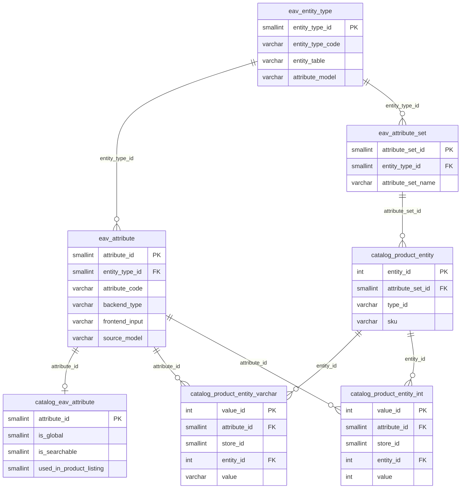

# EAV (Entity – Attribute – Value)

> **Techstack:** Magento 2.4.x (Adobe Commerce / Magento Open Source)

## 1. Tổng quan

EAV là mô hình lưu dữ liệu "dọc": thay vì một bảng nhiều cột, mỗi **giá trị** của một **attribute** cho một **entity** là một dòng riêng. Magento dùng EAV cho những entity cần attribute động do admin tự thêm và có giá trị khác nhau theo store view:

- `catalog_product`, `catalog_category`, `customer`, `customer_address`.
- Order/Quote/Invoice **không** phải EAV – chúng dùng bảng flat (`sales_order`, `quote`, …).

Đổi lại sự linh hoạt, mỗi lần load entity phải join/union nhiều bảng → chậm hơn flat; vì thế storefront dựa nhiều vào **index table** (xem [Optimize & Indexer](Optimize%20%26%20Indexer.md)).

## 2. Cấu trúc bảng

| Nhóm | Bảng | Ý nghĩa |
|---|---|---|
| Entity type | `eav_entity_type` | Khai báo loại entity (`catalog_product`, `customer`…) cùng entity table, attribute model |
| Entity | `catalog_product_entity`, `customer_entity`… | Bảng chính, chứa các attribute `static` |
| Attribute | `eav_attribute` | Định nghĩa chung: `attribute_code`, `backend_type`, `frontend_input`, `backend_model`, `source_model`… |
| Attribute (mở rộng) | `catalog_eav_attribute`, `customer_eav_attribute` | Thuộc tính riêng theo domain: `is_global`, `is_searchable`, `used_in_product_listing`… |
| Attribute set / group | `eav_attribute_set`, `eav_attribute_group`, `eav_entity_attribute` | Gom attribute thành set (product dùng nhiều set), group là tab/fieldset trong admin |
| Option | `eav_attribute_option`, `eav_attribute_option_value` | Option cho `select` / `multiselect` |
| Value | `<entity_table>_varchar`, `_int`, `_decimal`, `_text`, `_datetime` | Giá trị theo `backend_type`, có cột `store_id` (catalog) |

**Backend type**: `static` (cột trên bảng entity), `varchar`, `int`, `decimal`, `text`, `datetime`.

Quan hệ giữa các bảng chính (lấy product làm ví dụ; các bảng `_decimal`, `_text`, `_datetime` có cùng cấu trúc với `_varchar`/`_int`):



*Hình 1: Cấu trúc bảng EAV của product – entity type, attribute, entity và bảng value theo backend type*

> [!WARNING]
> Adobe Commerce (có Staging) dùng cột `row_id` làm khoá liên kết bảng value thay vì `entity_id`. Không hard-code: lấy link field qua `Magento\Framework\EntityManager\MetadataPool::getMetadata(ProductInterface::class)->getLinkField()`.

**Scope** (`Magento\Eav\Model\Entity\Attribute\ScopedAttributeInterface`): `SCOPE_GLOBAL`, `SCOPE_WEBSITE`, `SCOPE_STORE`. Giá trị store-level được lưu với `store_id` tương ứng, fallback về `store_id = 0`.

## 3. Các class chính

- `Magento\Eav\Model\Entity\AbstractEntity` – resource model cho EAV entity (product/category/customer resource kế thừa).
- `Magento\Eav\Model\Entity\Attribute` / `Magento\Catalog\Model\ResourceModel\Eav\Attribute` – attribute model.
- `Magento\Eav\Model\Entity\Attribute\Backend\AbstractBackend` – backend model (validate, beforeSave, afterLoad).
- `Magento\Eav\Model\Entity\Attribute\Source\AbstractSource` – source model cho option.
- `Magento\Eav\Model\Config` – cache metadata EAV (cache type `eav`).
- `Magento\Eav\Setup\EavSetup` / `EavSetupFactory` – thêm/sửa/xoá attribute trong patch.
- `Magento\Customer\Setup\CustomerSetupFactory` – bản mở rộng cho customer.

## 4. Thêm product attribute bằng Data Patch

**Ví dụ:** data patch thêm attribute `vendor_warranty` cho product

```php
<?php
// app/code/Vendor/Module/Setup/Patch/Data/AddWarrantyAttribute.php
declare(strict_types=1);

namespace Vendor\Module\Setup\Patch\Data;

use Magento\Catalog\Model\Product;
use Magento\Eav\Model\Entity\Attribute\ScopedAttributeInterface;
use Magento\Eav\Setup\EavSetupFactory;
use Magento\Framework\Setup\ModuleDataSetupInterface;
use Magento\Framework\Setup\Patch\DataPatchInterface;
use Magento\Framework\Setup\Patch\PatchRevertableInterface;

class AddWarrantyAttribute implements DataPatchInterface, PatchRevertableInterface
{
    private const CODE = 'vendor_warranty';

    public function __construct(
        private readonly ModuleDataSetupInterface $moduleDataSetup,
        private readonly EavSetupFactory $eavSetupFactory
    ) {
    }

    public function apply(): self
    {
        $eavSetup = $this->eavSetupFactory->create(['setup' => $this->moduleDataSetup]);
        $eavSetup->addAttribute(Product::ENTITY, self::CODE, [
            'type' => 'varchar',
            'label' => 'Warranty',
            'input' => 'text',
            'required' => false,
            'global' => ScopedAttributeInterface::SCOPE_STORE,
            'visible' => true,
            'user_defined' => true,
            'searchable' => false,
            'filterable' => false,
            'comparable' => false,
            'visible_on_front' => true,
            'used_in_product_listing' => true,
            'group' => 'General',
            'sort_order' => 200,
        ]);

        return $this;
    }

    public function revert(): void
    {
        $eavSetup = $this->eavSetupFactory->create(['setup' => $this->moduleDataSetup]);
        $eavSetup->removeAttribute(Product::ENTITY, self::CODE);
    }

    public static function getDependencies(): array
    {
        return [];
    }

    public function getAliases(): array
    {
        return [];
    }
}
```

Với customer attribute: dùng `CustomerSetupFactory`, sau đó gán `used_in_forms` (vd. `adminhtml_customer`, `customer_account_edit`) cho attribute và save – nếu không attribute sẽ không xuất hiện trên form.

## 5. Đọc / ghi giá trị EAV hiệu quả

**Ví dụ:** đọc/ghi attribute không cần load toàn bộ product

```php
// Chỉ select attribute cần dùng
$collection = $this->productCollectionFactory->create()
    ->addAttributeToSelect(['name', 'vendor_warranty'])
    ->addAttributeToFilter('vendor_warranty', ['notnull' => true])
    ->setStoreId($storeId);

// Đọc 1 giá trị mà không load cả product
$value = $this->productResource->getAttributeRawValue($productId, 'vendor_warranty', $storeId);

// Ghi 1 attribute của 1 entity đã load
$product->setData('vendor_warranty', '24 months');
$this->productResource->saveAttribute($product, 'vendor_warranty');

// Mass update nhiều product
$this->productAction->updateAttributes($productIds, ['vendor_warranty' => '12 months'], $storeId);
```

(`$this->productResource` là `Magento\Catalog\Model\ResourceModel\Product`, `$this->productAction` là `Magento\Catalog\Model\ResourceModel\Product\Action`.)

## 6. So sánh EAV và Flat

| Tiêu chí | EAV | Flat (bảng thường) |
|---|---|---|
| Thêm attribute | Không ALTER TABLE, admin tự thêm | Phải đổi schema |
| Giá trị theo store | Có sẵn | Phải tự thiết kế |
| Query | Nhiều join, khó index | Đơn giản, nhanh |
| Dùng khi | Entity cần attribute động (product, customer) | Dữ liệu custom của module, cấu trúc cố định |

> [!NOTE]
> "Flat Catalog" (`catalog_product_flat_*`) là tuỳ chọn cũ; Adobe khuyến nghị **không bật** cho các phiên bản 2.4 hiện tại – storefront nên dựa vào index + search engine.

## 7. Best practices & lưu ý

- Dữ liệu custom của module → dùng bảng flat riêng ([Custom Data](Custom%20Data.md)), đừng tạo EAV entity type mới nếu không thật cần.
- Chọn `backend_type` đúng: số nguyên/option → `int`, giá tiền → `decimal`, chuỗi ngắn → `varchar` (255), dài → `text`.
- Luôn `addAttributeToSelect()` những gì cần; `addAttributeToSelect('*')` trên collection lớn rất tốn.
- Tránh `$productRepository->getById()` trong vòng lặp (load toàn bộ attribute + extension). Dùng collection hoặc `getAttributeRawValue`.
- Sau khi thêm attribute bằng patch: flush cache `eav` và reindex các indexer liên quan (EAV, price, search).
- Attribute `is_global = SCOPE_GLOBAL` giúp giảm số dòng value và query đơn giản hơn – chỉ dùng scope store khi thực sự cần.

## Tham khảo

**Tài liệu chính thức**
- [EAV and extension attributes](https://developer.adobe.com/commerce/php/development/components/attributes)
- [Develop data and schema patches](https://developer.adobe.com/commerce/php/development/components/declarative-schema/patches)
- [Product attributes (Admin)](https://experienceleague.adobe.com/en/docs/commerce-admin/catalog/product-attributes/product-attributes)

**Source code**
- [`Magento\Eav\Model\Entity\AbstractEntity`](https://github.com/magento/magento2/blob/2.4-develop/app/code/Magento/Eav/Model/Entity/AbstractEntity.php)
- [`Magento\Eav\Setup\EavSetup`](https://github.com/magento/magento2/blob/2.4-develop/app/code/Magento/Eav/Setup/EavSetup.php)
- [`Magento_Eav` `etc/db_schema.xml`](https://github.com/magento/magento2/blob/2.4-develop/app/code/Magento/Eav/etc/db_schema.xml)

**Bài liên quan trong Knowledge Base**
- [Custom Data](Custom%20Data.md)
- [Validator](Validator.md)
- [Optimize & Indexer](Optimize%20%26%20Indexer.md)
- [Indexing trong M2](../Indexing%20trong%20M2.md)
