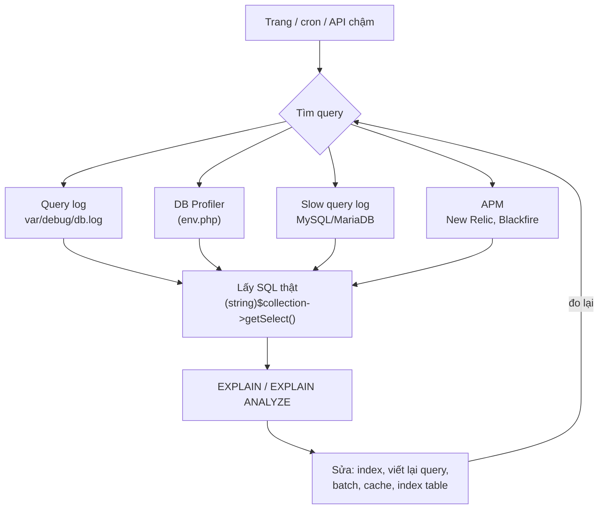

# Explain & Profile query

> **Techstack:** Magento 2.4.x (Adobe Commerce / Magento Open Source)

## 1. Tổng quan

Khi một trang/cron/API chậm, nguyên nhân phần lớn nằm ở DB: query không dùng index, query lặp lại trong vòng lặp (N+1), hoặc load quá nhiều dữ liệu. Quy trình xử lý chuẩn:

1. **Tìm** query nào chạy (và chạy bao nhiêu lần) → query log / DB profiler / slow query log / APM (New Relic, Blackfire).
2. **Lấy SQL thật** mà Magento sinh ra từ collection / `Select`.
3. **Phân tích** bằng `EXPLAIN` / `EXPLAIN ANALYZE`.
4. **Sửa**: thêm index, viết lại query, batch, cache, dùng index table (xem [Optimize & Indexer](Optimize%20%26%20Indexer.md)).



*Hình 1: Quy trình tìm, phân tích và tối ưu query chậm*

## 2. Lấy SQL Magento sinh ra

**Ví dụ:** lấy SQL của một collection

```php
$collection = $this->collectionFactory->create()
    ->addFieldToFilter('status', 1)
    ->setPageSize(20);

// Cách 1: Select -> string (chưa load collection)
$sql = (string)$collection->getSelect();

// Cách 2: helper của collection
$sql = $collection->getSelectSql(true);

$this->logger->debug($sql);
```

Với `Magento\Framework\DB\Select` tự build: `(string)$select` hoặc `$select->assemble()`.

> [!NOTE]
> Cả hai cách trả SQL theo **trạng thái hiện tại** của select. `addFieldToFilter()` được ghi vào `WHERE` ngay, nhưng `setOrder()`, `setPageSize()`/`setCurPage()` chỉ được render (`_renderOrders()`, `_renderLimit()`) khi collection `load()`. Nếu cần SQL đầy đủ (filter + order + limit), log sau khi `load()` hoặc dùng query log bên dưới.

## 3. Query log – `dev:query-log:enable`

Ghi mọi query đi qua adapter `Magento\Framework\DB\Adapter\Pdo\Mysql` vào `var/debug/db.log` (logger `Magento\Framework\DB\Logger\File`).

**Ví dụ:** bật/tắt query log

```bash
# Log tất cả query, kèm call stack
bin/magento dev:query-log:enable

# Chỉ log query chậm hơn 0.5s, không kèm stack
bin/magento dev:query-log:enable --include-all-queries=false --query-time-threshold=0.5 --include-call-stack=false

tail -f var/debug/db.log

bin/magento dev:query-log:disable
```

Lệnh này ghi nhóm `db_logger` vào `app/etc/env.php`:

```php
// app/etc/env.php
'db_logger' => [
    'output' => 'file',
    'log_everything' => 1,
    'query_time_threshold' => '0.001',
    'include_stacktrace' => 1,
],
```

Call stack giúp trả lời "query này do class nào gọi" – rất hữu ích khi tìm N+1.

> [!WARNING]
> **Chỉ bật ở môi trường dev/staging**, log tăng rất nhanh.

## 4. DB Profiler – `Magento\Framework\DB\Profiler`

`Magento\Framework\DB\Profiler` kế thừa `Zend_Db_Profiler`, đo thời gian từng query trong request. Bật trong `app/etc/env.php`:

**Ví dụ:** bật DB profiler cho connection `default`

```php
// app/etc/env.php
'db' => [
    'connection' => [
        'default' => [
            'host' => 'localhost',
            'dbname' => 'magento',
            // ...
            'profiler' => [
                'class' => '\\Magento\\Framework\\DB\\Profiler',
                'enabled' => true,
            ],
        ],
    ],
],
```

Đọc kết quả (vd. trong một class debug tạm thời, inject `ResourceConnection`):

**Ví dụ:** log tổng số query và thời gian từng query

```php
$profiler = $this->resourceConnection->getConnection()->getProfiler();

$this->logger->debug(sprintf(
    'Total: %d queries, %.4fs',
    $profiler->getTotalNumQueries(),
    $profiler->getTotalElapsedSecs()
));

foreach ($profiler->getQueryProfiles() ?: [] as $queryProfile) {
    $this->logger->debug(sprintf(
        '%.4fs | %s',
        $queryProfile->getElapsedSecs(),
        $queryProfile->getQuery()
    ));
}
```

## 5. EXPLAIN / EXPLAIN ANALYZE

**Ví dụ:** phân tích query lọc product theo attribute `int`

```sql
EXPLAIN
SELECT e.entity_id, e.sku
FROM catalog_product_entity AS e
INNER JOIN catalog_product_entity_int AS st
        ON st.entity_id = e.entity_id AND st.attribute_id = 97 AND st.store_id = 0
WHERE st.value = 1;

-- MySQL 8.0.18+: chạy thật query và trả thời gian thực tế từng bước
EXPLAIN ANALYZE SELECT ...;

-- MariaDB tương đương
ANALYZE FORMAT=JSON SELECT ...;
```

Các cột cần đọc trong `EXPLAIN`:

| Cột | Ý nghĩa / dấu hiệu xấu |
|---|---|
| `type` | Tốt → xấu: `const`, `eq_ref`, `ref`, `range`, `index`, **`ALL`** (full table scan) |
| `possible_keys` / `key` | Index có thể dùng / index thực tế được chọn. `key = NULL` → không dùng index |
| `rows` | Số dòng ước tính phải đọc – nhân lên qua các bảng join |
| `filtered` | % dòng còn lại sau điều kiện |
| `Extra` | `Using filesort`, `Using temporary` → cần xem lại `ORDER BY`/`GROUP BY`; `Using index` → covering index (tốt) |

## 6. Slow query log (MySQL/MariaDB)

**Ví dụ:** bật slow query log

```sql
SET GLOBAL slow_query_log = 'ON';
SET GLOBAL long_query_time = 1;              -- giây
SET GLOBAL log_queries_not_using_indexes = 'ON'; -- tuỳ chọn, rất ồn
SHOW VARIABLES LIKE 'slow_query_log_file';
```

Tổng hợp bằng `pt-query-digest` (Percona Toolkit) hoặc `mysqldumpslow` để thấy query nào tốn tổng thời gian nhiều nhất.

## 7. Best practices & lưu ý

- Đo trước, tối ưu sau: một query 5ms chạy 2000 lần (N+1) tệ hơn một query 200ms chạy 1 lần.
- `EXPLAIN` trên dữ liệu gần với production; dataset dev nhỏ khiến optimizer chọn plan khác.
- Hàm trên cột (`DATE(created_at) = ...`, `LOWER(sku)`), `LIKE '%abc'`, so sánh khác kiểu dữ liệu → không dùng được index.
- `EXPLAIN ANALYZE` **thực thi** query – cẩn thận với query nặng trên production.
- Tắt profiler/query log sau khi debug; cả hai đều tốn overhead và có thể ghi dữ liệu nhạy cảm vào log.
- Kết hợp với Blackfire/New Relic để thấy query nằm trong call graph nào.

## Tham khảo

**Tài liệu chính thức**
- [Database profiler – Adobe Commerce](https://experienceleague.adobe.com/en/docs/commerce-operations/configuration-guide/storage/db-profiler)
- [Commerce on-premises CLI reference (`dev:query-log:*`)](https://experienceleague.adobe.com/en/docs/commerce-operations/tools/cli-reference/commerce-on-premises)
- [MySQL 8.0 – EXPLAIN Statement](https://dev.mysql.com/doc/refman/8.0/en/explain.html)
- [MySQL 8.0 – The Slow Query Log](https://dev.mysql.com/doc/refman/8.0/en/slow-query-log.html)
- [MariaDB – ANALYZE Statement](https://mariadb.com/kb/en/analyze-statement/)

**Source code**
- [`Magento\Framework\DB\Profiler`](https://github.com/magento/magento2/blob/2.4-develop/lib/internal/Magento/Framework/DB/Profiler.php)
- [`Magento\Framework\DB\Logger\File`](https://github.com/magento/magento2/blob/2.4-develop/lib/internal/Magento/Framework/DB/Logger/File.php)

**Bài liên quan trong Knowledge Base**
- [QueryBuilder](QueryBuilder.md)
- [Optimize & Indexer](Optimize%20%26%20Indexer.md)
- [iterator](iterator.md)
