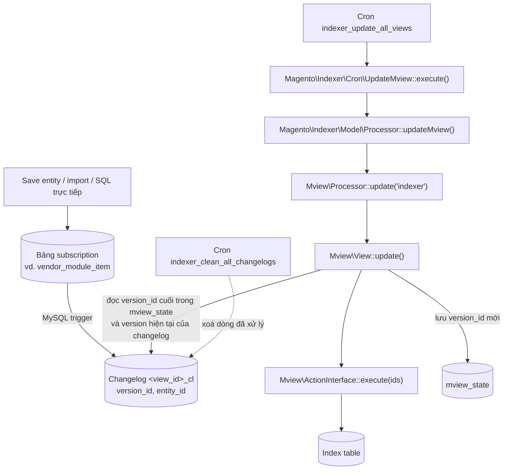

# Optimize & Indexer

> **Techstack:** Magento 2.4.x (Adobe Commerce / Magento Open Source)

## 1. Tổng quan

Tối ưu DB trong Magento xoay quanh 3 ý:

1. **Index của DB** (B-tree, unique, fulltext) – khai báo trong `db_schema.xml` để query nhanh.
2. **Indexer của Magento** – biến dữ liệu chuẩn hoá (EAV, rule, stock…) thành **index table** phẳng, sẵn sàng cho storefront đọc (`catalog_product_index_price`, `catalog_category_product_index_*`, `cataloginventory_stock_status`, …).
3. **Cách viết code truy cập dữ liệu** – batch, tránh N+1, chỉ select cột cần.

> [!NOTE]
> Hai chữ "index" khác nhau: *DB index* là cấu trúc của MySQL; *Magento indexer* là tiến trình sinh ra bảng dữ liệu tính sẵn.

## 2. DB index trong `db_schema.xml`

**Ví dụ:** khai báo index B-tree, fulltext và unique

```xml
<!-- app/code/Vendor/Module/etc/db_schema.xml -->
<table name="vendor_module_item" resource="default" engine="innodb">
    <!-- ... columns ... -->
    <index referenceId="VENDOR_MODULE_ITEM_STATUS_CREATED_AT" indexType="btree">
        <column name="status"/>
        <column name="created_at"/>
    </index>
    <index referenceId="VENDOR_MODULE_ITEM_NAME_FULLTEXT" indexType="fulltext">
        <column name="name"/>
    </index>
    <constraint xsi:type="unique" referenceId="VENDOR_MODULE_ITEM_SKU">
        <column name="sku"/>
    </constraint>
</table>
```

- Composite index theo thứ tự **cột lọc bằng (=) trước, cột range/sort sau** (leftmost prefix).
- Đừng index cột có độ phân biệt thấp một mình (vd. `is_active`) – kết hợp với cột khác.
- Mỗi index làm chậm INSERT/UPDATE; bảng ghi nhiều (log, queue) chỉ giữ index thật cần.

## 3. Magento Indexer

### 3.1. Thành phần

| Thành phần | Mô tả |
|---|---|
| `etc/indexer.xml` | Khai báo indexer: `id`, `view_id`, `class`, `title`, dependencies |
| `etc/mview.xml` | Khai báo *materialized view*: bảng nguồn cần theo dõi (`subscriptions`) |
| `Magento\Framework\Indexer\ActionInterface` | `executeFull()`, `executeList(array $ids)`, `executeRow($id)` |
| `Magento\Framework\Mview\ActionInterface` | `execute($ids)` – được gọi khi chạy theo schedule |
| `Magento\Framework\Indexer\IndexerRegistry` | Lấy indexer theo id: `get('catalog_product_price')` |
| Bảng `<view_id>_cl` | Changelog: `version_id`, `entity_id` |
| Bảng `mview_state`, `indexer_state` | Trạng thái/version của từng view và indexer |

### 3.2. Update on Save và Update by Schedule

| Tiêu chí | Update on Save (`realtime`) | Update by Schedule (`schedule`) |
|---|---|---|
| Khi nào reindex | Ngay trong request save (plugin/observer gọi `executeRow`/`executeList`) | Cron đọc changelog và reindex theo batch |
| Cơ chế | – | MySQL **trigger** trên bảng subscription ghi `entity_id` vào `<view>_cl` |
| Ưu | Dữ liệu cập nhật tức thì | Save nhanh, không lock index table khi admin/import |
| Nhược | Save chậm, dễ deadlock khi ghi nhiều | Trễ tới lần chạy cron kế tiếp |
| Khuyến nghị | Dev / catalog rất nhỏ | **Production** |

**Ví dụ:** các lệnh quản lý indexer

```bash
bin/magento indexer:info
bin/magento indexer:status
bin/magento indexer:show-mode
bin/magento indexer:set-mode schedule                 # tất cả
bin/magento indexer:set-mode realtime catalog_product_price
bin/magento indexer:reindex catalogsearch_fulltext
bin/magento indexer:reset catalog_product_price       # đánh dấu invalid
```

Cron group `index` chạy các job `indexer_reindex_all_invalid`, `indexer_update_all_views` (mỗi phút), `indexer_clean_all_changelogs` (mỗi giờ) – nếu cron không chạy thì mode schedule sẽ không bao giờ cập nhật.



*Hình 1: Luồng Update by Schedule – trigger ghi changelog, cron đọc changelog và gọi action của indexer*

### 3.3. Ví dụ custom indexer

**Ví dụ:** khai báo indexer

```xml
<!-- app/code/Vendor/Module/etc/indexer.xml -->
<config xmlns:xsi="http://www.w3.org/2001/XMLSchema-instance"
        xsi:noNamespaceSchemaLocation="urn:magento:framework:Indexer/etc/indexer.xsd">
    <indexer id="vendor_item_summary" view_id="vendor_item_summary"
             class="Vendor\Module\Model\Indexer\ItemSummary">
        <title translate="true">Vendor Item Summary</title>
        <description translate="true">Aggregate item data for storefront</description>
    </indexer>
</config>
```

**Ví dụ:** khai báo mview subscription

```xml
<!-- app/code/Vendor/Module/etc/mview.xml -->
<config xmlns:xsi="http://www.w3.org/2001/XMLSchema-instance"
        xsi:noNamespaceSchemaLocation="urn:magento:framework:Mview/etc/mview.xsd">
    <view id="vendor_item_summary" class="Vendor\Module\Model\Indexer\ItemSummary" group="indexer">
        <subscriptions>
            <table name="vendor_module_item" entity_column="entity_id"/>
        </subscriptions>
    </view>
</config>
```

**Ví dụ:** action class dùng chung cho indexer và mview

```php
<?php
// app/code/Vendor/Module/Model/Indexer/ItemSummary.php
declare(strict_types=1);

namespace Vendor\Module\Model\Indexer;

use Magento\Framework\Indexer\ActionInterface as IndexerActionInterface;
use Magento\Framework\Mview\ActionInterface as MviewActionInterface;

class ItemSummary implements IndexerActionInterface, MviewActionInterface
{
    public function __construct(private readonly Action\Rebuild $rebuild)
    {
    }

    public function executeFull(): void
    {
        $this->rebuild->execute(null); // toàn bộ, chia batch bên trong
    }

    public function executeList(array $ids): void
    {
        $this->rebuild->execute($ids);
    }

    public function executeRow($id): void
    {
        $this->rebuild->execute([(int)$id]);
    }

    public function execute($ids): void // gọi bởi mview (schedule)
    {
        $this->rebuild->execute(array_map('intval', $ids));
    }
}
```

Khi chạy "on save", module tự gọi reindex sau khi lưu entity – kiểm tra `isScheduled()` để không reindex 2 lần:

**Ví dụ:** reindex một dòng khi indexer ở mode realtime

```php
$indexer = $this->indexerRegistry->get('vendor_item_summary');
if (!$indexer->isScheduled()) {
    $indexer->reindexRow((int)$item->getId());
}
```

### 3.4. Batch size của indexer core

Một số indexer core đọc batch size từ `app/etc/env.php` (key `indexer/batch_size/...`), ví dụ:

```php
// app/etc/env.php
'indexer' => [
    'batch_size' => [
        'catalog_category_product' => 666,
        'catalog_product_price' => ['simple' => 200, 'default' => 500, 'configurable' => 666],
    ],
],
```

## 4. Tối ưu code truy cập dữ liệu

**N+1 / load-in-loop** – lỗi phổ biến nhất:

**Ví dụ:** từ load-in-loop sang collection và query trực tiếp

```php
// XẤU: 1 query (+ nhiều query EAV) cho mỗi id
foreach ($productIds as $id) {
    $product = $this->productRepository->getById($id);
    $names[$id] = $product->getName();
}

// TỐT: 1 collection, chỉ select attribute cần
$collection = $this->productCollectionFactory->create()
    ->addIdFilter($productIds)
    ->addAttributeToSelect('name');
foreach ($collection as $product) {
    $names[$product->getId()] = $product->getName();
}

// TỐT HƠN cho dữ liệu flat: query trực tiếp, trả mảng
$select = $connection->select()
    ->from($this->resource->getTableName('vendor_module_item'), ['entity_id', 'sku'])
    ->where('entity_id IN (?)', $ids);
$pairs = $connection->fetchPairs($select);
```

Ghi hàng loạt: `insertMultiple()`, `insertOnDuplicate()` thay vì `save()` từng model (mỗi save = 1 transaction + event + validate).

## 5. Best practices & lưu ý

- Production: tất cả indexer để **Update by Schedule**, cron chạy ổn định. (Customer Grid hỗ trợ schedule từ 2.4.8 và mặc định là schedule; bản < 2.4.8 Customer Grid chỉ hỗ trợ Update on Save.)
- Storefront đọc từ index table / search engine, không join trực tiếp bảng EAV trong block/plugin.
- Không gọi `reindexAll()` trong request web; full reindex chỉ chạy CLI/cron.
- Tránh `getSize()` + `count()` + `load()` cùng lúc trên collection lớn; tránh `addAttributeToSelect('*')`.
- Duyệt dữ liệu lớn theo batch – xem [iterator](iterator.md).
- Xác minh hiệu quả bằng `EXPLAIN` và query log – xem [Explain & Profile query](Explain%20%26%20Profile%20query.md).
- Thay đổi trực tiếp bằng SQL vào bảng subscription vẫn kích hoạt trigger mview; nhưng nếu mất trigger (vd. dump/restore DB không kèm trigger) thì schedule không còn ghi changelog – chuyển indexer sang `realtime` rồi `schedule` lại để Magento tạo lại trigger. Lưu ý: chuyển sang `realtime` sẽ **drop bảng `_cl`** (mất các thay đổi chưa xử lý) và **invalidate** indexer (`Indexer::setScheduled(false)`) → cron `indexer_reindex_all_invalid` sẽ full reindex; Adobe khuyên bật maintenance mode và tắt cron trước khi đổi mode. Cách nhẹ hơn: `bin/magento setup:upgrade` tạo lại trigger cho các indexer đang ở mode schedule mà không drop changelog, không invalidate (`Magento\Indexer\Setup\Recurring`).

## Tham khảo

**Tài liệu chính thức**
- [Indexing overview](https://developer.adobe.com/commerce/php/development/components/indexing/)
- [Create a custom indexer](https://developer.adobe.com/commerce/php/development/components/indexing/custom-indexer)
- [Indexer optimization (batching)](https://developer.adobe.com/commerce/php/development/components/indexing/optimization)
- [Manage the indexers (CLI)](https://experienceleague.adobe.com/en/docs/commerce-operations/configuration-guide/cli/manage-indexers)
- [Indexer configuration best practices](https://experienceleague.adobe.com/en/docs/commerce-operations/implementation-playbook/best-practices/maintenance/indexer-configuration)
- [Configure declarative schema (index/constraint)](https://developer.adobe.com/commerce/php/development/components/declarative-schema/configuration)

**Source code**
- [`Magento\Framework\Mview\View`](https://github.com/magento/magento2/blob/2.4-develop/lib/internal/Magento/Framework/Mview/View.php)
- [`Magento_Indexer` `etc/crontab.xml`](https://github.com/magento/magento2/blob/2.4-develop/app/code/Magento/Indexer/etc/crontab.xml)

**Bài liên quan trong Knowledge Base**
- [Indexing trong M2](../Indexing%20trong%20M2.md)
- [Explain & Profile query](Explain%20%26%20Profile%20query.md)
- [iterator](iterator.md)
- [EAV](EAV.md)
