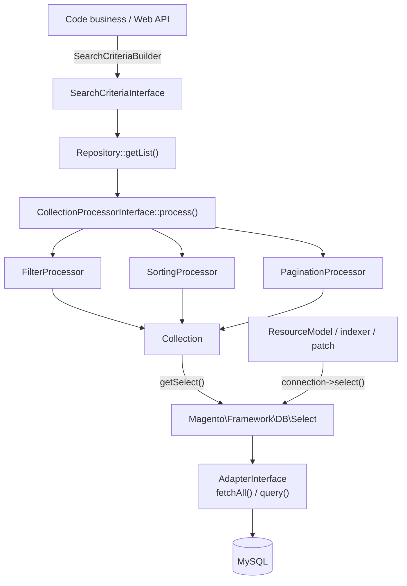

# QueryBuilder

> **Techstack:** Magento 2.4.x (Adobe Commerce / Magento Open Source)

## 1. Tổng quan

Magento có hai tầng "query builder":

| Tầng | Class | Dùng ở đâu |
|---|---|---|
| **SQL builder** | `Magento\Framework\DB\Select` (kế thừa `Zend_Db_Select`) + `Magento\Framework\DB\Adapter\AdapterInterface` | ResourceModel, Collection, indexer, data patch – nơi được phép biết tên bảng/cột |
| **Criteria builder** | `Magento\Framework\Api\SearchCriteriaBuilder`, `FilterBuilder`, `Search\FilterGroupBuilder`, `SortOrderBuilder` | Service contract (`Repository::getList()`), Web API – không phụ thuộc DB |

> [!IMPORTANT]
> Nguyên tắc: code business / module khác dùng **SearchCriteria + Repository**; SQL builder chỉ nằm trong tầng persistence của module.



*Hình 1: Hai tầng query builder – criteria builder ở service contract, SQL builder ở tầng persistence*

## 2. SQL builder – `Magento\Framework\DB\Select`

Lấy connection & select qua `Magento\Framework\App\ResourceConnection`:

**Ví dụ:** báo cáo doanh thu theo SKU bằng `Select`

```php
<?php
// app/code/Vendor/Module/Model/ResourceModel/ItemReport.php
declare(strict_types=1);

namespace Vendor\Module\Model\ResourceModel;

use Magento\Framework\App\ResourceConnection;
use Magento\Framework\DB\Sql\Expression;

class ItemReport
{
    public function __construct(private readonly ResourceConnection $resource)
    {
    }

    public function getRevenueBySku(int $storeId, string $from): array
    {
        $connection = $this->resource->getConnection();

        $select = $connection->select()
            ->from(
                ['i' => $this->resource->getTableName('vendor_module_item')],
                ['sku']
            )
            ->joinInner(
                ['oi' => $this->resource->getTableName('sales_order_item')],
                'oi.sku = i.sku',
                ['revenue' => new Expression('SUM(oi.base_row_total)')]
            )
            ->joinLeft(
                ['s' => $this->resource->getTableName('store')],
                's.store_id = oi.store_id',
                ['store_code' => 's.code']
            )
            ->where('oi.store_id = ?', $storeId)
            ->where('oi.created_at >= ?', $from)
            ->where('i.sku IN (?)', ['SKU-1', 'SKU-2'])
            ->group(['i.sku', 's.code'])
            ->having('revenue > ?', 0)
            ->order('revenue DESC')
            ->limit(50);

        return $connection->fetchAll($select);
    }
}
```

Các method hay dùng:

- Build: `from()`, `columns()`, `joinInner()`, `joinLeft()`, `where()`, `orWhere()`, `group()`, `having()`, `order()`, `limit()`, `limitPage($page, $rowCount)`, `union()`, `reset(Select::COLUMNS)`.
- Đặc thù Magento: `insertFromSelect($table, $fields, $onDuplicate)`, `orderRand()`, `resetJoinLeft()`.
- Fetch qua adapter: `fetchAll()`, `fetchRow()`, `fetchCol()`, `fetchOne()`, `fetchPairs()`, `fetchAssoc()`, hoặc `query($select)` để lấy statement và `fetch()` từng dòng.
- Ghi qua adapter: `insert()`, `insertMultiple()`, `insertOnDuplicate()`, `update($table, $bind, $where)`, `delete($table, $where)`.

### 2.1. Chèn biểu thức SQL thô – `Expression`

`Magento\Framework\DB\Sql\Expression` (kế thừa `Zend_Db_Expr`) đánh dấu một chuỗi là biểu thức SQL, không bị quote/escape – chỉ dùng cho chuỗi do code kiểm soát:

**Ví dụ:** tăng `qty` và cập nhật `updated_at` bằng expression

```php
$connection->update(
    $table,
    ['qty' => new Expression('qty + 1'), 'updated_at' => new Expression('NOW()')],
    ['entity_id = ?' => $id]
);
```

Adapter cũng có helper sinh expression: `getCheckSql()`, `getIfNullSql()`, `getConcatSql()`, `getDateAddSql()`…

### 2.2. Quote & binding

- `where('col = ?', $value)` / `where('col IN (?)', $array)` tự quote giá trị.
- Với điều kiện tự ghép: `$connection->quoteInto('sku = ?', $sku)`, `$connection->quoteIdentifier('order')`.
- **Không bao giờ** nối trực tiếp input của user vào chuỗi SQL.

### 2.3. Collection cũng là query builder

**Ví dụ:** filter, select cột và join trên collection

```php
$collection->addFieldToFilter('status', ['in' => [1, 2]])
    ->addFieldToFilter('created_at', ['gteq' => $from])
    ->addFieldToSelect(['entity_id', 'sku'])
    ->setOrder('created_at', 'DESC');

$collection->getSelect()->joinLeft(
    ['s' => $collection->getTable('store')],
    's.store_id = main_table.store_id',
    ['store_code' => 's.code']
);
```

Condition keys hỗ trợ: `eq`, `neq`, `like`, `nlike`, `in`, `nin`, `null`, `notnull`, `gt`, `lt`, `gteq`, `lteq`, `from`/`to`, `finset`…

## 3. SearchCriteria (service contract)

**Ví dụ:** tìm item active với nhóm điều kiện OR

```php
use Magento\Framework\Api\SearchCriteriaBuilder;
use Magento\Framework\Api\SortOrderBuilder;
use Magento\Framework\Api\FilterBuilder;
use Magento\Framework\Api\Search\FilterGroupBuilder;

public function __construct(
    private readonly SearchCriteriaBuilder $searchCriteriaBuilder,
    private readonly FilterBuilder $filterBuilder,
    private readonly FilterGroupBuilder $filterGroupBuilder,
    private readonly SortOrderBuilder $sortOrderBuilder,
    private readonly ItemRepositoryInterface $itemRepository
) {
}

public function findActive(): array
{
    // Trong 1 filter group: OR. Giữa các group: AND.
    $skuLike = $this->filterBuilder->setField('sku')->setValue('BSS-%')->setConditionType('like')->create();
    $nameLike = $this->filterBuilder->setField('name')->setValue('%bss%')->setConditionType('like')->create();
    $orGroup = $this->filterGroupBuilder->setFilters([$skuLike, $nameLike])->create();

    $sortOrder = $this->sortOrderBuilder->setField('created_at')->setDescendingDirection()->create();

    $criteria = $this->searchCriteriaBuilder
        ->setFilterGroups([$orGroup])
        ->addFilter('status', 1)                 // group AND mới, mặc định 'eq'
        ->addSortOrder($sortOrder)
        ->setPageSize(20)
        ->setCurrentPage(1)
        ->create();

    return $this->itemRepository->getList($criteria)->getItems();
}
```

> [!WARNING]
> `setFilterGroups()` **ghi đè** các group đã thêm trước đó, nên gọi trước `addFilter()`.

Trong repository, apply criteria vào collection bằng `CollectionProcessorInterface`:

**Ví dụ:** `getList()` trong repository

```php
// app/code/Vendor/Module/Model/ItemRepository.php
public function getList(SearchCriteriaInterface $searchCriteria): ItemSearchResultsInterface
{
    $collection = $this->collectionFactory->create();
    $this->collectionProcessor->process($searchCriteria, $collection);

    $searchResults = $this->searchResultsFactory->create();
    $searchResults->setSearchCriteria($searchCriteria);
    $searchResults->setItems($collection->getItems());
    $searchResults->setTotalCount($collection->getSize());
    return $searchResults;
}
```

Preference mặc định của `Magento\Framework\Api\SearchCriteria\CollectionProcessorInterface` là `Magento\Framework\Api\SearchCriteria\CollectionProcessor` – composite gồm `FilterProcessor`, `SortingProcessor`, `PaginationProcessor`. Có thể thêm *custom filter* cho field đặc biệt (join bảng khác) bằng virtualType `FilterProcessor` với argument `customFilters`.

## 4. Best practices & lưu ý

- Luôn dùng `$this->resource->getTableName()` / `$collection->getTable()` – hỗ trợ table prefix.
- Chỉ select cột cần (`from($table, ['col1', 'col2'])`), tránh `*` trên bảng rộng.
- `IN (?)` với mảng rỗng **không** lỗi cú pháp: `Pdo\Mysql::quoteInto()` thay mảng rỗng bằng `NULL` → `IN (NULL)` không khớp dòng nào, còn `NOT IN (NULL)` (vd. `['nin' => []]`) cũng trả **0 dòng** thay vì toàn bộ – luôn kiểm tra mảng rỗng và return sớm / bỏ điều kiện.
- Query trả nhiều dòng → dùng batch/iterator ([iterator](iterator.md)), không `fetchAll()` cả triệu dòng.
- Debug SQL: `(string)$select` – xem [Explain & Profile query](Explain%20%26%20Profile%20query.md).
- Không dùng `Zend_Db_Expr`/`Expression` cho dữ liệu người dùng.

## Tham khảo

**Tài liệu chính thức**
- [Searching with repositories (SearchCriteria)](https://developer.adobe.com/commerce/php/development/components/searching-with-repositories)
- [Service contract design patterns](https://developer.adobe.com/commerce/php/development/components/service-contracts/design-patterns)

**Source code**
- [`Magento\Framework\DB\Select`](https://github.com/magento/magento2/blob/2.4-develop/lib/internal/Magento/Framework/DB/Select.php)
- [`Magento\Framework\DB\Adapter\AdapterInterface`](https://github.com/magento/magento2/blob/2.4-develop/lib/internal/Magento/Framework/DB/Adapter/AdapterInterface.php)
- [`Magento\Framework\Api\SearchCriteria\CollectionProcessor`](https://github.com/magento/magento2/blob/2.4-develop/lib/internal/Magento/Framework/Api/SearchCriteria/CollectionProcessor.php)

**Bài liên quan trong Knowledge Base**
- [Custom Data](Custom%20Data.md)
- [Explain & Profile query](Explain%20%26%20Profile%20query.md)
- [iterator](iterator.md)
- [Builder](../SOLID%20principles%20%26%20Patterns%20in%20Magento/Builder.md)
