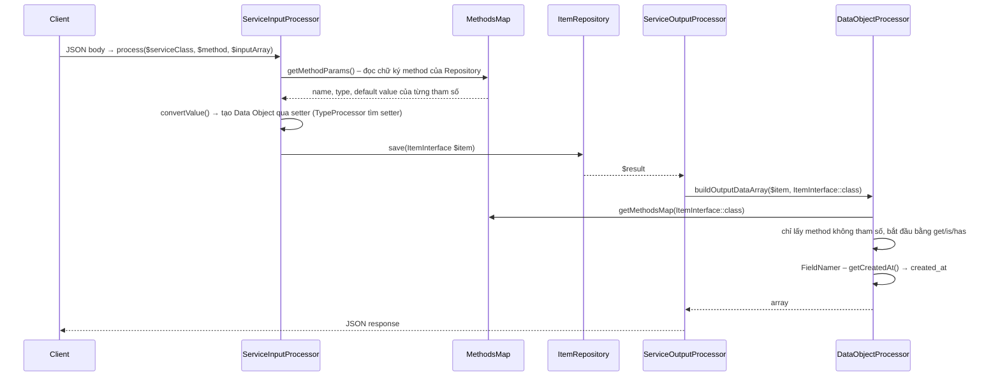

# Reflection

> **Techstack:** Magento 2.4.x (Adobe Commerce / Magento Open Source)

## 1. Tổng quan

Trong ngữ cảnh "DB & Data Object", **Reflection** là bộ công cụ trong namespace `Magento\Framework\Reflection\*` giúp Magento **đọc cấu trúc của Data Interface** (method, kiểu trả về trong PHPDoc, tham số) để tự động:

- **Serialize** Data Object → mảng (output của REST/SOAP, `toArray` của service contract).
- **Deserialize** mảng/JSON → Data Object (input của REST/SOAP, `DataObjectHelper::populateWithArray`).
- Sinh WSDL/schema cho Web API.

Nhờ vậy dev chỉ cần khai báo interface `Api/Data/*Interface` với getter/setter + PHPDoc đúng chuẩn; không phải viết mapper thủ công.

## 2. Các class chính

| Class | Vai trò |
|---|---|
| `Magento\Framework\Reflection\MethodsMap` | Đọc danh sách method của interface/class + kiểu trả về, số tham số, `isRequired`. Kết quả cache vào cache type **`reflection`** |
| `Magento\Framework\Reflection\TypeProcessor` | Chuẩn hoá & phân loại type (`int[]`, `string`, `\Vendor\...\Interface`), xử lý PHPDoc, tìm getter/setter, `isTypeSimple()`, `isArrayType()`… |
| `Magento\Framework\Reflection\DataObjectProcessor` | `buildOutputDataArray($dataObject, $dataObjectType)` – Data Object → array (đệ quy cho object lồng nhau) |
| `Magento\Framework\Reflection\ExtensionAttributesProcessor` | Serialize `extension_attributes` (có kiểm tra ACL resource của attribute) |
| `Magento\Framework\Reflection\CustomAttributesProcessor` | Serialize `custom_attributes` (EAV) |
| `Magento\Framework\Reflection\FieldNamer` | `getFooBar()` / `isFoo()` / `hasFoo()` → `foo_bar` / `foo` |
| `Magento\Framework\Reflection\TypeCaster` | Cast giá trị scalar theo type khai báo |
| `Magento\Framework\Reflection\NameFinder` | Tìm tên getter/setter tương ứng với field |
| `Magento\Framework\Webapi\ServiceInputProcessor` | Request body → tham số method của service (dùng `MethodsMap`, `TypeProcessor`) |
| `Magento\Framework\Webapi\ServiceOutputProcessor` | Kết quả service → array response (dùng `DataObjectProcessor`) |
| `Magento\Framework\Api\DataObjectHelper` | `populateWithArray($dataObject, array $data, $interfaceName)` – fill data object từ array dựa trên setter |

## 3. Luồng REST request

`Magento\Webapi\Controller\Rest\SynchronousRequestProcessor` gọi `InputParamsResolver::resolve()` (bên trong là `ServiceInputProcessor::process()`), thực thi method của service, rồi chuyển kết quả qua `ServiceOutputProcessor::process()`:



*Hình 1: Reflection chuyển đổi input/output của một REST request*

## 4. Ví dụ

### 4.1. Data Interface "chuẩn reflection"

**Ví dụ:** Data Interface có PHPDoc đầy đủ

```php
<?php
// app/code/Vendor/Module/Api/Data/ItemInterface.php
declare(strict_types=1);

namespace Vendor\Module\Api\Data;

interface ItemInterface
{
    /**
     * @return int|null
     */
    public function getId();

    /**
     * @return string
     */
    public function getSku();

    /**
     * @param string $sku
     * @return $this
     */
    public function setSku($sku);

    /**
     * @return \Vendor\Module\Api\Data\ItemOptionInterface[]
     */
    public function getOptions();

    /**
     * @param \Vendor\Module\Api\Data\ItemOptionInterface[] $options
     * @return $this
     */
    public function setOptions(array $options);
}
```

- Kiểu trong PHPDoc phải là **FQCN có dấu `\` đầu** hoặc kiểu scalar (`int`, `string`, `bool`, `float`, `mixed`, `int[]`…).
- Array object khai báo `Type[]` để Reflection biết kiểu phần tử.

### 4.2. Convert Data Object → array (vd. đẩy sang hệ thống ngoài, queue)

**Ví dụ:** converter hai chiều giữa Data Object và array

```php
<?php
// app/code/Vendor/Module/Model/ItemConverter.php
declare(strict_types=1);

namespace Vendor\Module\Model;

use Magento\Framework\Api\DataObjectHelper;
use Magento\Framework\Reflection\DataObjectProcessor;
use Vendor\Module\Api\Data\ItemInterface;
use Vendor\Module\Api\Data\ItemInterfaceFactory;

class ItemConverter
{
    public function __construct(
        private readonly DataObjectProcessor $dataObjectProcessor,
        private readonly DataObjectHelper $dataObjectHelper,
        private readonly ItemInterfaceFactory $itemFactory
    ) {
    }

    public function toArray(ItemInterface $item): array
    {
        return $this->dataObjectProcessor->buildOutputDataArray($item, ItemInterface::class);
    }

    public function fromArray(array $data): ItemInterface
    {
        $item = $this->itemFactory->create();
        $this->dataObjectHelper->populateWithArray($item, $data, ItemInterface::class);
        return $item;
    }
}
```

Khác biệt với `$model->getData()`: `getData()` trả **mọi** key trong `_data` (kể cả field nội bộ), còn `buildOutputDataArray()` chỉ trả field được khai báo qua getter của interface – đúng "contract".

## 5. Reflection cache

- `MethodsMap` lưu metadata vào `Magento\Framework\App\Cache\Type\Reflection` (cache id `reflection`, tag `REFLECTION`) – xem [Magento Cache](../Magento%20Cache.md).
- Sau khi sửa PHPDoc/chữ ký method của Data Interface hoặc thêm extension attribute, nếu API trả field cũ/sai type: `bin/magento cache:clean reflection config_webservice` (WSDL/service metadata nằm ở cache `config_webservice`).
- Production mode: chạy lại `setup:di:compile` khi đổi interface (generated `*Extension`, `*ExtensionInterface`, factory).

## 6. Best practices & lưu ý

- Mọi getter của Data Interface phải có `@return` chính xác; thiếu/sai → lỗi khi gọi API (Web API không suy được type) hoặc field bị cast sai.
- Getter có tham số (`getFoo($storeId)`) bị **bỏ qua** khi serialize.
- Không đặt method helper bắt đầu bằng `get`/`is`/`has` trong Data Interface nếu không muốn nó xuất hiện trong output.
- Giá trị `null` của getter không bắt buộc sẽ bị lược khỏi output.
- Reflection runtime (`\ReflectionClass`) tốn chi phí – dựa vào `MethodsMap` (đã cache) thay vì tự reflect trong vòng lặp.
- Extension attribute có khai báo `<resources>` ACL chỉ được serialize khi user API có quyền tương ứng.

## Tham khảo

**Tài liệu chính thức**
- [Web API – Services](https://developer.adobe.com/commerce/php/development/components/web-api/services)
- [Service contracts](https://developer.adobe.com/commerce/php/development/components/service-contracts/)
- [Service contract design patterns](https://developer.adobe.com/commerce/php/development/components/service-contracts/design-patterns)
- [Adding extension attributes to entity](https://developer.adobe.com/commerce/php/development/components/add-attributes)

**Source code**
- [`Magento\Framework\Reflection`](https://github.com/magento/magento2/tree/2.4-develop/lib/internal/Magento/Framework/Reflection)
- [`Magento\Framework\Webapi\ServiceInputProcessor`](https://github.com/magento/magento2/blob/2.4-develop/lib/internal/Magento/Framework/Webapi/ServiceInputProcessor.php)
- [`Magento\Framework\Webapi\ServiceOutputProcessor`](https://github.com/magento/magento2/blob/2.4-develop/lib/internal/Magento/Framework/Webapi/ServiceOutputProcessor.php)

**Bài liên quan trong Knowledge Base**
- [Custom Data](Custom%20Data.md)
- [REST](../API%20Rest%2C%20Soap%20%26%20Graphql/REST.md)
- [Service contracts](../Service%20contracts.md)
- [Magento Cache](../Magento%20Cache.md)
