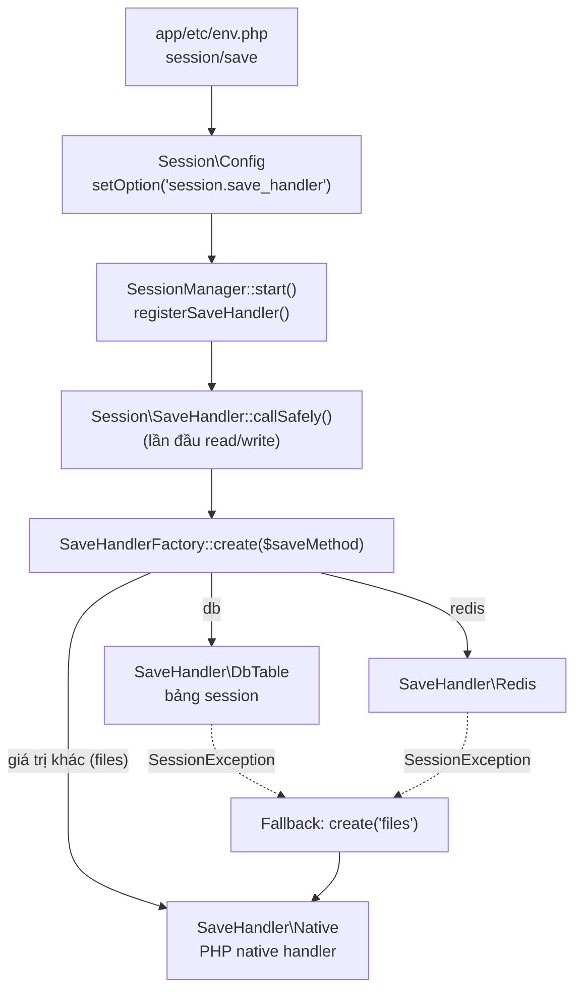

# Session Storage

> **Techstack:** Magento 2.4.x (Adobe Commerce / Magento Open Source)

## 1. Tổng quan

Session lưu trạng thái riêng của từng visitor giữa các request (đăng nhập customer/admin, quote id, message, dữ liệu tạm của form…). Ở Magento có 2 tầng cần phân biệt:

1. **Save handler** – *nơi* PHP session được lưu vật lý: `files`, `db`, `redis` (cấu hình trong `app/etc/env.php`).
2. **Session object** – *cách* code đọc/ghi: các class kế thừa `Magento\Framework\Session\SessionManager`, mỗi class có một **storage namespace** riêng trong `$_SESSION`.

## 2. Các thành phần chính

| Class / Interface | Vai trò |
|---|---|
| `Magento\Framework\Session\SessionManagerInterface` / `SessionManager` | Start session, `getSessionId()`, `regenerateId()`, `destroy()`, `writeClose()`; magic `get*/set*/uns*/has*` chuyển tới storage |
| `Magento\Framework\Session\StorageInterface` / `Storage` | `DataObject` gắn vào `$_SESSION[<namespace>]` |
| `Magento\Framework\Session\Generic` | Session object chung (namespace mặc định) |
| `Magento\Framework\Session\SaveHandler` | Chọn handler theo `session/save`, fallback về `files` |
| `Magento\Framework\Session\SaveHandler\DbTable` | Handler `db` – bảng `session` |
| `Magento\Framework\Session\SaveHandler\Redis` | Handler `redis` (dựa trên thư viện `colinmollenhour/php-redis-session-abstract`) |
| `Magento\Framework\Session\Config` | Cookie lifetime/path/domain, `session/save_path`, gc… |
| `Magento\Framework\Session\SessionMaxSizeConfig` | Giới hạn kích thước session (`system/security/max_session_size_admin`, `..._storefront`) |
| `Magento\Customer\Model\Session` | Customer đăng nhập, `getCustomerId()`, `isLoggedIn()` |
| `Magento\Checkout\Model\Session` | Quote hiện tại (`getQuote()`, `getQuoteId()`), last order |
| `Magento\Backend\Model\Auth\Session` | Admin user đăng nhập, ACL |
| `Magento\Catalog\Model\Session` | Dữ liệu catalog (vd. last viewed category) |

## 3. Cấu hình save handler trong `env.php`

**Ví dụ:** ba lựa chọn `session/save`

```php
// app/etc/env.php
// files (mặc định) – không dùng cho nhiều web node
'session' => [
    'save' => 'files',
],

// db – lưu vào bảng `session`
'session' => [
    'save' => 'db',
],

// redis – khuyến nghị cho production
'session' => [
    'save' => 'redis',
    'redis' => [
        'host' => '127.0.0.1',
        'port' => '6379',
        'password' => '',
        'timeout' => '2.5',
        'persistent_identifier' => '',
        'database' => '2',
        'compression_threshold' => '2048',
        'compression_library' => 'gzip',
        'log_level' => '1',
        'max_concurrency' => '6',
        'break_after_frontend' => '5',
        'break_after_adminhtml' => '30',
        'first_lifetime' => '600',
        'bot_first_lifetime' => '60',
        'bot_lifetime' => '7200',
        'disable_locking' => '0',
        'min_lifetime' => '60',
        'max_lifetime' => '2592000',
    ],
],
```

Cấu hình bằng CLI:

**Ví dụ:** chuyển session sang Redis

```bash
bin/magento setup:config:set --session-save=redis \
    --session-save-redis-host=127.0.0.1 \
    --session-save-redis-port=6379 \
    --session-save-redis-db=2
```

> [!IMPORTANT]
> Dùng **database Redis riêng** cho session, tách khỏi cache/FPC (cache có thể bị flush, session thì không được mất).

Cách Magento chọn handler lúc runtime:



*Hình 1: Chọn save handler theo `session/save` và fallback về `files` khi handler lỗi*

Map `db`/`redis` → class được khai báo ở argument `handlers` của `Magento\Framework\Session\SaveHandlerFactory` trong `app/etc/di.xml`.

## 4. Session riêng cho module

**Ví dụ:** virtualType storage với namespace riêng

```xml
<!-- app/code/Vendor/Module/etc/di.xml -->
<virtualType name="Vendor\Module\Model\Session\Storage" type="Magento\Framework\Session\Storage">
    <arguments>
        <argument name="namespace" xsi:type="string">vendor_module</argument>
    </arguments>
</virtualType>
<type name="Vendor\Module\Model\Session">
    <arguments>
        <argument name="storage" xsi:type="object">Vendor\Module\Model\Session\Storage</argument>
    </arguments>
</type>
```

**Ví dụ:** session class của module

```php
<?php
// app/code/Vendor/Module/Model/Session.php
declare(strict_types=1);

namespace Vendor\Module\Model;

use Magento\Framework\Session\SessionManager;

/**
 * @method string|null getWizardStep()
 * @method $this setWizardStep(string $step)
 * @method $this unsWizardStep()
 */
class Session extends SessionManager
{
}
```

Đây đúng là pattern core dùng cho `Magento\Catalog\Model\Session` (virtualType `Magento\Catalog\Model\Session\Storage`, namespace `catalog`).

Sử dụng – inject **Proxy** vì constructor của `SessionManager` gọi `start()`:

**Ví dụ:** inject session qua Proxy cho controller

```xml
<!-- app/code/Vendor/Module/etc/di.xml -->
<type name="Vendor\Module\Controller\Wizard\Next">
    <arguments>
        <argument name="session" xsi:type="object">Vendor\Module\Model\Session\Proxy</argument>
    </arguments>
</type>
```

**Ví dụ:** đọc/ghi dữ liệu session trong controller

```php
// app/code/Vendor/Module/Controller/Wizard/Next.php
public function __construct(
    private readonly \Vendor\Module\Model\Session $session
) {
}

public function execute()
{
    $this->session->setWizardStep('shipping');
    // ...
}
```

## 5. Session & Full Page Cache

- Trang **cacheable** được render một lần rồi phục vụ cho mọi người, nên Magento *depersonalize* session trong quá trình render layout cacheable (vd. `Magento\Customer\Model\Layout\DepersonalizePlugin`): trong block của trang cacheable, `customerSession->getCustomerId()` có thể trả `null`.
- Dữ liệu riêng của user hiển thị trên trang cache → dùng **private content / customer-data sections**: implement `Magento\Customer\CustomerData\SectionSourceInterface::getSectionData()`, đăng ký vào `Magento\Customer\CustomerData\SectionPoolInterface` (argument `sectionSourceMap`), khai báo invalidation trong `etc/frontend/sections.xml`, đọc ở JS bằng `Magento_Customer/js/customer-data`.
- Biến thể nội dung theo nhóm (customer group, currency…) → `Magento\Framework\App\Http\Context` (vary string), không phải session.
- **Không** đặt `cacheable="false"` cho block chỉ để đọc session – cả trang sẽ không được cache.

## 6. Best practices & lưu ý

- Inject session qua `\Proxy` cho class được tạo sớm (plugin, observer, block, helper) để không start session không cần thiết.
- Không truy cập session trong constructor của block/ViewModel trên trang cacheable.
- Lưu ít và nhỏ: id thay vì object/collection; session lớn làm chậm mọi request và có thể vượt `max_session_size_*`.
- Redis session có **locking**: request song song (AJAX) của cùng user phải chờ nhau. Với request chỉ đọc, gọi `$session->writeClose()` sớm để nhả lock.
- Sau đăng nhập/đổi quyền: `regenerateId()` để tránh session fixation (core đã làm cho customer/admin login).
- Session không dùng cho API REST/GraphQL (token-based) – không dựa vào `Customer\Model\Session` trong code service contract.

## Tham khảo

**Tài liệu chính thức**
- [Use Redis for session storage](https://experienceleague.adobe.com/en/docs/commerce-operations/configuration-guide/cache/redis/redis-session)
- [env.php reference – session](https://experienceleague.adobe.com/en/docs/commerce-operations/configuration-guide/files/config-reference-envphp)
- [Private content](https://developer.adobe.com/commerce/php/development/cache/page/private-content)
- [Public content](https://developer.adobe.com/commerce/php/development/cache/page/public-content)

**Source code**
- [`Magento\Framework\Session\SaveHandler`](https://github.com/magento/magento2/blob/2.4-develop/lib/internal/Magento/Framework/Session/SaveHandler.php)
- [`Magento\Framework\Session\SessionManager`](https://github.com/magento/magento2/blob/2.4-develop/lib/internal/Magento/Framework/Session/SessionManager.php)

**Bài liên quan trong Knowledge Base**
- [Magento Cache](../Magento%20Cache.md)
- [Object Manager (Proxy)](../Object%20Manager.md)
- [Proxies](../SOLID%20principles%20%26%20Patterns%20in%20Magento/Proxies.md)
