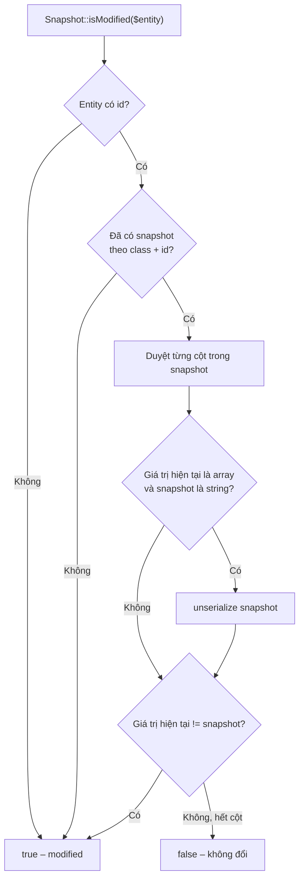
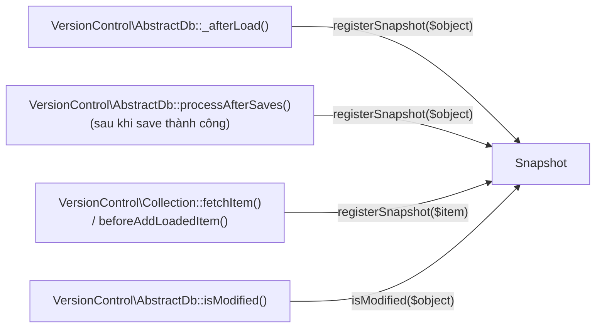

# Snapshot

> **Techstack:** Magento 2.4.x (Adobe Commerce / Magento Open Source)

## 1. Tổng quan

`Magento\Framework\Model\ResourceModel\Db\VersionControl\Snapshot` là cơ chế **chụp lại trạng thái dữ liệu của entity ngay sau khi load/save**, để lần `save()` tiếp theo có thể so sánh và **bỏ qua câu UPDATE nếu dữ liệu không đổi**.

Lý do tồn tại: các entity lớn như order, quote, customer được `save()` rất nhiều lần trong một request (checkout, place order, plugin của bên thứ ba…). Mỗi lần save "rỗng" vẫn tốn transaction + UPDATE + event. Snapshot giúp:

- Giảm số query ghi, giảm lock row → giảm deadlock trong checkout.
- Vẫn cho phép xử lý **relation** (item, address, payment) dù entity cha không đổi.

Snapshot là một phần của bộ [VersionControl](VersionControl.md); bài này tập trung vào bản thân class Snapshot.

## 2. Cách hoạt động

| Method | Mô tả |
|---|---|
| `registerSnapshot(DataObject $entity)` | Lưu `$entity->getData()` (chỉ giữ các key là **cột của main table**) vào `snapshotData[get_class($entity)][$entity->getId()]` |
| `isModified(DataObject $entity)` | `true` nếu entity chưa có id, chưa có snapshot, hoặc có ít nhất một cột khác giá trị snapshot |
| `getSnapshotData(DataObject $entity): array` | Lấy dữ liệu đã chụp (rỗng nếu không có) |
| `clear(?DataObject $entity = null)` | Xoá snapshot – **của cả class** entity truyền vào, hoặc toàn bộ nếu `null` |

Danh sách cột lấy từ `Magento\Framework\Model\ResourceModel\Db\VersionControl\Metadata::getFields()` – gọi `describeTable()` trên main table của resource model và cache theo class.

Chi tiết so sánh trong `isModified()`:

- So sánh lỏng (`!=`), nên `'10'` và `10` được coi là bằng nhau.
- Nếu giá trị hiện tại là array còn snapshot là string → unserialize snapshot rồi so sánh (dành cho field serialized).
- **Field không phải cột của main table** (data tạm, extension attribute, related object) **không** được so sánh.



*Hình 1: Logic so sánh của `Snapshot::isModified()`*

## 3. Các điểm gọi Snapshot



*Hình 2: Các điểm trong VersionControl gọi tới Snapshot*

Flow trong `Magento\Framework\Model\ResourceModel\Db\AbstractDb::save()`:

**Source:** `Magento\Framework\Model\ResourceModel\Db\AbstractDb::save()` (rút gọn)

```php
$this->beginTransaction();
if (!$this->isModified($object)) {        // Snapshot quyết định
    $this->processNotModifiedSave($object); // VersionControl: vẫn xử lý relations
    $this->commit();
    $object->setHasDataChanges(false);
    return $this;
}
$object->validateBeforeSave();
$object->beforeSave();
// ... updateObject / saveNewObject, processAfterSaves ...
```

## 4. Ví dụ

**Ví dụ:** save order không đổi dữ liệu

```php
// Order resource kế thừa VersionControl\AbstractDb → có snapshot
$order = $this->orderRepository->get($orderId);  // _afterLoad: snapshot được chụp

$order->setCustomerNote($order->getCustomerNote()); // giá trị không đổi
$this->orderRepository->save($order);
// → isModified() = false → KHÔNG có UPDATE sales_order,
//   không chạy beforeSave/afterSave, không dispatch sales_order_save_before/after
//   nhưng relation processors (items, addresses, payment...) vẫn chạy.

$order->setData('vendor_flag', 1);              // không phải cột của sales_order
$this->orderRepository->save($order);
// → vẫn coi là "không đổi" nếu các cột khác giữ nguyên!
```

Debug xem entity có bị coi là thay đổi không:

**Ví dụ:** inject `Snapshot` để kiểm tra trạng thái

```php
public function __construct(
    private readonly \Magento\Framework\Model\ResourceModel\Db\VersionControl\Snapshot $snapshot
) {
}

// ...
$isModified = $this->snapshot->isModified($order);
$before = $this->snapshot->getSnapshotData($order);
```

`Snapshot` được dùng như shared instance (mặc định của DI), nên mọi resource model VersionControl cùng chia sẻ một kho snapshot trong request.

## 5. Pitfalls

- **Observer `*_save_after` không chạy** khi entity không đổi. Logic phải chạy mỗi lần save nên dùng plugin trên repository, hoặc đăng ký relation processor (xem [VersionControl](VersionControl.md)).
- **Lưu thêm cột custom vào bảng core** (đã thêm qua `db_schema.xml`) thì sẽ được so sánh vì `describeTable` trả cả cột mới; nhưng dữ liệu nằm ở extension attribute/bảng riêng thì không – phải tự lưu (relation processor hoặc plugin).
- **Update trực tiếp bằng SQL** rồi save object đã load trước đó: snapshot cũ có thể khiến Magento bỏ qua hoặc ghi đè dữ liệu bạn vừa update. Reload entity sau khi ghi SQL trực tiếp.
- `clear($entity)` xoá snapshot **toàn bộ entity cùng class**, không riêng entity đó.
- Long-running process (consumer, cron xử lý hàng nghìn order): snapshot tích luỹ trong bộ nhớ – gọi `clear()` theo batch nếu cần.
- Entity mới (chưa có id) luôn được coi là modified.

## Tham khảo

**Source code**
- [`Magento\Framework\Model\ResourceModel\Db\VersionControl\Snapshot`](https://github.com/magento/magento2/blob/2.4-develop/lib/internal/Magento/Framework/Model/ResourceModel/Db/VersionControl/Snapshot.php)
- [`Magento\Framework\Model\ResourceModel\Db\VersionControl\AbstractDb`](https://github.com/magento/magento2/blob/2.4-develop/lib/internal/Magento/Framework/Model/ResourceModel/Db/VersionControl/AbstractDb.php)
- [`Magento\Framework\Model\ResourceModel\Db\AbstractDb::save()`](https://github.com/magento/magento2/blob/2.4-develop/lib/internal/Magento/Framework/Model/ResourceModel/Db/AbstractDb.php)

**Bài liên quan trong Knowledge Base**
- [VersionControl](VersionControl.md)
- [Transaction](Transaction.md)
- [iterator](iterator.md)
