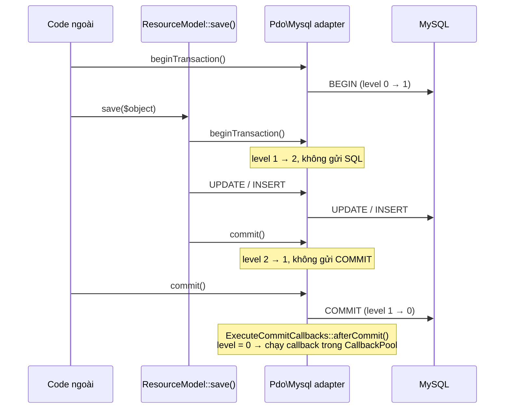
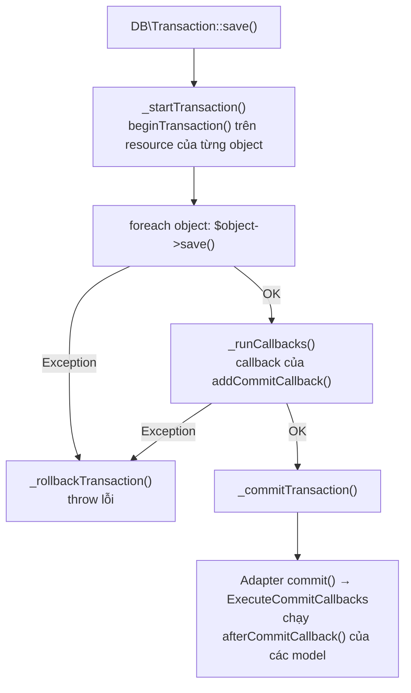

# Transaction

> **Techstack:** Magento 2.4.x (Adobe Commerce / Magento Open Source)

## 1. Tổng quan

Transaction đảm bảo một nhóm thao tác ghi DB **thành công cùng nhau hoặc không thao tác nào được áp dụng** (atomicity). Trong Magento có 3 cách làm việc với transaction:

| Cách | Class | Khi nào dùng |
|---|---|---|
| Adapter trực tiếp | `ResourceConnection::getConnection()` → `beginTransaction()` / `commit()` / `rollBack()` | Ghi bằng SQL (insertMultiple, update…) trong resource model, indexer, import |
| Resource model | `AbstractResource::beginTransaction()` / `commit()` / `rollBack()` / `addCommitCallback()` | `AbstractDb::save()`/`delete()` đã tự bọc transaction |
| Nhiều model | `Magento\Framework\DB\Transaction` (`TransactionFactory`) | Save/delete nhiều model trong một transaction (vd. invoice + order) |

Ngoài ra `Magento\Framework\Model\ResourceModel\Db\TransactionManagerInterface` (`start()`, `commit()`, `rollBack()`) quản lý transaction trên nhiều connection, được dùng nội bộ bởi `ObjectRelationProcessor`/EntityManager.

## 2. Nested transaction trong Magento

MySQL không hỗ trợ transaction lồng nhau thực sự. `Magento\Framework\DB\Adapter\Pdo\Mysql` giả lập bằng **bộ đếm `_transactionLevel`**:

- `beginTransaction()`: chỉ gửi `BEGIN` khi level = 0, sau đó `++level`.
- `commit()`: chỉ gửi `COMMIT` khi level = 1; các level trong chỉ giảm bộ đếm.
- `rollBack()` ở level trong: **không rollback ngay**, chỉ đánh dấu `_isRolledBack = true`. Khi đó mọi `commit()` sau đó sẽ throw `Rolled back transaction has not been completed correctly.` – transaction ngoài **bắt buộc** phải `rollBack()`.
- `rollBack()` ở level 1: gửi `ROLLBACK` thật.
- Commit/rollback khi level = 0 → `Asymmetric transaction commit/rollback.`

Hệ quả: một `save()` bên trong transaction lớn **không commit riêng** – toàn bộ chỉ commit khi transaction ngoài cùng commit.



*Hình 1: Nested transaction – chỉ transaction ngoài cùng gửi BEGIN/COMMIT thật*

## 3. Commit callback – làm việc sau khi commit

`AbstractResource::addCommitCallback($callback)` đăng ký callback vào `Magento\Framework\Model\CallbackPool` theo connection. Plugin `Magento\Framework\Model\ExecuteCommitCallbacks::afterCommit()` chạy các callback **khi transaction ngoài cùng đã commit** (level về 0); `afterRollBack()` xoá chúng. Exception trong callback chỉ bị log (`critical`), không làm hỏng commit.

Model dùng cơ chế này cho `afterCommitCallback()` → event `<prefix>_save_commit_after`. Đây là chỗ đúng để: publish message queue, gọi API ngoài, reindex, clean cache – những việc **không được chạy nếu dữ liệu bị rollback**.

> [!WARNING]
> `Magento\Framework\DB\Transaction::addCommitCallback()` thì **khác**: callback chạy **trước** commit, vẫn trong transaction (`_runCallbacks()` được gọi trước `_commitTransaction()`); nếu callback throw thì toàn bộ rollback.



*Hình 2: `Magento\Framework\DB\Transaction::save()` – callback riêng chạy trước commit, callback của model chạy sau commit*

## 4. Ví dụ

### 4.1. Ghi nhiều bảng bằng adapter

**Ví dụ:** import item và cập nhật batch trong một transaction

```php
<?php
// app/code/Vendor/Module/Model/ResourceModel/ItemImporter.php
declare(strict_types=1);

namespace Vendor\Module\Model\ResourceModel;

use Magento\Framework\App\ResourceConnection;

class ItemImporter
{
    public function __construct(private readonly ResourceConnection $resource)
    {
    }

    /**
     * @param array<int, array{sku: string, price: float}> $rows
     */
    public function import(array $rows, int $batchId): void
    {
        $connection = $this->resource->getConnection();
        $connection->beginTransaction();
        try {
            $connection->insertOnDuplicate(
                $this->resource->getTableName('vendor_module_item'),
                $rows,
                ['price']
            );
            $connection->update(
                $this->resource->getTableName('vendor_module_batch'),
                ['status' => 'done'],
                ['batch_id = ?' => $batchId]
            );
            $connection->commit();
        } catch (\Throwable $e) {
            $connection->rollBack();
            throw $e;
        }
    }
}
```

### 4.2. Save nhiều model với `DB\Transaction`

**Ví dụ:** save invoice và order cùng lúc

```php
use Magento\Framework\DB\TransactionFactory;

public function __construct(private readonly TransactionFactory $transactionFactory)
{
}

public function saveInvoiceAndOrder(Invoice $invoice): void
{
    $this->transactionFactory->create()
        ->addObject($invoice)
        ->addObject($invoice->getOrder())
        ->save(); // rollback toàn bộ nếu một object lỗi
}
```

### 4.3. Việc làm sau commit trong resource model

**Ví dụ:** publish message sau khi commit

```php
// app/code/Vendor/Module/Model/ResourceModel/Item.php
// $this->publisher: Magento\Framework\MessageQueue\PublisherInterface (inject qua constructor)
protected function _afterSave(\Magento\Framework\Model\AbstractModel $object)
{
    $this->addCommitCallback(function () use ($object): void {
        $this->publisher->publish('vendor.item.updated', (string)$object->getId());
    });
    return parent::_afterSave($object);
}
```

Hoặc observer event `vendor_module_item_save_commit_after` (với `_eventPrefix = 'vendor_module_item'`).

## 5. Pitfalls

- **DDL trong transaction**: `CREATE/ALTER/DROP TABLE` gây implicit commit trong MySQL; Magento chặn và throw `DDL statements are not allowed in transactions`. Thay đổi schema thuộc về `db_schema.xml`/schema patch.
- **Nuốt exception** ở transaction trong (catch rồi không throw) sau khi đã `rollBack()` → transaction ngoài commit sẽ throw "Rolled back transaction has not been completed correctly".
- **Gọi API ngoài / gửi email / publish queue bên trong transaction**: nếu sau đó rollback thì side-effect đã xảy ra; đồng thời giữ lock lâu. Dùng commit callback.
- **Transaction quá dài** (vòng lặp hàng nghìn save) → lock wait timeout, deadlock. Chia batch, mỗi batch một transaction.
- **Deadlock** (`SQLSTATE[40001]`): khoá row theo thứ tự nhất quán, giữ transaction ngắn, retry có giới hạn nếu nghiệp vụ cho phép.
- `Magento\Framework\Model\ResourceModel\AbstractResource::commit()` được đánh dấu `@deprecated` (logic callback đã chuyển sang plugin `ExecuteCommitCallbacks`), nhưng vẫn là cách resource model commit – không cần đổi code cũ.
- Mỗi connection có transaction riêng; với split DB (Adobe Commerce cũ: `checkout`, `sales`) một transaction không bao trùm nhiều DB.

## Tham khảo

**Tài liệu chính thức**
- [MySQL 8.0 – Statements That Cause an Implicit Commit](https://dev.mysql.com/doc/refman/8.0/en/implicit-commit.html)

**Source code**
- [`Magento\Framework\DB\Adapter\Pdo\Mysql`](https://github.com/magento/magento2/blob/2.4-develop/lib/internal/Magento/Framework/DB/Adapter/Pdo/Mysql.php)
- [`Magento\Framework\DB\Transaction`](https://github.com/magento/magento2/blob/2.4-develop/lib/internal/Magento/Framework/DB/Transaction.php)
- [`Magento\Framework\Model\ExecuteCommitCallbacks`](https://github.com/magento/magento2/blob/2.4-develop/lib/internal/Magento/Framework/Model/ExecuteCommitCallbacks.php)

**Bài liên quan trong Knowledge Base**
- [Snapshot](Snapshot.md)
- [VersionControl](VersionControl.md)
- [Custom Data](Custom%20Data.md)
