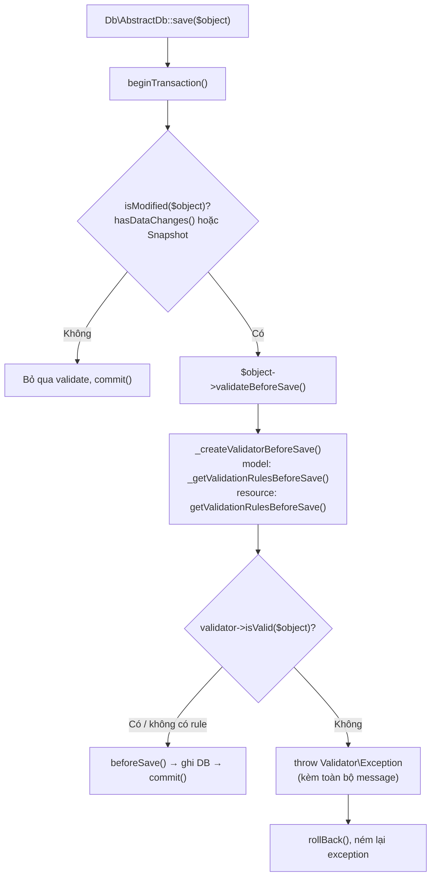

# Validator

> **Techstack:** Magento 2.4.x (Adobe Commerce / Magento Open Source)

## 1. Tổng quan

Validator đảm bảo dữ liệu hợp lệ **trước khi ghi xuống DB**. Ở tầng server, Magento có các điểm validate chính:

1. **Model validation before save** – `AbstractModel::validateBeforeSave()` được `Db\AbstractDb::save()` gọi tự động, dựa trên rule từ `_getValidationRulesBeforeSave()` (model) và `getValidationRulesBeforeSave()` (resource model).
2. **Validation theo cấu hình** – `etc/validation.xml` + `Magento\Framework\Validator\Factory::createValidator($entity, $group)` (customer, customer address dùng cách này).
3. **EAV attribute validation** – backend model của attribute (`AbstractBackend::validate()`: required, unique) và `Magento\Eav\Model\Validator\Attribute\Data` (input/validate rules của attribute).
4. **Service contract / Web API** – repository tự kiểm tra và throw `InputException`; `ServiceInputProcessor` kiểm tra kiểu dữ liệu đầu vào.

> [!IMPORTANT]
> Validation phía frontend (`data-validate`, `validation.js`, `frontend_class` của attribute) chỉ hỗ trợ UX – **không thay thế** validation phía server.

## 2. Các class chính

| Class / Interface | Vai trò |
|---|---|
| `Magento\Framework\Validator\ValidatorInterface` | Kế thừa `Laminas\Validator\ValidatorInterface` (`isValid()`, `getMessages()`) + translator |
| `Magento\Framework\Validator\AbstractValidator` | Base class: `_addMessages()`, `_clearMessages()`, `getMessages()`, `hasMessages()` |
| `Magento\Framework\Validator` | Chain validator: `addValidator($validator, $breakChainOnFailure)` |
| `Magento\Framework\Validator\DataObject` | Áp rule theo field: `addRule($validator, 'field')` – field rỗng = validate cả entity |
| `Magento\Framework\Validator\Factory` | `createValidator($entityName, $groupName)` từ `validation.xml` |
| `Magento\Framework\Validator\Builder`, `Config` | Đọc/merge `validation.xml`, dựng validator |
| `Magento\Framework\Validator\Exception` | Exception chứa danh sách message khi validate thất bại |
| Validator có sẵn | `NotEmpty`, `StringLength`, `Regex`, `EmailAddress`, `Url`, `UrlKey`, `Alnum`, `IntUtils`, `FloatUtils`, `Currency`, `Locale`, `Timezone`… (namespace `Magento\Framework\Validator\`) |

## 3. Custom validator

**Ví dụ:** validator kiểm tra SKU và giá

```php
<?php
// app/code/Vendor/Module/Model/Validator/ItemValidator.php
declare(strict_types=1);

namespace Vendor\Module\Model\Validator;

use Magento\Framework\Validator\AbstractValidator;
use Vendor\Module\Api\Data\ItemInterface;

class ItemValidator extends AbstractValidator
{
    /**
     * @param ItemInterface $value
     */
    public function isValid($value): bool
    {
        $this->_clearMessages();
        $errors = [];

        if (!preg_match('/^[A-Z0-9\-]{3,64}$/', (string)$value->getSku())) {
            $errors['sku'] = __('SKU must be 3-64 characters: A-Z, 0-9, "-".');
        }
        if ($value->getPrice() !== null && (float)$value->getPrice() < 0) {
            $errors['price'] = __('Price cannot be negative.');
        }

        $this->_addMessages($errors);
        return !$this->hasMessages();
    }
}
```

## 4. Gắn vào model – tự chạy khi save

**Ví dụ:** model trả validator qua `_getValidationRulesBeforeSave()`

```php
<?php
// app/code/Vendor/Module/Model/Item.php
declare(strict_types=1);

namespace Vendor\Module\Model;

use Magento\Framework\Model\AbstractModel;
use Vendor\Module\Model\Validator\ItemValidator;

class Item extends AbstractModel
{
    public function __construct(
        \Magento\Framework\Model\Context $context,
        \Magento\Framework\Registry $registry,
        private readonly ItemValidator $itemValidator,
        ?\Magento\Framework\Model\ResourceModel\AbstractResource $resource = null,
        ?\Magento\Framework\Data\Collection\AbstractDb $resourceCollection = null,
        array $data = []
    ) {
        parent::__construct($context, $registry, $resource, $resourceCollection, $data);
    }

    protected function _construct(): void
    {
        $this->_init(ResourceModel\Item::class);
    }

    protected function _getValidationRulesBeforeSave()
    {
        return $this->itemValidator;
    }
}
```

`AbstractModel::validateBeforeSave()` gom rule của model và resource vào một `Laminas\Validator\ValidatorChain`; nếu không hợp lệ sẽ throw `Magento\Framework\Validator\Exception` với toàn bộ message → `save()` rollback.



*Hình 1: Validation tự động trong luồng `save()` của resource model*

> [!NOTE]
> `validateBeforeSave()` chỉ chạy khi entity **thực sự thay đổi** – với resource model VersionControl, entity không đổi sẽ bỏ qua bước này (xem [Snapshot](Snapshot.md)).

Validate theo field bằng `DataObject` (pattern core, vd. `Magento\GoogleAdwords\Model\Config\Backend\Color`):

**Ví dụ:** rule theo field và rule cho cả entity

```php
// $this->validatorObjectFactory: Magento\Framework\Validator\DataObjectFactory
protected function _getValidationRulesBeforeSave()
{
    $validator = $this->validatorObjectFactory->create();
    $validator->addRule($this->skuValidator, 'sku');
    $validator->addRule($this->itemValidator); // cả entity
    return $validator;
}
```

## 5. Validation theo cấu hình – `validation.xml` + `Validator\Factory`

**Ví dụ:** khai báo entity `vendor_item` với group `save`

```xml
<!-- app/code/Vendor/Module/etc/validation.xml -->
<validation xmlns:xsi="http://www.w3.org/2001/XMLSchema-instance"
            xsi:noNamespaceSchemaLocation="urn:magento:framework:Validator/etc/validation.xsd">
    <entity name="vendor_item">
        <rules>
            <rule name="check_item">
                <entity_constraints>
                    <constraint alias="item_validator" class="Vendor\Module\Model\Validator\ItemValidator"/>
                </entity_constraints>
            </rule>
        </rules>
        <groups>
            <group name="save">
                <uses>
                    <use rule="check_item"/>
                </uses>
            </group>
        </groups>
    </entity>
</validation>
```

**Ví dụ:** tạo validator từ cấu hình và kiểm tra

```php
// $this->validatorFactory: Magento\Framework\Validator\Factory
$validator = $this->validatorFactory->createValidator('vendor_item', 'save');
if (!$validator->isValid($item)) {
    throw new \Magento\Framework\Validator\Exception(null, null, $validator->getMessages());
}
```

Đây là cách `Magento\Customer\Model\ResourceModel\Customer::_validate()` hoạt động (`createValidator('customer', 'save')` với các rule `check_eav`, `check_name`, `check_dob`). Module khác có thể **thêm rule vào entity `customer`** bằng `validation.xml` của mình vì file được merge. Ngoài `entity_constraints` còn có `property_constraints` (gắn validator vào một property cụ thể).

## 6. Validation trong Repository / Web API

**Ví dụ:** throw `InputException` cho field bắt buộc

```php
use Magento\Framework\Exception\InputException;

if ($item->getSku() === '') {
    throw InputException::requiredField('sku');
}
```

`Magento\Framework\Validator\Exception` kế thừa `Magento\Framework\Exception\InputException`, nên cả hai đều được Web API trả về dạng HTTP 400 kèm message.

## 7. Best practices & lưu ý

- Validate ở tầng server, càng gần persistence càng tốt; không tin dữ liệu đã "validate ở JS".
- Validator nên **stateless** và inject qua DI; gọi `_clearMessages()` đầu `isValid()` vì instance có thể được tái sử dụng.
- Message dùng `__()` để dịch được; trả **toàn bộ** lỗi một lần thay vì dừng ở lỗi đầu tiên (trừ khi cần `breakChainOnFailure`).
- Ràng buộc toàn vẹn (unique, FK, NOT NULL) vẫn phải có ở schema – validator không thay thế constraint DB.
- Validation tốn kém (query DB) không đặt trong vòng lặp import; validate theo batch.
- Validator của Magento dựa trên `laminas/laminas-validator` – ưu tiên các class wrapper `Magento\Framework\Validator\*` thay vì gọi trực tiếp Laminas.

## Tham khảo

**Tài liệu chính thức**
- [Service contracts](https://developer.adobe.com/commerce/php/development/components/service-contracts/)
- [Service contract design patterns](https://developer.adobe.com/commerce/php/development/components/service-contracts/design-patterns)

**Source code**
- [`Magento\Framework\Validator` – source & README](https://github.com/magento/magento2/tree/2.4-develop/lib/internal/Magento/Framework/Validator)
- [`validation.xsd`](https://github.com/magento/magento2/blob/2.4-develop/lib/internal/Magento/Framework/Validator/etc/validation.xsd)
- [`Magento_Customer` `etc/validation.xml`](https://github.com/magento/magento2/blob/2.4-develop/app/code/Magento/Customer/etc/validation.xml)
- [`Magento\Framework\Model\AbstractModel::validateBeforeSave()`](https://github.com/magento/magento2/blob/2.4-develop/lib/internal/Magento/Framework/Model/AbstractModel.php)

**Bài liên quan trong Knowledge Base**
- [EAV](EAV.md)
- [Custom Data](Custom%20Data.md)
- [Transaction](Transaction.md)
- [Snapshot](Snapshot.md)
