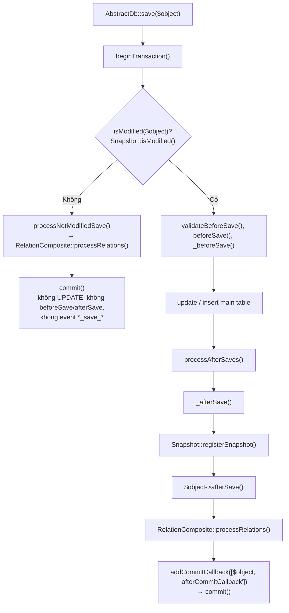

# VersionControl

> **Techstack:** Magento 2.4.x (Adobe Commerce / Magento Open Source)

## 1. Tổng quan

`Magento\Framework\Model\ResourceModel\Db\VersionControl` là bộ class mở rộng resource model chuẩn để:

1. **Theo dõi thay đổi** của entity bằng [Snapshot](Snapshot.md) → bỏ qua UPDATE khi entity không đổi.
2. **Lưu các entity liên quan (relations)** – item, address, payment… – qua một điểm mở rộng thống nhất là `RelationComposite`, kể cả khi entity cha không thay đổi.

> [!NOTE]
> "Version control" ở đây **không** phải lịch sử phiên bản dữ liệu (đó là Staging của Adobe Commerce), mà là kiểm soát "đã thay đổi so với lần load gần nhất hay chưa".

## 2. Các class chính

| Class | Vai trò |
|---|---|
| `...\Db\VersionControl\AbstractDb` | Resource model base: inject `Snapshot` + `RelationComposite`; override `_afterLoad()`, `isModified()`, `processAfterSaves()`, `processNotModifiedSave()` |
| `...\Db\VersionControl\Collection` | Collection base: `registerSnapshot()` cho mỗi item được load (`fetchItem()`, `beforeAddLoadedItem()`) |
| `...\Db\VersionControl\Snapshot` | Lưu & so sánh dữ liệu – xem [Snapshot](Snapshot.md) |
| `...\Db\VersionControl\Metadata` | Danh sách cột của main table (`describeTable`) |
| `...\Db\VersionControl\RelationComposite` | Chạy lần lượt các `RelationInterface` rồi dispatch event `<event_prefix>_process_relation` |
| `...\Db\VersionControl\RelationInterface` | `processRelation(AbstractModel $object)` – lưu entity con |
| `Magento\Eav\Model\Entity\VersionControl\AbstractEntity` | Phiên bản cho EAV entity (customer, customer address); `Magento_Customer` inject Snapshot virtualType dùng `Magento\Eav\Model\Entity\VersionControl\Metadata` (cột entity table + EAV attribute); address dùng `CustomerAddressSnapshot` → `AddressSnapshot`, xem [Snapshot](Snapshot.md) |

(`...` = `Magento\Framework\Model\ResourceModel`)

### 2.1. Các module core đang dùng

- `Magento\Sales\Model\ResourceModel\EntityAbstract` → Order, Invoice, Shipment, Creditmemo…; collection `Magento\Sales\Model\ResourceModel\Collection\AbstractCollection`.
- `Magento\Quote\Model\ResourceModel\Quote`, `Quote\Address`, …
- `Magento\Customer\Model\ResourceModel\Customer`, `Address` (bản EAV).

## 3. Flow save



*Hình 1: Flow `save()` của resource model VersionControl – Snapshot quyết định có ghi main table hay không*

`RelationComposite::processRelations()`:

**Source:** `Magento\Framework\Model\ResourceModel\Db\VersionControl\RelationComposite::processRelations()` (rút gọn)

```php
foreach ($this->relationProcessors as $processor) {
    $processor->processRelation($object);
}
$this->eventManager->dispatch($object->getEventPrefix() . '_process_relation', ['object' => $object]);
```

Ví dụ core: `Magento\Sales\Model\ResourceModel\Order\Relation` lưu items, payment, status histories, related objects và addresses của order. Được gắn bằng DI:

**Source:** `app/code/Magento/Sales/etc/di.xml` (bản cài composer: `vendor/magento/module-sales/etc/di.xml`)

```xml
<virtualType name="OrderRelationsComposite"
             type="Magento\Framework\Model\ResourceModel\Db\VersionControl\RelationComposite">
    <arguments>
        <argument name="relationProcessors" xsi:type="array">
            <item name="default" xsi:type="object">Magento\Sales\Model\ResourceModel\Order\Relation</item>
        </argument>
    </arguments>
</virtualType>
<type name="Magento\Sales\Model\ResourceModel\Order">
    <arguments>
        <argument name="entityRelationComposite" xsi:type="object">OrderRelationsComposite</argument>
    </arguments>
</type>
```

## 4. Lưu dữ liệu custom của order qua relation processor

Thêm processor vào composite có sẵn (merge argument array, không thay thế). Core cũng làm đúng như vậy: `Magento_Tax` thêm item `applied_taxes` vào `OrderRelationsComposite`. Nên khai báo `<sequence>` `Magento_Sales` trong `module.xml` để processor của bạn chạy **sau** processor `default` của core (merge argument vẫn hoạt động khi không có sequence, nhưng thứ tự chạy không đảm bảo).

**Ví dụ:** thêm processor vào `OrderRelationsComposite`

```xml
<!-- app/code/Vendor/Module/etc/di.xml -->
<virtualType name="OrderRelationsComposite">
    <arguments>
        <argument name="relationProcessors" xsi:type="array">
            <item name="vendor_delivery_note" xsi:type="object">Vendor\Module\Model\ResourceModel\Order\DeliveryNoteRelation</item>
        </argument>
    </arguments>
</virtualType>
```

**Ví dụ:** relation processor lưu delivery note

```php
<?php
// app/code/Vendor/Module/Model/ResourceModel/Order/DeliveryNoteRelation.php
declare(strict_types=1);

namespace Vendor\Module\Model\ResourceModel\Order;

use Magento\Framework\Model\AbstractModel;
use Magento\Framework\Model\ResourceModel\Db\VersionControl\RelationInterface;
use Vendor\Module\Model\ResourceModel\DeliveryNote as DeliveryNoteResource;

class DeliveryNoteRelation implements RelationInterface
{
    public function __construct(private readonly DeliveryNoteResource $deliveryNoteResource)
    {
    }

    /**
     * @param \Magento\Sales\Model\Order $object
     */
    public function processRelation(AbstractModel $object): void
    {
        $note = $object->getExtensionAttributes()?->getVendorDeliveryNote();
        if ($note === null) {
            return;
        }
        $this->deliveryNoteResource->saveForOrder((int)$object->getId(), $note);
    }
}
```

Chạy bên trong transaction của order save → nếu processor throw, toàn bộ order save rollback. Cách thay thế nhẹ hơn: observer event `sales_order_process_relation`.

## 5. Resource model custom dùng VersionControl

**Ví dụ:** resource model kế thừa `VersionControl\AbstractDb`

```php
<?php
// app/code/Vendor/Module/Model/ResourceModel/Shipment.php
declare(strict_types=1);

namespace Vendor\Module\Model\ResourceModel;

use Magento\Framework\Model\ResourceModel\Db\VersionControl\AbstractDb;

class Shipment extends AbstractDb
{
    protected function _construct(): void
    {
        $this->_init('vendor_module_shipment', 'entity_id');
    }
}
```

Constructor cha nhận `Context`, `Snapshot`, `RelationComposite` – DI tự inject; cấu hình `entityRelationComposite` bằng virtualType riêng nếu entity có con. Collection kế thừa `Magento\Framework\Model\ResourceModel\Db\VersionControl\Collection` để item load qua collection cũng có snapshot.

## 6. Best practices & lưu ý

- Chỉ đáng dùng cho entity **save nhiều lần / có nhiều entity con**. Entity CRUD đơn giản dùng `Db\AbstractDb` thường.
- Đừng dựa vào `sales_order_save_after` / `_afterSave()` để lưu dữ liệu phụ – sẽ bị bỏ qua khi order không đổi. Dùng relation processor hoặc `*_process_relation`.
- Relation processor chạy **mọi lần save**, kể cả không đổi → phải nhẹ và tự kiểm tra có gì cần lưu không.
- Load bằng collection không phải VersionControl Collection → không có snapshot → lần save sau luôn UPDATE (đúng nhưng tốn).
- Khi thêm item vào `virtualType` core, dùng `name` item duy nhất để không ghi đè `default`.

## Tham khảo

**Tài liệu chính thức**
- [Adding extension attributes to entity](https://developer.adobe.com/commerce/php/development/components/add-attributes)

**Source code**
- [`Magento\Framework\Model\ResourceModel\Db\VersionControl`](https://github.com/magento/magento2/tree/2.4-develop/lib/internal/Magento/Framework/Model/ResourceModel/Db/VersionControl)
- [`Magento\Sales\Model\ResourceModel\Order\Relation`](https://github.com/magento/magento2/blob/2.4-develop/app/code/Magento/Sales/Model/ResourceModel/Order/Relation.php)
- [`Magento_Sales` `etc/di.xml`](https://github.com/magento/magento2/blob/2.4-develop/app/code/Magento/Sales/etc/di.xml)

**Bài liên quan trong Knowledge Base**
- [Snapshot](Snapshot.md)
- [Transaction](Transaction.md)
- [Custom Data](Custom%20Data.md)
- [Composite Pattern](../SOLID%20principles%20%26%20Patterns%20in%20Magento/Composite%20Pattern.md)
