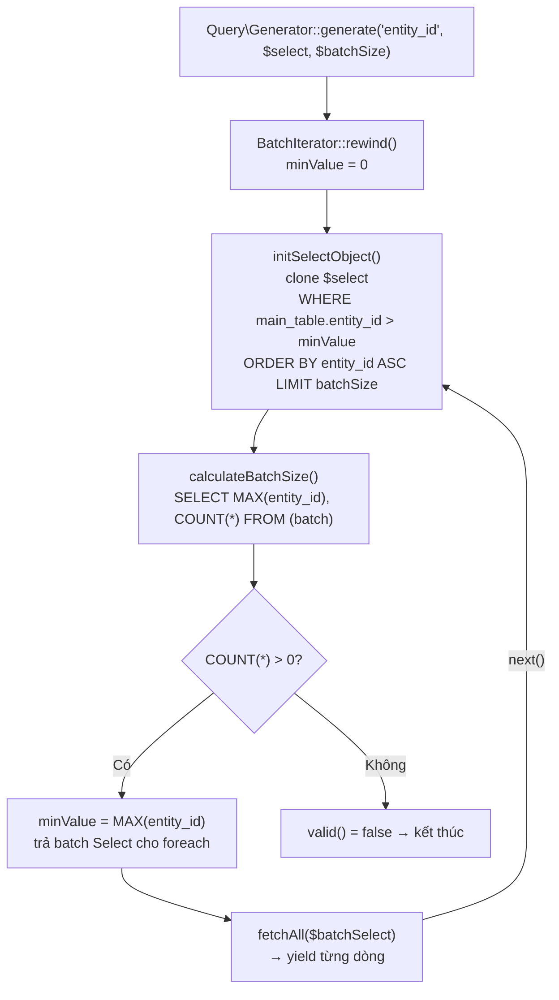

# Iterator – duyệt dữ liệu lớn

> **Techstack:** Magento 2.4.x (Adobe Commerce / Magento Open Source)

## 1. Tổng quan

Bài này nói về **cách duyệt tập dữ liệu lớn từ DB** (hàng trăm nghìn product, order, customer) trong cron, CLI, indexer, export mà không hết `memory_limit` hay giữ lock quá lâu. Về lý thuyết Iterator Pattern, xem [Iterator Design Pattern](../SOLID%20principles%20%26%20Patterns%20in%20Magento/Iterator%20Design%20Pattern.md).

Vấn đề của cách "ngây thơ":

**Ví dụ:** duyệt cả collection – cách không nên làm

```php
$collection = $this->productCollectionFactory->create()->addAttributeToSelect('*');
foreach ($collection as $product) { /* ... */ } // load TOÀN BỘ vào RAM, mỗi dòng là 1 model object
```

Một collection sau khi `load()` giữ mọi item trong `_items`; mỗi model kéo theo data array, resource, event manager… → vài trăm nghìn dòng là đủ làm chết process.

## 2. Các công cụ

| Công cụ | Class | Đặc điểm |
|---|---|---|
| Phân trang collection | `setPageSize()` / `setCurPage()` / `getLastPageNumber()` / `clear()` | Vẫn dùng model, dễ đọc; OFFSET chậm dần ở trang sâu |
| Walk từng dòng | `Magento\Framework\Model\ResourceModel\Iterator::walk()` | Callback nhận **mảng** từng dòng (`$args['row']`), không tạo model |
| Batch theo khoảng id | `Magento\Framework\DB\Query\Generator::generate()` → `BatchIteratorInterface` | Chia `Select` thành nhiều query theo range của cột (keyset), không dùng OFFSET |
| Statement + `fetch()` | `$connection->query($select)` | Lấy từng dòng thay vì `fetchAll()` |
| PHP Generator | `yield` | Đóng gói bất kỳ cách nào ở trên thành iterator lazy cho code gọi |

## 3. Phân trang collection

**Ví dụ:** duyệt order theo trang 500 dòng

```php
$collection = $this->orderCollectionFactory->create()
    ->addFieldToSelect(['entity_id', 'increment_id', 'grand_total'])
    ->addFieldToFilter('state', 'complete')
    ->setOrder('entity_id', 'ASC')
    ->setPageSize(500);

$lastPage = $collection->getLastPageNumber();
for ($page = 1; $page <= $lastPage; $page++) {
    $collection->setCurPage($page);
    foreach ($collection as $order) {
        $this->process($order);
    }
    $collection->clear(); // giải phóng _items, buộc load lại trang kế tiếp
}
```

- Luôn có `ORDER BY` ổn định (thường là primary key), nếu không trang có thể trùng/thiếu dòng.
- Lặp theo `getLastPageNumber()` – không lặp "cho tới khi collection rỗng": một số phiên bản/collection cũ tự kẹp page vượt quá về trang cuối → vòng lặp vô hạn.
- Nếu trong lúc xử lý bạn **sửa cột đang filter** (vd. `status` từ pending → done), dữ liệu dịch chuyển và OFFSET sẽ bỏ sót dòng → dùng batch theo id bên dưới.

## 4. Walk từng dòng – `ResourceModel\Iterator::walk()`

**Ví dụ:** export SKU ra CSV bằng `walk()`

```php
<?php
// app/code/Vendor/Module/Model/SkuExporter.php
declare(strict_types=1);

namespace Vendor\Module\Model;

use Magento\Framework\Model\ResourceModel\Iterator;

class SkuExporter
{
    public function __construct(
        private readonly Iterator $iterator,
        private readonly \Magento\Catalog\Model\ResourceModel\Product\CollectionFactory $collectionFactory
    ) {
    }

    public function export(\SplFileObject $file): void
    {
        // joinType 'left' → JOIN bảng value của `name` vào Select; không truyền joinType thì EAV collection
        // load attribute bằng query riêng sau load() → `walk()` trên getSelect() sẽ không có cột `name`
        $collection = $this->collectionFactory->create()->addAttributeToSelect('name', 'left');

        $this->iterator->walk(
            $collection->getSelect(),
            [[$this, 'writeRow']],
            ['file' => $file]
        );
    }

    public function writeRow(array $args): void
    {
        // $args['row'] = mảng dữ liệu 1 dòng, $args['idx'] = số thứ tự
        $args['file']->fputcsv([$args['row']['sku'], $args['row']['name'] ?? '']);
    }
}
```

`walk($query, array $callbacks, array $args = [], $connection = null)` chấp nhận `Select`, statement, hoặc chuỗi SQL (cần truyền `$connection`). Bên trong là `while ($row = $stmt->fetch())` – không tạo model object.

## 5. Batch theo khoảng id – `Query\Generator` (khuyến nghị)

**Ví dụ:** reader trả từng dòng lazy, mỗi batch một `Select`

```php
<?php
// app/code/Vendor/Module/Model/ItemBatchReader.php
declare(strict_types=1);

namespace Vendor\Module\Model;

use Magento\Framework\App\ResourceConnection;
use Magento\Framework\DB\Query\Generator as QueryGenerator;

class ItemBatchReader
{
    public function __construct(
        private readonly ResourceConnection $resource,
        private readonly QueryGenerator $queryGenerator
    ) {
    }

    /**
     * @return \Generator<int, array> từng dòng, lazy
     */
    public function rows(int $batchSize = 1000): \Generator
    {
        $connection = $this->resource->getConnection();
        $select = $connection->select()
            ->from(['main_table' => $this->resource->getTableName('vendor_module_item')], ['entity_id', 'sku', 'price'])
            ->where('main_table.status = ?', 1);

        foreach ($this->queryGenerator->generate('entity_id', $select, $batchSize) as $batchSelect) {
            foreach ($connection->fetchAll($batchSelect) as $row) {
                yield $row;
            }
        }
    }
}
```

**Ví dụ:** sử dụng reader

```php
foreach ($this->itemBatchReader->rows(2000) as $row) {
    $this->handle($row);
}
```

- Strategy mặc định `BatchIteratorInterface::UNIQUE_FIELD_ITERATOR` (`BatchIterator`): mỗi batch là `WHERE entity_id > <max id batch trước> ORDER BY entity_id LIMIT n` – nhanh đều kể cả với bảng rất lớn. Mỗi batch iterator chạy thêm 1 query `SELECT MAX(..), COUNT(*)` bọc ngoài (`calculateBatchSize()`).
- `NON_UNIQUE_FIELD_ITERATOR` → `BatchRangeIterator` dùng `LIMIT/OFFSET`, cho cột không unique. Gọi qua `generate($field, $select, $batchSize, BatchIteratorInterface::NON_UNIQUE_FIELD_ITERATOR)`; `generateByRange()` đã `@deprecated`.
- Cột range nên là primary key hoặc có index, và **phải có trong danh sách cột select** (iterator tính `MAX(<range field>)` của batch hiện tại để dựng batch tiếp theo); `Select` phải có phần `FROM` hợp lệ.
- `$select` gốc **không nên có `ORDER BY`**: `BatchIterator::initSelectObject()` chỉ *nối thêm* `ORDER BY <range field> ASC` (không reset), nên order cũ đứng trước sẽ làm `MAX(<range field>)` của batch sai → bỏ sót dòng.
- Magento core dùng cách này trong nhiều indexer và data patch (vd. migrate dữ liệu serialized).



*Hình 1: Vòng lặp của `BatchIterator` – mỗi batch là một query keyset theo cột range*

## 6. So sánh `fetchAll()`, `fetch()` và `yield`

**Ví dụ:** lấy toàn bộ kết quả và lấy từng dòng

```php
// fetchAll: toàn bộ kết quả thành mảng PHP một lần
$rows = $connection->fetchAll($select);

// fetch: từng dòng
$stmt = $connection->query($select);
while ($row = $stmt->fetch()) {
    // ...
}
```

> [!NOTE]
> PDO MySQL mặc định dùng **buffered query** – toàn bộ result set vẫn được kéo về client khi `query()` chạy. `fetch()` tiết kiệm được chi phí tạo mảng/model cho mọi dòng cùng lúc, nhưng **không** thay thế cho việc chia batch ở tầng SQL. Với bảng thật lớn, kết hợp `Query\Generator` + `yield`.

## 7. Best practices & lưu ý

- Chỉ select cột cần; với EAV chỉ `addAttributeToSelect()` attribute cần.
- Batch size 500–5000 tuỳ độ rộng dòng; đo `memory_get_peak_usage()` khi tuning.
- Ghi theo batch (`insertMultiple`, `insertOnDuplicate`) và mỗi batch một transaction ngắn – xem [Transaction](Transaction.md).
- Không gọi repository/`load()` trong vòng lặp (N+1) – xem [Optimize & Indexer](Optimize%20%26%20Indexer.md).
- Process chạy lâu: giải phóng tham chiếu (`$collection->clear()`, `unset()`), cân nhắc `Snapshot::clear()` nếu save nhiều entity VersionControl ([Snapshot](Snapshot.md)).
- Không giữ `Select`/statement mở trong khi ghi vào cùng bảng nếu thứ tự đọc phụ thuộc vào dữ liệu đang ghi.

## Tham khảo

**Tài liệu chính thức**
- [Indexer optimization (batching)](https://developer.adobe.com/commerce/php/development/components/indexing/optimization)

**Source code**
- [`Magento\Framework\DB\Query\Generator`](https://github.com/magento/magento2/blob/2.4-develop/lib/internal/Magento/Framework/DB/Query/Generator.php)
- [`Magento\Framework\DB\Query\BatchIterator`](https://github.com/magento/magento2/blob/2.4-develop/lib/internal/Magento/Framework/DB/Query/BatchIterator.php)
- [`Magento\Framework\Model\ResourceModel\Iterator`](https://github.com/magento/magento2/blob/2.4-develop/lib/internal/Magento/Framework/Model/ResourceModel/Iterator.php)

**Bài viết khác**
- [PHP – Generators](https://www.php.net/manual/en/language.generators.overview.php)
- [PHP – Buffered and Unbuffered queries](https://www.php.net/manual/en/mysqlinfo.concepts.buffering.php)

**Bài liên quan trong Knowledge Base**
- [Iterator Design Pattern](../SOLID%20principles%20%26%20Patterns%20in%20Magento/Iterator%20Design%20Pattern.md)
- [QueryBuilder](QueryBuilder.md)
- [Transaction](Transaction.md)
- [Optimize & Indexer](Optimize%20%26%20Indexer.md)
