# Dependency injection configuration (di.xml)

> **Techstack:** Magento 2.4.x (Adobe Commerce / Magento Open Source)

Tài liệu gốc: [The di.xml file | Commerce PHP Extensions](https://developer.adobe.com/commerce/php/development/build/dependency-injection-file)

`di.xml` là nơi module khai báo cho **ObjectManager** biết: interface nào map sang class nào, constructor nhận argument gì, object có shared hay không, plugin nào bọc quanh class nào. Code PHP chỉ khai báo dependency qua constructor; còn "lắp ráp" thế nào nằm hoàn toàn trong `di.xml`.

Xem thêm: [Object Manager](../Object%20Manager.md) · [So sánh overview về Event, Plugin & DI](So%20sánh%20overview%20về%20Event%2C%20Plugin%20%26%20DI.md)

## 1. Scope (area) của di.xml

| File | Áp dụng cho |
|---|---|
| `etc/di.xml` | global – mọi area |
| `etc/frontend/di.xml` | storefront |
| `etc/adminhtml/di.xml` | admin |
| `etc/webapi_rest/di.xml` | REST API |
| `etc/webapi_soap/di.xml` | SOAP API |
| `etc/graphql/di.xml` | GraphQL |
| `etc/crontab/di.xml` | cron |

- Khi bootstrap, ObjectManager load config global trước, sau đó area config (qua `Magento\Framework\ObjectManager\ConfigLoaderInterface::load($areaCode)`) được **merge đè** lên global.
- Giữa các module, thứ tự merge theo `<sequence>` trong `module.xml` → module load sau thắng khi cùng khai báo một `<preference>`/argument.
- Nguyên tắc: chỉ đặt config vào area cần thiết (VD plugin cho checkout storefront → `etc/frontend/di.xml`), tránh ảnh hưởng admin/API/cron.

## 2. Preference – map interface → implementation

**Ví dụ:** khai báo implementation cho interface của module

```xml
<!-- app/code/Vendor/Module/etc/di.xml -->
<config xmlns:xsi="http://www.w3.org/2001/XMLSchema-instance"
        xsi:noNamespaceSchemaLocation="urn:magento:framework:ObjectManager/etc/config.xsd">
    <preference for="Vendor\Module\Api\ShippingCalculatorInterface"
                type="Vendor\Module\Model\ShippingCalculator"/>
</config>
```

- Dùng `preference` cho **interface của chính module** là chuẩn. Dùng `preference` để thay class core (rewrite) là cách cuối cùng: chỉ một preference thắng → dễ conflict giữa các extension, nên ưu tiên plugin.

## 3. Type và arguments

`<argument name="...">` trong `<type>` / `<arguments>` phải **trùng tên biến** trong constructor (`$name`). Các `xsi:type` hợp lệ:

**Ví dụ:** khai báo đủ các loại argument cho một class

```xml
<!-- app/code/Vendor/Module/etc/di.xml -->
<type name="Vendor\Module\Model\Exporter">
    <arguments>
        <argument name="label" xsi:type="string" translate="true">Order exporter</argument>
        <argument name="isEnabled" xsi:type="boolean">true</argument>
        <argument name="batchSize" xsi:type="number">500</argument>
        <argument name="area" xsi:type="const">Magento\Framework\App\Area::AREA_ADMINHTML</argument>
        <argument name="installDate" xsi:type="init_parameter">Magento\Framework\Config\ConfigOptionsListConstants::CONFIG_PATH_INSTALL_DATE</argument>
        <argument name="logger" xsi:type="object">Vendor\Module\Logger\Logger</argument>
        <argument name="session" xsi:type="object">Magento\Customer\Model\Session\Proxy</argument>
        <argument name="resolver" xsi:type="null"/>
        <argument name="formatters" xsi:type="array">
            <item name="csv" xsi:type="object">Vendor\Module\Model\Formatter\Csv</item>
            <item name="xml" xsi:type="object">Vendor\Module\Model\Formatter\Xml</item>
        </argument>
    </arguments>
</type>
```

| xsi:type | Ý nghĩa |
|---|---|
| `string` | Chuỗi; `translate="true"` để dịch |
| `boolean` | `true/false`, `1/0` |
| `number` | Số nguyên/thực |
| `const` | Giá trị hằng số class |
| `init_parameter` | Global init parameter của app (deployment config / bootstrap params), giá trị là hằng số chứa key |
| `object` | Instance class; thêm `shared="false"` để luôn tạo mới |
| `array` | Mảng `<item>`; item có thể lồng `array`/`object`… |
| `null` | Truyền `null` |

- `array` được **merge** giữa các module theo `name` của `<item>` → đây là cơ chế mở rộng pool/composite (thêm 1 item vào `CommandList`, `CommandPool`, validator list…) mà không cần sửa module gốc.
- Argument khai báo cho một class **được kế thừa** bởi class con (trừ khi class con override lại).

Khi ObjectManager tạo object, argument trong `di.xml` được resolve như sau (theo `Magento\Framework\ObjectManager\Factory\Dynamic\Developer` và `AbstractFactory` – mode developer):

```mermaid
flowchart TD
    A["ObjectManager::get() / create()"] --> B["Config::getPreference()<br/>áp dụng preference"]
    B --> C["Factory::create(requestedType)"]
    C --> D["Config::getInstanceType()<br/>virtualType → class thật<br/>có plugin → Interceptor"]
    D --> E["Đọc constructor parameters"]
    E --> F["Merge argument từ di.xml<br/>với argument truyền vào create()"]
    F --> G{"Mỗi parameter"}
    G -- "Có trong arguments" --> H{"Là object (instance)?"}
    G -- "Required, type-hint class" --> H
    G -- "Optional, không khai báo" --> J["Giá trị default"]
    H -- "shared (mặc định)" --> L["ObjectManager::get()"]
    H -- "shared=false" --> M["ObjectManager::create()"]
    H -- "Không phải object" --> N["Giữ giá trị / parse array"]
    L --> O["new Type(...args)"]
    M --> O
    N --> O
    J --> O
```



*Hình 1: Cách ObjectManager resolve preference, virtual type, plugin và constructor argument khi tạo object*

## 4. Shared vs non-shared

**Ví dụ:** class luôn tạo instance mới

```xml
<!-- app/code/Vendor/Module/etc/di.xml -->
<type name="Vendor\Module\Model\Cart\Calculator" shared="false"/>
```

- Mặc định ObjectManager trả **shared instance** (singleton theo request) khi inject qua constructor.
- `shared="false"` ở `<type>`: mỗi lần inject là một instance mới. Ở `<argument xsi:type="object" shared="false">`: chỉ argument đó non-shared.
- Object có state (giữ data theo entity) nên tạo qua **Factory** thay vì non-shared tràn lan.

## 5. Virtual type

Virtual type (`<virtualType>`) = "class ảo" là một class thật + bộ argument khác, không cần tạo file PHP.

**Ví dụ:** logger ghi ra file riêng bằng virtual type

```xml
<!-- app/code/Vendor/Module/etc/di.xml -->
<virtualType name="Vendor\Module\Model\Logger\Handler" type="Magento\Framework\Logger\Handler\Base">
    <arguments>
        <argument name="fileName" xsi:type="string">/var/log/vendor_module.log</argument>
    </arguments>
</virtualType>
<virtualType name="Vendor\Module\Logger\Logger" type="Magento\Framework\Logger\Monolog">
    <arguments>
        <argument name="name" xsi:type="string">vendor_module</argument>
        <argument name="handlers" xsi:type="array">
            <item name="system" xsi:type="object">Vendor\Module\Model\Logger\Handler</item>
        </argument>
    </arguments>
</virtualType>
```

- Không thể khai báo **plugin** cho virtual type (plugin phải gắn vào type thật).
- Virtual type không dùng được trong type-hint PHP – chỉ dùng trong XML (argument `object`, `preference`…).

## 6. Plugin (Interceptor)

**Ví dụ:** khai báo và tắt plugin

```xml
<!-- app/code/Vendor/Module/etc/di.xml -->
<type name="Magento\Catalog\Api\ProductRepositoryInterface">
    <plugin name="vendor_module_product_repository" type="Vendor\Module\Plugin\ProductRepositoryPlugin" sortOrder="10"/>
</type>
<!-- tắt plugin của module khác -->
<type name="Magento\Checkout\Model\Cart">
    <plugin name="some_third_party_plugin" disabled="true"/>
</type>
```

| Method | Signature | Dùng khi |
|---|---|---|
| `beforeX` | `beforeX($subject, ...$args): ?array` | Đổi argument đầu vào |
| `afterX` | `afterX($subject, $result, ...$args)` | Đổi kết quả trả về |
| `aroundX` | `aroundX($subject, callable $proceed, ...$args)` | Bỏ qua/bao bọc hoàn toàn method gốc – hạn chế dùng (stack trace dài, tốn performance) |

- `sortOrder` nhỏ chạy trước. Khi có `around`, các plugin có sortOrder lớn hơn chạy *bên trong* around đó, nên thứ tự `after` không còn tuyến tính – xem bảng ví dụ [Prioritizing plugins](https://developer.adobe.com/commerce/php/development/components/plugins#prioritizing-plugins) trước khi dựa vào thứ tự. Sơ đồ before → around → after: xem [So sánh overview về Event, Plugin & DI](So%20sánh%20overview%20về%20Event%2C%20Plugin%20%26%20DI.md).
- Không dùng plugin cho: `final` class/method, method non-public, static method, `__construct`/`__destruct`, virtual type, object tạo trước khi interception được bootstrap, object không tạo qua ObjectManager.
- Plugin được sinh thành class `...\Interceptor` trong `generated/code` – xem [Decorator Pattern](../SOLID%20principles%20%26%20Patterns%20in%20Magento/Decorator%20Pattern.md) để hiểu bản chất "bọc" object.

## 7. Proxy & Factory (code generation)

- **Factory**: inject `Vendor\Module\Model\FooFactory` → Magento tự sinh class có `create(array $data = [])`.
- **Proxy**: inject `Vendor\Module\Model\Foo\Proxy` (khai báo trong di.xml, không type-hint trực tiếp) → lazy-load dependency nặng, chỉ khởi tạo khi gọi method lần đầu.

**Ví dụ:** inject Proxy cho dependency nặng trong console command

```xml
<!-- app/code/Vendor/Module/etc/di.xml -->
<type name="Vendor\Module\Console\Command\ReindexCommand">
    <arguments>
        <argument name="indexerRegistry" xsi:type="object">Magento\Framework\Indexer\IndexerRegistry\Proxy</argument>
    </arguments>
</type>
```

- Ở mode developer class được sinh on-the-fly vào `generated/code`; ở production phải chạy `setup:di:compile`.
- Xem thêm [Factories Patterns](../SOLID%20principles%20%26%20Patterns%20in%20Magento/Factories%20Patterns.md), [Proxies](../SOLID%20principles%20%26%20Patterns%20in%20Magento/Proxies.md).

## 8. Đánh dấu config path sensitive / environment

Khai báo argument cho `Magento\Config\Model\Config\TypePool` để `app:config:dump` **không** ghi các giá trị này vào `app/etc/config.php` (file được commit):

**Ví dụ:** đánh dấu config path sensitive và environment

```xml
<!-- app/code/Vendor/Module/etc/di.xml -->
<type name="Magento\Config\Model\Config\TypePool">
    <arguments>
        <argument name="sensitive" xsi:type="array">
            <item name="vendor_module/api/secret_key" xsi:type="string">1</item>
        </argument>
        <argument name="environment" xsi:type="array">
            <item name="vendor_module/api/endpoint_url" xsi:type="string">1</item>
        </argument>
    </arguments>
</type>
```

- `sensitive`: secret (API key, password) – set riêng mỗi môi trường qua `config:sensitive:set` / env variable.
- `environment` (system-specific): giá trị khác nhau giữa dev/staging/prod (URL, host…) – được dump vào `app/etc/env.php`.
- Tài liệu: [Sensitive and environment settings](https://developer.adobe.com/commerce/php/development/configuration/sensitive-environment-settings)

## 9. Compile & debug

```bash
# sinh Interceptor/Factory/Proxy + metadata vào generated/
bin/magento setup:di:compile
bin/magento dev:di:info "Magento\Catalog\Api\ProductRepositoryInterface"
```

`dev:di:info` in ra: preference thực tế, constructor parameters (sau khi merge di.xml) và danh sách plugin (kèm method before/around/after) – rất hữu ích khi debug "vì sao plugin không chạy" hoặc "class nào đang thắng preference".

Checklist khi config di.xml không có hiệu lực:

1. Đúng area chưa? (plugin ở `frontend/di.xml` sẽ không chạy trong REST).
2. Tên `<argument name>` có khớp tên biến constructor?
3. Đã xoá `generated/code/<Vendor>` và cache `config` chưa (`bin/magento cache:clean config`)?
4. Production: đã chạy lại `setup:di:compile`?
5. Có module khác cùng khai báo preference và load sau không? (`dev:di:info`)

## Tham khảo

**Tài liệu chính thức**

- [The di.xml file](https://developer.adobe.com/commerce/php/development/build/dependency-injection-file)
- [Dependency injection](https://developer.adobe.com/commerce/php/development/components/dependency-injection)
- [Object Manager](https://developer.adobe.com/commerce/php/development/components/object-manager/)
- [Plugins (Interceptors)](https://developer.adobe.com/commerce/php/development/components/plugins)
- [Factories](https://developer.adobe.com/commerce/php/development/components/factories)
- [Proxies](https://developer.adobe.com/commerce/php/development/components/proxies)
- [Code generation](https://developer.adobe.com/commerce/php/development/components/code-generation)
- [Sensitive and environment settings](https://developer.adobe.com/commerce/php/development/configuration/sensitive-environment-settings)

**Source code**

- [`Magento\Framework\ObjectManager\Factory\Dynamic\Developer`](https://github.com/magento/magento2/blob/2.4-develop/lib/internal/Magento/Framework/ObjectManager/Factory/Dynamic/Developer.php)
- [`Magento\Framework\ObjectManager\Factory\AbstractFactory`](https://github.com/magento/magento2/blob/2.4-develop/lib/internal/Magento/Framework/ObjectManager/Factory/AbstractFactory.php)
- [`ObjectManager/etc/config.xsd`](https://github.com/magento/magento2/blob/2.4-develop/lib/internal/Magento/Framework/ObjectManager/etc/config.xsd) – schema của `di.xml`

**Bài liên quan trong Knowledge Base**

- [Object Manager](../Object%20Manager.md)
- [So sánh overview về Event, Plugin & DI](So%20sánh%20overview%20về%20Event%2C%20Plugin%20%26%20DI.md)
- [Proxies](../SOLID%20principles%20%26%20Patterns%20in%20Magento/Proxies.md)
- [Code generation & Optimal development environment](../Code%20generation%20%26%20Optimal%20development%20environment.md)
