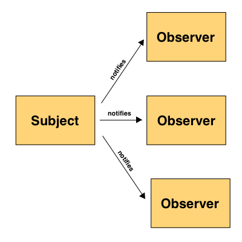
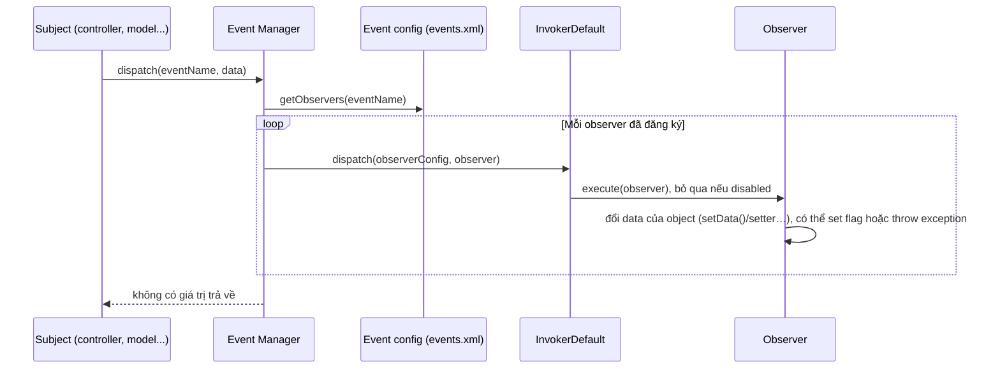
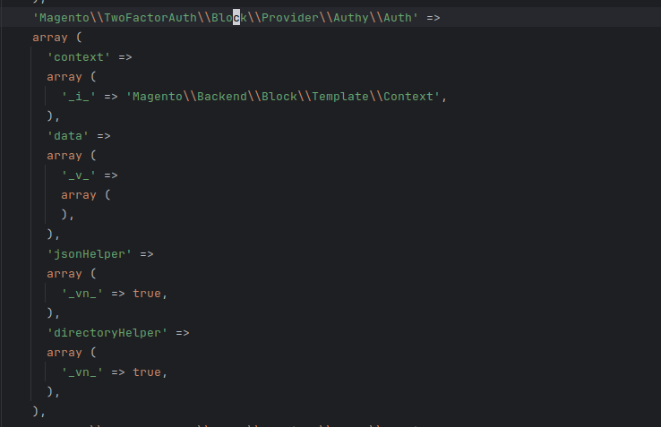
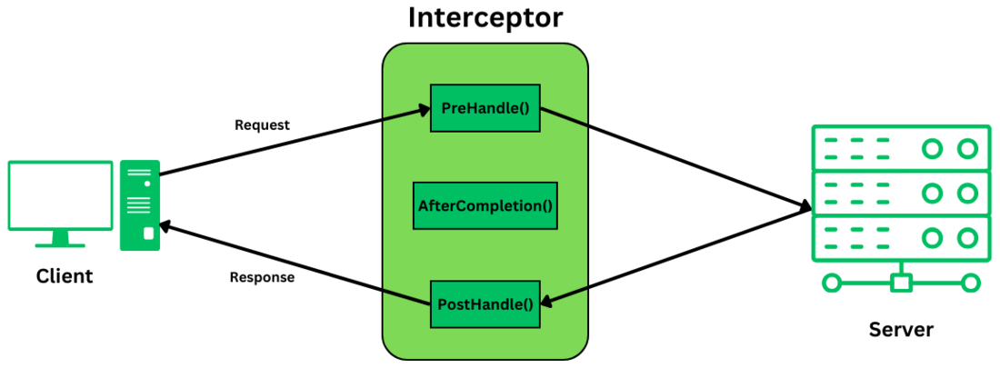
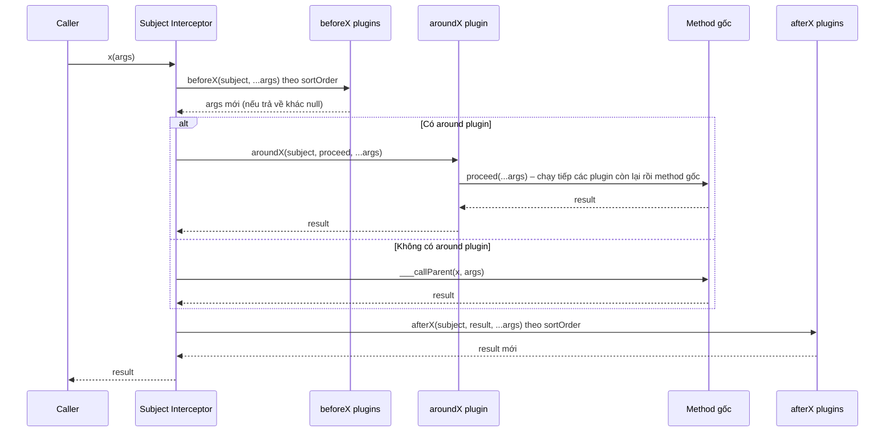
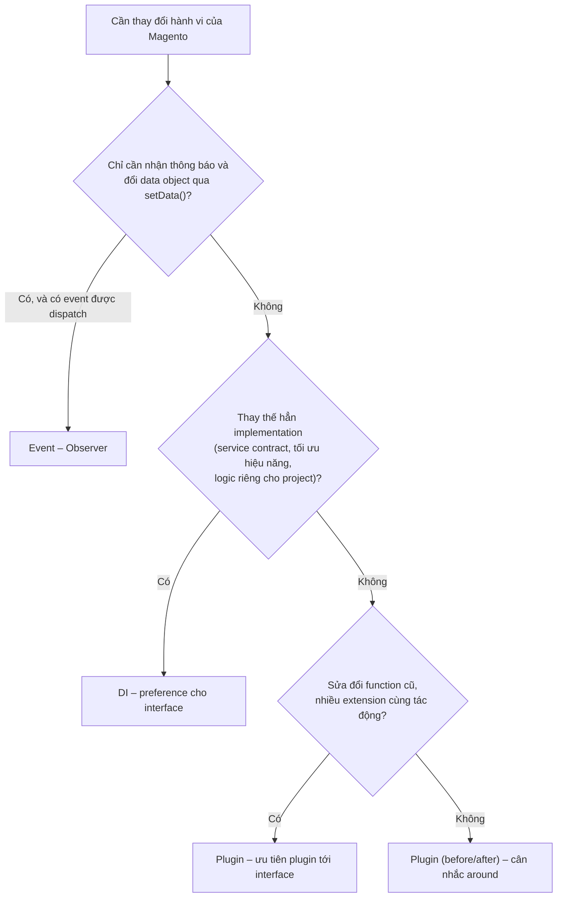

# Overview Event, Plugin & DI

> **Techstack:** Magento 2.4.x (Adobe Commerce / Magento Open Source)

Trước đây khi được hỏi làm thế nào thay thế một function của magento thì câu trả lời sẽ thường là:

Ưu tiên sử dụng event > plugin > override

Nhưng trong thực tế, câu trả lời này không chính xác, vì nó cần phải phụ thuộc vào tính chất của đối tượng cần phải thay đổi, và mong muốn thay đổi những gì của đối tượng, function gốc.

## 1. Event – Được xây dựng dựa trên Event observer pattern

*Hình 1: Observer pattern – Subject thông báo tới các Observer*

Mỗi event sẽ thực dispatch để thực hiện thông báo việc đã thực hiện xong hành động và truyền data tới các observer.

Các observer chỉ thực hiện hành động dựa trên thông báo từ Subject, ko thể **thay thế** method của đối tượng gốc hay đổi giá trị trả về của nó (`Event\Manager::dispatch()` không trả về gì). Observer tác động qua các object được truyền vào event: gọi `setData()`/setter bất kỳ, `save()`…

> [!NOTE]
> Observer vẫn có thể **chặn luồng xử lý** của Subject, nên đừng coi event là "chỉ đổi data":
> - Set flag `no-dispatch` để controller không chạy action – VD `Magento\Captcha\Observer\CheckContactUsFormObserver::execute()` (event `controller_action_predispatch_contact_index_post`) gọi `$this->_actionFlag->set('', Action::FLAG_NO_DISPATCH, true)` khi captcha sai.
> - Throw exception để dừng cả hành động – VD `Magento\Captcha\Observer\CheckUserLoginBackendObserver` throw `PluginAuthenticationException` khi captcha admin login sai.

*Hình 2: `Magento\Framework\Event\Manager::dispatch()` gọi lần lượt các observer đã đăng ký cho event*

Event thường được dispatch trong controller, model, resource model sau, và trước khi các hành động đc thực hiện.

Thi thoảng có thể thấy trong view của layout

## 2. DI – Inject object

DI (dependency injection) sẽ thực hiện thay thế object thông qua ObjectManager (`<preference>` trong `di.xml`). Thường thì đối tượng được thay thế và đối tượng gốc cùng implement một interface (`preference for="...Interface"`), nhưng preference cũng dùng được class → class: class mới phải extends class gốc để giữ type-hint, VD `<preference for="Magento\Framework\Logger\Handler\Debug" type="Magento\Developer\Model\Logger\Handler\Debug"/>` (`Magento/Developer/etc/di.xml`). Preference class → class là rewrite core, dễ conflict giữa các extension – xem [Dependency injection configuration](Dependency%20injection%20configuration.md#2-preference--map-interface--implementation).

DI ko hoàn toàn giống như Mage class trong M1 replace object

M2 đưa show cho developer về DI pattern được thực hiện trong M2:

> “Dependency injection is a design pattern that allows an object A to declare its dependencies to an external object B that supplies those dependencies. The dependencies declared by A are usually class interfaces and the dependencies B provides are concrete implementations for those interfaces.
>
> This allows for loose coupling of code because object A no longer needs to be concerned with initializing its own dependencies. Object B decides which implementations to provide to object A based on a configuration or desired behavior.”

DI sẽ phụ thuộc vào ObjectManager nên chúng sẽ chỉ có thể DI được với các object gọi sau khi ObjectManager khởi tạo.

DI sẽ không thể tác động vào các object khởi tạo bằng toán tử `new Object();` mà chỉ tác động vào các object tạo qua ObjectManager: constructor injection, `ObjectManager::get()` / `ObjectManager::create()` (cả hai đều gọi `Config::getPreference()` trước khi tạo object), Factory (`FooFactory::create()` cũng gọi `ObjectManager::create()`).

DI config được chia theo từng area (global, frontend, adminhtml, webapi_rest…). Nơi đọc config phụ thuộc vào việc đã compile hay chưa:

- **Đã chạy `setup:di:compile`** (production): config đã merge của từng area nằm trong `generated/metadata/<area>.php` (VD `global.php`, `frontend.php`), đọc bởi `Magento\Framework\App\ObjectManager\ConfigLoader\Compiled`. `Magento\Framework\App\EnvironmentFactory` chỉ chuyển sang chế độ compiled khi file `generated/metadata/global.php` tồn tại.
- **Chưa compile** (developer/default): ObjectManager đọc và merge trực tiếp các file `di.xml`, kết quả được cache trong cache type `config` – vì vậy sửa `di.xml` xong phải `cache:clean config`.

> [!WARNING]
> Ở môi trường dev, nếu còn sót `generated/metadata/global.php` từ lần compile trước thì Magento sẽ dùng config compiled cũ và **bỏ qua** thay đổi trong `di.xml`. Xoá `generated/metadata` (hoặc compile lại) khi gặp tình huống này.

*Hình 3: DI config đã compile trong `generated/metadata` cho một class*

Ưu điểm của DI so với plugin có lẽ là performance, và khả năng thay thế các đối tượng phụ thuộc khi khởi tạo object.

DI config được load ngay khi khởi tạo đối tượng dựa trên ObjectManager cũng là một ưu điểm giúp sử dụng DI sẽ có hiệu suất nhanh hơn đáng kể so với Plugin.

Sau khi DI thì vì đối tượng gốc được thay thế bằng đối tượng mới nên hành động của đối tượng mới sẽ dễ kiểm soát, không giống như interceptor là thêm các điểm chặn vào trước và sau của method, và một method có thể bị tác động bởi nhiều interceptor.

DI phù hợp với việc customize các service contract, và sửa các hệ thống cần tối ưu hóa hiệu năng và or hành động xử lý dành riêng cho project, các đối tượng đc implement bởi interface.

## 3. Plugin – interceptors

Plugin sẽ thực hiện một interceptor lên object gốc, yếu điểm sẽ là performance và hành vi của method gốc sẽ bị thay đổi. Magento sinh class `<Class>\Interceptor` **extends** class gốc vào `generated/code` (`Magento\Framework\Interception\Code\Generator\Interceptor`), override **tất cả** public method (trừ `__construct`, final, static…); mỗi method kiểm tra lúc runtime qua `PluginList::getNext()`: có plugin thì gọi `___callPlugins()`, không thì gọi thẳng `parent::method()`; ObjectManager trả về instance của Interceptor thay cho class gốc. Code của class gốc không bị sửa.

*Hình 4: Mô hình interceptor nói chung (minh hoạ theo `HandlerInterceptor` của Spring MVC: preHandle/postHandle/afterCompletion) – chặn trước và sau khi request được xử lý. Magento không có các hook này; plugin Magento chặn từng **public method** bằng before/around/after như Hình 5.*

*Hình 5: Thứ tự chạy before → around → method gốc → after trong `Magento\Framework\Interception\Interceptor::___callPlugins()`*

Ưu điểm:

- Linh động dễ dàng tùy chỉnh đối tượng.
- Có thể tác động đến hầu hết các method, object
- Có thể thực hiện nhiều interceptor vào trong cùng một method của object

Yếu điểm:

- Performance
- Plugin tạo thêm object: class `\Interceptor` được sinh ra thay cho class gốc, và mỗi plugin là một instance riêng – `Magento\Framework\Interception\PluginList\PluginList` giữ danh sách plugin đã merge từ `di.xml` và lấy instance qua `ObjectManager::get()` (shared) trong `getPlugin()`.
- Nhiều Interceptor cùng tác động vào một hành động => dữ liệu bị thay đổi khi chạy qua interceptor => Khó kiểm soát dữ liệu.

Plugin phù hợp với việc customize, sửa đổi lại function cũ, thường là khi build extension vì có thể nhiều interceptor tác động lên 1 func.

> [!TIP]
> Một interceptor nên hạn chế thay đổi dữ liệu đầu vào ra ra của đối tượng gốc. Trong một vài trường hợp nên thay thế bằng DI. Nên ưu tiên plugin tới interface thay vì plugin tới trực tiếp class.

=> Tùy vào mục đích và mong muốn chúng ta sẽ lựa chọn giải pháp phù hợp.

*Hình 6: Tóm tắt cách lựa chọn giữa Event, DI và Plugin theo nội dung bài*

## Tham khảo

**Tài liệu chính thức**

- [Events and observers](https://developer.adobe.com/commerce/php/development/components/events-and-observers/)
- [Plugins (Interceptors)](https://developer.adobe.com/commerce/php/development/components/plugins)
- [Dependency injection](https://developer.adobe.com/commerce/php/development/components/dependency-injection)
- [The di.xml file](https://developer.adobe.com/commerce/php/development/build/dependency-injection-file)

**Source code**

- [`Magento\Framework\Event\Manager`](https://github.com/magento/magento2/blob/2.4-develop/lib/internal/Magento/Framework/Event/Manager.php)
- [`Magento\Framework\Interception\Interceptor`](https://github.com/magento/magento2/blob/2.4-develop/lib/internal/Magento/Framework/Interception/Interceptor.php)

**Bài viết khác**

- [Refactoring.Guru – Observer](https://refactoring.guru/design-patterns/observer)

**Bài liên quan trong Knowledge Base**

- [Dependency injection configuration](Dependency%20injection%20configuration.md)
- [Object Manager](../Object%20Manager.md)
- [Observer](../SOLID%20principles%20%26%20Patterns%20in%20Magento/Observer.md)
- [Decorator Pattern](../SOLID%20principles%20%26%20Patterns%20in%20Magento/Decorator%20Pattern.md)
