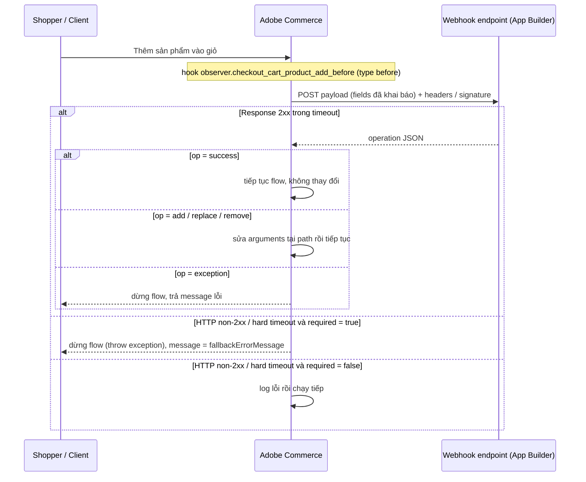

# Event & Webhook – Cloud Version (Adobe Commerce Cloud / App Builder)

> **Techstack:** Magento 2.4.x – Adobe Commerce 2.4.4+ (PaaS: on cloud infrastructure / on-premises; SaaS: Adobe Commerce as a Cloud Service)

> [!NOTE]
> Nội dung bài này chỉ áp dụng cho **Adobe Commerce**. Magento Open Source không hỗ trợ Adobe I/O Events; lựa chọn cho Open Source / Mage-OS xem [Event-driven Architecture with Mage-OS](Event-driven%20Architecture%20with%20Mage-OS.md).

## 1. Tổng quan

Trong Magento truyền thống, mọi tuỳ biến chạy **in-process**: observer (`events.xml`), plugin (`di.xml`), preference… đều là PHP code chạy bên trong request của Magento (xem [So sánh Event, Plugin & DI](../DI%20%26%20Interceptors/So%20s%C3%A1nh%20overview%20v%E1%BB%81%20Event%2C%20Plugin%20%26%20DI.md)).

Với Adobe Commerce trên cloud (đặc biệt **Adobe Commerce as a Cloud Service – SaaS**, nơi không được deploy PHP module tuỳ ý), Adobe đẩy mạnh mô hình **out-of-process extensibility**: logic tuỳ biến chạy **bên ngoài** Commerce (thường trên **Adobe App Builder / I/O Runtime**) và giao tiếp với Commerce qua:

| Cơ chế | Kiểu | Module / package | Dùng khi |
|---|---|---|---|
| **Adobe Commerce Webhooks** | Đồng bộ (sync) – Commerce chờ response | `magento/commerce-webhooks` (PaaS; SaaS có sẵn) | Cần kết quả ngay để quyết định tiếp tục / chặn / sửa dữ liệu (validate cart, tính thuế, check stock…) |
| **Adobe I/O Events for Commerce** | Bất đồng bộ (async) – fire & forget | `magento/commerce-eventing` (chỉ cần require trên 2.4.4–2.4.5; 2.4.6+ và SaaS có sẵn) | Thông báo cho hệ thống ngoài (ERP, CRM, PIM) khi có thay đổi |
| REST / GraphQL (+ API Mesh) | Pull / write-back | core | App Builder đọc thêm dữ liệu hoặc ghi ngược lại Commerce |
| Admin UI SDK | UI | `magento/commerce-backend-sdk` (module `CommerceBackendUix`, có sẵn trên SaaS / PaaS ≥ 2.4.8) + App Builder extension | Thêm menu, page, grid column, mass action, button, banner vào Admin |

> [!IMPORTANT]
> Adobe khuyến nghị: **chỉ dùng webhook khi giao tiếp đồng bộ là bắt buộc**; còn lại dùng I/O Events.

## 2. So sánh in-process vs out-of-process

| Tiêu chí | Observer / Plugin (on-prem) | Webhook (cloud) | I/O Events (cloud) |
|---|---|---|---|
| Nơi chạy | Trong PHP process của Magento | Endpoint HTTP bên ngoài | App Builder action / webhook / journal |
| Đồng bộ | Có | Có (chờ response; chỉ có hard timeout nếu khai báo `timeout` – mặc định `0` = không giới hạn) | Không (cron mỗi phút hoặc priority queue) |
| Ảnh hưởng upgrade | Phụ thuộc code core, dễ vỡ | Chỉ phụ thuộc payload | Chỉ phụ thuộc payload |
| Có thể sửa dữ liệu Commerce | Tuỳ ý | Qua operation `add` / `replace` / `remove` | Không trực tiếp – phải gọi API ngược lại |
| Có thể chặn flow | `throw` exception | Operation `exception` | Không |
| Hiệu năng | Không network | +latency mỗi request | Không ảnh hưởng request |
| Dùng được trên SaaS | Không (không deploy được module PHP) | Có (Admin *Webhooks Subscriptions* hoặc REST API; chỉ các webhook method được Adobe hỗ trợ) | Có |

## 3. Adobe Commerce Webhooks

Webhook là cơ chế **đồng bộ**: khi flow của Commerce chạm tới method/event đã đăng ký, Commerce gọi HTTP tới endpoint bên ngoài, **chờ response** và áp dụng operation trả về trước khi chạy tiếp:



*Hình 1: Luồng webhook đồng bộ – Commerce gọi endpoint, chờ response và áp dụng operation*

### 3.1. Cài đặt (PaaS)

```bash
composer require magento/commerce-webhooks=^1.0 --no-update
composer update
bin/magento module:enable --all

# On-premises: generate module chứa plugin cho các webhook đã đăng ký
bin/magento webhooks:generate:module
bin/magento module:enable Magento_AdobeCommerceWebhookPlugins
bin/magento setup:upgrade
bin/magento setup:di:compile
```

Adobe Commerce on cloud infrastructure: commit `app/etc/config.php`, dùng `ece-tools` ≥ 2002.1.16 và bật trong `.magento.env.yaml`:

```yaml
stage:
  global:
    ENABLE_WEBHOOKS: true
```

SaaS: không có CLI/PHP. Xem webhook method được hỗ trợ ở Admin **System > Webhooks > Webhooks List** hoặc REST `GET /V1/webhooks/supportedList`; tạo/sửa subscription ở **System > Webhooks > Webhooks Subscriptions** hoặc REST `POST /V1/webhooks/subscribe` (`POST /V1/webhooks/unsubscribe`, `GET /V1/webhooks/list`). SaaS chỉ hỗ trợ một tập webhook method (muốn thêm phải mở support ticket); URL phải là full URL, không dùng `{env:...}`.

PaaS (từ webhooks 1.5.0): Admin UI tạo webhook đã bị bỏ – chỉ cấu hình qua `webhooks.xml`.

### 3.2. Tên webhook & hook type

Tên webhook có dạng `<type>.<webhook_name>`:

- `observer.<event_name>` – gắn vào event dispatch bởi observer, VD `observer.checkout_cart_product_add_before`.
- `plugin.<...>` – gắn vào method của service class, VD `plugin.magento.catalog.api.product_repository.save`.

Attribute `type` của `<method>` = `before` hoặc `after`: webhook chạy **trước** hay **sau** hành động gốc.

### 3.3. Cấu hình – `webhooks.xml`

Đặt ở `<module>/etc/webhooks.xml` (extension developer) hoặc `app/etc/webhooks.xml` (merchant). Cấu trúc: `config > method > hooks > batch > hook > (headers/header, fields/field, rules/rule)`.

**Ví dụ:** webhook kiểm tra tồn kho trước khi thêm sản phẩm vào giỏ

```xml
<?xml version="1.0"?>
<!-- app/etc/webhooks.xml -->
<config xmlns:xsi="http://www.w3.org/2001/XMLSchema-instance"
        xsi:noNamespaceSchemaLocation="urn:magento:module:Magento_AdobeCommerceWebhooks:etc/webhooks.xsd">
    <method name="observer.checkout_cart_product_add_before" type="before">
        <hooks>
            <batch name="vendor_stock_check">
                <hook name="validate_stock"
                      url="{env:APP_BUILDER_URL}/validate-stock"
                      method="POST"
                      timeout="2000"
                      softTimeout="500"
                      required="true"
                      fallbackErrorMessage="Can't add the product to the cart right now">
                    <headers>
                        <header name="Authorization">Bearer {env:APP_BUILDER_AUTH_TOKEN}</header>
                    </headers>
                    <fields>
                        <field name="product.name" source="data.product.name"/>
                        <field name="product.sku" source="data.product.sku"/>
                    </fields>
                </hook>
            </batch>
        </hooks>
    </method>
</config>
```

Điểm chính:

- Các `hook` trong cùng một `batch` chạy **song song**; các batch chạy tuần tự theo `order`.
- `required="false"`: hook lỗi chỉ log rồi chạy tiếp; `true` (mặc định): lỗi sẽ dừng flow.
- `timeout` (hard timeout, ms; mặc định `0` = không giới hạn; vượt → request bị abort + log) / `softTimeout` (ms, vượt chỉ ghi notice vào log), `ttl` (giây, cache response; `0` = không cache), `sslVerification` (mặc định `true`, chỉ tắt khi dev), `priority` (thứ tự merge kết quả các hook trong batch).
- `fields`: chỉ gửi những field cần thiết (`name` = path gửi đi, `source` = path trong payload gốc).
- `rules`: conditional webhook – chỉ gọi khi mọi rule đúng (operator như `equal`, `notEqual`, `regex`…).
- `developerConsoleOauth`: Commerce tự sinh OAuth header cho App Builder action.

### 3.4. Response của endpoint

Endpoint trả HTTP 200 + JSON (một operation hoặc mảng operation). Status khác 2xx hoặc vượt `timeout` được coi là hook lỗi (xử lý theo `required`):

| `op` | Ý nghĩa |
|---|---|
| `success` | Tiếp tục, không thay đổi |
| `exception` | Dừng flow, throw exception với `message` (field `type` chỉ định class; không set/không hợp lệ → `\Magento\Framework\Exception\LocalizedException`; thiếu `message` → dùng `fallbackErrorMessage`) |
| `add` | Thêm `value` vào `path` của arguments |
| `replace` | Thay giá trị tại `path` |
| `remove` | Xoá giá trị/node tại `path` |

**Ví dụ:** response chặn thêm sản phẩm vào giỏ

```json
{ "op": "exception", "message": "The product cannot be added to the cart because it is out of stock" }
```

Bảo mật: **Stores > Settings > Configuration > Adobe Services > Webhooks** → (Digital Signature) **Enabled = Yes** → **Regenerate key pair**. Commerce ký request bằng private key và gửi header `x-adobe-commerce-webhook-signature` (signature SHA256 dạng base64). Docs Adobe gọi là "HMAC SHA256" nhưng thực chất là chữ ký bất đối xứng (key pair): endpoint verify bằng `crypto.createVerify('SHA256')` với **public key** copy từ Admin. Dữ liệu được ký là request body đã base64-encode (App Builder: bật annotation `raw-http: true` và verify trên `__ow_body`). Regenerate key pair → phải cập nhật public key ở endpoint.

### 3.5. CLI (PaaS)

```bash
bin/magento webhooks:list:all Magento_Checkout          # webhook method được hỗ trợ của module
bin/magento webhooks:info observer.checkout_cart_product_add_before   # payload mẫu
bin/magento webhooks:list                                # webhook đã đăng ký
bin/magento webhooks:generate:module                     # on-premises only: (re)generate Magento_AdobeCommerceWebhookPlugins vào app/code/Magento
bin/magento webhooks:dev:run observer.checkout_cart_product_add_before:before '{"data":{"product":{"sku":"simple-product"}}}'
```

Log: PaaS ghi exception/notice vào `var/log/system.log`. Ngoài ra (PaaS & SaaS) có thể bật database logging tại **Stores > Settings > Configuration > Adobe Services > Webhooks > Database logging configuration** rồi xem ở **System > Webhooks > Webhook Logs** (bảng `webhook_log`; không nên bật trên production). SaaS: *Webhooks Subscriptions* → **Select > Show Logs** để xem log của một hook.

## 4. Adobe I/O Events (tóm tắt)

- Commerce publish event (observer/plugin) → Adobe I/O Events → App Builder runtime action / webhook URL / Journaling API / Amazon EventBridge.
- Đăng ký event bằng `io_events.xml`, `config.php`/`env.php` (`io_events` section) hoặc `bin/magento events:subscribe`.
- Gửi theo batch bằng cron `event_data_batch_send` (mỗi phút), event priority đi qua consumer `commerce.eventing.event.publish`.
- Chi tiết: [Event-driven Architecture with Adobe I/O Events](Event-driven%20Architecture%20with%20Adobe%20I_O%20Events.md).

## 5. App Builder – out-of-process extensibility

- App Builder project gồm **runtime actions** (Node.js serverless trên Adobe I/O Runtime), có thể expose làm endpoint cho webhook hoặc consumer cho I/O Events.
- Auth giữa App Builder ↔ Commerce để gọi REST/GraphQL ngược lại: PaaS dùng Commerce Integration (OAuth 1.0a); SaaS dùng IMS OAuth Server-to-Server.
- Adobe cung cấp **Integration Starter Kit** (template đồng bộ dữ liệu Commerce ↔ ERP/CRM qua events + webhooks).

## 6. Best practices & lưu ý

- Webhook nằm trên **critical path** của request: luôn đặt `timeout`, `fallbackErrorMessage`, và đánh giá `required`. Endpoint phải trả lời nhanh (vài trăm ms).
- Chỉ gửi field cần thiết (`fields`) – giảm payload và tránh lộ dữ liệu nhạy cảm / PCI.
- Bật signature verification hoặc dùng header Authorization; không để endpoint public không xác thực.
- Không chain logic phụ thuộc nhau trong cùng một `batch` (chạy song song).
- Dùng `{env:VAR}` cho URL/token thay vì hardcode trong `webhooks.xml`.
- Với tích hợp không cần kết quả ngay → dùng I/O Events, không dùng webhook.
- Trên PaaS, observer/plugin in-process vẫn hợp lệ; out-of-process là lựa chọn khi muốn giảm phụ thuộc core và dễ upgrade, và là **bắt buộc** trên SaaS.

## Tham khảo

**Tài liệu chính thức**

- [Webhooks overview](https://developer.adobe.com/commerce/extensibility/webhooks)
- [Install Adobe Commerce Webhooks](https://developer.adobe.com/commerce/extensibility/webhooks/installation)
- [Webhooks XML schema](https://developer.adobe.com/commerce/extensibility/webhooks/xml-schema)
- [Conditional webhooks](https://developer.adobe.com/commerce/extensibility/webhooks/conditional-webhooks)
- [Webhook responses](https://developer.adobe.com/commerce/extensibility/webhooks/responses)
- [Webhooks commands](https://developer.adobe.com/commerce/extensibility/webhooks/commands)
- [Signature verification](https://developer.adobe.com/commerce/extensibility/webhooks/signature-verification)
- [Adobe I/O Events for Adobe Commerce](https://developer.adobe.com/commerce/extensibility/events)
- [App Builder overview](https://developer.adobe.com/app-builder/docs/overview)
- [Admin UI SDK overview](https://developer.adobe.com/commerce/extensibility/admin-ui-sdk)
- [Install Adobe Commerce integration starter kit](https://developer.adobe.com/commerce/extensibility/starter-kit/integration/create-integration)

**Bài liên quan trong Knowledge Base**

- [Event-driven Architecture with Adobe I/O Events](Event-driven%20Architecture%20with%20Adobe%20I_O%20Events.md) – chi tiết eventing bất đồng bộ
- [Event-driven Architecture with Mage-OS](Event-driven%20Architecture%20with%20Mage-OS.md) – lựa chọn cho Open Source / Mage-OS
- [So sánh overview về Event, Plugin & DI](../DI%20%26%20Interceptors/So%20s%C3%A1nh%20overview%20v%E1%BB%81%20Event%2C%20Plugin%20%26%20DI.md)
