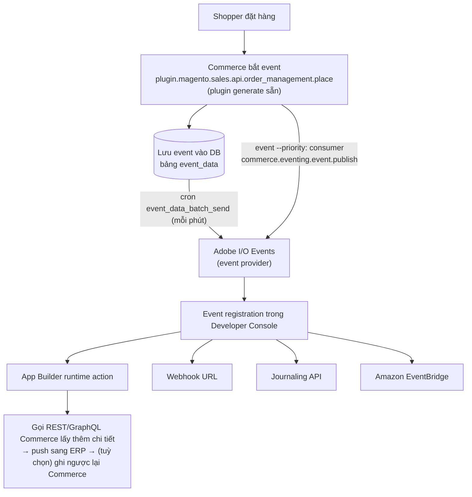

# Event-driven Architecture with Adobe I/O Events

> **Techstack:** Magento 2.4.x – Adobe Commerce 2.4.4+ (PaaS: on cloud infrastructure / on-premises, và SaaS)

> [!IMPORTANT]
> Adobe I/O Events for Adobe Commerce yêu cầu **Adobe Commerce 2.4.4+**. **Magento Open Source không được hỗ trợ** – xem [Event-driven Architecture with Mage-OS](Event-driven%20Architecture%20with%20Mage-OS.md) cho lựa chọn thay thế.

## 1. Tổng quan

Adobe I/O Events for Adobe Commerce cho phép Commerce **publish event bất đồng bộ** ra hạ tầng Adobe I/O Events; các ứng dụng (thường là App Builder) subscribe và xử lý mà không cần polling API.

Flow điển hình (VD đồng bộ order sang ERP):



*Hình 1: Flow điển hình của Adobe I/O Events – đồng bộ order sang ERP*

Ưu điểm: không chặn request của shopper, giảm phụ thuộc vào code core (logic nằm ngoài Commerce), giữ khả năng upgrade "SaaS-like".

## 2. Thành phần chính

### 2.1. Modules

Chỉ Commerce **2.4.4/2.4.5** cần `composer require` (2.4.6+ đã load sẵn eventing modules); `composer update` và `module:enable` chạy cho mọi version. Các bước từ `events:generate:module` trở đi chỉ dành cho **on-premises** (cloud do `ece-tools` xử lý):

```bash
# Chỉ 2.4.4 / 2.4.5
composer require magento/commerce-eventing=^1.0 --no-update

composer update
bin/magento module:enable Magento_AdobeCommerceEventsClient Magento_AdobeCommerceEventsGenerator \
    Magento_AdobeIoEventsClient Magento_AdobeCommerceOutOfProcessExtensibility

# On-premises: generate module chứa plugin cho các event đã đăng ký
bin/magento events:generate:module
bin/magento module:enable Magento_AdobeCommerceEvents
bin/magento setup:upgrade
bin/magento setup:di:compile
```

| Module | Vai trò |
|---|---|
| `Magento_AdobeCommerceEventsClient` | Đọc config event, thu thập & lưu event, gửi lên Adobe I/O |
| `Magento_AdobeCommerceEventsGenerator` | Generate plugin cho các event `plugin.*` |
| `Magento_AdobeIoEventsClient` | Client gọi Adobe I/O Events API (provider, metadata) |
| `Magento_AdobeCommerceOutOfProcessExtensibility` | Logic thu thập dữ liệu dùng chung cho out-of-process extensibility (events, webhooks); bắt buộc enable |
| `Magento_AdobeCommerceEvents` | Module **được generate** bởi `events:generate:module` |

Adobe Commerce on cloud infrastructure: commit `app/etc/config.php`, `ece-tools` ≥ 2002.1.13, và (stage `deploy` cần cho event `--priority`, xem mục 2.8):

```yaml
# .magento.env.yaml
stage:
  global:
    ENABLE_EVENTING: true
  deploy:
    CRON_CONSUMERS_RUNNER:
      cron_run: true
      max_messages: 0
      consumers: []
```

### 2.2. Workspace config & event provider

1. Tạo project từ template **App Builder** trong **Adobe Developer Console** (tick *Include Runtime with each workspace*). Trong workspace: *Add service > API* → **I/O Management API** (hoặc I/O Events / Adobe I/O Events for Adobe Commerce), credential **OAuth Server-to-Server** (Adobe đã deprecate credential Service Account (JWT); eventing hỗ trợ OAuth S2S từ 1.2.0); sau đó *Add service > API* lần nữa → filter *Experience Cloud* → **Adobe I/O Events for Adobe Commerce**. Bấm *Download All* để tải file **workspace configuration** (`<workspace-name>.json`).
2. Admin: **Stores > Settings > Configuration > Adobe Services > Adobe I/O Events > General configuration**
   - Dán nội dung workspace JSON vào *Adobe I/O Workspace Configuration*.
   - Nhập *Adobe I/O Event Provider Instance ID* (định danh instance Commerce; chỉ chữ, số, `-`, `_`).
   - Bấm **Save Config** (chưa lưu workspace + Instance ID thì không tạo được event provider).
3. Tạo **event provider**: nút *Create Event Provider* (tự điền *Adobe I/O Event Provider ID*) hoặc CLI `events:create-event-provider` (copy ID trả về vào field *Adobe I/O Event Provider ID*).
4. *Commerce Eventing*: `Enabled = Yes`, nhập *Merchant ID* + *Environment ID* (chỉ chữ, số và `_`, không dùng `-`) → event có `source = "<merchant-id>.<environment-id>"`.
5. *Send Test Event* để kiểm tra kết nối.

Từ eventing 1.12.0 có thể đăng ký **thêm event provider** tại **System > Events > Event Providers** và chỉ định provider khi subscribe (`--providerId`). Provider phải được tạo trước trên Adobe I/O (bằng `aio` CLI hoặc Adobe I/O Events API); Commerce chỉ lưu *Provider ID* + *Instance ID* (workspace config tuỳ chọn).

### 2.3. Tên event

`<type>.<event_name>`:

- `observer.<event>` – event dispatch bởi observer, VD `observer.catalog_product_save_after`, `observer.sales_order_save_after`.
- `plugin.<...>` – event sinh từ plugin generate trên service method, VD `plugin.magento.sales.api.order_management.place`, `plugin.magento.catalog.model.resource_model.product.save`.

Trên Adobe I/O, event code có prefix `com.adobe.commerce.`, VD `com.adobe.commerce.observer.catalog_product_save_after`.

> [!WARNING]
> Event `observer.*_save_after` được dispatch khi transaction DB **còn mở** (`AbstractModel::afterSave()` chạy trong `AbstractDb::save()` trước `commit()`) nên dữ liệu có thể bị rollback. Với tích hợp hệ thống ngoài (ERP…) Adobe khuyến nghị dùng `*_save_commit_after` (dispatch trong `AbstractModel::afterCommitCallback()`), VD `observer.sales_order_save_commit_after`, `observer.catalog_product_save_commit_after`, hoặc plugin event như `plugin.magento.sales.api.order_management.place`.

> [!NOTE]
> Tên `plugin.magento.<...>` là format **PaaS**. Trên Adobe Commerce as a Cloud Service (SaaS), tên plugin event không có segment `magento.` (VD `plugin.sales.api.order_management.place`). Các mục 2.1, 2.4, 2.5, 2.8 và 3.1 chỉ áp dụng PaaS; SaaS đăng ký event qua Admin (*System > Events*) hoặc REST.

### 2.4. Đăng ký event

Có 3 cách (PaaS):

1. **`io_events.xml`** trong `<module>/etc/` hoặc `app/etc/` – event luôn được gửi, **không** tắt được bằng `events:unsubscribe`.
2. Section `io_events` trong `app/etc/config.php` (hoặc `env.php` từ eventing 1.11.0) – tắt được bằng CLI.
3. CLI `bin/magento events:subscribe` hoặc REST `POST /rest/<store_view_code>/V1/eventing/eventSubscribe` – từ eventing 1.11.0 ghi vào `app/etc/env.php` (trước đó ghi vào `config.php`). `events:unsubscribe` chỉ disable, không xoá entry trong `env.php`.

> [!NOTE]
> Nếu nhiều module đăng ký cùng một event → field được **merge**.

### 2.5. CLI

```bash
bin/magento events:list:all Magento_Catalog            # event được hỗ trợ trong module
bin/magento events:info observer.catalog_product_save_after --depth=1   # payload mẫu
bin/magento events:subscribe observer.catalog_product_save_after --fields=sku --fields=stock_data.qty
bin/magento events:list                                # event đã subscribe (-v để xem chi tiết)
bin/magento events:unsubscribe observer.catalog_product_save_after
bin/magento events:create-event-provider --label "bss_provider" --description "BSS Commerce provider"
bin/magento events:provider:info
bin/magento events:metadata:populate                   # đồng bộ event metadata lên provider
bin/magento events:registrations:list
bin/magento events:generate:module                     # regenerate plugin sau khi đổi plugin.* event
```

Option quan trọng của `events:subscribe`:

| Option | Ý nghĩa |
|---|---|
| `--fields` | Field cần gửi (lặp nhiều lần). `'*'` = toàn bộ (không khuyến nghị) |
| `--force` | Ép subscribe dù event chưa được định nghĩa local; bắt buộc khi subscribe event `plugin.*` qua CLI (sau đó chạy `events:generate:module` + `setup:di:compile`) |
| `--parent` + `--rules` | Tạo **conditional event** dựa trên event cha |
| `--priority` | Gửi ngay qua message queue thay vì đợi cron |
| `--providerId` | Gửi tới provider khác provider mặc định |
| `--destination` | Destination tuỳ chỉnh (dùng cho SaaS) |

### 2.6. Payload & filtering

**Ví dụ:** payload nhận được (rút gọn)

```json
{
  "event": {
    "data": {
      "value": { "entity_id": "3", "sku": "test2", "is_new": "0" },
      "_metadata": {
        "commerceEdition": "Adobe Commerce",
        "eventsClientVersion": "1.0.1",
        "storeId": "0",
        "websiteId": "1",
        "storeGroupId": "0"
      },
      "source": "demo.demo"
    }
  }
}
```

- Chỉ khai báo field cần thiết; field lồng dùng dấu chấm (`stock_data.qty`), mảng dùng `items[].sku`.
- `<field converter="...">` để convert giá trị; `source="context_..."` để lấy dữ liệu từ application context (store, area…).

### 2.7. Rule-based (conditional) events

Event "con" chỉ được gửi khi **tất cả rule** đúng. Operator: `greaterThan`, `lessThan`, `equal`, `regex`, `in`, `onChange` (so với `_origData`, chỉ dùng được với event có original data).

**Ví dụ:** conditional event "low stock" trong `io_events.xml`

```xml
<event name="observer.catalog_product_save_after_low_stock" parent="observer.catalog_product_save_after">
    <fields>
        <field name="sku"/>
        <field name="stock_data.qty"/>
    </fields>
    <rules>
        <rule>
            <field>stock_data.qty</field>
            <operator>lessThan</operator>
            <value>20</value>
        </rule>
    </rules>
</event>
```

Event có rule đánh giá `false` không được lưu DB và không gửi đi.

### 2.8. Cron & message queue (PaaS)

- `event_data_batch_send` (group `default`, mỗi phút) – gửi batch event lên Adobe I/O; event thường có thể trễ tới 59 giây.
- `clean_event_data` – xoá event data cũ (mặc định giữ 3 ngày, cấu hình *Event retention time*).
- Consumer `commerce.eventing.event.publish` – xử lý event `--priority` trong khoảng 1 giây.
- Gửi lỗi được retry tối đa 7 lần (cấu hình *Maximum retries to send events*).

### 2.9. Consume event

| Cách | Mô tả |
|---|---|
| Journaling API | Mặc định; event được lưu vào journal có thứ tự, consumer tự pull (có thể dùng `@adobe/aio-lib-events`) |
| Webhook URL | Adobe I/O push tới endpoint của hệ thống ngoài (khác với Adobe Commerce Webhooks sync) |
| Runtime Action | App Builder action nhận event; template `@adobe/generator-app-events-generic` |
| Amazon EventBridge | Forward event sang AWS |

## 3. Ví dụ code

### 3.1. Đăng ký event trong module `Vendor_Module`

**Ví dụ:** gửi event order và invoice với các field cần thiết (dùng `*_save_commit_after` để chỉ gửi khi dữ liệu đã commit)

```xml
<?xml version="1.0"?>
<!-- app/code/Vendor/Module/etc/io_events.xml -->
<config xmlns:xsi="http://www.w3.org/2001/XMLSchema-instance"
        xsi:noNamespaceSchemaLocation="urn:magento:module-commerce-events-client/etc/io_events.xsd">
    <event name="observer.sales_order_save_commit_after">
        <fields>
            <field name="entity_id"/>
            <field name="increment_id"/>
            <field name="status"/>
            <field name="grand_total"/>
        </fields>
    </event>
    <event name="observer.sales_order_invoice_save_commit_after">
        <fields>
            <field name="order_id"/>
            <field name="items[].sku"/>
            <field name="items[].qty"/>
        </fields>
    </event>
</config>
```

```bash
bin/magento setup:upgrade            # cũng đồng bộ subscription lên event provider
bin/magento events:list
```

### 3.2. Runtime action nhận event (App Builder, Node.js)

**Ví dụ:** runtime action log thông tin order nhận được

```javascript
// actions/order-sync/index.js
const { Core } = require('@adobe/aio-sdk')

async function main (params) {
  const logger = Core.Logger('order-sync', { level: params.LOG_LEVEL || 'info' })
  const order = params.data.value          // payload theo fields đã đăng ký
  logger.info(`Order ${order.increment_id} status=${order.status}`)

  // TODO: gọi Commerce REST/GraphQL (OAuth) nếu cần thêm dữ liệu, rồi push sang ERP
  return { statusCode: 200, body: { received: order.entity_id } }
}

exports.main = main
```

## 4. Khi nào dùng I/O Events vs observer in-process

| Tình huống | Chọn |
|---|---|
| Logic thuần nội bộ Magento, cần transaction chung (VD set attribute trước khi save) | Observer / plugin |
| Cần chặn hoặc sửa dữ liệu ngay trong request, logic ở hệ thống ngoài | Adobe Commerce Webhooks |
| Thông báo hệ thống ngoài (ERP, CRM, PIM, marketing), chấp nhận trễ vài giây – 1 phút | **Adobe I/O Events** |
| Magento Open Source / Mage-OS | Observer + message queue (xem [bài Mage-OS](Event-driven%20Architecture%20with%20Mage-OS.md)) |
| Adobe Commerce as a Cloud Service (SaaS) | I/O Events / Webhooks (không deploy được PHP module) |

## 5. Best practices & lưu ý

- Chỉ gửi field cần thiết – tránh lộ dữ liệu nhạy cảm / PCI và giảm chi phí.
- Event chỉ là "thông báo": cần chi tiết đầy đủ → gọi API ngược lại Commerce.
- Đảm bảo cron chạy; event priority cần consumer `commerce.eventing.event.publish` chạy.
- Đổi danh sách `plugin.*` event → chạy lại `events:generate:module` + `setup:di:compile`.
- Môi trường performance test: chạy `setup:perf:generate-fixtures` trước khi subscribe event.
- Dùng *Merchant ID / Environment ID* khác nhau giữa staging và production để lọc event theo `source`.

> [!WARNING]
> Consumer phải **idempotent**: event có thể bị gửi lại (retry), và thứ tự không nên giả định tuyệt đối ngoài Journaling.

## Tham khảo

**Tài liệu chính thức**

- [Adobe I/O Events for Adobe Commerce – Overview](https://developer.adobe.com/commerce/extensibility/events)
- [Installation](https://developer.adobe.com/commerce/extensibility/events/installation)
- [Configure Commerce](https://developer.adobe.com/commerce/extensibility/events/configure-commerce)
- [Module development (`io_events.xml`)](https://developer.adobe.com/commerce/extensibility/events/module-development)
- [Commands](https://developer.adobe.com/commerce/extensibility/events/commands)
- [Conditional events](https://developer.adobe.com/commerce/extensibility/events/conditional-events)
- [Consume events](https://developer.adobe.com/commerce/extensibility/events/consume-events)
- [Adobe I/O Events Journaling](https://developer.adobe.com/events/docs/guides/journaling-intro)

**Bài liên quan trong Knowledge Base**

- [Cloud Version](Cloud%20Version.md) – tổng quan out-of-process extensibility & Adobe Commerce Webhooks (sync)
- [Event-driven Architecture with Mage-OS](Event-driven%20Architecture%20with%20Mage-OS.md) – lựa chọn cho Open Source / Mage-OS
- [Observer](../SOLID%20principles%20%26%20Patterns%20in%20Magento/Observer.md)
