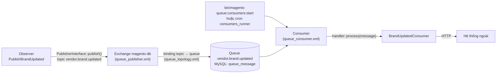

# Event-driven Architecture with Mage-OS

> **Techstack:** Magento 2.4.x (Magento Open Source) và Mage-OS Distribution (community fork của Magento Open Source)

> [!NOTE]
> Quy ước trong bài: thông tin đánh dấu **[Verified]** đã được đối chiếu với source/docs chính thức (Magento core, Adobe docs, GitHub Mage-OS) tại thời điểm viết; **[Đề xuất]** là gợi ý thiết kế của team, không phải tính năng có sẵn.
>
> - **[Verified]**: mục 1.1, 2.1, 2.2, 2.3, 2.4 (module `mageos-async-events` đối chiếu trên GitHub, branch `4.x`).
> - **[Verified + suy luận]**: mục 1.2.

## 1. Tổng quan

### 1.1. Mage-OS là gì

- **Mage-OS** là dự án cộng đồng do **Mage-OS Association** (tổ chức phi lợi nhuận đăng ký tại Ba Lan, chính thức thành lập năm 2022) vận hành.
- **Mage-OS Distribution** được build trên codebase Magento Open Source, bổ sung cải tiến của cộng đồng và phát hành bản vá nhanh hơn; tương thích với extension/theme của Magento Open Source. Có version riêng (VD Mage-OS 3.6.0 dựa trên Magento Open Source 2.4.9 theo trang Mage-OS tại thời điểm viết) – luôn kiểm tra release notes để biết bản upstream tương ứng.
- Core fork: [mage-os/mageos-magento2](https://github.com/mage-os/mageos-magento2); composer repository `https://repo.mage-os.org/`.

**Ví dụ:** tạo project Mage-OS mới

```bash
composer create-project --repository-url=https://repo.mage-os.org/ mage-os/project-community-edition .
```

### 1.2. Hệ quả với event-driven

- Adobe I/O Events for Adobe Commerce yêu cầu Adobe Commerce 2.4.4+, docs ghi rõ **Magento Open Source không được hỗ trợ** → Mage-OS (dựa trên Open Source) **không** dùng được `magento/commerce-eventing` (suy luận từ điều kiện trên).
- Adobe Commerce Webhooks (`magento/commerce-webhooks`) chỉ được Adobe tài liệu hoá cho Adobe Commerce (cloud / on-premises / SaaS); docs không nêu hỗ trợ Magento Open Source → không phải lựa chọn cho Mage-OS (suy luận – docs webhooks không có câu "not supported" tường minh như I/O Events).
- Vì vậy trên Mage-OS/Open Source, kiến trúc event-driven được xây từ các building block **có sẵn trong core**:

| Building block | Đồng bộ? | Dùng khi |
|---|---|---|
| Events / Observers (`events.xml`) | Sync, in-process | Phản ứng với sự kiện trong cùng request |
| Message Queue (MySQL hoặc RabbitMQ/AMQP) | Async | Đẩy việc nặng / tích hợp ngoài ra khỏi request |
| Async & Bulk Web API | Async | Client ngoài gửi nhiều request ghi mà không chờ xử lý |
| Module cộng đồng `mage-os/mageos-async-events` | Async | Cần "outgoing webhook" có retry, trace, replay |

## 2. Thành phần chính

### 2.1. Events & Observers (core)

- Dispatch: `Magento\Framework\Event\ManagerInterface::dispatch(string $eventName, array $data = [])`.
- Đăng ký: `etc/events.xml` (global) hoặc `etc/frontend|adminhtml|webapi_rest|graphql/events.xml`.
- Observer implement `Magento\Framework\Event\ObserverInterface::execute(Observer $observer)`.
- Chạy **đồng bộ, trong cùng request**; nếu event được dispatch bên trong transaction (VD `<prefix>_save_after`) thì observer chạy **trước khi commit** → không gọi HTTP chậm trong observer.

Chi tiết so sánh với plugin/DI: [So sánh Event, Plugin & DI](../DI%20%26%20Interceptors/So%20s%C3%A1nh%20overview%20v%E1%BB%81%20Event%2C%20Plugin%20%26%20DI.md).

### 2.2. Message Queue Framework (MQF)

| File | Vai trò |
|---|---|
| `etc/communication.xml` | Khai báo **topic** + kiểu dữ liệu message (`request`) |
| `etc/queue_publisher.xml` | Topic được publish tới connection/exchange nào |
| `etc/queue_topology.xml` | Exchange, binding topic → queue |
| `etc/queue_consumer.xml` | Consumer: đọc queue nào, handler nào |

- Connection `db`: dùng MySQL (module `Magento_MysqlMq`, bảng `queue`, `queue_message`, `queue_message_status`) – không cần cài thêm gì.
- Connection `amqp`: RabbitMQ, cấu hình trong `app/etc/env.php` (`queue.amqp`).
- Publish: `Magento\Framework\MessageQueue\PublisherInterface::publish($topicName, $data)`.
- Consumer chạy bằng CLI hoặc cron `consumers_runner` (module `Magento_MessageQueue`).

Luồng publish/consume (theo ví dụ ở mục 3):



*Hình 1: Message Queue Framework – observer publish message, consumer xử lý bất đồng bộ ngoài request*

```bash
bin/magento queue:consumers:list
bin/magento queue:consumers:start vendor.brand.updated --max-messages=1000
bin/magento queue:consumers:restart
```

**Ví dụ:** điều khiển cron chạy consumer trong `app/etc/env.php`

```php
// app/etc/env.php (trích)
'cron_consumers_runner' => [
    'cron_run' => true,
    'max_messages' => 1000,
    'consumers' => ['vendor.brand.updated', 'async.operations.all'],
],
```

### 2.3. Async & Bulk Web API

- Async: `POST /rest/<store_code>/async/V1/<route>` → trả về `bulk_uuid` ngay, request được đưa vào queue.
- Bulk: `POST /rest/<store_code>/async/bulk/V1/<route>` → nhiều entity trong một request.
- Xử lý bởi consumer `async.operations.all` (`Magento\AsynchronousOperations\Model\MassConsumer`).
- Theo dõi: `GET /rest/V1/bulk/:bulkUuid/status`.
- Flow controller tương ứng: [REST](../API%20Rest%2C%20Soap%20%26%20Graphql/REST.md) (processor `async` – `AsynchronousRequestProcessor`, và `asyncBulk`).

### 2.4. Community module – `mage-os/mageos-async-events`

- Repo: [mage-os/mageos-async-events](https://github.com/mage-os/mageos-async-events) (branch `4.x`) – port của Aligent `magento-async-events`. Module `MageOS_AsyncEvents`, require PHP ≥ 8.1, license MIT.
- Khai báo event trong `etc/async_events.xml`: tên event + service contract dùng để build payload.
- Subscription (endpoint nhận) tạo qua REST `POST /V1/async_event` (ACL `MageOS_AsyncEvents::manage`).
- Publish bằng `MageOS\AsyncEvents\Api\AsyncEventPublisherInterface::publish(string $eventName, array $data, int $storeId): void` (branch `4.x`; implementation `Model\AsyncEventPublisher` cho `$storeId = 0` mặc định; branch `3.x` không có `$storeId`). `$data` là tham số của service method khai báo trong `async_events.xml` (VD `['id' => $orderId]`). Bên trong module publish qua `Magento\Framework\MessageQueue\PublisherInterface` tới topic `event.trigger`.
- Dùng MQF: consumer `event.trigger.consumer` (queue `event.trigger`) và `event.retry.consumer` (queue `event.failover.retry`); `queue_consumer.xml` / `queue_topology.xml` khai báo cứng `connection="amqp"` (README nói hỗ trợ "RabbitMQ (or DB queues)" nhưng module không ship cấu hình `db` → dùng DB queue phải tự override config).
- Tính năng: retry với quadratic backoff (cần RabbitMQ; DB queue phải tự implement `RetryManagementInterface`), trace log theo UUID, replay, tìm kiếm event bằng Lucene query (index qua search engine).
- Sinks mở rộng: danh sách tại monorepo [mage-os/mageos-async-events-sinks](https://github.com/mage-os/mageos-async-events-sinks) (không phải package cài trực tiếp); cài từng package, VD `composer require mage-os/mageos-async-events-aws` (Amazon EventBridge, SQS), ngoài ra có `mageos-async-events-gcp` (Pub/Sub), `mageos-async-events-azure` (Event Grid).

> [!WARNING]
> Trước khi dùng production: kiểm tra branch/version tương thích với bản Mage-OS/Magento của project, và tự review code/test – đây là module cộng đồng, không có SLA.

## 3. Ví dụ code – observer → message queue (MySQL) → consumer

Bài toán: khi brand được lưu, đồng bộ sang hệ thống ngoài **mà không làm chậm** admin save.

**Ví dụ:** đăng ký observer cho event `vendor_brand_save_after`

```xml
<?xml version="1.0"?>
<!-- app/code/Vendor/Module/etc/events.xml -->
<config xmlns:xsi="http://www.w3.org/2001/XMLSchema-instance"
        xsi:noNamespaceSchemaLocation="urn:magento:framework:Event/etc/events.xsd">
    <event name="vendor_brand_save_after">
        <observer name="vendor_brand_publish_updated" instance="Vendor\Module\Observer\PublishBrandUpdated"/>
    </event>
</config>
```

**Ví dụ:** observer chỉ publish message, không gọi HTTP

```php
<?php
// app/code/Vendor/Module/Observer/PublishBrandUpdated.php
declare(strict_types=1);

namespace Vendor\Module\Observer;

use Magento\Framework\Event\Observer;
use Magento\Framework\Event\ObserverInterface;
use Magento\Framework\MessageQueue\PublisherInterface;
use Magento\Framework\Serialize\Serializer\Json;

class PublishBrandUpdated implements ObserverInterface
{
    public const TOPIC = 'vendor.brand.updated';

    public function __construct(
        private readonly PublisherInterface $publisher,
        private readonly Json $json
    ) {
    }

    public function execute(Observer $observer): void
    {
        $brand = $observer->getEvent()->getData('object');
        $this->publisher->publish(self::TOPIC, $this->json->serialize([
            'brand_id' => (int)$brand->getId(),
            'name'     => (string)$brand->getName(),
        ]));
    }
}
```

> [!NOTE]
> Event `vendor_brand_save_after` được dispatch tự động nếu model `Brand` khai báo `protected $_eventPrefix = 'vendor_brand';` (cơ chế của `Magento\Framework\Model\AbstractModel`). Key `object` trong event data là giá trị mặc định của `$_eventObject` (`AbstractModel::_getEventData()`).

> [!WARNING]
> `<prefix>_save_after` được dispatch **bên trong transaction** (`AbstractDb::save()` → `processAfterSaves()` trước `commit()`). Với connection `db`, message được insert vào `queue_message` trên cùng DB connection nên rollback cùng entity. Với `amqp`, message đã gửi sang RabbitMQ trước khi commit → consumer có thể đọc dữ liệu chưa commit hoặc đã rollback; khi chuyển sang RabbitMQ nên đổi sang event `vendor_brand_save_commit_after` (dispatch trong `AbstractModel::afterCommitCallback()`).

**Ví dụ:** `communication.xml` – khai báo topic

```xml
<?xml version="1.0"?>
<!-- app/code/Vendor/Module/etc/communication.xml -->
<config xmlns:xsi="http://www.w3.org/2001/XMLSchema-instance"
        xsi:noNamespaceSchemaLocation="urn:magento:framework:Communication/etc/communication.xsd">
    <topic name="vendor.brand.updated" request="string"/>
</config>
```

**Ví dụ:** `queue_publisher.xml` – publish topic tới exchange `magento-db` (connection `db`)

```xml
<?xml version="1.0"?>
<!-- app/code/Vendor/Module/etc/queue_publisher.xml -->
<config xmlns:xsi="http://www.w3.org/2001/XMLSchema-instance"
        xsi:noNamespaceSchemaLocation="urn:magento:framework-message-queue:etc/publisher.xsd">
    <publisher topic="vendor.brand.updated">
        <connection name="db" exchange="magento-db"/>
    </publisher>
</config>
```

**Ví dụ:** `queue_topology.xml` – binding topic → queue

```xml
<?xml version="1.0"?>
<!-- app/code/Vendor/Module/etc/queue_topology.xml -->
<config xmlns:xsi="http://www.w3.org/2001/XMLSchema-instance"
        xsi:noNamespaceSchemaLocation="urn:magento:framework-message-queue:etc/topology.xsd">
    <exchange name="magento-db" type="topic" connection="db">
        <binding id="vendorBrandUpdated" topic="vendor.brand.updated"
                 destinationType="queue" destination="vendor.brand.updated"/>
    </exchange>
</config>
```

**Ví dụ:** `queue_consumer.xml` – consumer đọc queue và gọi handler

```xml
<?xml version="1.0"?>
<!-- app/code/Vendor/Module/etc/queue_consumer.xml -->
<config xmlns:xsi="http://www.w3.org/2001/XMLSchema-instance"
        xsi:noNamespaceSchemaLocation="urn:magento:framework-message-queue:etc/consumer.xsd">
    <consumer name="vendor.brand.updated" queue="vendor.brand.updated" connection="db"
              handler="Vendor\Module\Model\Queue\BrandUpdatedConsumer::process"/>
</config>
```

**Ví dụ:** consumer handler gọi API hệ thống ngoài

```php
<?php
// app/code/Vendor/Module/Model/Queue/BrandUpdatedConsumer.php
declare(strict_types=1);

namespace Vendor\Module\Model\Queue;

use Magento\Framework\HTTP\Client\Curl;
use Magento\Framework\Serialize\Serializer\Json;
use Psr\Log\LoggerInterface;

class BrandUpdatedConsumer
{
    public function __construct(
        private readonly Curl $curl,
        private readonly Json $json,
        private readonly LoggerInterface $logger
    ) {
    }

    public function process(string $message): void
    {
        $payload = $this->json->unserialize($message);
        $this->curl->setTimeout(5);
        $this->curl->addHeader('Content-Type', 'application/json');
        $this->curl->post('https://erp.example.com/api/brands', $this->json->serialize($payload));

        if ($this->curl->getStatus() >= 400) {
            $this->logger->error('Brand sync failed', ['payload' => $payload, 'status' => $this->curl->getStatus()]);
            throw new \RuntimeException('Brand sync failed'); // message bị đánh dấu lỗi
        }
    }
}
```

**Ví dụ:** cài đặt và chạy consumer

```bash
bin/magento setup:upgrade
bin/magento queue:consumers:start vendor.brand.updated
```

> [!TIP]
> Muốn chuyển sang RabbitMQ: đổi `connection="amqp"`, exchange `magento`, cấu hình `queue.amqp` trong `env.php` – code publisher/consumer giữ nguyên (chỉ nên đổi event sang `vendor_brand_save_commit_after`, xem WARNING ở trên).

## 4. Best practices & lưu ý

- [Đề xuất] Observer chỉ **publish message** (nhanh, không network); mọi gọi HTTP/ERP đặt trong consumer.
- [Đề xuất] Consumer phải **idempotent** (message có thể được xử lý lại) và log đủ context để debug.
- [Verified] Consumer core (`Magento\Framework\MessageQueue\Consumer`) khi handler throw exception sẽ gọi `$queue->reject($message, false, ...)` – `requeue = false` nên message **không được retry** (MySQL: status `MESSAGE_STATUS_ERROR` trong `queue_message_status`). Retry/backoff phải tự xây; `mageos-async-events` làm điều này nhưng README ghi rõ backoff **cần RabbitMQ**. Tải lớn / cần retry tin cậy → ưu tiên RabbitMQ.
- [Verified] Production: chạy consumer qua `cron_consumers_runner` hoặc supervisor; đặt `max_messages` để process tự restart, tránh memory leak.
- [Đề xuất] Topic name theo convention `vendor.entity.action`; payload nhỏ (ID + field thay đổi), consumer tự load chi tiết qua repository (xem [Service contracts](../Service%20contracts.md)).
- [Đề xuất] Nếu cần "outgoing webhooks" có retry/trace/replay mà không muốn tự build → đánh giá `mage-os/mageos-async-events`.
- Khi migrate code từ Adobe Commerce sang Mage-OS: logic dựa trên `io_events.xml` / `webhooks.xml` **không chạy**; cần thay bằng observer + MQF hoặc async-events module.

## Tham khảo

**Tài liệu chính thức**

- [Events and observers](https://developer.adobe.com/commerce/php/development/components/events-and-observers/)
- [Message queues](https://developer.adobe.com/commerce/php/development/components/message-queues/)
- [Message queue configuration files](https://developer.adobe.com/commerce/php/development/components/message-queues/configuration)
- [Asynchronous web endpoints](https://developer.adobe.com/commerce/webapi/rest/use-rest/asynchronous-web-endpoints)
- [Bulk endpoints](https://developer.adobe.com/commerce/webapi/rest/use-rest/bulk-endpoints)
- [Manage message queues (cron consumers runner)](https://experienceleague.adobe.com/en/docs/commerce-operations/configuration-guide/message-queues/manage-message-queues)
- [Mage-OS](https://mage-os.org/)
- [Mage-OS DevDocs](https://devdocs.mage-os.org/)

**Source code**

- [Mage-OS core fork – mage-os/mageos-magento2](https://github.com/mage-os/mageos-magento2)
- [mage-os/mageos-async-events](https://github.com/mage-os/mageos-async-events)
- [`Magento\Framework\MessageQueue\Consumer`](https://github.com/magento/magento2/blob/2.4-develop/lib/internal/Magento/Framework/MessageQueue/Consumer.php)
- [`Magento\AsynchronousOperations\Model\MassConsumer`](https://github.com/magento/magento2/blob/2.4-develop/app/code/Magento/AsynchronousOperations/Model/MassConsumer.php)

**Bài liên quan trong Knowledge Base**

- [Cloud Version](Cloud%20Version.md) – Adobe Commerce Webhooks & out-of-process extensibility
- [Event-driven Architecture with Adobe I/O Events](Event-driven%20Architecture%20with%20Adobe%20I_O%20Events.md) – eventing của Adobe Commerce
- [Observer](../SOLID%20principles%20%26%20Patterns%20in%20Magento/Observer.md)
- [Service contracts](../Service%20contracts.md)
