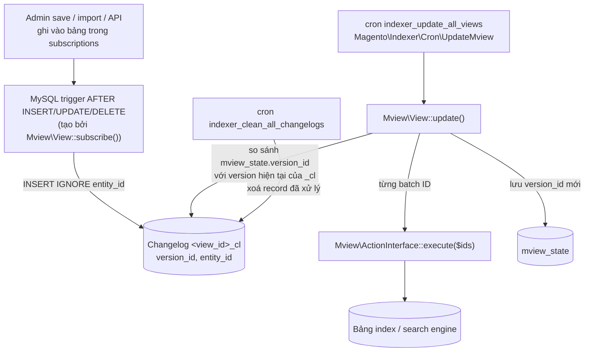

# Indexing trong Magento 2

> **Techstack:** Magento 2.4.x (Adobe Commerce / Magento Open Source)

## 1. Tổng quan

Indexing giúp tối ưu truy vấn DB trên storefront.

Dữ liệu gốc trong Magento (EAV product/category, price rule, stock, URL…) được lưu ở dạng chuẩn hoá, tối ưu cho việc **ghi** (admin save, import). Nếu storefront đọc trực tiếp từ các bảng này thì mỗi request listing/search phải JOIN hàng chục bảng EAV + tính giá theo website/customer group → rất chậm.

Indexer giải quyết bằng cách **tính toán trước** (pre-calculate) và lưu kết quả vào các bảng index phẳng (`catalog_product_index_price`, `catalog_category_product_index_store1`, `cataloginventory_stock_status`, …) hoặc vào search engine (OpenSearch/Elasticsearch). Storefront chỉ đọc từ index.

Thuật ngữ:

- **Dictionary**: dữ liệu gốc (VD: `catalog_product_entity_*`).
- **Index**: dữ liệu đã được biến đổi, tối ưu cho đọc.
- **Indexer**: object thực hiện biến đổi dictionary → index.

Tham khảo: [Indexing – Adobe Commerce PHP Developer Guide](https://developer.adobe.com/commerce/php/development/components/indexing/).

## 2. Thành phần chính

| Thành phần | Vai trò |
|---|---|
| `Magento\Framework\Indexer` | Framework khai báo, chạy, quản lý trạng thái indexer |
| `Magento\Framework\Mview` | Theo dõi thay đổi DB (materialized view giả lập bằng MySQL trigger + changelog) |
| `Magento\Indexer` module | CLI, cron, admin **System > Tools > Index Management** |
| `etc/indexer.xml` | Khai báo indexer (id, class, view_id, title) |
| `etc/mview.xml` | Khai báo bảng cần theo dõi cho mode Update by Schedule |
| Bảng `indexer_state` | Trạng thái của từng indexer (`valid`, `invalid`, `working`, `suspended`) |
| Bảng `mview_state` | Trạng thái + `version_id` đã xử lý của từng view |

### 2.1. Khai báo indexer – `indexer.xml`

**Source:** `Magento/Catalog/etc/indexer.xml` (rút gọn)

```xml
<indexer id="catalog_product_price" view_id="catalog_product_price"
         class="Magento\Catalog\Model\Indexer\Product\Price">
    <title translate="true">Product Price</title>
    <description translate="true">Index product prices</description>
</indexer>
<indexer id="catalog_category_product" view_id="catalog_category_product"
         class="Magento\Catalog\Model\Indexer\Category\Product" shared_index="category_product">
    ...
</indexer>
```

- `id`: tên indexer dùng trong CLI.
- `view_id`: trỏ tới `<view id>` trong `mview.xml` (bắt buộc nếu muốn hỗ trợ schedule mode).
- `class`: implement `Magento\Framework\Indexer\ActionInterface`.
- `shared_index`: nhiều indexer dùng chung một index (reindex một cái thì cái kia cũng được đánh dấu valid).

### 2.2. Khai báo view – `mview.xml`

**Source:** `Magento/Catalog/etc/mview.xml` (rút gọn)

```xml
<view id="catalog_category_flat" class="Magento\Catalog\Model\Indexer\Category\Flat" group="indexer">
    <subscriptions>
        <table name="catalog_category_entity" entity_column="entity_id" />
        <table name="catalog_category_entity_varchar" entity_column="entity_id" />
    </subscriptions>
</view>
```

- `table name`: bảng cần theo dõi; `entity_column`: cột ID sẽ ghi vào changelog.
- `class`: implement `Magento\Framework\Mview\ActionInterface::execute($ids)`.

### 2.3. Indexing modes

| Mode (Admin) | CLI | Cơ chế |
|---|---|---|
| Update on Save | `realtime` | Index được cập nhật ngay khi entity save. Indexer cần code (plugin/observer) gọi `executeRow()`/`executeList()` khi entity thay đổi. |
| Update by Schedule | `schedule` | MySQL trigger ghi ID thay đổi vào changelog, cron xử lý theo batch. |

> [!NOTE]
> Từ 2.4.8, `customer_grid` hỗ trợ cả hai mode và mặc định là Update by Schedule (trước 2.4.8 chỉ hỗ trợ Update on Save).

### 2.4. Changelog tables & triggers (schedule mode)

Khi chuyển indexer sang `schedule`, `Magento\Framework\Mview\View::subscribe()` tạo:

1. Bảng changelog `<view_id>_cl` (VD: `catalog_category_product_cl`) gồm `version_id` (auto increment) và `entity_id`.
2. MySQL `AFTER INSERT / UPDATE / DELETE` trigger trên mỗi bảng trong `<subscriptions>`:

```sql
-- trigger AFTER INSERT trên catalog_category_entity (ví dụ trong Adobe docs)
INSERT IGNORE INTO `catalog_category_product_cl` (`entity_id`) VALUES (NEW.`entity_id`);
```

3. Cron đọc `mview_state.version_id` → lấy các `entity_id` mới trong `_cl` → gọi `execute($ids)` → cập nhật `version_id`.

Chuyển về `realtime` thì trigger bị xoá (changelog vẫn còn).



*Hình 1: Luồng Update by Schedule – trigger ghi changelog, cron đọc changelog theo batch và gọi indexer*

### 2.5. Cron jobs (module `Magento_Indexer`, group `index`)

| Job | Class | Schedule | Vai trò |
|---|---|---|---|
| `indexer_reindex_all_invalid` | `Magento\Indexer\Cron\ReindexAllInvalid` | mỗi phút | Full reindex các indexer đang `invalid` |
| `indexer_update_all_views` | `Magento\Indexer\Cron\UpdateMview` | mỗi phút | Xử lý changelog cho các indexer ở mode schedule |
| `indexer_clean_all_changelogs` | `Magento\Indexer\Cron\ClearChangelog` | mỗi giờ (`0 * * * *`) | Xoá các record changelog đã xử lý |

> [!IMPORTANT]
> Schedule mode **bắt buộc** cron chạy ổn định, nếu không index sẽ bị "trễ".

### 2.6. CLI

```bash
bin/magento indexer:info                         # liệt kê indexer id + title
bin/magento indexer:status                       # trạng thái + mode + backlog changelog
bin/magento indexer:reindex [indexer_id ...]     # full reindex (không truyền id = tất cả)
bin/magento indexer:reset [indexer_id]           # đánh dấu invalid
bin/magento indexer:set-mode schedule [id ...]   # realtime | schedule
bin/magento indexer:show-mode [id ...]
bin/magento indexer:set-status suspended [id]    # valid | invalid | suspended (2.4.7+)
bin/magento indexer:set-dimensions-mode catalog_product_price website_and_customer_group
bin/magento indexer:show-dimensions-mode
```

### 2.7. Built-in indexers (Magento Open Source)

| Indexer id | Class |
|---|---|
| `design_config_grid` | `Magento\Theme\Model\Indexer\Design\Config` |
| `customer_grid` | `Magento\Framework\Indexer\Action\Entity` |
| `catalog_category_product` | `Magento\Catalog\Model\Indexer\Category\Product` |
| `catalog_product_category` | `Magento\Catalog\Model\Indexer\Product\Category` |
| `catalogrule_rule` | `Magento\CatalogRule\Model\Indexer\Rule\RuleProductIndexer` |
| `catalog_product_attribute` | `Magento\Catalog\Model\Indexer\Product\Eav` |
| `cataloginventory_stock` | `Magento\CatalogInventory\Model\Indexer\Stock` |
| `inventory` | `Magento\InventoryIndexer\Indexer\InventoryIndexer` (MSI) |
| `catalogrule_product` | `Magento\CatalogRule\Model\Indexer\Product\ProductRuleIndexer` |
| `catalog_product_price` | `Magento\Catalog\Model\Indexer\Product\Price` |
| `catalogsearch_fulltext` | `Magento\CatalogSearch\Model\Indexer\Fulltext` |

Adobe Commerce có thêm `targetrule_product_rule`, `targetrule_rule_product`, `salesrule_rule`, … Luôn chạy `bin/magento indexer:info` để xem danh sách thực tế của project.

### 2.8. Dimension-based (multi-dimensional) price indexer

`catalog_product_price` có thể chia index thành nhiều bảng theo **dimension** để giảm kích thước bảng và lock khi reindex trên store lớn (nhiều website × customer group). Các mode (`Magento\Catalog\Model\Indexer\Product\Price\DimensionModeConfiguration`):

| Mode | Ý nghĩa |
|---|---|
| `none` | Một bảng duy nhất (mặc định) |
| `website` | Tách theo website |
| `customer_group` | Tách theo customer group |
| `website_and_customer_group` | Tách theo cả hai |

```bash
bin/magento indexer:set-dimensions-mode catalog_product_price website
```

> [!NOTE]
> Đổi dimension mode sẽ yêu cầu full reindex price.

## 3. Ví dụ code – custom indexer

Bài toán: `Vendor_Module` duy trì bảng `vendor_product_popularity_idx` (product_id, score) tính từ `sales_order_item`, hỗ trợ cả 2 mode.

**Ví dụ:** khai báo indexer

```xml
<?xml version="1.0"?>
<!-- app/code/Vendor/Module/etc/indexer.xml -->
<config xmlns:xsi="http://www.w3.org/2001/XMLSchema-instance"
        xsi:noNamespaceSchemaLocation="urn:magento:framework:Indexer/etc/indexer.xsd">
    <indexer id="vendor_product_popularity" view_id="vendor_product_popularity"
             class="Vendor\Module\Model\Indexer\Popularity">
        <title translate="true">Vendor Product Popularity</title>
        <description translate="true">Pre-calculate product popularity score</description>
    </indexer>
</config>
```

**Ví dụ:** khai báo view theo dõi `sales_order_item`

```xml
<?xml version="1.0"?>
<!-- app/code/Vendor/Module/etc/mview.xml -->
<config xmlns:xsi="http://www.w3.org/2001/XMLSchema-instance"
        xsi:noNamespaceSchemaLocation="urn:magento:framework:Mview/etc/mview.xsd">
    <view id="vendor_product_popularity" class="Vendor\Module\Model\Indexer\Popularity" group="indexer">
        <subscriptions>
            <table name="sales_order_item" entity_column="product_id"/>
        </subscriptions>
    </view>
</config>
```

**Ví dụ:** indexer action implement cả `Indexer\ActionInterface` và `Mview\ActionInterface`

```php
<?php
// app/code/Vendor/Module/Model/Indexer/Popularity.php
declare(strict_types=1);

namespace Vendor\Module\Model\Indexer;

use Magento\Framework\Indexer\ActionInterface as IndexerActionInterface;
use Magento\Framework\Mview\ActionInterface as MviewActionInterface;
use Vendor\Module\Model\ResourceModel\Popularity as PopularityResource;

class Popularity implements IndexerActionInterface, MviewActionInterface
{
    public function __construct(
        private readonly PopularityResource $resource
    ) {
    }

    /** Full reindex: indexer:reindex hoặc cron indexer_reindex_all_invalid */
    public function executeFull(): void
    {
        $this->resource->rebuild();
    }

    /** Partial reindex theo list ID (Update on Save / gọi thủ công) */
    public function executeList(array $ids): void
    {
        $this->resource->rebuild(array_map('intval', $ids));
    }

    public function executeRow($id): void
    {
        $this->resource->rebuild([(int)$id]);
    }

    /** Mview: cron indexer_update_all_views truyền ID lấy từ changelog */
    public function execute($ids): void
    {
        $this->executeList((array)$ids);
    }
}
```

**Ví dụ:** trigger reindex khi đang ở mode Update on Save (VD trong service/observer)

```php
use Magento\Framework\Indexer\IndexerRegistry;

public function __construct(private readonly IndexerRegistry $indexerRegistry) {}

public function reindexProduct(int $productId): void
{
    $indexer = $this->indexerRegistry->get('vendor_product_popularity');
    if (!$indexer->isScheduled()) {
        $indexer->reindexRow($productId);
    }
}
```

**Ví dụ:** cài đặt và chạy indexer

```bash
bin/magento setup:upgrade
bin/magento indexer:set-mode schedule vendor_product_popularity
bin/magento indexer:reindex vendor_product_popularity
```

## 4. Best practices & lưu ý

- **Production nên dùng Update by Schedule** cho hầu hết indexer, đặc biệt store nhiều SKU / import thường xuyên. Update on Save làm chậm admin save và API import.
- Đảm bảo cron chạy ổn định (`bin/magento cron:run` qua crontab). Theo dõi backlog bằng `indexer:status`.
- Tránh `indexer:reindex` full trên production giờ cao điểm; full reindex price/search có thể lock bảng hoặc tốn nhiều giờ.
- Full reindex nên build vào bảng tạm rồi swap (pattern của core: `Magento\Framework\Indexer\Table\StrategyInterface` / table switching) để storefront không đọc index rỗng.
- Tối ưu batch size cho price/EAV indexer qua `di.xml` (`BatchSizeCalculator`, `batchRowsCount`) hoặc `indexer.batch_size` trong `env.php` (2.4.3+).
- Custom indexer: `executeFull()` phải idempotent; `execute($ids)` phải xử lý được ID trùng lặp và ID đã bị xoá.
- Khi thêm bảng vào `<subscriptions>` của indexer đang ở schedule mode: cần chuyển `realtime` → `schedule` lại (hoặc `setup:upgrade`) để tạo trigger mới.
- Trạng thái `suspended` (2.4.7+) hữu ích khi import lớn: tạm dừng cron indexer, import xong set lại `valid`/`invalid`.
- Indexer liên quan trực tiếp tới cache: sau khi reindex, FPC/block cache của entity được clean theo cache tag (xem [Magento Cache](Magento%20Cache.md)).

> [!WARNING]
> Không ghi trực tiếp vào bảng index của core. Muốn thay đổi dữ liệu index → plugin vào indexer/`DataProvider` tương ứng.

## Tham khảo

**Tài liệu chính thức**

- [Indexing overview](https://developer.adobe.com/commerce/php/development/components/indexing/)
- [Custom indexer](https://developer.adobe.com/commerce/php/development/components/indexing/custom-indexer)
- [Indexer optimization (batching, table switching)](https://developer.adobe.com/commerce/php/development/components/indexing/optimization)
- [Manage indexers (CLI)](https://experienceleague.adobe.com/en/docs/commerce-operations/configuration-guide/cli/manage-indexers)
- [Configuration best practices for indexers](https://experienceleague.adobe.com/en/docs/commerce-operations/implementation-playbook/best-practices/maintenance/indexer-configuration)

**Source code**

- [`Magento\Framework\Mview\View`](https://github.com/magento/magento2/blob/2.4-develop/lib/internal/Magento/Framework/Mview/View.php) – `subscribe()`, `update()`
- [`Magento\Framework\Indexer\ActionInterface`](https://github.com/magento/magento2/blob/2.4-develop/lib/internal/Magento/Framework/Indexer/ActionInterface.php)
- [`Magento/Indexer/etc/crontab.xml`](https://github.com/magento/magento2/blob/2.4-develop/app/code/Magento/Indexer/etc/crontab.xml)

**Bài liên quan trong Knowledge Base**

- [Optimize & Indexer](DB%20%26%20Data%20Object/Optimize%20%26%20Indexer.md)
- [Magento Cache](Magento%20Cache.md)
- [CQRS - Command and Query Responsibility Segregation](SOLID%20principles%20%26%20Patterns%20in%20Magento/CQRS%20-%20Command%20and%20Query%20Responsibility%20Segregation_.md)
