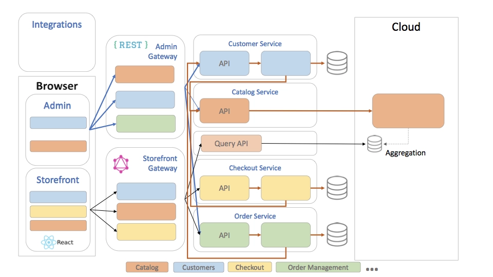
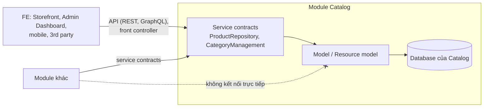
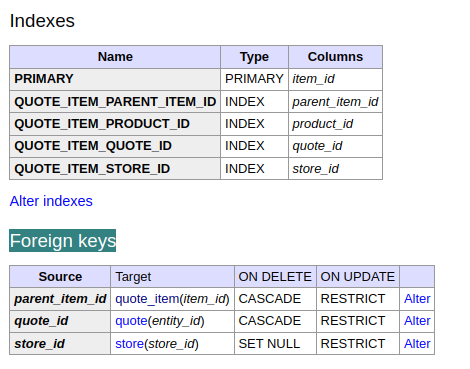
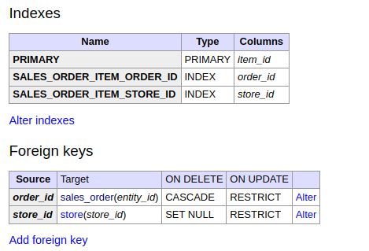
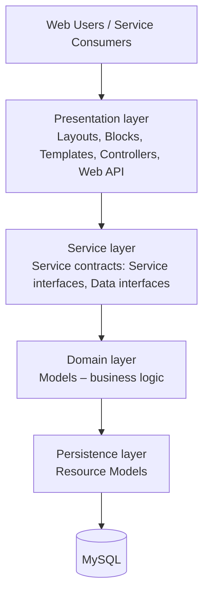
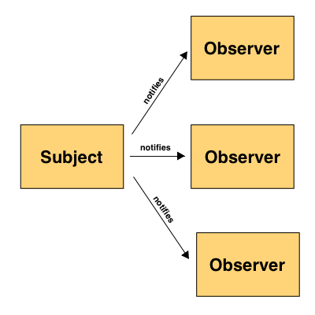
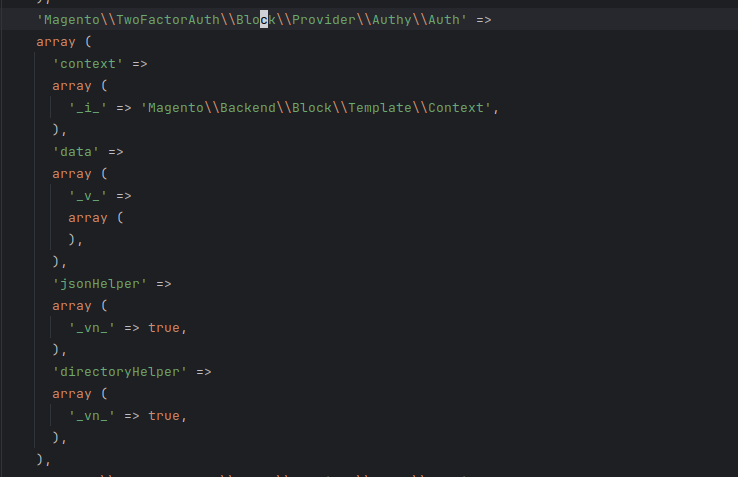
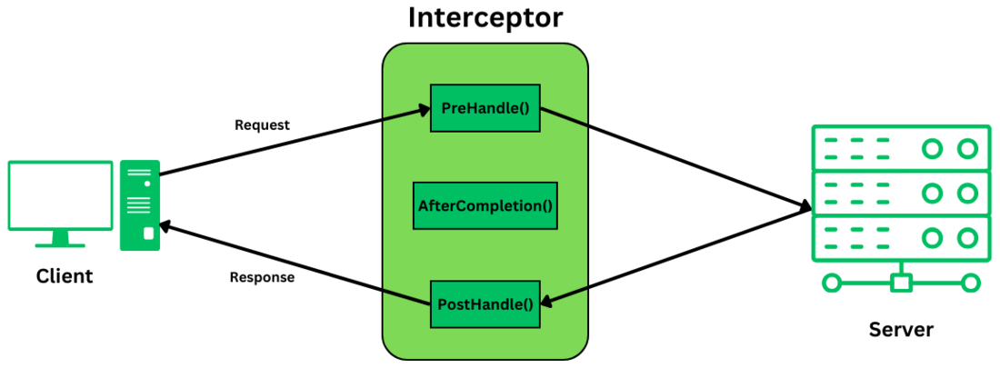
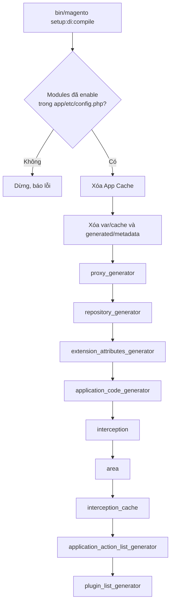
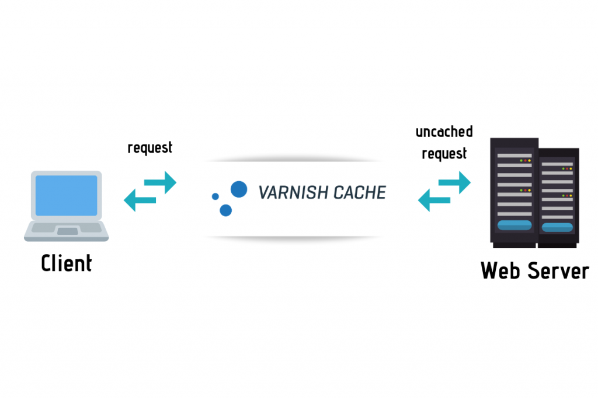

# Kiến trúc tổng quan của Adobe Commerce

> **Techstack:** Magento 2.4.x (Adobe Commerce / Magento Open Source)

Hiểu kiến trúc của Adobe (Magento) Commerce sẽ bước quan trọng nhất giúp developer có góc nhìn tổng quan về ứng dụng, kiến trúc của các module trong Magento và cách các thành phần tương tác với nhau như thế nào, để có thể thiết kế được module, mở rộng Magento một cách phù hợp nhất.

## 1. Sơ đồ kiến trúc của Magento



*Hình 1: Các thành phần của Magento tương tác với nhau qua gateway và service của từng domain (Catalog, Customers, Checkout, Order Management)*

Trong sơ đồ này chúng ta sẽ nhìn thấy cách các thành phần của Magento tương tác với nhau. Magento sẽ hướng tới kiến trúc Modular Monolith (mỗi module sẽ là một cụm làm việc độc lập và tương tác với các module khác thông qua service)

### 1.1. Cách tương tác giữa các module

*Ví dụ Module Catalog:*

Module Catalog sẽ giải quyết các vấn đề liên quan đến Domain Catalog (thông tin product, category):

- Catalog sẽ tương tác với FE thông qua API (rest, graphql) và front controller (FE này có thể là Storefront, Admin Dashboard, or các hệ thống mobile, tích hợp với 3rd party)
- Kết nối với các module khác thông qua service contracts (Management service, … Repository) như CategoryManagement, ProductRepository,...
- Các module khác không nên kết nối trực tiếp với tầng xử lý logic cho database (model, resource model) cũng như không trực tiếp lưu trữ dữ liệu vào trong database của catalog.



*Hình 2: Module Catalog giao tiếp với FE và các module khác thông qua API/service contracts, không cho truy cập trực tiếp vào model, resource model*

### 1.2. Cách thức tương tác giữa database

Kiến trúc và cách tương tác giữa các module cũng sẽ ảnh hưởng phần nào đến cách thiết kế hệ thống Database của Magento.

*Ví dụ mối quan hệ giữa Catalog và Order:*

Sales Order: Magento sẽ có 2 loại dữ liệu chính là quote và order.

Thường dữ liệu từ `order_item`, `quote_item` sẽ được liên kết trực tiếp với các dữ liệu của product thông qua “Foreign keys” là `product_id` để đảm bảo sự ràng buộc về dữ liệu của hệ thống khi có thay đổi.

Nhưng với cách tiếp cận của Magento, các module là độc lập vì vậy catalog và order chỉ liên kết một cách lỏng lẻo với nhau, bằng việc chỉ đánh index `product_id`, và xóa bỏ hoàn toàn phụ thuộc FK của `product_id`

Chúng ta có thể xem bảng `quote_item`



*Hình 3: Bảng `quote_item` – `product_id` chỉ được đánh index, không có foreign key*

`order_item`



*Hình 4: Bảng `sales_order_item` – không có foreign key tới product*

Cách tiếp cận này sẽ giúp chúng ta dễ dàng mở rộng, và đem lại cải tiến đáng kể về mặt hiệu năng trong ecommerce.

Làm thế nào Magento lưu thông tin sản phẩm, lấy thông tin sản phẩm? Vấn đề này được giải quyết bằng cách copy thông tin sản phẩm vào chính bảng `sales_order_item` trong DB
=> Khi user mua hàng thì thông tin sản phẩm tại thời điểm mua hàng được copy vào các cột của `sales_order_item` (`sku`, `name`, `price`, `base_price`, `original_price`, `weight`, `product_type`…), còn options/buyRequest được lưu vào `product_options` (`Magento\Quote\Model\Quote\Item\ToOrderItem` gọi `$orderItem->setProductOptions($options)`). (lưu trữ một phiên bản sản phẩm tại thời điểm user mua hàng)
=> Vấn đề: Thông tin về sản phẩm (như giá …) sẽ không được cập nhật ngay lập tức tới customer. Chúng ta sẽ thấy ở mỗi bước của mua hàng Magento sẽ gọi `Quote::collectTotals()` để lấy, và tính toán lại thông tin của đơn hàng hiện tại.

Khi truy xuất đọc thông tin của quote, hay order chúng ta sẽ không cần phải join quá nhiều dữ liệu, và data quote, order cũng sẽ không bị lock bởi các cập nhật thay đổi từ product.

#### Vấn đề FK

- FK khiến MySQL mở rộng metadata lock và shared lock sang các bảng liên quan khi chạy DML/DDL ("MySQL extends metadata locks, as necessary, to tables that are related by a foreign key constraint"), làm giảm khả năng chạy đồng thời, đặc biệt khi tải cao.
- Cột FK và cột được tham chiếu phải cùng kiểu, cùng size và dấu ("The size and sign of fixed precision types such as INTEGER and DECIMAL must be the same"), nên không đổi được kiểu một phía: muốn đổi INT → BIGINT phải drop FK, đổi cả bảng cha và bảng con rồi tạo lại FK. Xem [MySQL 8.4 – FOREIGN KEY Constraints](https://dev.mysql.com/doc/refman/8.4/en/create-table-foreign-keys.html).
- Khi các ứng dụng phát triển, cần phải tái cấu trúc lược đồ. Đây là một quá trình phức tạp hơn bao gồm nhiều bước hơn để tái cấu trúc lược đồ chứa các ràng buộc khóa ngoại.
- FOREIGN KEY các ràng buộc khó duy trì khi dữ liệu của bạn phát triển và được chia thành nhiều máy chủ cơ sở dữ liệu. Điều này thường xảy ra khi bạn giới thiệu phân vùng/phân mảnh chức năng và/hoặc phân mảnh theo chiều ngang.

#### Một số lưu ý khi thiết kế dữ liệu của ứng dụng khi thiết kế

- Cố gắng thực hiện join dữ liệu để lấy lại thông tin về product, và đẩy vào `order_item`.
  => Join dữ liệu sẽ làm tốc độ truy vấn chậm hơn, việc tăng thêm ràng buộc join khiến hệ thống khó mở rộng, cũng như sẽ có thể xảy ra nhiều trường hợp không dự đoán được trước khi bảo trì. Như một bảng dữ liệu bị lock trong quá trình đọc ghi, dẫn đến việc join ảnh hưởng đến bảng dữ liệu khác.
- Giảm thiếu Khóa ngoại FK trong cách thiết kế database. Magento cũng đã thiết kế DB để giảm FK để giảm thiểu mức độ phụ thuộc giữa các module, thành phần trong ứng dụng.
- Thiết kế DB với quan hệ n-n ntn nên hạn chế sử dụng.
  Đọc thêm mô tả giải pháp tại:
  - [SQL many-to-many relationship | Dgraph Blog](https://dgraph.io/blog/post/sql-many-to-many-relationship/)
  - [Is it a good practice to have as little many-to-many relationships in a relational database? | Quora](https://www.quora.com/Is-it-a-good-practice-to-have-as-little-many-to-many-relationships-in-a-relational-database)
- Tùy trường hợp để lụa chọn giữa denormalize-database và normalize-database

## 2. Magento Layer Architecture


*Hình 5: Kiến trúc các layer của Magento cùng Magento Framework và các chuẩn PHP*

Magento Layer cũng như hầu hết các hệ thống enterprise khác sẽ bao gồm nhiều lớp.

- Presentation layer
- Service layer
- Domain layer
- Persistence layer



*Hình 6: Luồng tương tác giữa các layer: Presentation → Service → Domain → Persistence → DB*

Kiến trúc nhiều Layer sẽ giúp magento dễ dàng tổ chức code resource, phân chia rõ ràng vai trò và nhiệm vụ của từng layer và cách thức các layer tương tác với nhau. Tách biệt giữa presentation logic và business logic, cũng như database logic, sẽ giúp cho ứng dụng dễ dàng tùy chỉnh và mở rộng.

### 2.1. Presentation layer

Presentation layer là tầng mà user tương tác với ứng dụng Magento. Bao gồm WebUI (layouts, blocks, templates) and controllers & API.

- Customer Storefront
- Admin Dashboard System
- Web API

Presentation layer sẽ tương tác với “Service Layer", yêu cầu “Service layer" request thông tin tới “Domain layer"

### 2.2. Service layer

Service layer là tầng trung gian giữa presentation layer và domain layer. Tầng này sẽ thực thi implement các service contract định nghĩa các interface để sử dụng.

- Bao gồm service contracts
- Định nghĩa cách thức tương tác thông qua interface
- Cách thức implement các service contract

Tương tác với presentation layer:

- Controllers (initiated by actions of users of the storefront)
- Web services (SOAP and REST API calls)
- Graphql

Tương tác với các modules khác trong Magento.

Magento cung cấp 3 kiểu định nghĩa interface để implement Service Contract.

1. Repository interfaces: Định nghĩa các hành động được phép thực hiện, tương tác với model từ module khác
2. Management interfaces: Định nghĩa các hành động được xử lý của cho từng nghiệp vụ.
3. Metadata interfaces: cung cấp metadata của attribute entity (vd. `Magento\Customer\Api\CustomerMetadataInterface::getAttributeMetadata()`).

Data interfaces (`Api/Data/*Interface`) là các data entity truyền vào/trả ra từ service interface. Adobe cũng lưu ý không bắt buộc service contract phải có đủ cả 3 loại interface trên.

> [!NOTE]
> Service contracts are the recommended way for one module to access another module's domain-level code. This loosely coupled solution is the optimal way for most modules to access another module.

### 2.3. Domain layer

Domain layer là là nơi thực hiện các business logic layer của module. Không bao gồm những hành động xử lý database, bao gồm:

- Định nghĩa generic data objects
- Model business logic
- Bao gồm implementation các service contracts, thông qua những gì đã định nghĩa ở service contract.

*There are three primary ways of accessing a module's domain-layer code:*

1. Service contracts are the recommended way for one module to access another module's domain-level code. This loosely coupled solution is the optimal way for most modules to access another module.
2. A module can directly call into another module. This tightly coupled solution is not recommended for most situations, but is sometimes unavoidable.
3. Domain layer code in one module can also plug itself into another module by:
   - event hooks
   - plugins
   - `di.xml` files (with an SPI contract)

### 2.4. Persistence layer

Persistence layer là tầng tương tác trực tiếp với DB.

Bao gồm các resource model để thực hiện các action CRUD (create, read, update, delete) với DB.

Bao gồm một số logic mở rộng của business logic như validation, start processes before or after data đã được thực hiện save, các hành động transaction thực hiện đồng thời …

Ngoài ra, còn có bao gồm ORM của framework

Các hành động kết nối với hệ thống DB khác.

## 3. Extensibility and modularity

Magento platform hướng đến 2 tính chất cốt lõi và quan trọng nhất với magento, và cộng đồng các nhà phát triển.

- Extensibility: khả năng mở rộng
- Modularity: module hóa mỗi module là độc lập

=> Magento hướng đến cộng đồng opensource và khả năng tùy chỉnh, dễ dàng mở rộng, kiểm soát sự mở rộng giữa các thành phần bằng việc module hóa. Vì tập trung hướng đến 2 tính chất này Magento vì vậy cũng đánh đổi rất nhiều so với các hệ thống khác, như shopify vs salesforce …. về sự ổn định (stability) và hiệu năng (performance). Khi cài nhiều module thì sẽ không thể đảm bảo CE thì sự ổn định và hiệu năng của Magento ngày càng giảm. Vì vậy chúng ta cần phải follow theo các nguyên tắc thiết kế để đảm bảo Website Magento chạy ổn định.

### 3.1. Extensibility

Magento được thiết kế để cho các nhà phát triển, và merchants dễ dàng tích hợp module của họ vào trong hệ thống Magento. Hầu hết tất cả tính năng của Magento đều được thiết kế để có thể thay thế và mở rộng được bằng cách tích hợp or sử dụng module của bên thứ ba. Magento core sẽ chỉ bảo gồm các tính năng core, cung cấp logic chung.

Vd: Việc tích hợp các payment method, delivery method khác nhau cho mỗi store.

### 3.2. Modularity

Module hóa giúp mỗi module là độc lập, giúp giảm thiểu sự phụ thuộc các module vào nhau.
Khi đó có thể thay đổi chỉnh sửa mà không làm ảnh hưởng đến những module khác.
Quy định cách thức liên kết giữa các module với nhau, và với các layer của ứng dụng.

Cung cấp các tiêu chuẩn mã hóa coding standard, để đảm bảo mã hoạt động chính xác và đồng thời đảm bảo các bên thứ 3 không vi phạm các chuẩn, nguyên tắc trong thiết kế ứng dụng để dễ dàng bảo trì và mở rộng.
Việc module hóa cũng giúp việc nâng cấp dữ liệu trong các phiên bản giảm thiểu sự phụ thuộc vào các module khác.

### 3.3. Flexible attribute types

- EAV (Entity-Attribute-Value) attributes
- Custom attributes
- Extension attributes

### 3.4. Service contracts, dependency injection, and dependency inversion

Service contracts cung cấp một cách thức để các module tương tác với nhau, cũng như cách thức để truy cập API (REST, Soap, Graphql)

Dependency inversion principle đã hỗ trợ magento về cách thức mô tả architectural principles để thực hiện modularity ứng dụng và dễ dàng để mở rộng extensibility.
Thông qua việc thực hiện dependency injection, để cung cấp cơ chế thay đổi các thành phần của ứng dụng mà không làm thay đổi cách thức triển khai ứng dụng.

### 3.5. Plugin interceptors

Magento cung cấp cơ chế Plugin interceptor giúp việc dễ dàng thay thế mở rộng hành vi của các actual class bằng một hành động khác.

Plugin có thể tác động vào code before, after, or around khi function call.

> [!NOTE]
> plugin không thể sử dụng trong một số trường hợp:
>
> - Final methods
> - Final classes
> - Non-public methods
> - Class methods (such as static methods)
> - `__construct` and `__destruct`
> - Virtual types
> - Objects that are instantiated before `Magento\Framework\Interception` is bootstrapped
> - Objects that implement `Magento\Framework\ObjectManager\NoninterceptableInterface`

Plugin vì có thể sử dụng nhiều interceptor tới một function vì vậy plugin, ảnh hưởng khá nhiều đến performance, và sự thống nhất của dữ liệu đầu vào và ra trong một function.

- Các Interceptor sẽ được generated trong `generated/code`
- trait `Magento\Framework\Interception\Interceptor`
- Plugin list sau khi compile được lưu trong: `generated/metadata/<scopes>|plugin-list.php` (vd. `global|frontend|plugin-list.php`, xem `Magento\Framework\Interception\PluginListGenerator`)

### 3.6. So sánh việc sử dụng Event, Plugin & DI

#### Event: Được xây dựng dựa trên Event observer pattern



*Hình 7: Event observer pattern – Subject thông báo tới các Observer*

Mỗi event sẽ thực dispatch để thực hiện thông báo việc đã thực hiện xong hành động và truyền data tới các observer.

Các observer chỉ thực hiện hành động dựa trên thông báo từ Subject, không thể thực hiện sửa đổi hoặc thay thế hành động của đối tượng gốc ban đầu. Event-Observer chỉ thay đổi được về data của object được truyền vào bằng các hàm `setData()`.

Event thường được dispatch trong controller, model, resource model sau, và trước khi các hành động được thực hiện.
Thi thoảng có thể thấy trong view của layout, nhưng cách thiết kế view, block kiểu ntn không hiệu quả lắm vì Magento nên dùng page cache để cải thiện performance.

#### DI: Inject object

DI (dependency injection) sẽ thực hiện thay thế object thông qua ObjectManager. Đối tượng thay thế và đối tượng gốc đều implement một interface.

DI không hoàn toàn giống như Mage class trong M1 replace object

M2 đưa show cho developer về DI pattern được thực hiện trong M2:

> “Dependency injection is a design pattern that allows an object A to declare its dependencies to an external object B that supplies those dependencies. The dependencies declared by A are usually class interfaces and the dependencies B provides are concrete implementations for those interfaces.
>
> This allows for loose coupling of code because object A no longer needs to be concerned with initializing its own dependencies. Object B decides which implementations to provide to object A based on a configuration or desired behavior.”

DI sẽ phụ thuộc vào ObjectManager nên chúng sẽ chỉ có thể DI được với các object gọi sau khi ObjectManager khởi tạo.
DI sẽ không thể tác động vào các object khởi tạo bằng toán tử `new Object();` mà chỉ tác động vào các object do ObjectManager tạo (inject qua constructor, Factory, `ObjectManager::get()` / `create()`)

Sau `setup:di:compile`, DI config được chia theo từng area và lưu trong `generated/metadata/<area>.php` (`global.php`, `frontend.php`, `adminhtml.php`, `webapi_rest.php`…).
`global.php` được load khi `ObjectManagerFactory` khởi tạo `ObjectManager`; file của area được load trong `Magento\Framework\App\Http::launch()` sau khi xác định area (`$this->_objectManager->configure($this->_configLoader->load($areaCode))`).



*Hình 8: Ví dụ DI config của một class được lưu trong `generated/metadata/{area_config}.php`*

Ưu điểm của DI so với plugin có lẽ là performance, và khả năng thay thế các đối tượng phụ thuộc khi khởi tạo object.
DI config được load ngay khi khởi tạo đối tượng dựa trên ObjectManager cũng là một ưu điểm giúp sử dụng DI sẽ có hiệu suất nhanh hơn đáng kể so với Plugin.
Sau khi DI thì vì đối tượng gốc được thay thế bằng đối tượng mới nên hành động của đối tượng mới sẽ dễ kiểm soát, không giống như interceptor là thêm các điểm chặn vào trước và sau của method, và một method có thể bị tác động bởi nhiều interceptor.

DI phù hợp với việc customize các service contract, và sửa các hệ thống cần tối ưu hóa hiệu năng hoặc hành động xử lý dành riêng chỉ cho project, chỉnh sửa các đối tượng được implement bởi interface.

**Magento 2 Preferences**

**Ví dụ:** khai báo preference trong `di.xml`

```xml
<preference for="Packages\BaseClass" type="Packages\NewClass" />
```

Preference là một hành động set một inject một Class(Object) trong quá trình khởi tạo một Object của Class thông qua ObjectManager

- Nên sử dụng cho các interface, AbstractClass
- Không nên sử dụng tới một RegularClass
- Nên dùng preference trong các trường hợp bạn thay đổi hoàn toàn Strategy hành động của Object, chỉ thực hiện nó theo interface action:
  VD: Gửi thông báo
  - `MailNotification` implement `NotificationInterface`
  - `SMSNotification` implement `NotificationInterface`

  => Việc thay đổi sẽ giúp chúng ta dễ kiếm soát xử lý hơn việc cố gắng dùng plugin
- Preference sẽ nhanh hơn Plugin
- Yếu điểm mỗi lần sử dụng sẽ Object gốc sẽ bị thay thế, vì vậy các extension muốn lại or tác động cùng lúc nhiều plugin vào object này sẽ khó hơn.

#### Plugin: interceptors

Plugin sẽ thực hiện một interceptor lên object gốc, yếu điểm sẽ là performance và đối tượng gốc sẽ bị thay đổi. Vì interceptor sẽ thực hiện bọc ngoài func gốc bằng một function mới.



*Hình 9: Minh hoạ interceptor chặn trước và sau lời gọi xử lý chính*

Ưu điểm:

- Linh động dễ dàng tùy chỉnh đối tượng.
- Có thể tác động đến hầu hết các method, object
- Có thể thực hiện nhiều interceptor vào trong cùng một method của object

Yếu điểm:

- Performance
- Plugin sẽ là tạo thêm một đối tượng mới trong DI config, để ObjectManager có thể khởi tạo đối tượng này.
  `Magento\Framework\Interception\PluginList\PluginList`
- Nhiều Interceptor cùng tác động vào một hành động => dữ liệu bị thay đổi khi chạy qua interceptor => Khó kiểm soát dữ liệu.

Plugin phù hợp với việc customize, sửa đổi lại function cũ, thường là khi build extension

Một interceptor nên hạn chế thay đổi dữ liệu đầu vào ra ra của đối tượng gốc. Trong một vài trường hợp nên thay thế bằng DI.

=> Tùy vào mục đích và mong muốn chúng ta sẽ lựa chọn giải pháp phù hợp.

## 4. Magento xây dựng theo kiến trúc Modular Monoliths

### 4.1. Tại sao là Modular Monoliths mà không phải microservice

- Magento tập trung vào hỗ trợ tất cả các kiểu store (nhỏ, vừa, và lớn)
- Microservice sẽ khá cồng kềnh cho các hệ thống nhỏ và vừa cũng như tăng khá nhiều chi phí phát triển cho các store nhỏ và vừa.
- Việc tương tác qua lại giữa các service, phục vụ nhiều kiểu store sẽ tăng độ phức tạp của giải pháp
  => Ví dụ đơn giản là việc rollback lại order sau khi đơn hàng có lỗi, không thành công.
- Kiến trúc thiết kế dữ liệu sẽ phức tạp, khi mỗi service thường sẽ có data lưu trữ riêng.
- Nếu chọn kiến trúc microservice thì chi phí server, bảo trì cũng sẽ tăng

### 4.2. Ưu điểm Modularity với Modular Monoliths

- Dễ dàng kiểm soát kiến trúc tổng thể của ứng dụng
- Mỗi module sẽ là độc lập, nhưng việc tương tác qua lại giữa các module trên cùng một khối sẽ dễ dàng hơn.
- Các module cũng sẽ dễ dàng chia sẻ dữ liệu với nhau
- Chi phí phát triển, và bảo trì sẽ nhỏ hơn với các site vừa và nhỏ
- Bên cạnh đó việc kiến trúc thành modules giống như một service cũng sẽ dễ dàng tách từng phần ra khỏi hệ thống Monoliths để thành các service riêng, phục vụ cho các store lớn, và cực lớn.

### 4.3. Giải pháp xây dựng, tổ chức source code

#### Đảm bảo các tính chất The Twelve Factors trong phát triển magento 2

Đội ngũ core của Magento đã cố gắng xây dựng magento đảm bảo 12 yếu tố khi xây dựng một ứng dụng web (xem thêm tại [The Twelve-Factor App](https://12factor.net/))

#### Base source code

- Tích hợp nhiều Extension (Plugin) do cộng đồng và merchant, developer cùng phát triển
- Lib, extension được quản lý bởi composer.
- Dễ dàng tích hợp các custom module trong `app/code`

#### Giảm thiểu sự phụ thuộc giữa các module (Modularity)

- Đưa ra các tiêu chuẩn Coding standard & CI
  [PHP Coding Standard | Commerce PHP Extensions](https://developer.adobe.com/commerce/php/coding-standards/php)
- Service contract giúp xây dựng ra tiêu chuẩn giao tiếp giữa các module.
- DI & ObjectManager giúp dễ dàng thay đổi
- Đưa ra các tài liệu đặc tả mô tả tính năng và phạm vi của từng service, module.
- Xây dựng DB giảm thiểu sự phụ thuộc với các service, module khác.
- Mỗi module sẽ xử lý 1 tính năng, chịu trách nhiệm riêng về tính năng đó
  [Module Dependencies | Commerce PHP Extensions](https://developer.adobe.com/commerce/php/architecture/modules/dependencies)

#### Deployment

Đây là giải pháp thiết kế server AWS dành cho Magento, giải pháp này giúp ứng dụng Magento có thể tự mở rộng (Auto Scaling) tùy thuộc từng thời điểm quản trị server có thể lựa chọn cân đối được việc server có cần mở rộng hay không.


*Hình 10: Kiến trúc triển khai Magento trên AWS với Auto Scaling*

## 5. Magento Setup

Thông tin về setup của Magento có thể xem nhiều hơn tại:
[Technical details | Adobe Commerce](https://experienceleague.adobe.com/en/docs/commerce-operations/configuration-guide/deployment/technical-details)

### 5.1. Magento Environment Mode Setup (Production, Development, Build)

#### Development System Setup

> [!NOTE]
> Nội dung đang được cập nhật.

#### Build System Setup

> [!NOTE]
> Nội dung đang được cập nhật.

#### Production System Setup

> [!NOTE]
> Nội dung đang được cập nhật.

#### Code compiler

`Magento\Setup\Console\Command\DiCompileCommand`

Command: `setup:di:compile`
Các step thực hiện:

- Kiểm tra ứng dụng đã được install hay chưa (check modules trong `app/etc/config.php`)
- Xóa App Cache
- Xóa file Cache, Generated Metadata.
- Proxy generator: `Magento\Setup\Module\Di\App\Task\Operation\ProxyGenerator`
- repository_generator:
- extension_attributes_generator
- application_code_generator
- interception generator
- area generator
- interception_cache
- application_action_list_generator
- plugin_list_generator



*Hình 11: Các bước của `setup:di:compile` theo `DiCompileCommand::execute()`*

=> Quá trình generate phụ thuộc rất nhiều vào tốc độ đọc và ghi của ổ đĩa, Từ đây chúng ta có thể hình dung được vì sao khi chạy DI thường chậm, khi số lượng module càng nhiều thì lượng file cần đọc để generate càng lớn => Files metadata sẽ càng lớn

#### Profiler

[Enable profiling | Adobe Commerce](https://experienceleague.adobe.com/en/docs/commerce-operations/configuration-guide/setup/mage-profiler)

### 5.2. ENV setup & Multiple websites or stores

> [!NOTE]
> Nội dung đang được cập nhật.

### 5.3. File systems access permissions

[File systems access permissions | Adobe Commerce](https://experienceleague.adobe.com/en/docs/commerce-operations/configuration-guide/deployment/file-system-permissions)

> [!TIP]
> Tìm hiểu setup configuration của FPM
> [PHP-FPM Configuration 101 (php-fpm.conf, www.conf) | myjeeva blog](https://myjeeva.com/php-fpm-configuration-101.html)

### 5.4. Configure caching

Các loại cache trong Magento

- config
- layout
- block_html
- collections
- reflection
- db_ddl
- compiled_config
- eav
- customer_notification
- config_integration
- config_integration_api
- full_page
- graphql_query_resolver_result
- config_webservice
- translate

### 5.5. Configure Redis

[Configure Redis for Default and Page Cache | Adobe Commerce](https://experienceleague.adobe.com/en/docs/commerce-operations/configuration-guide/cache/redis/redis-pg-cache)

[Configure Redis for Session Storage | Adobe Commerce](https://experienceleague.adobe.com/en/docs/commerce-operations/configuration-guide/cache/redis/redis-session)

### 5.6. Configure and use Varnish

[Configure and use Varnish | Adobe Commerce](https://experienceleague.adobe.com/en/docs/commerce-operations/configuration-guide/cache/varnish/config-varnish)



*Hình 12: Varnish Cache làm reverse proxy giữa Client và Web Server*

So sánh varnish với một số giải pháp page cache trực tiếp trên Magento, và các dịch vụ saas trong cloud.
Sự khác biệt lớn nhất Varnish sẽ cache lại data html dựa trên router, varnish sẽ không cần phải thực hiện các bước matching, tìm kiếm router, load config … trong base magento.

Các phương pháp trên M2 server thì vẫn phải thực hiện thông matching url, get configuration.

SAAS thì cơ chế khá tương tự như Varnish, nhưng khác biệt là Varnish dễ dàng để tự config và chỉnh sửa, debug và view logging. Và về mặt chi phí vận hành thì Varnish sẽ thấp hơn.

Varnish sẽ được mô tả kỹ hơn khi nói về performance

Một số giải pháp page cache

- [Genaker/FastFPC](https://github.com/Genaker/FastFPC)
- Default page cache magento sử dụng redis
- Fastly
- HAProxy Caching: Khá tương tự Varnish [Advanced HAProxy caching strategies | LoadForge](https://loadforge.com/guides/advanced-haproxy-caching-strategies)
- Cloudflare

### 5.7. Split database & Master slave DB

> [!NOTE]
> Nội dung đang được cập nhật.

### 5.8. Logging

#### Magento logger

A Monolog logger is a channel that has its own set of handlers. Monolog has a large number of handlers, including:

- Log to files and syslog
- Send alerts and emails
- Log specific servers and networked logging
- Logging in development (integration with FireBug and Chrome Logger, among others)
- Log to the database

> [!TIP]
> Không nên viết riêng file customize cho logger handle, chỉ cần setting bằng virtualType, object sử dụng logger thì nên viết như thế này để nếu không muốn customize file log thì Magento sẽ chọn file default.

**Ví dụ:** inject logger qua constructor

```php
use Psr\Log\LoggerInterface as PsrLoggerInterface;

class Example
{
    /**
     * @var PsrLoggerInterface
     */
    private PsrLoggerInterface $logger;

    /**
     * @param PsrLoggerInterface $logger
     */
    public function __construct(
        // ...other dependencies
        PsrLoggerInterface $logger
    ) {
        $this->logger = $logger;
    }
}
```

[Write to custom log file | Adobe Commerce](https://experienceleague.adobe.com/en/docs/commerce-operations/configuration-guide/logs/custom-log-files)

#### DB logging database

[Log database activity | Adobe Commerce](https://experienceleague.adobe.com/en/docs/commerce-operations/configuration-guide/logs/database-activity)

#### Configure the database profiler

[Configure the database profiler | Adobe Commerce](https://experienceleague.adobe.com/en/docs/commerce-operations/configuration-guide/storage/db-profiler)

M2 Terraform: [magenx/Magento-2-aws-cluster-terraform](https://github.com/magenx/Magento-2-aws-cluster-terraform)

## Tham khảo

**Tài liệu chính thức**
- [Module Overview | Commerce PHP Extensions](https://developer.adobe.com/commerce/php/architecture/modules/overview)
- [Presentation layer | Commerce PHP Extensions](https://developer.adobe.com/commerce/php/architecture/layers/presentation)
- [Service layer | Commerce PHP Extensions](https://developer.adobe.com/commerce/php/architecture/layers/service)
- [Domain layer | Commerce PHP Extensions](https://developer.adobe.com/commerce/php/architecture/layers/domain)
- [Persistence layer | Commerce PHP Extensions](https://developer.adobe.com/commerce/php/architecture/layers/persistence)
- [Module Dependencies | Commerce PHP Extensions](https://developer.adobe.com/commerce/php/architecture/modules/dependencies)
- [Dependency injection | Commerce PHP Extensions](https://developer.adobe.com/commerce/php/development/components/dependency-injection)
- [Plugins | Commerce PHP Extensions](https://developer.adobe.com/commerce/php/development/components/plugins)
- [Code compiler | Adobe Commerce](https://experienceleague.adobe.com/en/docs/commerce-operations/configuration-guide/cli/code-compiler)
- [Configure and use Varnish | Adobe Commerce](https://experienceleague.adobe.com/en/docs/commerce-operations/configuration-guide/cache/varnish/config-varnish)
- [Configure Redis for Default and Page Cache | Adobe Commerce](https://experienceleague.adobe.com/en/docs/commerce-operations/configuration-guide/cache/redis/redis-pg-cache)

**Source code**
- [`Magento\Setup\Console\Command\DiCompileCommand`](https://github.com/magento/magento2/blob/2.4-develop/setup/src/Magento/Setup/Console/Command/DiCompileCommand.php)
- [`Magento\Framework\Interception\Interceptor`](https://github.com/magento/magento2/blob/2.4-develop/lib/internal/Magento/Framework/Interception/Interceptor.php)

**Bài viết khác**
- [The Twelve-Factor App](https://12factor.net/)
- [Technical details | Adobe Commerce](https://experienceleague.adobe.com/en/docs/commerce-operations/configuration-guide/deployment/technical-details)
- [magenx/Magento-2-aws-cluster-terraform](https://github.com/magenx/Magento-2-aws-cluster-terraform)

**Bài liên quan trong Knowledge Base**
- [Service contracts](Service%20contracts.md)
- [Object Manager](Object%20Manager.md)
- [So sánh overview về Event, Plugin & DI](DI%20%26%20Interceptors/So%20s%C3%A1nh%20overview%20v%E1%BB%81%20Event%2C%20Plugin%20%26%20DI.md)
- [Code generation & Optimal development environment](Code%20generation%20%26%20Optimal%20development%20environment.md)
