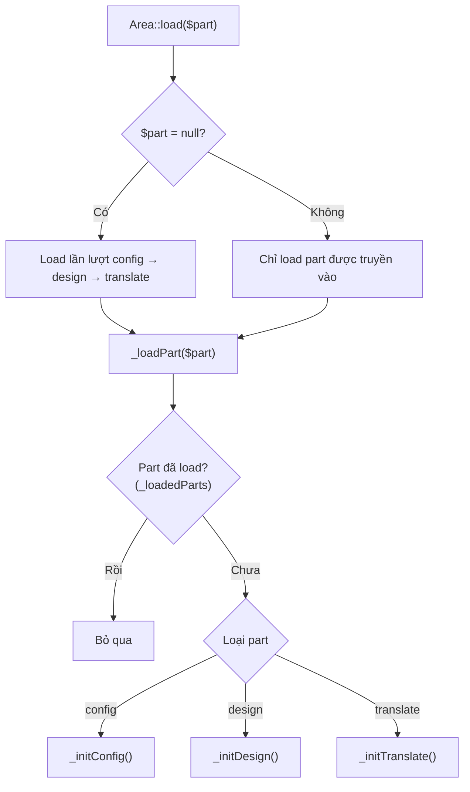
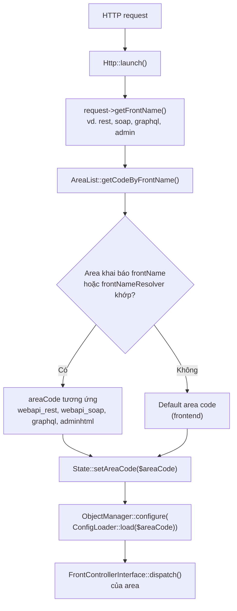

# Magento Area

> **Techstack:** Magento 2.4.x (Adobe Commerce / Magento Open Source)

Magento tổ chức application thành nhiều phân vùng area, mỗi phân vùng sẽ được xử lý tối ưu hóa và cho từng thành phần, request, url riêng biệt.

## 1. Tổng quan

Mỗi phân vùng sẽ có load configs, code khác nhau

- Admin (`adminhtml`): entry point cho phân vùng này tại `pub/index.php`. The Admin panel area includes the code needed for store management. The `/app/design/adminhtml` directory contains all the code for components you'll see while working in the Admin.
- Storefront (`frontend`): entry point for this area is `pub/index.php`. The storefront (or frontend) contains template and layout files that define the appearance of your storefront.
- Basic (`base`): used as a fallback for files absent in adminhtml and frontend areas. Đây chỉ là area fallback cho các file view (template, layout, web), không phải runtime area và không có entry point.
- Cron (`crontab`): In `pub/cron.php`, the `\Magento\Framework\App\Cron` class always loads the `'crontab'` area.
- Web API REST (`webapi_rest`): entry point for this area is `pub/index.php`. The REST area has a front controller that understands how to do URL lookups for REST-based URLs
- GraphQL (`graphql`): entry point for this area is `pub/index.php`.
- Web API SOAP (`webapi_soap`): entry point for this area is `pub/index.php`.

**Source:** `Magento\Framework\App\Area`

```php
// bên trong class Magento\Framework\App\Area sẽ thấy khai báo list areas
const AREA_GLOBAL = 'global';
const AREA_FRONTEND = 'frontend';
const AREA_ADMINHTML = 'adminhtml';
const AREA_DOC = 'doc';
const AREA_CRONTAB = 'crontab';
const AREA_WEBAPI_REST = 'webapi_rest';
const AREA_WEBAPI_SOAP = 'webapi_soap';
const AREA_GRAPHQL = 'graphql';
```

Bên trong class này chúng ta sẽ thấy cách Magento thực hiện load các thành phần của area: `Magento\Framework\App\Area::_loadPart($part)`

- config
- translate
- design (load design cho frontend, adminhtml và load theme)



*Hình 1: `Magento\Framework\App\Area::load()` và `_loadPart()` – mỗi part (config, design, translate) chỉ được load một lần cho mỗi area*

Mỗi area sẽ thực hiện load config DI cho ObjectManager. Loader được chọn theo **ObjectManager environment** (không phải deploy mode `MAGE_MODE`): `Magento\Framework\App\EnvironmentFactory::getMode()` dùng `Compiled` nếu tồn tại `generated/metadata/global.php`, ngược lại dùng `Developer`.

- Environment `developer` (chưa compile): `Magento\Framework\App\ObjectManager\Environment\Developer` (`getObjectManagerConfigLoader()` trả `null`, `configureObjectManager()` gán `ConfigLoader`) → dùng `Magento\Framework\App\ObjectManager\ConfigLoader::load($area)`: đọc các file `di.xml` của area rồi cache lại với key

```php
// Magento\Framework\App\ObjectManager\ConfigLoader::load()
$cacheId = $area . '::DiConfig';
```

- Environment `compiled` (đã chạy `setup:di:compile`, kể cả khi đang ở developer mode): `Magento\Framework\App\ObjectManager\Environment\Compiled` → dùng `Magento\Framework\App\ObjectManager\ConfigLoader\Compiled::load($area)`: đọc thẳng file metadata `generated/metadata/$area.php` (sinh ra bởi `setup:di:compile`)

## 2. Area frontName

```xml
<type name="Magento\Framework\App\AreaList">
    <arguments>
        <argument name="areas" xsi:type="array">
            <item name="webapi_rest" xsi:type="array">
                <item name="frontName" xsi:type="string">rest</item>
            </item>
            <item name="webapi_soap" xsi:type="array">
                <item name="frontName" xsi:type="string">soap</item>
            </item>
        </argument>
    </arguments>
</type>
```

Mỗi area thường sẽ có một frontName: \<là các area sử dụng HTTP\>

- `webapi_rest`: `rest`
- `webapi_soap`: `soap`
- `graphql`: `graphql`
- `adminhtml`: frontName động, do `Magento\Backend\App\Area\FrontNameResolver` resolve từ `backend/frontName` trong `app/etc/env.php` (vd. `admin`) hoặc config `admin/url/custom_path`
- …

Khi launch application `Magento\Framework\App\Http`

**Source:** `Magento\Framework\App\Http::launch()`

```php
public function launch()
{
    $areaCode = $this->_areaList->getCodeByFrontName($this->_request->getFrontName());
    $this->_state->setAreaCode($areaCode);
    $this->_objectManager->configure($this->_configLoader->load($areaCode));
    // ….
}
```

sẽ set area code vào `App\State` (mode developer/production/default đã được xác định từ lúc bootstrap), sau đó nạp DI config của area cho ObjectManager

sau đó sẽ thực hiện xử lý `\Magento\Framework\App\FrontControllerInterface` trên mỗi area.



*Hình 2: Xác định area từ frontName của request và load DI config tương ứng trong `Http::launch()`*

Với Cron area, `Magento\Framework\App\Cron::launch()` set area `crontab`, load DI config và translate của area, rồi dispatch event `default` qua `Magento\Framework\Event\ManagerInterface` (observer `Magento\Cron\Observer\ProcessCronQueueObserver` khai báo trong `Magento/Cron/etc/crontab/events.xml` sẽ chạy các cron job).

Ngoài `Http` và `Cron` còn các application (`AppInterface`) khác không gắn với area HTTP:

- Media (`Magento\MediaStorage\App\Media`), entry point `pub/get.php`
- Static (`Magento\Framework\App\StaticResource`), entry point `pub/static.php`

## 3. FrontControllerInterface

Application front controller responsible for dispatching application requests.

`Magento\Framework\App\FrontControllerInterface`

sẽ thực hiện các dispatch của application là http request:

- Controller: `Magento\Framework\App\FrontController`
- Rest: `Magento\Webapi\Controller\Rest`
- Soap: `Magento\Webapi\Controller\Soap`
- Graphql: `Magento\GraphQl\Controller\GraphQl`

Về cơ bản khi thực hiện HTTP Request sẽ bao gồm:

- Request
- Response
- Validate
- Exception & format error msg with Http Exception

## Tham khảo

**Tài liệu chính thức**

- [Modules and Areas | Commerce PHP Extensions](https://developer.adobe.com/commerce/php/architecture/modules/areas)
- [Routing | Commerce PHP Extensions](https://developer.adobe.com/commerce/php/development/components/routing)
- [Dependency Injection Configuration | Commerce PHP Extensions](https://developer.adobe.com/commerce/php/development/build/dependency-injection-file)

**Source code**

- [`Magento\Framework\App\Area`](https://github.com/magento/magento2/blob/2.4-develop/lib/internal/Magento/Framework/App/Area.php)
- [`Magento\Framework\App\AreaList`](https://github.com/magento/magento2/blob/2.4-develop/lib/internal/Magento/Framework/App/AreaList.php)
- [`Magento\Framework\App\Http`](https://github.com/magento/magento2/blob/2.4-develop/lib/internal/Magento/Framework/App/Http.php)
- [`Magento\Framework\App\ObjectManager\ConfigLoader`](https://github.com/magento/magento2/blob/2.4-develop/lib/internal/Magento/Framework/App/ObjectManager/ConfigLoader.php)

**Bài liên quan trong Knowledge Base**

- [Xử lý Request trong Magento (Routing)](Routing%20trong%20Magento%20Commerce.md)
- [Object Manager](Object%20Manager.md)
- [Controller (API Rest, Soap & Graphql)](API%20Rest%2C%20Soap%20%26%20Graphql/Controller.md)
- [Config & Env trong Magento](Config%20%26%20Env%20trong%20Magento.md)
