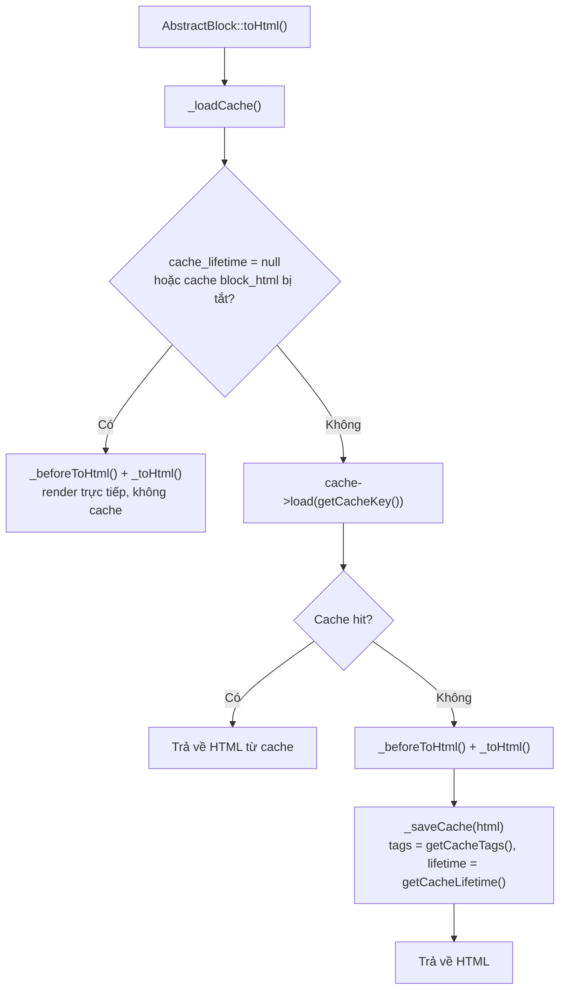
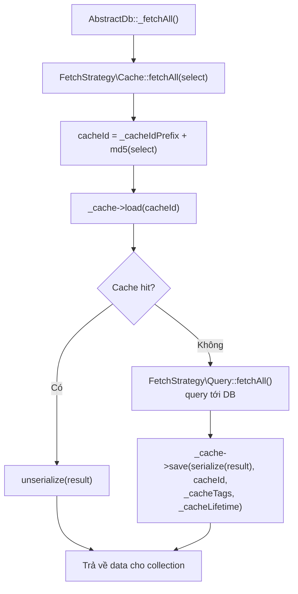

# Magento Cache

> **Techstack:** Magento 2.4.x (Adobe Commerce / Magento Open Source)

**Xử lý Cache trong Magento**

## 1. Các kiểu cache trong Magento

| **Cache** | **Cache id** | **Cache tag** |
|---|---|---|
| Configuration | config | `CONFIG` |
| Layouts | layout | `LAYOUT_GENERAL_CACHE_TAG` |
| Blocks HTML output | block_html | `BLOCK_HTML` |
| Collections Data | collections | `COLLECTION_DATA` |
| Reflection Data | reflection | `REFLECTION` |
| Database DDL operations | db_ddl | `DB_DDL` |
| Compiled Config | compiled_config | `COMPILED_CONFIG` |
| Webhooks Response Cache *(chỉ Adobe Commerce)* | webhooks_response | `WEBHOOKS_RESPONSE` |
| EAV types and attributes | eav | `EAV` |
| Customer Notification | customer_notification | `CUSTOMER_NOTIFICATION` |
| GraphQL Query Resolver Results | graphql_query_resolver_result | `GRAPHQL_QUERY_RESOLVER_RESULT` |
| Integrations Configuration | config_integration | `INTEGRATION` |
| Integrations API Configuration | config_integration_api | `INTEGRATION_API_CONFIG` |
| Admin UI SDK Cache *(chỉ Adobe Commerce)* | admin_ui_sdk | `ADMIN_UI_SDK` |
| Page Cache | full_page | `FPC` |
| Target Rule *(chỉ Adobe Commerce)* | target_rule | `TARGET_RULE` |
| Web Services Configuration | config_webservice | `WEBSERVICE` |
| Translations | translate | `TRANSLATE` |

> [!NOTE]
> Các cache type đánh dấu *(chỉ Adobe Commerce)* có trong output `cache:status` của Adobe Commerce ([Manage the cache](https://experienceleague.adobe.com/en/docs/commerce-operations/configuration-guide/cli/manage-cache)) nhưng không có trong `cache.xml` của Magento Open Source 2.4.8.

### 1.1. Configuration Cache

System / Cache Management / Cache type "Configuration"

Class: `Magento\Framework\App\Cache\Type\Config`

CACHE_TAG: `'CONFIG'`

base từ `Magento\Framework\Cache\Frontend\Decorator\TagScope`

TagScope là một Decorator tự gắn `CACHE_TAG` của cache type khi `save()` và giới hạn `clean()` trong phạm vi tag đó; `load()`, `remove()` được ủy quyền xuống frontend (kế thừa từ `Magento\Framework\Cache\Frontend\Decorator\Bare`)

- save – thêm tag của type vào cache entry
- clean – chỉ clean các entry có tag của type

Đây là global config của Magento, có thể tìm thấy cache này ở rất nhiều nơi:

- `Magento\Framework\App\ObjectManager\ConfigLoader` tag `::DiConfig`
- `Magento\Framework\App\ObjectManager\ConfigCache`
- `Magento\Framework\Interception\Config\CacheManager`
- `Magento\Framework\App\ResourceConnection\Config`
- `Magento\Store\Model\StoreManager`
- …

**Ví dụ:**

```php
\Magento\Framework\App\Cache\Type\Config $cache,

$data = $cache->load(CACHE_ID);
if (!$data) {
    $data = . . .;
    $cache->save($data, CACHE_ID);
}
```

### 1.2. Layouts Cache

System / Cache Management / Cache type "Layouts"

Class: `Magento\Framework\App\Cache\Type\Layout`

CACHE_TAG = `'LAYOUT_GENERAL_CACHE_TAG'`

Được khai báo trong một số Layout Classes:

- `Magento\Framework\View\Layout`
- `Magento\Widget\Model\ResourceModel\Layout\Update`
- `Magento\Framework\View\Model\Layout\Merge`

`Layout Cache` này lưu layout XML đã merge theo tập handles của page (`Magento\Framework\View\Model\Layout\Merge::load()`) và layout structure đã generate (`Magento\Framework\View\Layout::generateElements()`); handles được dùng làm cache tag

cacheId: `$this->generateCacheId(md5(implode('|', array_merge($this->getHandles(), $layoutCacheKeys))))`

**Source:** `Magento\Framework\View\Layout::generateElements()`

```php
// Magento\Framework\View\Layout::generateElements()
$cacheId = 'structure_' . $this->getUpdate()->getCacheId();
$result = $this->cache->load($cacheId);
if (!$result) {
    $this->cache->save($this->serializer->serialize($data), $cacheId, $this->getUpdate()->getHandles(), $this->cacheLifetime);
}
```

### 1.3. Blocks HTML Cache

`Magento\Framework\App\Cache\Type\Block`

CACHE_TAG = `'BLOCK_HTML'`

Block HTML Cache sẽ cache lại HTML output theo từng block template

Block Cache được thực thi tại `Magento\Framework\View\Element\AbstractBlock`

- `_loadCache`
- `_saveCache`



*Hình 1: Luồng load/save Block HTML cache trong `AbstractBlock::_loadCache()` (Magento 2.4.8, load/save được bọc bởi `lockQuery->lockedLoadData()`)*

Xem lại cache key của block trong AbstractBlock:

**Source:** `Magento\Framework\View\Element\AbstractBlock::getCacheKey()`

```php
// Magento\Framework\View\Element\AbstractBlock
public const CACHE_KEY_PREFIX = 'BLOCK_';

public const CUSTOM_CACHE_KEY_PREFIX = 'CUSTOM_BLOCK_';

/**
 * Get Key for caching block content
 *
 * @return string
 * @throws RuntimeException
 */
public function getCacheKey()
{
    if ($this->hasData('cache_key')) {
        if (preg_match('/[^a-z0-9\-\_]/i', $this->getData('cache_key'))) {
            throw new RuntimeException(__('Please enter cache key with only alphanumeric or hash string.'));
        }

        return static::CUSTOM_CACHE_KEY_PREFIX . $this->getData('cache_key');
    }

    /**
     * don't prevent recalculation by saving generated cache key
     * because of ability to render single block instance with different data
     */
    $key = $this->getCacheKeyInfo();

    $key = array_values($key);  // ignore array keys

    $key[] = (string)$this->getDeploymentConfig()->get(
        ConfigOptionsListConstants::CONFIG_PATH_CRYPT_KEY
    );

    $key = implode('|', $key);
    $key = hash('sha256', $key); // use hashing to hide potentially private data
    return static::CACHE_KEY_PREFIX . $key;
}
```

> [!NOTE]
> Để tạo cache cho block thì cần chú ý tới `cache_key` data trong block (chỉ chữ/số/`-`/`_`, prefix `CUSTOM_BLOCK_`), hoặc array data của `getCacheKeyInfo` + crypt key (hash sha256, prefix `BLOCK_`), và data `cache_lifetime`

### 1.4. Collections Cache

System / Cache Management / Cache type "Collections Data"

Class: `Magento\Framework\App\Cache\Type\Collection`

CACHE_TAG: `COLLECTION_DATA`

Collection Cache sẽ cache lại data của collection sau khi thực hiện query `fetchAll()` tới db.

Bên trong AbstractCollectionDB (`Magento\Framework\Data\Collection\AbstractDb`) ta có thể thấy `$fetchStrategy` implement từ `FetchStrategyInterface`

`AbstractCollectionDB::_fetchAll()` sẽ thực hiện một `$fetchStrategy::fetchAll()`

Mặc định `FetchStrategyInterface` có preference là `Magento\Framework\Data\Collection\Db\FetchStrategy\Query` (luôn query DB, xem `app/etc/di.xml`). Chỉ collection được inject `fetchStrategy` là virtualType của FetchStrategyByCache (`Magento\Framework\Data\Collection\Db\FetchStrategy\Cache`) – vd. Store/Group/Website collection trong `Magento/Store/etc/di.xml` (`Magento/Catalog/etc/frontend/di.xml` có khai báo virtualType `Category\Collection\FetchStrategy` nhưng core không inject vào collection nào) – mới tìm collection data trong cache trước, với cacheId là prefix + md5 của query select.

`Magento\Framework\Data\Collection\Db\FetchStrategy\Cache`

Retrieve collection data from cache, fail over to another fetch strategy, if cache does not exist yet

Xem lại trong code:

**Source:** `Magento\Framework\Data\Collection\Db\FetchStrategy\Cache::fetchAll()`

```php
public function fetchAll(Select $select, array $bindParams = [])
{
    $cacheId = $this->_getSelectCacheId($select);
    $result = $this->_cache->load($cacheId);
    if ($result) {
        $result = $this->serializer->unserialize($result);
    } else {
        $result = $this->_fetchStrategy->fetchAll($select, $bindParams);
        $this->_cache->save(
            $this->serializer->serialize($result),
            $cacheId,
            $this->_cacheTags,
            $this->_cacheLifetime
        );
    }
    return $result;
}

protected function _getSelectCacheId($select)
{
    return $this->_cacheIdPrefix . md5((string)$select);
}
```

Khi cache không tồn tại data thì sẽ sử dụng FetchStrategyByQuery (`Magento\Framework\Data\Collection\Db\FetchStrategy\Query`) để thực hiện query đến DB.



*Hình 2: Fetch strategy của collection đã cấu hình `FetchStrategy\Cache` – cache hit/miss rồi fail over sang query DB*

### 1.5. Reflections Cache

Được sử dụng để tăng performance khi thực hiện thu thập thông tin về method metadata của services

**Source:** `Magento\Framework\Reflection\MethodsMap::getMethodsMap()`

```php
/**
 * Service methods' reflection data stored in cache as 'methodName' => 'returnType'
 * ex.
 * [
 *  'create' => '\Magento\Customer\Api\Data\Customer',
 *  'validatePassword' => 'boolean'
 * ]
 */
```

Reflection methods map thường được sử dụng trong

- `Magento\Framework\Reflection\DataObjectProcessor::buildOutputDataArray()`
- `Magento\Framework\Reflection\ExtensionAttributesProcessor::buildOutputDataArray()`

### 1.6. Cache Database DDL operations

`Magento\Framework\DB\Adapter\DdlCache`

**DDL?**

DDL is short name of Data Definition Language, which deals with database schemas and descriptions, of how the data should reside in the database.

- `CREATE` – to create database and its objects like (table, index, views, store procedure, function and triggers).
- `ALTER` – alters the structure of the existing database.
- `DROP` – delete objects from the database.
- `TRUNCATE` – remove all records from a table; also, all spaces allocated for the records are removed.
- `COMMENT` – add comments to the data dictionary (cú pháp Oracle; với MySQL/MariaDB, comment là mệnh đề `COMMENT '...'` trong `CREATE/ALTER TABLE`).
- `RENAME` – rename an object.

Magento không cache câu lệnh DDL mà cache kết quả đọc metadata schema của `Magento\Framework\DB\Adapter\Pdo\Mysql`: `describeTable()` (`DDL_DESCRIBE`), `getCreateTable()` (`DDL_CREATE`), `getIndexList()` (`DDL_INDEX`), `getForeignKeys()` (`DDL_FOREIGN_KEY`), `isTableExists()` (`DDL_EXISTS`). Cache được reset qua `resetDdlCache()` khi alter table.

### 1.7. Cache schema context webapi

Cache schema context cho webapi: `Magento\Webapi\Model\AbstractSchemaGenerator::generate()` cache schema theo context (`generateCacheIdUsingContext()`) vào cache type Web Services Configuration (`config_webservice`, tag `WEBSERVICE`). `generate()` được kế thừa, còn `generateSchema()` (abstract) được implement riêng bởi:

- `Magento\Webapi\Model\Rest\Swagger\Generator`
- `Magento\Webapi\Model\Soap\Wsdl\Generator`

### 1.8. EAV Cache

Class: `Magento\Eav\Model\Cache\Type`

CACHE_TAG: `EAV`

Được sử dụng để get attribute data trong EAV

`Magento\Eav\Model\Config::getAttribute()`

**Source:** `Magento\Eav\Model\Config`

```php
/**#@+
 * EAV cache ids
 */
public const ENTITIES_CACHE_ID = 'EAV_ENTITY_TYPES';
public const ATTRIBUTES_CACHE_ID = 'EAV_ENTITY_ATTRIBUTES';
public const ATTRIBUTES_CODES_CACHE_ID = 'EAV_ENTITY_ATTRIBUTES_CODES';
```

ModelEavConfig sẽ cache:

- `eav_entity_type` resource: collection entity_types data và mapping data với `attribute_model` của mỗi type.
- `eav_entity_attributes`: collection entity_attributes cho mỗi type

Class: `Magento\Eav\Model\Entity\Attribute`

CACHE_TAG: `EAV_ATTRIBUTE`

### 1.9. Integration Cache

System / Cache Management / Cache type "Integrations Configuration"

**Integration Module: Magento/Integration** enables third-party services to call the Web API by using access tokens.

Integration Config

`Magento\Integration\Model\Config` @deprecated

Integration Config API

`Magento\Integration\Model\IntegrationConfig` @deprecated

Integration Consolidated Config

`Magento\Integration\Model\ConsolidatedConfig`

ConsolidatedConfig to deliver information for config-based integrations that use `integration.xml`

### 1.10. Compiled Config - Interception

Compiled Config (`Magento\Framework\App\Interception\Cache\CompiledConfig`, tag `COMPILED_CONFIG`) sử dụng để lưu data đã compiled của:

- plugin list – `Magento\Framework\Interception\PluginList\PluginList::_loadScopedData()` (load configuration for current scope)
- danh sách action của router – `Magento\Framework\App\Router\ActionList`
- config event – `Magento\Framework\Event\Config\Data`

## 2. Low-level backend cache

- Redis
- File
- Database

## 3. FPC & Varnish Cache

> [!NOTE]
> Nội dung đang được cập nhật.

## Tham khảo

**Tài liệu chính thức**

- [Caching overview | Adobe Commerce](https://experienceleague.adobe.com/en/docs/commerce-operations/configuration-guide/cache/caching-overview)
- [Manage the cache | Adobe Commerce](https://experienceleague.adobe.com/en/docs/commerce-operations/configuration-guide/cli/manage-cache) – bật/tắt, clean, flush cache type bằng CLI
- [Create a cache type | Commerce PHP Extensions](https://developer.adobe.com/commerce/php/development/cache/partial/cache-type)
- [Create Custom Cache Engines | Commerce PHP Extensions](https://developer.adobe.com/commerce/php/development/cache/partial/database-caching) – low-level backend (database, Redis…)
- [Use Redis for default cache | Adobe Commerce](https://experienceleague.adobe.com/en/docs/commerce-operations/configuration-guide/cache/redis/config-redis)
- [Public Content | Commerce PHP Extensions](https://developer.adobe.com/commerce/php/development/cache/page/public-content) – full page cache

**Source code**

- [`Magento\Framework\App\Cache\Type\Config`](https://github.com/magento/magento2/blob/2.4-develop/lib/internal/Magento/Framework/App/Cache/Type/Config.php)
- [`Magento\Framework\Cache\Frontend\Decorator\TagScope`](https://github.com/magento/magento2/blob/2.4-develop/lib/internal/Magento/Framework/Cache/Frontend/Decorator/TagScope.php)
- [`Magento\Framework\View\Element\AbstractBlock`](https://github.com/magento/magento2/blob/2.4-develop/lib/internal/Magento/Framework/View/Element/AbstractBlock.php)
- [`Magento\Framework\Data\Collection\Db\FetchStrategy\Cache`](https://github.com/magento/magento2/blob/2.4-develop/lib/internal/Magento/Framework/Data/Collection/Db/FetchStrategy/Cache.php)
- [`Magento\Framework\Reflection\MethodsMap`](https://github.com/magento/magento2/blob/2.4-develop/lib/internal/Magento/Framework/Reflection/MethodsMap.php)
- [`Magento\Framework\DB\Adapter\DdlCache`](https://github.com/magento/magento2/blob/2.4-develop/lib/internal/Magento/Framework/DB/Adapter/DdlCache.php)
- [`Magento\Eav\Model\Config`](https://github.com/magento/magento2/blob/2.4-develop/app/code/Magento/Eav/Model/Config.php)

**Bài liên quan trong Knowledge Base**

- [Config & Env trong Magento](Config%20%26%20Env%20trong%20Magento.md)
- [Object Manager](Object%20Manager.md)
- [Indexing trong M2](Indexing%20trong%20M2.md)
- [Optimize & Indexer](DB%20%26%20Data%20Object/Optimize%20%26%20Indexer.md)
