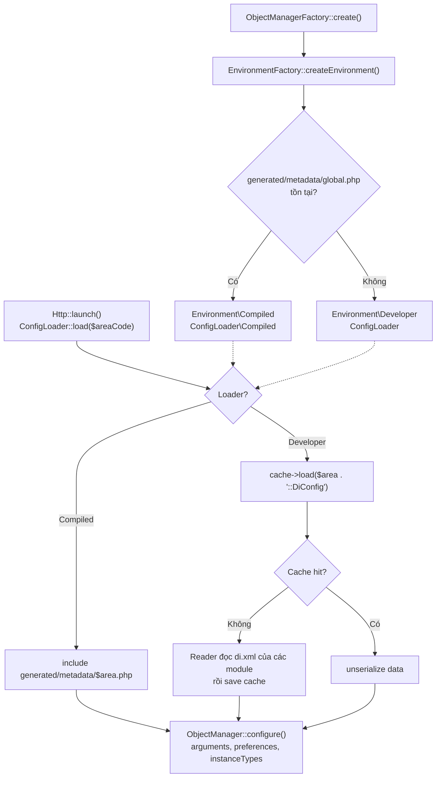
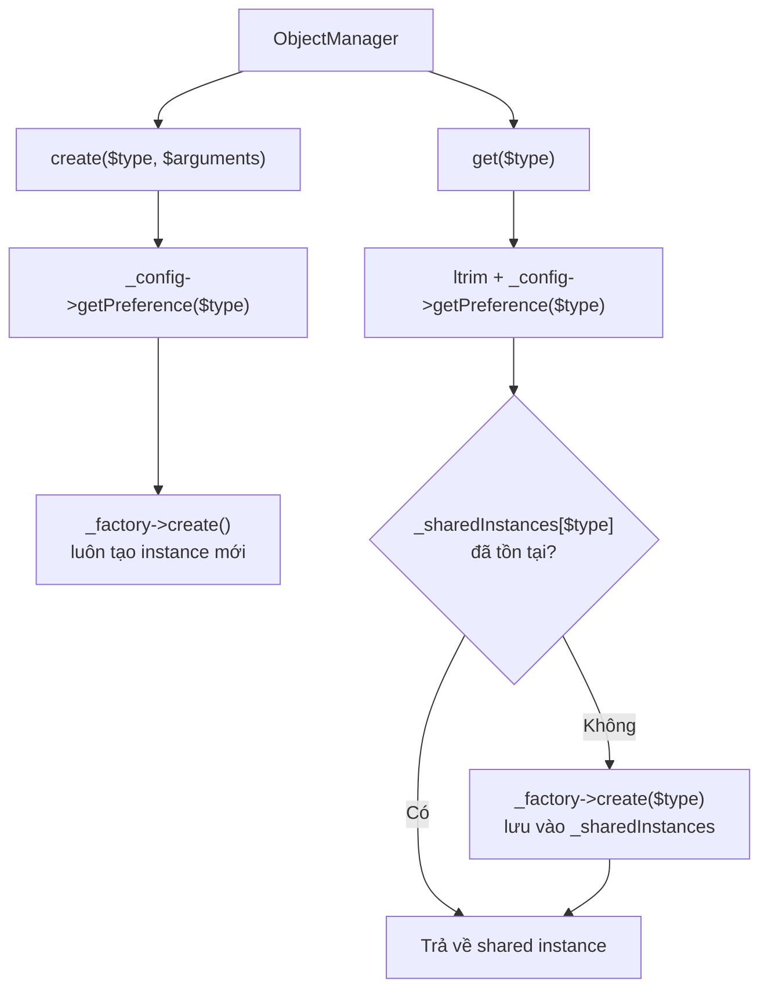
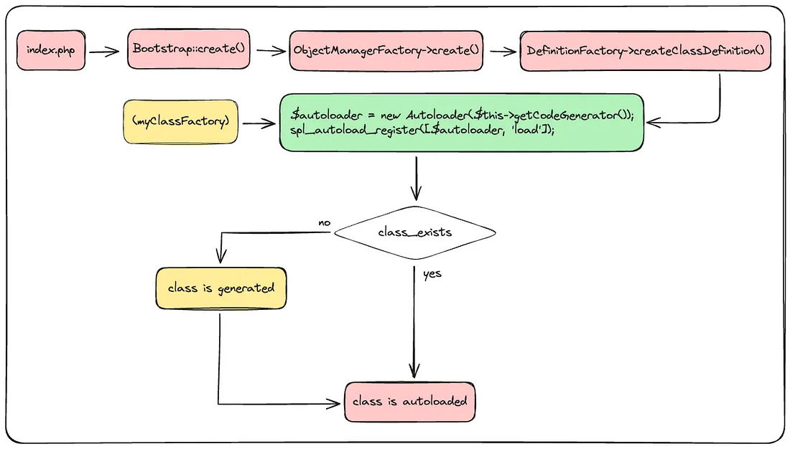

# ObjectManager trong Magento

> **Techstack:** Magento 2.4.x (Adobe Commerce / Magento Open Source)

Trong Magento, ObjectManager giúp điều hướng quá trình khởi tạo object (tạo một singleton object, tạo object với DI inject, tạo new object …)

## 1. Tổng quan

Magento mô tả trách nhiệm của ObjectManager:

- Object creation in factories and proxies
- Implementing the singleton pattern by returning the same shared instance of a class when requested
- Dependency management by instantiating the preferred class when a constructor requests its interface
- Automatically instantiating parameters in class constructors

[Object Manager | Commerce PHP Extensions](https://developer.adobe.com/commerce/php/development/components/object-manager/)

Khi application được khởi tạo dựa trên area & state thì bootstrap sẽ khởi tạo một global `ObjectManager` để có thể thực hiện load DI default cho các loại ứng dụng Http, Cron, Static, Media …. thông qua ObjectManagerFactory:

`Magento\Framework\App\ObjectManagerFactory::create()`

=> global ObjectManager

Sau đó, tùy thuộc vào từng loại ứng dụng, mode, area thì DI sẽ được load thêm các config DI thông qua `$configLoader, $state, $areaCode` : `Magento\Framework\ObjectManager\ConfigLoaderInterface`

```php
/** Magento\Framework\App\Http::launch() **/
$this->_objectManager->configure($this->_configLoader->load($areaCode));
// or
/** Magento\Framework\App\Cron::launch() **/
$this->objectManager->configure($configLoader->load(Area::AREA_CRONTAB));
```

## 2. DI Config Loader – Load modules DI configuration

`\Magento\Framework\ObjectManager\ConfigLoaderInterface`

- Compiled: metadata files `generated/metadata/. $area . '.php'`
- ConfigLoader: cache config `$area . '::DiConfig'`

metadata config gồm:

- `arguments`: arguments data inject
- `preferences`: preferences of instance types (implement interface, override object)
- `instanceTypes`: alias virtual of instance types

metadata area: global, frontend, adminhtml, webapi_rest, webapi_soap, graphql, crontab



*Hình 1: Chọn DI Config Loader theo mode (compiled/developer) và load DI config cho từng area*

## 3. Interceptor Plugin Config Loader

Metadata `generated/metadata/interception.php`

bên trong interception metadata là các object được khai báo có plugin

**Ví dụ:**

```xml
<!-- khai báo plugin -->
<type name="Magento\Store\Model\Store">
    <plugin name="themeDesignConfigGridIndexerStore" type="Magento\Theme\Model\Indexer\Design\Config\Plugin\Store"/>
</type>
```

thì trong interception metadata: `Magento\Store\Model\Store => true`

và bên trong metadata plugin `primary|global|plugin-list.php`:

```php
// định nghĩa plugin name
'Magento\\Store\\Model\\Store' =>
  array (
    'themeDesignConfigGridIndexerStore' =>
      array (
        'sortOrder' => 0,
        'instance' => 'Magento\\Theme\\Model\\Indexer\\Design\\Config\\Plugin\\Store',
      ),
  ),
// Method, và kiểu plugin
'Magento\\Store\\Model\\Store_save___self' =>
  array (
    4 =>
      array (
        0 => 'themeDesignConfigGridIndexerStore',
      ),
  ),
```

`4` (`LISTENER_AFTER`) là type định nghĩa kiểu của plugin method. Plugin before/after được lưu dạng mảng tên plugin, còn around chỉ lưu một tên (plugin around kế tiếp trong chuỗi) – xem `Magento\Framework\Interception\PluginListGenerator`.

**Source:** `Magento\Framework\Interception\DefinitionInterface`

```php
// Magento\Framework\Interception\DefinitionInterface
const LISTENER_BEFORE = 1;
const LISTENER_AROUND = 2;
const LISTENER_AFTER = 4;
```

vậy nhìn vào đây chúng ta sẽ biết:

với method `Magento\Store\Model\Store::save()`

được khai báo plugin là một **after** plugin (`afterSave`) với name là `'themeDesignConfigGridIndexerStore'` và là một instance của `Magento\Theme\Model\Indexer\Design\Config\Plugin\Store`

## 4. Tạo mới một instance

Khi muốn tạo mới một instance chúng ta sẽ sử dụng method `create`

**Source:** `Magento\Framework\ObjectManager\ObjectManager::create()`

```php
/**
 * Create new object instance
 *
 * @param string $type
 * @param array $arguments
 * @return mixed
 */
public function create($type, array $arguments = [])
{
    return $this->_factory->create($this->_config->getPreference($type), $arguments);
}
```

## 5. Get singleton

ObjectManager khi sử dụng phương thức get sẽ khởi tạo một instance và cache instance đấy lại và sử dụng nó như một Singleton.

**Source:** `Magento\Framework\ObjectManager\ObjectManager::get()`

```php
/**
 * Retrieve cached object instance
 *
 * @param string $type
 * @return mixed
 */
public function get($type)
{
    $type = ltrim($type, '\\');
    $type = $this->_config->getPreference($type);
    if (!isset($this->_sharedInstances[$type])) {
        $this->_sharedInstances[$type] = $this->_factory->create($type);
    }
    return $this->_sharedInstances[$type];
}
```



*Hình 2: So sánh `ObjectManager::create()` (instance mới) và `ObjectManager::get()` (shared instance)*

Xem thêm: DIConfig:
[Dependency Injection Configuration | Commerce PHP Extensions](https://developer.adobe.com/commerce/php/development/build/dependency-injection-file)

## 6. Autoloader

Magento đã custom một code generator để xử lý load Class Generator bên trong ObjectManagerFactory



*Hình 3: Code generator autoloader được đăng ký trong quá trình tạo ObjectManager – class chưa tồn tại (vd. `myClassFactory`) sẽ được generate trước khi autoload*

CodeGenerator Autoload sẽ được register:

**Source:** `Magento\Framework\ObjectManager\DefinitionFactory::createClassDefinition()`

```php
/**
 * Create class definitions
 *
 * @return DefinitionInterface
 */
public function createClassDefinition()
{
    $autoloader = new Autoloader($this->getCodeGenerator());
    spl_autoload_register([$autoloader, 'load']);
    return new Runtime();
}
```

Các kiểu Generator Code được khai báo qua argument `generatedEntities` của `Magento\Framework\Code\Generator` trong `app/etc/di.xml`:

```xml
<!-- app/etc/di.xml -->
<type name="Magento\Framework\Code\Generator">
    <arguments>
        <argument name="generatedEntities" xsi:type="array">
            <item name="extensionInterfaceFactory" xsi:type="string">\Magento\Framework\Api\Code\Generator\ExtensionAttributesInterfaceFactoryGenerator</item>
            <item name="factory" xsi:type="string">\Magento\Framework\ObjectManager\Code\Generator\Factory</item>
            <item name="proxy" xsi:type="string">\Magento\Framework\ObjectManager\Code\Generator\Proxy</item>
            <item name="interceptor" xsi:type="string">\Magento\Framework\Interception\Code\Generator\Interceptor</item>
            <item name="logger" xsi:type="string">\Magento\Framework\ObjectManager\Profiler\Code\Generator\Logger</item>
            <item name="mapper" xsi:type="string">\Magento\Framework\Api\Code\Generator\Mapper</item>
            <item name="persistor" xsi:type="string">\Magento\Framework\ObjectManager\Code\Generator\Persistor</item>
            <item name="repository" xsi:type="string">\Magento\Framework\ObjectManager\Code\Generator\Repository</item>
            <item name="convertor" xsi:type="string">\Magento\Framework\ObjectManager\Code\Generator\Converter</item>
            <item name="searchResults" xsi:type="string">\Magento\Framework\Api\Code\Generator\SearchResults</item>
            <item name="extensionInterface" xsi:type="string">\Magento\Framework\Api\Code\Generator\ExtensionAttributesInterfaceGenerator</item>
            <item name="extension" xsi:type="string">\Magento\Framework\Api\Code\Generator\ExtensionAttributesGenerator</item>
            <item name="remote" xsi:type="string">\Magento\Framework\MessageQueue\Code\Generator\RemoteServiceGenerator</item>
            <item name="proxyDeferred" xsi:type="string">\Magento\Framework\Async\Code\Generator\ProxyDeferredGenerator</item>
        </argument>
    </arguments>
</type>
```

Application sẽ được tạo dựa trên area & state

Đầu tiên bootstrap sẽ khởi tạo một global `ObjectManager` để có thể thực hiện load DI default cho các loại ứng dụng Http, Cron, Static, Media ….

Sau đó, tùy thuộc vào từng loại ứng dụng, mode, area thì DI sẽ được load thêm các config DI thông qua `$configLoader, $state, $areaCode` : `Magento\Framework\ObjectManager\ConfigLoaderInterface`

Chúng ta có thể thấy trong `Magento\Framework\App\Http::launch()`

**Source:** `Magento\Framework\App\Http::launch()`

```php
/**
 * Run application
 *
 * @return ResponseInterface
 * @throws LocalizedException|\InvalidArgumentException
 */
public function launch()
{
    $areaCode = $this->_areaList->getCodeByFrontName($this->_request->getFrontName());
    $this->_state->setAreaCode($areaCode);
    $this->_objectManager->configure($this->_configLoader->load($areaCode));
    // ……
    return $this->_response;
}
```

`ObjectManager\ConfigLoaderInterface`: Load metadata of DiConfig cho mỗi area

`App\State`: State mode `developer`, `production`, `default`

## 7. ObjectManagerFactory

Bên trong bootstrap chúng ta sẽ thấy, bootstrap sẽ sử dụng một ObjectManagerFactory để tạo ObjectManager

```php
\Magento\Framework\App\Bootstrap::createObjectManagerFactory(BP, []);
// —-- or —--
$this->objectManager = $this->factory->create($this->server);
```

ObjectManagerFactory sẽ khởi tạo một global ObjectManager được inject các config, server data, chúng ta có thể xem hàm:

**Source:** `Magento\Framework\App\Bootstrap::createObjectManagerFactory()`

```php
/**
 * Creates instance of object manager factory
 *
 * @param string $rootDir
 * @param array $initParams
 * @return ObjectManagerFactory
 */
public static function createObjectManagerFactory($rootDir, array $initParams)
{
    $dirList = self::createFilesystemDirectoryList($rootDir, $initParams);
    $driverPool = self::createFilesystemDriverPool($initParams);
    $configFilePool = self::createConfigFilePool();
    return new ObjectManagerFactory($dirList, $driverPool, $configFilePool);
}
```

Chúng ta sẽ thấy các config global sẽ được thiết lập sẵn để khởi tạo ObjectManager

```php
Magento\Framework\App\ObjectManagerFactory::create(array $arguments)
```

- definition
- relations
- generatedFiles
- appMode & default appMode
- profiler
- sharedInstances
- …

Sau khi ObjectManager được khởi tạo với mỗi area, state thì OM sẽ được set configure với:

```php
/**
 * Configure object manager
 *
 * @param array $configuration
 * @return void
 */
public function configure(array $configuration);

/** Example */
$objectManager = $bootstrap->getObjectManager();
$objectManager->configure([
    'preferences' => [
        'Magento\Framework\Authorization\PolicyInterface' => 'Magento\Framework\Authorization\Policy\DefaultPolicy'
    ]
]);
```

## 8. Object lifestyle configuration

The lifestyle of an object determines the number of instances that can exist of that object.

You can configure dependencies in Adobe Commerce and Magento Open Source to have the following lifestyles:

- Singleton (default) - One instance of this class exists. The object manager creates it at the first request. Requesting the class again returns the same instance. Disposing or ending the container registered to it releases the instance.
- Transient - The object manager creates a new instance of the class for every request.

Lifestyle được cấu hình bằng attribute `shared` trong `di.xml`: `shared="false"` trên `<type>` hoặc `<argument xsi:type="object">` sẽ là Transient; bỏ trống hoặc `shared="true"` là Singleton ([Dependency Injection Configuration](https://developer.adobe.com/commerce/php/development/build/dependency-injection-file)).

```xml
<!-- app/etc/di.xml -->
<type name="Magento\Framework\Acl" shared="false" />
```

> [!NOTE]
> `shared` chỉ ảnh hưởng tới `ObjectManager::get()` và constructor injection. `ObjectManager::create()` luôn tạo instance mới, bất kể `shared`.

## Tham khảo

**Tài liệu chính thức**

- [Object Manager | Commerce PHP Extensions](https://developer.adobe.com/commerce/php/development/components/object-manager/)
- [Dependency Injection | Commerce PHP Extensions](https://developer.adobe.com/commerce/php/development/components/dependency-injection)
- [Dependency Injection Configuration | Commerce PHP Extensions](https://developer.adobe.com/commerce/php/development/build/dependency-injection-file)
- [Code Generation | Commerce PHP Extensions](https://developer.adobe.com/commerce/php/development/components/code-generation)

**Source code**

- [`Magento\Framework\ObjectManager\ObjectManager`](https://github.com/magento/magento2/blob/2.4-develop/lib/internal/Magento/Framework/ObjectManager/ObjectManager.php)
- [`Magento\Framework\App\ObjectManagerFactory`](https://github.com/magento/magento2/blob/2.4-develop/lib/internal/Magento/Framework/App/ObjectManagerFactory.php)
- [`Magento\Framework\App\EnvironmentFactory`](https://github.com/magento/magento2/blob/2.4-develop/lib/internal/Magento/Framework/App/EnvironmentFactory.php)
- [`Magento\Framework\App\ObjectManager\ConfigLoader`](https://github.com/magento/magento2/blob/2.4-develop/lib/internal/Magento/Framework/App/ObjectManager/ConfigLoader.php)
- [`Magento\Framework\App\ObjectManager\ConfigLoader\Compiled`](https://github.com/magento/magento2/blob/2.4-develop/lib/internal/Magento/Framework/App/ObjectManager/ConfigLoader/Compiled.php)
- [`Magento\Framework\ObjectManager\DefinitionFactory`](https://github.com/magento/magento2/blob/2.4-develop/lib/internal/Magento/Framework/ObjectManager/DefinitionFactory.php)

**Bài liên quan trong Knowledge Base**

- [Dependency injection configuration](DI%20%26%20Interceptors/Dependency%20injection%20configuration.md)
- [Code generation & Optimal development environment](Code%20generation%20%26%20Optimal%20development%20environment.md)
- [Factories Patterns](SOLID%20principles%20%26%20Patterns%20in%20Magento/Factories%20Patterns.md)
- [Proxies](SOLID%20principles%20%26%20Patterns%20in%20Magento/Proxies.md)
