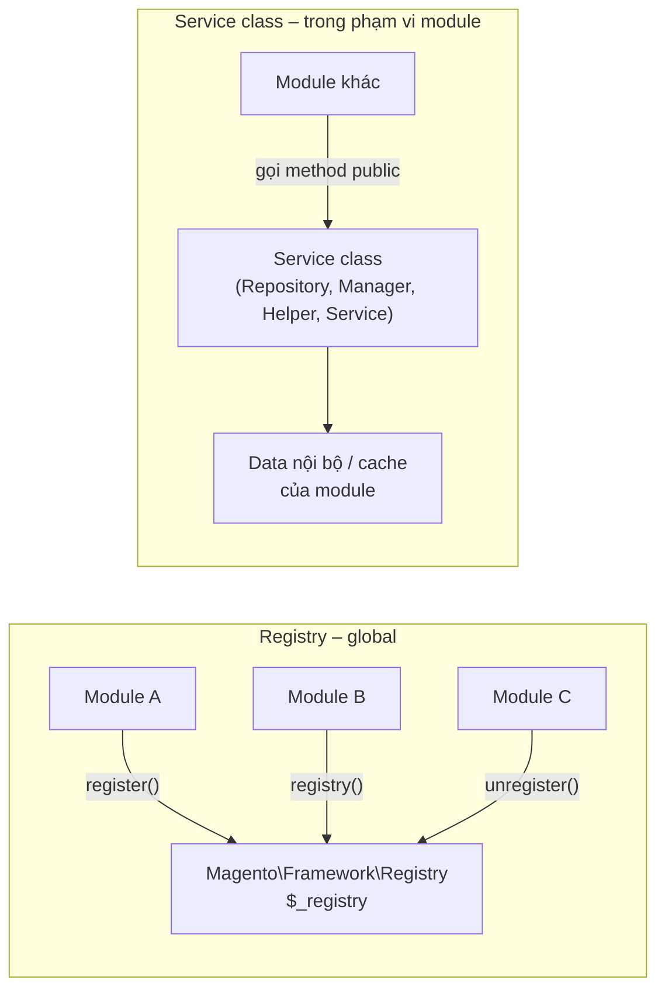

# Registry & Why registry deprecated

> **Techstack:** Magento 2.4.x (Adobe Commerce / Magento Open Source)

## 1. Registry

Registry model `Magento\Framework\Registry` sử dụng để share dữ liệu tạm thời giữa các services, class trong Magento.

Registry được khuyến nghị không nên sử dụng `usage should be avoid`, nhưng chúng ta sẽ cùng đi vào tìm hiểu registry là gì, làm gì, tại sao không nên sử dụng và làm như thế nào để thay thế Registry trong Magento.

Đầu tiên, registry sẽ được khởi tạo như một giá trị global trên toàn bộ ứng dụng

Các giá trị cần share sẽ được lưu vào một registry collection:

`Magento\Framework\Registry:$_registry`

Bên trong registry chúng ta sẽ có các phương thức:

- `register()`: để tạo mới một giá trị lưu vào trong registry
- `registry()`: lấy ra giá trị đã lưu trong registry
- `unregister()`: Xóa bỏ giá trị đã lưu trong registry đồng thời `__destruct` nếu giá trị lưu trong đó là một object.

Vậy trong quá trình chạy registry sẽ lưu trực tiếp các biến vào trong quá trình chạy.

## 2. Những vấn đề với Registry Model

Giá trị của registry được lưu global, dễ dàng chỉnh sửa, tạo mới và xóa dữ liệu trong quá trình chạy ứng dụng.

Khi giá trị được lưu trữ trên global và dễ dàng thay đổi thì điều đầu tiên thấy được là các module khác nhau có thể làm sai lệch giá trị của giá trị bên trong registry dẫn đến kết quả không mong muốn.

Vì giá trị này là global nên bản thân cũng tồn tại nhiều rủi ro về bảo mật khi có thể access, và modify từ mọi nơi.

Bên cạnh đấy là vấn đề hiệu suất và tràn memory, vì registry sử dụng trực tiếp lưu giá trị vào một mảng global.

Cập nhật, thay thế giá trị của registry sẽ có thể ảnh hưởng đến module khác, nên ảnh hưởng đến quá trình nâng cấp hệ thống.

## 3. Thay thế

Thay vì sử dụng Registry Model, Magento khuyến nghị developer sử dụng service classes or data providers để thay thế.

Magento sử dụng kiến trúc `Modular Monolith` vì vậy mỗi module nên làm việc độc lập với nhau, dữ liệu được chia sẻ thông qua `Service contracts`

Từ đây dễ dàng thấy rằng để thay thế Registry global chúng ta sẽ đẩy vào xử lý trên từng module và tương tác với nhau thông qua một service class (Repository, Manager, Helper, Service).

Bản thân mỗi service class cũng giống như một Registry khi lưu trữ và khởi tạo lại object, nhưng phạm vi sẽ chỉ nằm trong module, vì vậy dễ kiểm soát xử lý bảo mật. Sự thay đổi or cập nhật chỉ ảnh hưởng trong phạm vi module và những func cho phép trong service classes.

Bên cạnh đó việc xử lý service class developer sẽ có thể chủ động xử lý lưu trữ một phần or toàn phần dữ liệu, or lấy dữ liệu từ cache để có thể tăng performance của ứng dụng ….



*Hình 1: Registry cho phép mọi module đọc/ghi một mảng global, còn service class giới hạn việc lưu trữ và thay đổi dữ liệu trong phạm vi module*

**Ví dụ:**

```php
/**
 * GetCurrentCategoryService
 */
class GetCurrentCategoryService
{
    private $currentCategory;

    public function getCategory(): ?CategoryInterface
    {
        if (!$this->currentCategory) {
            $currentCategoryId = $this->catalogSession->getData('last_viewed_category_id');
            $this->currentCategory = $this->categoryRepository->get($categoryId);
        }

        return $this->currentCategory;
    }
}
```

## Tham khảo

**Tài liệu chính thức**

- [Technical Guidelines | Commerce PHP Extensions](https://developer.adobe.com/commerce/php/coding-standards/technical-guidelines)
- [Service Contract Design Patterns | Commerce PHP Extensions](https://developer.adobe.com/commerce/php/development/components/service-contracts/design-patterns)

**Source code**

- [`Magento\Framework\Registry`](https://github.com/magento/magento2/blob/2.4-develop/lib/internal/Magento/Framework/Registry.php)

**Bài liên quan trong Knowledge Base**

- [Service contracts](Service%20contracts.md)
- [Session Storage](DB%20%26%20Data%20Object/Session%20Storage.md)
- [Object Manager](Object%20Manager.md)
- [Magento Architecture - Kiến trúc tổng quan của Adobe Commerce](Magento%20Architecture%20-%20Ki%E1%BA%BFn%20tr%C3%BAc%20t%E1%BB%95ng%20quan%20c%E1%BB%A7a%20Adobe%20Commerce.md)
