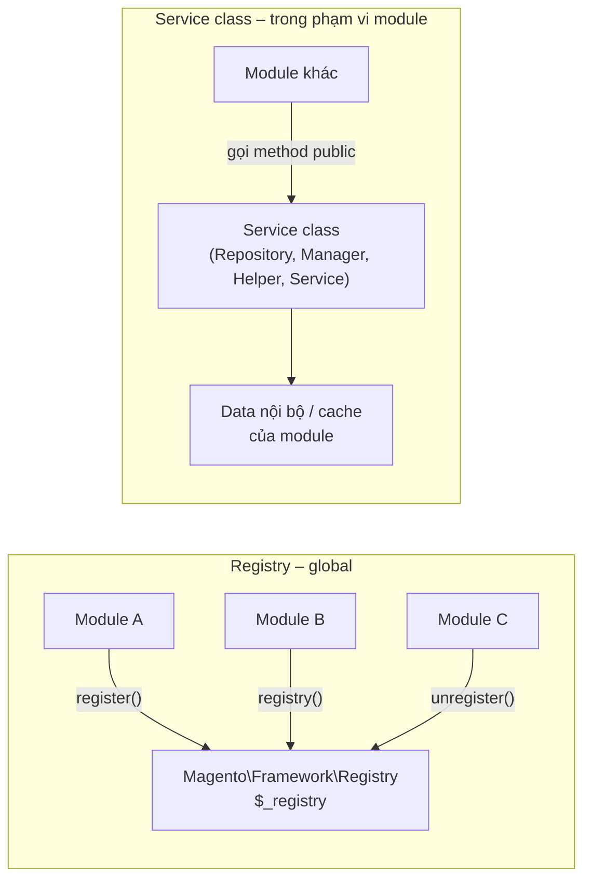

# Registry & Why registry deprecated

> **Techstack:** Magento 2.4.x (Adobe Commerce / Magento Open Source)

## 1. Registry

Registry model `Magento\Framework\Registry` sử dụng để share dữ liệu tạm thời giữa các services, class trong Magento.

Registry đã bị đánh dấu `@deprecated 102.0.0`, docblock của class ghi: *"Registry usage as a shared service introduces temporal, hard to detect coupling into system. Its usage should be avoided. Use service classes or data providers instead."* Chúng ta sẽ cùng đi vào tìm hiểu registry là gì, làm gì, tại sao không nên sử dụng và làm như thế nào để thay thế Registry trong Magento.

Đầu tiên, registry là một shared instance (singleton qua ObjectManager), nên mọi class inject nó đều đọc/ghi chung một mảng dữ liệu, giống như một giá trị global trên toàn bộ ứng dụng

Các giá trị cần share sẽ được lưu vào một registry collection (property `private`):

`Magento\Framework\Registry::$_registry`

Bên trong registry chúng ta sẽ có các phương thức:

- `register($key, $value, $graceful = false)`: để tạo mới một giá trị lưu vào trong registry; nếu key đã tồn tại thì throw `RuntimeException` (hoặc bỏ qua khi `$graceful = true`)
- `registry()`: lấy ra giá trị đã lưu trong registry
- `unregister()`: Xóa key khỏi registry (`unset`). Object chỉ được giải phóng khi không còn tham chiếu nào khác.

Vậy trong quá trình chạy registry sẽ lưu trực tiếp các biến vào trong quá trình chạy.

## 2. Những vấn đề với Registry Model

Giá trị của registry được lưu global, dễ dàng chỉnh sửa, tạo mới và xóa dữ liệu trong quá trình chạy ứng dụng.

Khi giá trị được lưu trữ trên global và dễ dàng thay đổi thì điều đầu tiên thấy được là các module khác nhau có thể làm sai lệch giá trị của giá trị bên trong registry dẫn đến kết quả không mong muốn.

Vì giá trị này là global nên bản thân cũng tồn tại nhiều rủi ro về bảo mật khi có thể access, và modify từ mọi nơi.

Bên cạnh đấy là vấn đề memory: giá trị được lưu trong mảng của một shared instance nên tồn tại suốt request nếu không `unregister()` (trong 2.4.8, `Registry` còn implement `ResetAfterRequestInterface::_resetState()` để `Magento\Framework\ObjectManager\Resetter\Resetter` xóa toàn bộ registry sau khi request đã được gửi, dùng khi chạy application server).

Cập nhật, thay thế giá trị của registry sẽ có thể ảnh hưởng đến module khác, nên ảnh hưởng đến quá trình nâng cấp hệ thống.

## 3. Thay thế

Thay vì sử dụng Registry Model, Magento khuyến nghị developer sử dụng service classes or data providers để thay thế.

Magento sử dụng kiến trúc `Modular Monolith` vì vậy mỗi module nên làm việc độc lập với nhau, dữ liệu được chia sẻ thông qua `Service contracts`

Từ đây dễ dàng thấy rằng để thay thế Registry global chúng ta sẽ đẩy vào xử lý trên từng module và tương tác với nhau thông qua một service class (Repository, Manager, Helper, Service).

Bản thân mỗi service class cũng giống như một Registry khi lưu trữ và khởi tạo lại object, nhưng phạm vi sẽ chỉ nằm trong module, vì vậy dễ kiểm soát xử lý bảo mật. Sự thay đổi or cập nhật chỉ ảnh hưởng trong phạm vi module và những func cho phép trong service classes.

Bên cạnh đó việc xử lý service class developer sẽ có thể chủ động xử lý lưu trữ một phần or toàn phần dữ liệu, or lấy dữ liệu từ cache để có thể tăng performance của ứng dụng ….



*Hình 1: Registry cho phép mọi module đọc/ghi một mảng global, còn service class giới hạn việc lưu trữ và thay đổi dữ liệu trong phạm vi module*

**Ví dụ:**

```php
use Magento\Catalog\Api\CategoryRepositoryInterface;
use Magento\Catalog\Api\Data\CategoryInterface;
use Magento\Catalog\Model\Session as CatalogSession;

/**
 * GetCurrentCategoryService
 */
class GetCurrentCategoryService
{
    private ?CategoryInterface $currentCategory = null;

    public function __construct(
        private readonly CatalogSession $catalogSession,
        private readonly CategoryRepositoryInterface $categoryRepository
    ) {
    }

    public function getCategory(): ?CategoryInterface
    {
        if (!$this->currentCategory) {
            $categoryId = $this->catalogSession->getLastViewedCategoryId();
            $this->currentCategory = $categoryId ? $this->categoryRepository->get($categoryId) : null;
        }

        return $this->currentCategory;
    }
}
```

## Tham khảo

**Tài liệu chính thức**

- [Technical Guidelines | Commerce PHP Extensions](https://developer.adobe.com/commerce/php/coding-standards/technical-guidelines)
- [Service Contract Design Patterns | Commerce PHP Extensions](https://developer.adobe.com/commerce/php/development/components/service-contracts/design-patterns)

**Source code**

- [`Magento\Framework\Registry`](https://github.com/magento/magento2/blob/2.4-develop/lib/internal/Magento/Framework/Registry.php)

**Bài liên quan trong Knowledge Base**

- [Service contracts](Service%20contracts.md)
- [Session Storage](DB%20%26%20Data%20Object/Session%20Storage.md)
- [Object Manager](Object%20Manager.md)
- [Magento Architecture - Kiến trúc tổng quan của Adobe Commerce](Magento%20Architecture%20-%20Ki%E1%BA%BFn%20tr%C3%BAc%20t%E1%BB%95ng%20quan%20c%E1%BB%A7a%20Adobe%20Commerce.md)
