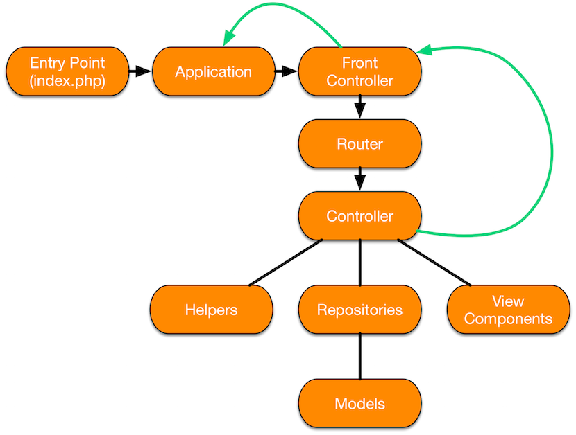
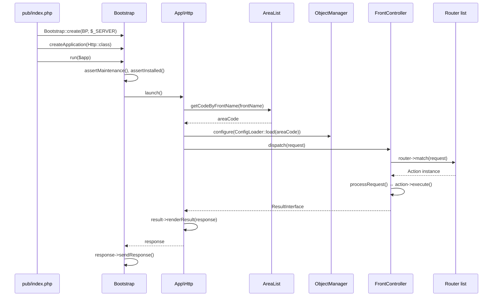
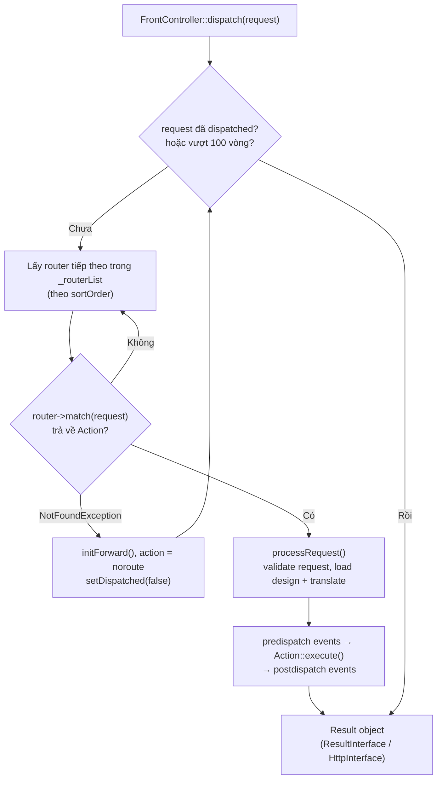

# Xử lý Request trong Magento

> **Techstack:** Magento 2.4.x (Adobe Commerce / Magento Open Source)

## 1. Xử lý Request flow trong Magento



*Hình 1: Tổng quan các thành phần tham gia xử lý một request trong Magento*

Đầu tiên chúng ta sẽ đi từ các magento entrypoint:

- `pub/static.php`: Entry point for static resources (JS, CSS, etc.)
- `pub/get.php`: Public media files entry point
- `pub/health_check.php`: Health check
- `pub/cron.php`: chạy cron qua HTTP (store `admin`). Gọi từ CLI sẽ bị từ chối, phải dùng `php bin/magento cron:run`
- `pub/errors/`: trang lỗi/maintenance (404, 503, error report), không phải entry point
- `pub/index.php`: the application entry point

Chúng ta sẽ xem cách thức hoạt động của một request tới `pub/index.php`


*Hình 2: Luồng request đi qua `pub/index.php` tới Controller Action*

Tại `pub/index.php` Magento sẽ thực hiện khởi tạo một bootstrap của ứng dụng.
Trong bootstrap, sẽ khởi tạo và chạy application tại rootDir, với các tham số server parameters, tại đây ObjectManager cũng được khởi tạo.

**Source:** `pub/index.php`

```php
/**
 * Create a bootstrap of Magento application
 */
$bootstrap = Bootstrap::create(BP, $_SERVER);
$app = $bootstrap->createApplication(\Magento\Framework\App\Http::class);
```

`Bootstrap::create()` tạo `ObjectManagerFactory` rồi khởi tạo global `ObjectManager` ngay trong constructor của Bootstrap. Method `createApplication($type)` dùng ObjectManager đó để tạo instance application (`Http`, `Cron`, `StaticResource`, `Media`, …) và kiểm tra nó implement `AppInterface` (`Magento\Framework\App\Bootstrap::createApplication()`).

Một ứng dụng sẽ được implement từ interface `\Magento\Framework\AppInterface`

```php
public function launch();
public function catchException(App\Bootstrap $bootstrap, \Exception $exception);
```

- HTTP: `Magento\Framework\App\Http`
- Cron: `Magento\Framework\App\Cron`
- …

Sau khi ứng dụng được khởi tạo, sẽ được thực hiện run `$bootstrap->run()`

**Source:** `Magento\Framework\App\Bootstrap::run()`

```php
public function run(AppInterface $application)
{
    try {
        try {
            \Magento\Framework\Profiler::start('magento');
            $this->initErrorHandler();
            $this->assertMaintenance();
            $this->assertInstalled();
            $response = $application->launch();
            $response->sendResponse();
            \Magento\Framework\Profiler::stop('magento');
        } catch (\Exception $e) {
            \Magento\Framework\Profiler::stop('magento');
            $this->objectManager->get(LoggerInterface::class)->error($e->getMessage());
            if (!$application->catchException($this, $e)) {
                throw $e;
            }
        }
    } catch (\Throwable $e) {
        $this->terminate($e);
    }
}
```

bên cạnh đó bootstrap còn chứa các method để thực hiện check trạng thái của application:

- `assertMaintenance()`
- `assertInstalled()`
- `isInstalled()`
- `isDeveloperMode()`

Trong quá trình này, ứng dụng sẽ trả về response là kết quả của application khi `launch()`

Nếu có lỗi xảy ra, thì lỗi sẽ được xử lý trong application `catchException()`



*Hình 3: Sequence xử lý một HTTP request – từ `pub/index.php` qua `Bootstrap::run()`, `Http::launch()`, `FrontController::dispatch()` tới response*

## 2. Application Area Environment

### 2.1. Area

Để dễ dàng tối ưu hóa, Magento đã được chia nhỏ thành nhiều phân vùng, mỗi phân vùng sẽ chứa các config, và xử lý với các router khác nhau.

- `adminhtml`: admin area được xử lý
- `frontend`: storefront area
- `crontab`: xử lý cron
- `webapi_rest`: phân vùng này chứa config để xử lý api sử dụng rest
- `webapi_soap`: phân vùng này chứa config để xử lý api sử dụng soap
- `graphql`: phân vùng này chứa config để xử lý api sử dụng graphql.

Xem thêm: [Magento Area & Những gì Magento xử lý trong mỗi area](Magento%20Area%20%26%20Nh%E1%BB%AFng%20g%C3%AC%20Magento%20x%E1%BB%AD%20l%C3%BD%20trong%20m%E1%BB%97i%20area.md)

### 2.2. Create Application & Configuration & ObjectManager

Application sẽ được tạo dựa trên area & state

Đầu tiên bootstrap sẽ khởi tạo một global `ObjectManager` để có thể thực hiện load DI default cho các loại ứng dụng Http, Cron, Static, Media ….

Sau đó, tùy thuộc từng loại mỗi loại ứng dụng, mode, area thì DI sẽ được load thêm các config DI thông qua `$configLoader, $state, $areaCode` : `Magento\Framework\ObjectManager\ConfigLoaderInterface`

Chúng ta có thể thấy trong `Magento\Framework\App\Http::launch()`

**Source:** `Magento\Framework\App\Http::launch()`

```php
/**
 * Run application
 *
 * @return ResponseInterface
 * @throws LocalizedException|\InvalidArgumentException
 */
public function launch()
{
    $areaCode = $this->_areaList->getCodeByFrontName($this->_request->getFrontName());
    $this->_state->setAreaCode($areaCode);
    $this->_objectManager->configure($this->_configLoader->load($areaCode));
    // ……
    return $this->_response;
}
```

`ObjectManager\ConfigLoaderInterface`: Load metadata of DiConfig cho mỗi area

`App\State`: State mode `developer`, `production`, `default`

### 2.3. ObjectManagerFactory

Bên trong bootstrap chúng ta sẽ thấy, bootstrap sẽ sử dụng một ObjectManagerFactory để tạo ObjectManager

```php
\Magento\Framework\App\Bootstrap::createObjectManagerFactory(BP, []);
// —-- or —--
$this->objectManager = $this->factory->create($this->server);
```

ObjectManagerFactory sẽ khởi tạo một global ObjectManager được inject các config, server data chúng ta có thể xem func:

**Source:** `Magento\Framework\App\Bootstrap::createObjectManagerFactory()`

```php
/**
 * Creates instance of object manager factory
 *
 * @param string $rootDir
 * @param array $initParams
 * @return ObjectManagerFactory
 */
public static function createObjectManagerFactory($rootDir, array $initParams)
{
    $dirList = self::createFilesystemDirectoryList($rootDir, $initParams);
    $driverPool = self::createFilesystemDriverPool($initParams);
    $configFilePool = self::createConfigFilePool();
    return new ObjectManagerFactory($dirList, $driverPool, $configFilePool);
}
```

Chúng ta sẽ thấy các config global sẽ được thiết lập sẵn để khởi tạo ObjectManager

```php
Magento\Framework\App\ObjectManagerFactory::create(array $arguments)
```

- definition
- relations
- generatedFiles
- appMode & default appMode
- profiler
- sharedInstances
- …

Sau khi, ObjectManager được khởi tạo với mỗi area, state thì OM sẽ được set configure với:

```php
/**
 * Configure object manager
 *
 * @param array $configuration
 * @return void
 */
public function configure(array $configuration);

/** Example */
$objectManager = $bootstrap->getObjectManager();
$objectManager->configure([
    'preferences' => [
        'Magento\Framework\Authorization\PolicyInterface' => 'Magento\Framework\Authorization\Policy\DefaultPolicy'
    ]
]);
```

### 2.4. Front Name & Front Controller

Với các phân vùng kiểu HTTP request được định nghĩa như một `FrontControllerInterface` và config một `FrontName`

- `frontend`, `adminhtml`: `Magento\Framework\App\FrontController` + RouterList (preference mặc định trong `app/etc/di.xml`)
- `webapi_rest`/`webapi_soap`/`graphql`: không dùng RouterList, preference `FrontControllerInterface` được thay bằng `Magento\Webapi\Controller\Rest` / `Magento\Webapi\Controller\Soap` / `Magento\GraphQl\Controller\GraphQl` (khai báo ở `etc/<area>/di.xml`)

```xml
<!-- config frontname -->
<type name="Magento\Framework\App\AreaList">
    <arguments>
        <argument name="areas" xsi:type="array">
            <item name="webapi_rest" xsi:type="array">
                <item name="frontName" xsi:type="string">rest</item>
            </item>
            <item name="webapi_soap" xsi:type="array">
                <item name="frontName" xsi:type="string">soap</item>
            </item>
        </argument>
    </arguments>
</type>
```

## 3. FrontController class `Magento\Framework\App\FrontController`

Khi một request đến, Magento sẽ duyệt qua danh sách các router theo thứ tự đã định để tìm router phù hợp để xử lý request đó, Mặc định thực hiện match router trong `$_routerList`



*Hình 4: Vòng lặp match router trong `FrontController::dispatch()` (Magento 2.4.8)*

*Storefront:*

| **Name** | **Sort order** | **Description** |
|---|---|---|
| [robots](https://github.com/magento/magento2/blob/2.4/app/code/Magento/Robots/Controller/Router.php) | 10 | Router này được sử dụng để xử lý các request đến file robots.txt |
| securitytxt (`Magento\Securitytxt\Controller\Router`) | 10 | Xử lý `/.well-known/security.txt` |
| [urlrewrite](https://github.com/magento/magento2/blob/2.4/app/code/Magento/UrlRewrite/Controller/Router.php) | 20 | Router này sẽ cố gắng match request với các URL đã được định nghĩa trong database |
| [standard](https://github.com/magento/magento2/blob/2.4/lib/internal/Magento/Framework/App/Router/Base.php) | 30 | Router này xử lý các request theo cách thông thường của Magento |
| [cms](https://github.com/magento/magento2/blob/2.4/app/code/Magento/Cms/Controller/Router.php) | 60 | Router này match các request liên quan đến các CMS page |
| [default](https://github.com/magento/magento2/blob/2.4/lib/internal/Magento/Framework/App/Router/DefaultRouter.php) | 100 | default router |

*Đối với khu vực adminhtml (admin):*

| **Name** | **Sort order** | **Description** |
|---|---|---|
| [admin](https://github.com/magento/magento2/blob/2.4/app/code/Magento/Backend/App/Router.php) | 10 | Router này xử lý các request trong khu vực Admin |
| [default](https://github.com/magento/magento2/blob/2.4/lib/internal/Magento/Framework/App/Router/DefaultRouter.php) | 100 | default router |

> [!NOTE]
> Hai bảng trên chưa phải danh sách đầy đủ (module khác có thể thêm router, VD `wellknown` của Payment Services). Liệt kê router thực tế của project: `grep -rn 'App\\RouterList' vendor/magento app/code --include=di.xml`.

Chi tiết về Action class, `routes.xml`, validate request và Result object: xem [Controller](API%20Rest%2C%20Soap%20%26%20Graphql/Controller.md).

## 4. Rest – `Magento\Webapi\Controller\Rest`

Xem chi tiết: [Controller](API%20Rest%2C%20Soap%20%26%20Graphql/Controller.md) và [REST](API%20Rest%2C%20Soap%20%26%20Graphql/REST.md).

## 5. Soap – `Magento\Webapi\Controller\Soap`

Xem chi tiết: [Controller](API%20Rest%2C%20Soap%20%26%20Graphql/Controller.md).

## 6. Graphql – `Magento\GraphQl\Controller\GraphQl`

Xem chi tiết: [Controller](API%20Rest%2C%20Soap%20%26%20Graphql/Controller.md) và [Graphql](API%20Rest%2C%20Soap%20%26%20Graphql/Graphql.md).

## Tham khảo

**Tài liệu chính thức**

- [Routing | Commerce PHP Extensions](https://developer.adobe.com/commerce/php/development/components/routing)
- [Modules and Areas | Commerce PHP Extensions](https://developer.adobe.com/commerce/php/architecture/modules/areas)
- [Configure Services as Web APIs | Commerce PHP Extensions](https://developer.adobe.com/commerce/php/development/components/web-api/services)

**Source code**

- [`pub/index.php`](https://github.com/magento/magento2/blob/2.4-develop/pub/index.php)
- [`Magento\Framework\App\Bootstrap`](https://github.com/magento/magento2/blob/2.4-develop/lib/internal/Magento/Framework/App/Bootstrap.php)
- [`Magento\Framework\App\Http`](https://github.com/magento/magento2/blob/2.4-develop/lib/internal/Magento/Framework/App/Http.php)
- [`Magento\Framework\App\FrontController`](https://github.com/magento/magento2/blob/2.4-develop/lib/internal/Magento/Framework/App/FrontController.php)
- [`Magento\Framework\App\AreaList`](https://github.com/magento/magento2/blob/2.4-develop/lib/internal/Magento/Framework/App/AreaList.php)

**Bài liên quan trong Knowledge Base**

- [Magento Area & Những gì Magento xử lý trong mỗi area](Magento%20Area%20%26%20Nh%E1%BB%AFng%20g%C3%AC%20Magento%20x%E1%BB%AD%20l%C3%BD%20trong%20m%E1%BB%97i%20area.md)
- [Object Manager](Object%20Manager.md)
- [Controller (API Rest, Soap & Graphql)](API%20Rest%2C%20Soap%20%26%20Graphql/Controller.md)
- [REST](API%20Rest%2C%20Soap%20%26%20Graphql/REST.md)
