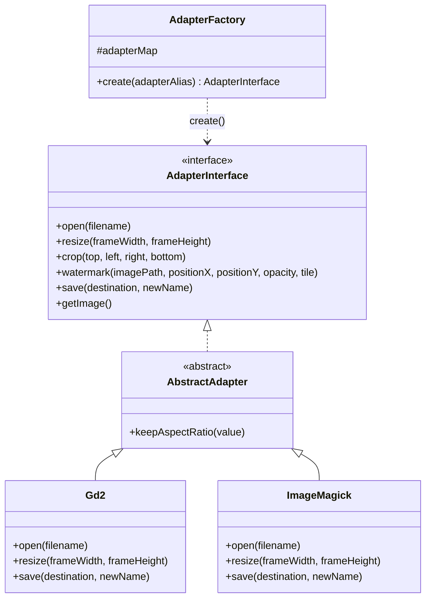

# Adapter Pattern

> **Techstack:** Magento 2.4.x (Adobe Commerce / Magento Open Source)

## 1. Định nghĩa

Adapter là một structural design pattern, đóng vai trò bộ chuyển đổi: chuyển interface của một class (adaptee) sang interface mà client mong đợi (target), giúp các object có interface không tương thích làm việc được với nhau. Thường được xây dựng để hệ thống có thể dễ dàng kết nối với các thư viện ngoài, cũng như dễ dàng thay đổi thư viện khi cần.

> [!NOTE]
> Structural design pattern là các tập hợp pattern mô tả thiết kế cấu trúc, mối quan hệ, cách thức liên kết giữa các objects


*Hình 1: Đi du lịch nước ngoài – lần đầu và lần thứ 10, khi đã biết mang theo các adapter phích cắm*

Bài toán trong thực tế, là du lịch ở các quốc gia khác nhau thì đầu phích cắm điện ở mỗi nước lại khác nhau.

## 2. Cấu trúc


*Hình 2: Cấu trúc Adapter Pattern – Adapter chuyển dữ liệu sang định dạng của Service rồi gọi `serviceMethod(specialData)`*

## 3. Cách thức implement pattern

### Ví dụ PHP – Adapter (Refactoring.Guru)

Conceptual example của [Refactoring.Guru – Adapter in PHP](https://refactoring.guru/design-patterns/adapter/php/example) (© Alexander Shvets, CC BY-NC-ND 4.0). Đối chiếu với Magento ở mục 4: `Target` ≈ `AdapterInterface`, `Adapter` ≈ `Gd2` / `ImageMagick`, `Adaptee` ≈ PHP extension GD / Imagick; `clientCode()` ≈ code chỉ làm việc với `AdapterInterface` (vd. `Theme\Model\Wysiwyg\Storage`).

```php
<?php

namespace RefactoringGuru\Adapter\Conceptual;

/**
 * The Target defines the domain-specific interface used by the client code.
 */
class Target
{
    public function request(): string
    {
        return "Target: The default target's behavior.";
    }
}

/**
 * The Adaptee contains some useful behavior, but its interface is incompatible
 * with the existing client code. The Adaptee needs some adaptation before the
 * client code can use it.
 */
class Adaptee
{
    public function specificRequest(): string
    {
        return ".eetpadA eht fo roivaheb laicepS";
    }
}

/**
 * The Adapter makes the Adaptee's interface compatible with the Target's
 * interface.
 */
class Adapter extends Target
{
    private $adaptee;

    public function __construct(Adaptee $adaptee)
    {
        $this->adaptee = $adaptee;
    }

    public function request(): string
    {
        return "Adapter: (TRANSLATED) " . strrev($this->adaptee->specificRequest());
    }
}

/**
 * The client code supports all classes that follow the Target interface.
 */
function clientCode(Target $target)
{
    echo $target->request();
}

echo "Client: I can work just fine with the Target objects:\n";
$target = new Target();
clientCode($target);
echo "\n\n";

$adaptee = new Adaptee();
echo "Client: The Adaptee class has a weird interface. See, I don't understand it:\n";
echo "Adaptee: " . $adaptee->specificRequest();
echo "\n\n";

echo "Client: But I can work with it via the Adapter:\n";
$adapter = new Adapter($adaptee);
clientCode($adapter);
```

## 4. Adapter trong Magento

Trong Magento, Image Adapter là một ví dụ điển hình của việc áp dụng Adapter Pattern. Magento sử dụng Image Adapter để xử lý các vấn đề liên quan đến ảnh và kết nối với các thư viện xử lý ảnh khác nhau như PHP GD (alias `GD2`) và ImageMagick (alias `IMAGEMAGICK`) – xem hằng `AdapterInterface::ADAPTER_GD2` / `ADAPTER_IM`.

`\Magento\Framework\Image\Adapter\AdapterInterface`

- `open`
- `resize`
- `crop`
- `watermark`
- `getImage`
- …

Cụ thể, Image Adapter hoạt động như sau:

- `AdapterInterface` (target interface) định nghĩa các phương thức chung để xử lý ảnh như open, resize, crop, watermark, save, rotate và getImage.
- `AbstractAdapter` implement `AdapterInterface`, chứa phần logic dùng chung (vd. `keepAspectRatio()`, `getImageType()`) còn các method xử lý ảnh (`open()`, `resize()`, `crop()`, `save()`, `getImage()`…) được khai báo abstract để lớp con hiện thực.
- `Image\Adapter\Gd2` kế thừa từ `AbstractAdapter` và gọi các hàm của PHP extension GD để thực hiện các chức năng xử lý ảnh.
- `Image\Adapter\ImageMagick` cũng kế thừa từ `AbstractAdapter` và gọi extension Imagick (ImageMagick) để thực hiện các chức năng xử lý ảnh tương tự.
- `AdapterFactory` được sử dụng để lựa chọn Image Adapter phù hợp dựa trên cài đặt của hệ thống: alias lấy từ config `dev/image/default_adapter` (mặc định `GD2`, chỉnh ở *Stores > Configuration > Advanced > Developer > Image Processing Settings* – tab *Developer* chỉ hiện ở developer mode; ở production mode dùng `bin/magento config:set dev/image/default_adapter IMAGEMAGICK`, sau đó flush Catalog Images Cache), class lấy từ `dev/image/adapters` trong `Magento/Store/etc/config.xml`. `create()` còn merge thêm mảng `adapterMap` khai báo qua `di.xml` (đè lên config) và gọi `checkDependencies()` trước khi trả adapter.

```xml
<!-- Magento/Store/etc/config.xml (trích, nằm trong default/dev) -->
<image>
    <default_adapter>GD2</default_adapter>
    <adapters>
        <GD2>
            <title>PHP GD2</title>
            <class>Magento\Framework\Image\Adapter\Gd2</class>
        </GD2>
        <IMAGEMAGICK>
            <title>ImageMagick</title>
            <class>Magento\Framework\Image\Adapter\ImageMagick</class>
        </IMAGEMAGICK>
    </adapters>
</image>
```



*Hình 3: Image Adapter trong Magento – `AdapterFactory::create()` chọn `Gd2` (alias `GD2`) hoặc `ImageMagick` (alias `IMAGEMAGICK`) theo cấu hình, client chỉ làm việc với `AdapterInterface`*

**Ví dụ – Sử dụng:**

```php
// Magento/Theme/Model/Wysiwyg/Storage.php – _createThumbnail() (rút gọn)
/**
 * @var \Magento\Framework\Image\AdapterFactory
 */
protected $_imageFactory;

$image = $this->_imageFactory->create();
$image->open($this->mediaWriteDirectory->getAbsolutePath($source));
$image->keepAspectRatio(true);
$image->resize(self::THUMBNAIL_WIDTH, self::THUMBNAIL_HEIGHT);
$image->save($this->mediaWriteDirectory->getAbsolutePath($thumbnailPath));
```

Trong ví dụ trên, `AdapterFactory` sẽ tạo ra một instance của Image Adapter phù hợp (ví dụ, Gd2 hoặc ImageMagick) dựa trên cấu hình hệ thống, sau đó các phương thức như open, resize và save sẽ được gọi để xử lý ảnh.

> [!NOTE]
> `AdapterFactory::create()` khai báo trả về `AdapterInterface`, nhưng `keepAspectRatio()` chỉ có trên `AbstractAdapter` (không có trong interface). Ví dụ trên chạy được vì cả `Gd2` và `ImageMagick` đều kế thừa `AbstractAdapter`; nếu tự viết adapter mới chỉ implement `AdapterInterface` thì code gọi `keepAspectRatio()` sẽ lỗi.

## Tham khảo

**Tài liệu chính thức**
- [Developer – Image Processing Settings](https://experienceleague.adobe.com/en/docs/commerce-admin/config/advanced/developer) – cấu hình Image Adapter (GD2 / ImageMagick) trong Admin
- [Factories](https://developer.adobe.com/commerce/php/development/components/factories)

**Source code**
- [`Magento\Framework\Image\Adapter\AdapterInterface`](https://github.com/magento/magento2/blob/2.4-develop/lib/internal/Magento/Framework/Image/Adapter/AdapterInterface.php)
- [`Magento\Framework\Image\Adapter\AbstractAdapter`](https://github.com/magento/magento2/blob/2.4-develop/lib/internal/Magento/Framework/Image/Adapter/AbstractAdapter.php)
- [`Magento\Framework\Image\Adapter\Gd2`](https://github.com/magento/magento2/blob/2.4-develop/lib/internal/Magento/Framework/Image/Adapter/Gd2.php)
- [`Magento\Framework\Image\Adapter\ImageMagick`](https://github.com/magento/magento2/blob/2.4-develop/lib/internal/Magento/Framework/Image/Adapter/ImageMagick.php)
- [`Magento\Framework\Image\AdapterFactory`](https://github.com/magento/magento2/blob/2.4-develop/lib/internal/Magento/Framework/Image/AdapterFactory.php)

**Bài viết khác**
- [Refactoring.Guru – Adapter](https://refactoring.guru/design-patterns/adapter)

**Bài liên quan trong Knowledge Base**
- [Tổng quan Design Pattern](T%E1%BB%95ng%20quan%20Design%20Pattern.md)
- [Factories](Factories%20Patterns.md)
- [Facade Pattern](Facade%20Pattern.md)
