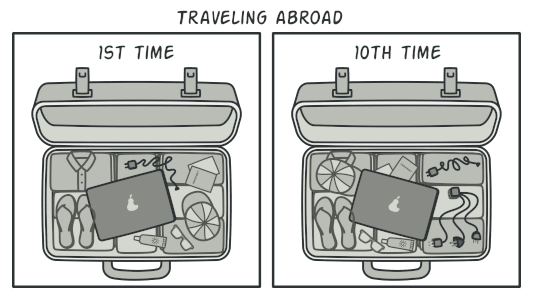
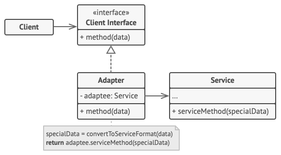
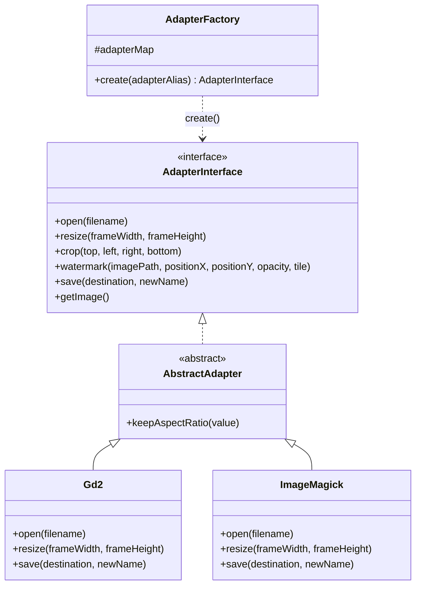

# Adapter Pattern

> **Techstack:** Magento 2.4.x (Adobe Commerce / Magento Open Source)

## 1. Định nghĩa

Adapter là một structural design pattern, như một bộ chuyển đổi giúp convert class thành một interface class mà hệ thống hỗ trợ. Thường được xây dựng để hệ thống có thể dễ dàng kết nối với các thư viện ngoài, cũng như dễ dàng thay đổi thư viện khi cần.

> [!NOTE]
> Structural design pattern là các tập hợp pattern mô tả thiết kế cấu trúc, mối quan hệ, cách thức liên kết giữa các objects



*Hình 1: Đi du lịch nước ngoài – lần đầu và lần thứ 10, khi đã biết mang theo các adapter phích cắm*

Bài toán trong thực tế, là du lịch ở các quốc gia khác nhau thì đầu phích cắm điện ở mỗi nước lại khác nhau.

## 2. Cấu trúc



*Hình 2: Cấu trúc Adapter Pattern – Adapter chuyển dữ liệu sang định dạng của Service rồi gọi `serviceMethod(specialData)`*

## 3. Cách thức implement pattern

**Ví dụ:** Target, Adaptee và Adapter viết bằng TypeScript

```typescript
/**
 * The Target defines the domain-specific interface used by the client code.
 */
class Target {
    public request(): string {
        return 'Target: The default target\'s behavior.';
    }
}

/**
 * The Adaptee contains some useful behavior, but its interface is incompatible
 * with the existing client code. The Adaptee needs some adaptation before the
 * client code can use it.
 */
class Adaptee {
    public specificRequest(): string {
        return '.eetpadA eht fo roivaheb laicepS';
    }
}

/**
 * The Adapter makes the Adaptee's interface compatible with the Target's
 * interface.
 */
class Adapter extends Target {
    private adaptee: Adaptee;

    constructor(adaptee: Adaptee) {
        super();
        this.adaptee = adaptee;
    }

    public request(): string {
        const result = this.adaptee.specificRequest().split('').reverse().join('');
        return `Adapter: (TRANSLATED) ${result}`;
    }
}

/**
 * The client code supports all classes that follow the Target interface.
 */
function clientCode(target: Target) {
    console.log(target.request());
}

console.log('Client: I can work just fine with the Target objects:');
const target = new Target();
clientCode(target);

console.log('');

const adaptee = new Adaptee();
console.log('Client: The Adaptee class has a weird interface. See, I don\'t understand it:');
console.log(`Adaptee: ${adaptee.specificRequest()}`);

console.log('');

console.log('Client: But I can work with it via the Adapter:');
const adapter = new Adapter(adaptee);
clientCode(adapter);
```

## 4. Adapter trong Magento

Trong Magento, Image Adapter là một ví dụ điển hình của việc áp dụng Adapter Pattern. Magento sử dụng Image Adapter để xử lý các vấn đề liên quan đến ảnh và kết nối với các thư viện xử lý ảnh khác nhau như 'Gd' và 'IMAGEMAGICK'

`\Magento\Framework\Image\Adapter\AdapterInterface`

- `open`
- `resize`
- `crop`
- `watermark`
- `getImage`
- …

Cụ thể, Image Adapter hoạt động như sau:

- `AbstractAdapter` sẽ đc implement `AdapterInterface` định nghĩa các phương thức chung để xử lý ảnh như open, resize, crop, watermark, và getImage.
- `AbstractAdapter` sẽ implement `AdapterInterface` để mô tả các phương thức chung để cùng thực hiện.
- `Image\Adapter\Gd2` kế thừa từ `ImageAbstractAdapter` và kết nối với thư viện xử lý ảnh Gd2 để thực hiện các chức năng xử lý ảnh.
- `Image\Adapter\ImageMagick` cũng kế thừa từ `ImageAbstractAdapter` và kết nối với thư viện xử lý ảnh ImageMagick để thực hiện các chức năng xử lý ảnh tương tự.
- `AdapterFactory` được sử dụng để lựa chọn Image Adapter phù hợp dựa trên cài đặt của hệ thống



*Hình 3: Image Adapter trong Magento – `AdapterFactory::create()` chọn `Gd2` (alias `GD2`) hoặc `ImageMagick` (alias `IMAGEMAGICK`) theo cấu hình, client chỉ làm việc với `AdapterInterface`*

**Ví dụ – Sử dụng:**

```php
/**
 * @var \Magento\Framework\Image\AdapterFactory
 */
protected $_imageFactory;

$image = $this->_imageFactory->create();
$image->open($this->mediaWriteDirectory->getAbsolutePath($source));
$image->keepAspectRatio(true);
$image->resize(self::THUMBNAIL_WIDTH, self::THUMBNAIL_HEIGHT);
$image->save($this->mediaWriteDirectory->getAbsolutePath($thumbnailPath));
```

Trong ví dụ trên, `AdapterFactory` sẽ tạo ra một instance của Image Adapter phù hợp (ví dụ, Gd2 hoặc ImageMagick) dựa trên cấu hình hệ thống, sau đó các phương thức như open, resize và save sẽ được gọi để xử lý ảnh

## Tham khảo

**Tài liệu chính thức**
- [Developer – Image Processing Settings](https://experienceleague.adobe.com/en/docs/commerce-admin/config/advanced/developer) – cấu hình Image Adapter (GD2 / ImageMagick) trong Admin
- [Factories](https://developer.adobe.com/commerce/php/development/components/factories)

**Source code**
- [`Magento\Framework\Image\Adapter\AdapterInterface`](https://github.com/magento/magento2/blob/2.4-develop/lib/internal/Magento/Framework/Image/Adapter/AdapterInterface.php)
- [`Magento\Framework\Image\Adapter\AbstractAdapter`](https://github.com/magento/magento2/blob/2.4-develop/lib/internal/Magento/Framework/Image/Adapter/AbstractAdapter.php)
- [`Magento\Framework\Image\Adapter\Gd2`](https://github.com/magento/magento2/blob/2.4-develop/lib/internal/Magento/Framework/Image/Adapter/Gd2.php)
- [`Magento\Framework\Image\Adapter\ImageMagick`](https://github.com/magento/magento2/blob/2.4-develop/lib/internal/Magento/Framework/Image/Adapter/ImageMagick.php)
- [`Magento\Framework\Image\AdapterFactory`](https://github.com/magento/magento2/blob/2.4-develop/lib/internal/Magento/Framework/Image/AdapterFactory.php)

**Bài viết khác**
- [Refactoring.Guru – Adapter](https://refactoring.guru/design-patterns/adapter)

**Bài liên quan trong Knowledge Base**
- [Tổng quan Design Pattern](T%E1%BB%95ng%20quan%20Design%20Pattern.md)
- [Factories](Factories%20Patterns.md)
- [Facade Pattern](Facade%20Pattern.md)
