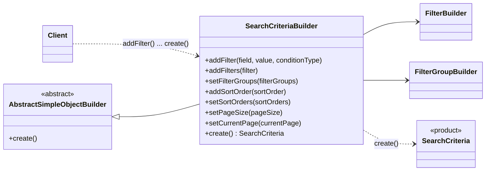

# Builder Design Pattern

> **Techstack:** Magento 2.4.x (Adobe Commerce / Magento Open Source)

## 1. Định nghĩa

Builder cũng là một mẫu design pattern được thiết kế để khởi tạo Object.

Builder được xây dựng bằng cách tổng hợp các thành phần thành một object phức tạp.


*Hình 1: Đặt suất ăn trẻ em – Cashier (director) điều phối Restaurant crew (builder) build từng thành phần trước khi trả meal cho Customer (client)*

Đây là một ví dụ dễ hiểu cho Builder Pattern, khi bạn đặt đơn hàng đơn hàng của bạn sẽ bao gồm nhiều thành phần:

- Tráng miệng
- Đồ uống
- Phương thức giao hàng

Về cơ bản, builder sẽ bao gồm nhiều thành phần để tạo ra một sản phẩm cuối cùng cho bạn sau quá trình khởi tạo.

## 2. Builder trong Magento

Trong Magento, có thể tìm thấy builder ở một số khu vực:

### 2.1. Search criteria – `SearchCriteriaBuilder`

VD: `Magento\Framework\Api\SearchCriteriaBuilder`

`SearchCriteriaBuilder`:

- Tạo, add filter, filter group
- Tạo sortOrder
- Tạo pageSize
- current page

Để tạo một `SearchCriteriaBuilder`, bạn có thể làm theo các bước sau, dựa trên thông tin từ các nguồn và lịch sử trò chuyện:

1. **Xác định các thành phần của đối tượng:**

   `SearchCriteriaBuilder` được sử dụng để tạo các điều kiện tìm kiếm phức tạp. Các điều kiện này thường bao gồm các bộ lọc (filters), thứ tự sắp xếp (sort order), kích thước trang (page size), và trang hiện tại (current page).

2. **Tạo một interface hoặc abstract class cho Builder:**

   Trong trường hợp của Magento, interface này đã được định nghĩa sẵn, ví dụ như `\Magento\Framework\Api\SearchCriteriaBuilder`. Interface này cung cấp các phương thức như `addFilter()`, `addSortOrder()`, `setPageSize()`, và `setCurrentPage()`

3. **Tạo một concrete Builder class:**

   Class này sẽ thực hiện interface hoặc abstract class của Builder. Các phương thức trong class này sẽ thêm các thành phần vào đối tượng SearchCriteria, và trả về chính đối tượng builder, cho phép chaining method.

   Ví dụ, bạn sẽ có các phương thức như:

   - `addFilter()`: Thêm một điều kiện lọc.
   - `addFilterGroup()`: Thêm một nhóm điều kiện lọc.
   - `addSortOrder()`: Thêm một điều kiện sắp xếp.
   - `setPageSize()`: Đặt kích thước trang.
   - `setCurrentPage()`: Đặt trang hiện tại.
   - `create()`: Trả về đối tượng SearchCriteria đã được xây dựng.

4. **Tạo một Director (optional):**

   - Trong Magento, bạn có thể không cần tạo Director vì các thành phần được thêm vào SearchCriteria thường được xác định tại thời điểm gọi builder.

5. **Sử dụng Builder:**

   - Khởi tạo một Builder instance
   - Gọi các phương thức của builder để thêm các thành phần
   - Gọi phương thức `create()` để trả về đối tượng SearchCriteria đã được xây dựng
   - Ví dụ:

     ```php
     $searchCriteriaBuilder = $this->_objectManager->create(\Magento\Framework\Api\SearchCriteriaBuilder::class);
     $searchCriteria = $searchCriteriaBuilder
         ->addFilter('name', 'product name', 'eq')
         ->addSortOrder('price', 'DESC')
         ->setPageSize(10)
         ->setCurrentPage(1)
         ->create();
     ```

Trong ví dụ trên, chúng ta tạo một `SearchCriteriaBuilder`, thêm một bộ lọc theo tên sản phẩm, sắp xếp theo giá giảm dần, đặt kích thước trang là 10, và trang hiện tại là 1. Cuối cùng, phương thức `create()`



*Hình 2: Builder trong `Magento\Framework\Api` – client gọi chuỗi method trên `SearchCriteriaBuilder`, `create()` trả về product `SearchCriteria`*

### 2.2. Payment transaction – `Transaction\Builder`

VD: `Magento\Sales\Model\Order\Payment\Transaction\Builder`

- Order
- Payment
- Transaction
- Message


*Hình 3: `Magento\Sales\Model\Order\Payment\Transaction\Builder::build()` – kiểm tra payment tồn tại, lấy hoặc tạo transaction rồi gán payment, order, txn type*

Builder có thể validate trước data và type để tạo object.

## Tham khảo

**Tài liệu chính thức**
- [Searching with repositories](https://developer.adobe.com/commerce/php/development/components/searching-with-repositories) – `SearchCriteriaBuilder`, `FilterBuilder`, `FilterGroupBuilder`

**Source code**
- [`Magento\Framework\Api\SearchCriteriaBuilder`](https://github.com/magento/magento2/blob/2.4-develop/lib/internal/Magento/Framework/Api/SearchCriteriaBuilder.php)
- [`Magento\Sales\Model\Order\Payment\Transaction\Builder`](https://github.com/magento/magento2/blob/2.4-develop/app/code/Magento/Sales/Model/Order/Payment/Transaction/Builder.php)

**Bài viết khác**
- [Refactoring.Guru – Builder](https://refactoring.guru/design-patterns/builder)

**Bài liên quan trong Knowledge Base**
- [QueryBuilder](../DB%20%26%20Data%20Object/QueryBuilder.md)
- [Factories](Factories%20Patterns.md)
- [Tổng quan Design Pattern](T%E1%BB%95ng%20quan%20Design%20Pattern.md)
