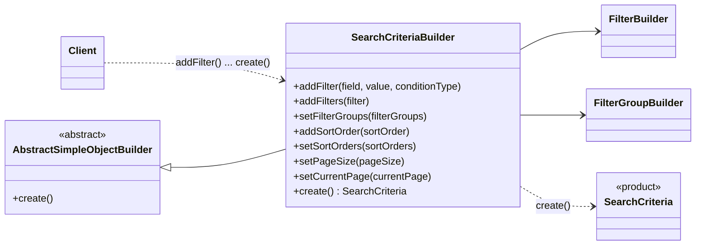
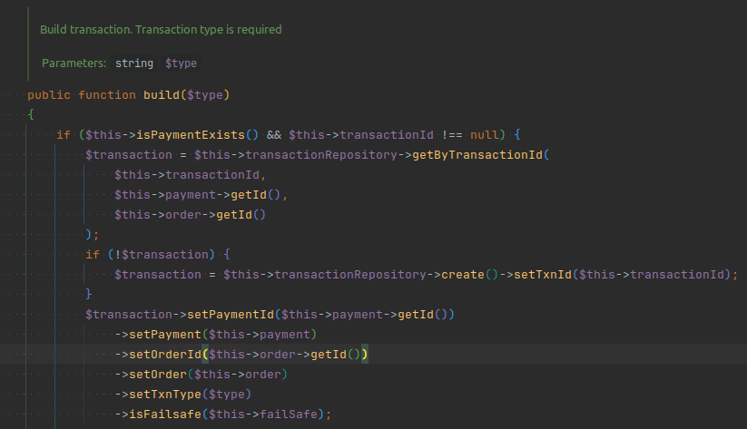

# Builder Design Pattern

> **Techstack:** Magento 2.4.x (Adobe Commerce / Magento Open Source)

## 1. Định nghĩa

Builder cũng là một mẫu design pattern được thiết kế để khởi tạo Object.

Builder được xây dựng bằng cách tổng hợp các thành phần thành một object phức tạp.


*Hình 1: Đặt suất ăn trẻ em – Cashier (director) điều phối Restaurant crew (builder) build từng thành phần trước khi trả meal cho Customer (client)*

Đây là một ví dụ dễ hiểu cho Builder Pattern, khi bạn đặt đơn hàng đơn hàng của bạn sẽ bao gồm nhiều thành phần:

- Món chính (burger)
- Đồ uống
- Tráng miệng (bánh)
- Đồ chơi

Về cơ bản, builder sẽ bao gồm nhiều thành phần để tạo ra một sản phẩm cuối cùng cho bạn sau quá trình khởi tạo.

### Ví dụ PHP – Builder (Refactoring.Guru)

Conceptual example của [Refactoring.Guru – Builder in PHP](https://refactoring.guru/design-patterns/builder/php/example) (© Alexander Shvets, CC BY-NC-ND 4.0). `Director` quyết định thứ tự các bước build, `ConcreteBuilder1` lắp `Product1` từng phần; `getProduct()` trả kết quả rồi `reset()` builder để dùng tiếp – cùng ý tưởng với `SearchCriteriaBuilder::create()` ở mục 2.1.

```php
<?php

namespace RefactoringGuru\Builder\Conceptual;

/**
 * The Builder interface specifies methods for creating the different parts
 * of the Product objects.
 */
interface Builder
{
    public function producePartA(): void;

    public function producePartB(): void;

    public function producePartC(): void;
}

/**
 * The Concrete Builder classes follow the Builder interface and provide
 * specific implementations of the building steps. Your program may have several
 * variations of Builders, implemented differently.
 */
class ConcreteBuilder1 implements Builder
{
    private $product;

    /**
     * A fresh builder instance should contain a blank product object, which
     * is used in further assembly.
     */
    public function __construct()
    {
        $this->reset();
    }

    public function reset(): void
    {
        $this->product = new Product1();
    }

    /**
     * All production steps work with the same product instance.
     */
    public function producePartA(): void
    {
        $this->product->parts[] = "PartA1";
    }

    public function producePartB(): void
    {
        $this->product->parts[] = "PartB1";
    }

    public function producePartC(): void
    {
        $this->product->parts[] = "PartC1";
    }

    /**
     * Concrete Builders are supposed to provide their own methods for
     * retrieving results. That's because various types of builders may create
     * entirely different products that don't follow the same interface.
     * Therefore, such methods cannot be declared in the base Builder interface
     * (at least in a statically typed programming language). Note that PHP is a
     * dynamically typed language and this method CAN be in the base interface.
     * However, we won't declare it there for the sake of clarity.
     *
     * Usually, after returning the end result to the client, a builder instance
     * is expected to be ready to start producing another product. That's why
     * it's a usual practice to call the reset method at the end of the
     * `getProduct` method body. However, this behavior is not mandatory, and
     * you can make your builders wait for an explicit reset call from the
     * client code before disposing of the previous result.
     */
    public function getProduct(): Product1
    {
        $result = $this->product;
        $this->reset();

        return $result;
    }
}

/**
 * It makes sense to use the Builder pattern only when your products are
 * quite complex and require extensive configuration.
 *
 * Unlike in other creational patterns, different concrete builders can produce
 * unrelated products. In other words, results of various builders may not
 * always follow the same interface.
 */
class Product1
{
    public $parts = [];

    public function listParts(): void
    {
        echo "Product parts: " . implode(', ', $this->parts) . "\n\n";
    }
}

/**
 * The Director is only responsible for executing the building steps in a
 * particular sequence. It is helpful when producing products according to a
 * specific order or configuration. Strictly speaking, the Director class is
 * optional, since the client can control builders directly.
 */
class Director
{
    /**
     * @var Builder
     */
    private $builder;

    /**
     * The Director works with any builder instance that the client code
     * passes to it. This way, the client code may alter the final type of the
     * newly assembled product.
     */
    public function setBuilder(Builder $builder): void
    {
        $this->builder = $builder;
    }

    /**
     * The Director can construct several product variations using the same
     * building steps.
     */
    public function buildMinimalViableProduct(): void
    {
        $this->builder->producePartA();
    }

    public function buildFullFeaturedProduct(): void
    {
        $this->builder->producePartA();
        $this->builder->producePartB();
        $this->builder->producePartC();
    }
}

/**
 * The client code creates a builder object, passes it to the director and
 * then initiates the construction process. The end result is retrieved from the
 * builder object.
 */
function clientCode(Director $director)
{
    $builder = new ConcreteBuilder1();
    $director->setBuilder($builder);

    echo "Standard basic product:\n";
    $director->buildMinimalViableProduct();
    $builder->getProduct()->listParts();

    echo "Standard full featured product:\n";
    $director->buildFullFeaturedProduct();
    $builder->getProduct()->listParts();

    // Remember, the Builder pattern can be used without a Director class.
    echo "Custom product:\n";
    $builder->producePartA();
    $builder->producePartC();
    $builder->getProduct()->listParts();
}

$director = new Director();
clientCode($director);
```

## 2. Builder trong Magento

Trong Magento, có thể tìm thấy builder ở một số khu vực:

### 2.1. Search criteria – `SearchCriteriaBuilder`

VD: `Magento\Framework\Api\SearchCriteriaBuilder`

`SearchCriteriaBuilder`:

- Tạo, add filter, filter group
- Tạo sortOrder
- Tạo pageSize
- current page

Các bước áp dụng Builder, đối chiếu với `SearchCriteriaBuilder`:

1. **Xác định các thành phần của đối tượng:**

   `SearchCriteriaBuilder` được sử dụng để tạo các điều kiện tìm kiếm phức tạp. Các điều kiện này thường bao gồm các bộ lọc (filters), thứ tự sắp xếp (sort order), kích thước trang (page size), và trang hiện tại (current page).

2. **Tạo một interface hoặc abstract class cho Builder:**

   Trong Magento, phần trừu tượng này đã có sẵn: interface `Magento\Framework\Api\SimpleBuilderInterface` (`create()`, `getData()`) và abstract class `Magento\Framework\Api\AbstractSimpleObjectBuilder` implement interface đó. `AbstractSimpleObjectBuilder` gom dữ liệu vào mảng `$data` qua `_set()`, rồi `create()` suy ra class data object từ tên builder (bỏ hậu tố `Builder`) và tạo object bằng `ObjectFactory`, sau đó reset `$data`.

3. **Tạo một concrete Builder class:**

   Class này sẽ thực hiện interface hoặc abstract class của Builder. Trong Magento, concrete builder là class `Magento\Framework\Api\SearchCriteriaBuilder` (extends `AbstractSimpleObjectBuilder`). Các phương thức trong class này sẽ thêm các thành phần vào dữ liệu của SearchCriteria, và trả về chính đối tượng builder, cho phép chaining method.

   Các phương thức của `SearchCriteriaBuilder`:

   - `addFilter($field, $value, $conditionType = 'eq')`: Thêm một điều kiện lọc (tạo một filter group chỉ chứa filter đó).
   - `addFilters(array $filter)`: Thêm một nhóm điều kiện lọc (các filter trong cùng group được nối bằng OR).
   - `setFilterGroups(array $filterGroups)`: Gán toàn bộ filter group.
   - `addSortOrder($sortOrder)`: Thêm một điều kiện sắp xếp – tham số là object `Magento\Framework\Api\SortOrder` (tạo bằng `SortOrderBuilder`).
   - `setSortOrders(array $sortOrders)`: Gán toàn bộ danh sách sắp xếp.
   - `setPageSize()`: Đặt kích thước trang.
   - `setCurrentPage()`: Đặt trang hiện tại.
   - `create()`: Trả về đối tượng SearchCriteria đã được xây dựng.

4. **Tạo một Director (optional):**

   - Trong Magento, bạn có thể không cần tạo Director vì các thành phần được thêm vào SearchCriteria thường được xác định tại thời điểm gọi builder.

5. **Sử dụng Builder:**

   - Khởi tạo một Builder instance
   - Gọi các phương thức của builder để thêm các thành phần
   - Gọi phương thức `create()` để trả về đối tượng SearchCriteria đã được xây dựng
   - Ví dụ:

     ```php
     use Magento\Framework\Api\SearchCriteriaBuilder;
     use Magento\Framework\Api\SortOrder;
     use Magento\Framework\Api\SortOrderBuilder;

     // inject qua constructor, không gọi ObjectManager trực tiếp
     public function __construct(
         private SearchCriteriaBuilder $searchCriteriaBuilder,
         private SortOrderBuilder $sortOrderBuilder
     ) {}

     public function buildCriteria(): \Magento\Framework\Api\SearchCriteriaInterface
     {
         $sortOrder = $this->sortOrderBuilder
             ->setField('price')
             ->setDirection(SortOrder::SORT_DESC)
             ->create();

         return $this->searchCriteriaBuilder
             ->addFilter('name', 'product name', 'eq')
             ->addSortOrder($sortOrder)
             ->setPageSize(10)
             ->setCurrentPage(1)
             ->create();
     }
     ```

Trong ví dụ trên, chúng ta dùng `SearchCriteriaBuilder`, thêm một bộ lọc theo tên sản phẩm, sắp xếp theo giá giảm dần (object `SortOrder` dựng bằng `SortOrderBuilder` – cũng là một builder), đặt kích thước trang là 10, và trang hiện tại là 1. Cuối cùng, phương thức `create()` trả về object `SearchCriteria` (implement `SearchCriteriaInterface`) và reset dữ liệu của builder, nên có thể dùng lại builder cho lần build tiếp theo.

> [!NOTE]
> `addSortOrder()` nhận **một object `SortOrder`**, không nhận `('price', 'DESC')`. Truyền 2 string sẽ không báo lỗi ngay (PHP bỏ qua tham số thừa) mà lưu chuỗi `'price'` vào `sort_orders`; đến khi `SearchCriteria\CollectionProcessor\SortingProcessor::applyOrders()` gọi `$sortOrder->getField()` trên string mới phát sinh `Error`. Adobe cũng khuyến nghị inject builder qua constructor thay vì gọi `ObjectManager` trực tiếp ([Object Manager](https://developer.adobe.com/commerce/php/development/components/object-manager)).



*Hình 2: Builder trong `Magento\Framework\Api` – client gọi chuỗi method trên `SearchCriteriaBuilder`, `create()` trả về product `SearchCriteria`*

### 2.2. Payment transaction – `Transaction\Builder`

VD: `Magento\Sales\Model\Order\Payment\Transaction\Builder`

- Order
- Payment
- Transaction
- Message



*Hình 3: `Magento\Sales\Model\Order\Payment\Transaction\Builder::build()` – kiểm tra payment tồn tại, lấy hoặc tạo transaction rồi gán payment, order, txn type*

Builder có thể kiểm tra điều kiện trước khi tạo object: `build($type)` chỉ tạo/lấy transaction khi đã set payment (và payment không bật `skip_transaction_creation`) và `transactionId` khác `null`, ngược lại trả về `null`. Tham số `$type` được kiểm tra khi gán qua `Transaction::setTxnType()` → `_verifyTxnType()`: chỉ chấp nhận `payment`, `order`, `authorization`, `capture`, `void`, `refund`, ngược lại ném `LocalizedException`.

## Tham khảo

**Tài liệu chính thức**
- [Searching with repositories](https://developer.adobe.com/commerce/php/development/components/searching-with-repositories) – `SearchCriteriaBuilder`, `FilterBuilder`, `FilterGroupBuilder`

**Source code**
- [`Magento\Framework\Api\SearchCriteriaBuilder`](https://github.com/magento/magento2/blob/2.4-develop/lib/internal/Magento/Framework/Api/SearchCriteriaBuilder.php)
- [`Magento\Sales\Model\Order\Payment\Transaction\Builder`](https://github.com/magento/magento2/blob/2.4-develop/app/code/Magento/Sales/Model/Order/Payment/Transaction/Builder.php)

**Bài viết khác**
- [Refactoring.Guru – Builder](https://refactoring.guru/design-patterns/builder)

**Bài liên quan trong Knowledge Base**
- [QueryBuilder](../DB%20%26%20Data%20Object/QueryBuilder.md)
- [Factories](Factories%20Patterns.md)
- [Tổng quan Design Pattern](T%E1%BB%95ng%20quan%20Design%20Pattern.md)
