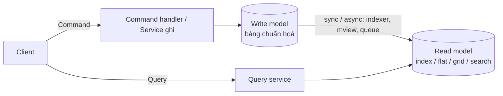
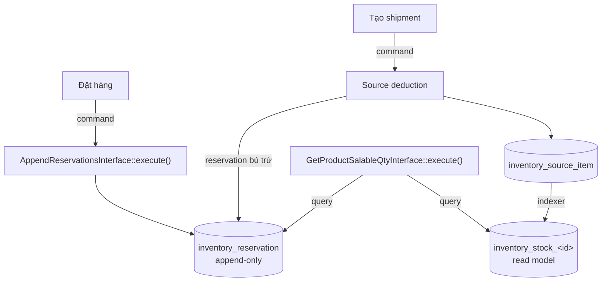

# CQRS - Command and Query Responsibility Segregation

> **Techstack:** Magento 2.4.x (Adobe Commerce / Magento Open Source)

## 1. Định nghĩa

**CQRS** (Command and Query Responsibility Segregation) là kiến trúc tách hệ thống thành 2 phía:

- **Command (write side)**: thay đổi state (create/update/delete), không trả về dữ liệu nghiệp vụ (hoặc chỉ trả id/status).
- **Query (read side)**: chỉ đọc, **không có side effect**, trả về dữ liệu đã được tổ chức sẵn cho nhu cầu đọc (read model).

CQRS phát triển từ nguyên tắc **CQS** (Command-Query Separation – Bertrand Meyer) ở mức method: *"một method hoặc là command, hoặc là query, không phải cả hai"*. CQRS đẩy ý tưởng đó lên mức **model/kiến trúc**: write model và read model có thể là các class, bảng dữ liệu, thậm chí storage khác nhau; read model thường được đồng bộ **bất đồng bộ** (eventual consistency) từ write model.

> [!NOTE]
> Magento 2 **không** phải hệ thống CQRS thuần (không có command bus, không event sourcing). Tuy nhiên nhiều phần của Magento áp dụng *tinh thần* CQS/CQRS. Bài này phân biệt rõ đâu là thực tế trong core, đâu là phép so sánh.

## 2. Khi nào dùng / vấn đề giải quyết

- Tải đọc và ghi chênh lệch lớn (e-commerce: đọc catalog >> ghi).
- Dữ liệu ghi được chuẩn hoá (EAV, nhiều bảng) nhưng query cần dạng phẳng, tính sẵn (giá, tồn kho theo website/stock).
- Muốn scale/tối ưu phía đọc (cache, search engine) mà không làm phức tạp logic ghi.
- Không nên dùng khi domain đơn giản CRUD – CQRS làm tăng số class, thêm độ trễ đồng bộ.

## 3. Cấu trúc



*Hình 1: Cấu trúc CQRS – write model và read model tách biệt, đồng bộ qua projection*

Participants:

- **Command / Command handler**: nhận ý định thay đổi, validate, ghi vào write model.
- **Write model**: nguồn dữ liệu gốc (source of truth).
- **Projection / Updater**: cập nhật read model khi write model thay đổi.
- **Read model + Query service**: dữ liệu tối ưu cho đọc, API chỉ đọc.

## 4. Áp dụng trong Magento 2

### 4.1. Repository – `save()` vs `getList()` (CQS ở mức API, phép so sánh)

Service contract tách rõ method ghi và method đọc:

- Ghi: `Magento\Catalog\Api\ProductRepositoryInterface::save()`, `delete()`, `deleteById()`.
- Đọc: `get()`, `getById()`, `getList(SearchCriteriaInterface $searchCriteria)`.
- `Magento\Framework\Api\SearchCriteriaBuilder` + `FilterBuilder`/`SortOrderBuilder` mô tả query; `Magento\Framework\Api\SearchCriteria\CollectionProcessorInterface` áp dụng vào collection.

Đây là tinh thần **CQS** (và cũng không chặt: `save()` trả về `ProductInterface` đã lưu, `delete()` trả `bool`), không phải CQRS: cả đọc và ghi vẫn dùng chung model/resource model/bảng.

### 4.2. Indexer, flat table, grid table (read model – thực tế trong core)

Đây là chỗ Magento gần CQRS nhất: write model (EAV, bảng chuẩn hoá) và read model (index table) **tách biệt**, đồng bộ qua indexer.

| Write model | Read model | Cơ chế đồng bộ |
|---|---|---|
| `catalog_product_entity_*` (EAV) | `catalog_product_index_price`, `catalog_product_index_eav`, search index (OpenSearch) | Indexer (`indexer.xml`), "Update by Schedule" dùng mview: trigger ghi vào bảng `*_cl`, cron xử lý |
| `catalog_product_entity_*` | `catalog_product_flat_<store>` (nếu bật Flat Catalog) | Indexer flat |
| `sales_order` | `sales_order_grid` | Observer `sales_grid_order_sync_insert` (`Magento\Sales\Observer\GridSyncInsertObserver`) trên event `sales_order_process_relation` (sync, chỉ refresh grid khi `dev/grid/async_indexing` = 0) hoặc cron `sales_grid_order_async_insert` khi bật `dev/grid/async_indexing` |

- Khi "Update by Schedule" hoặc grid async indexing bật → read model **eventually consistent**, đúng tinh thần CQRS.
- Các màn đọc chính **query read model** thay vì tự tính từ write model: admin order grid đọc `sales_order_grid` (`Magento\Sales\Model\ResourceModel\Order\Grid\Collection`), storefront lấy giá từ `catalog_product_index_price` (`Product\Collection::addPriceData()`), search/layered navigation đọc search index.

> [!NOTE]
> Không phải mọi chỗ đều tách hoàn toàn: product collection (`Magento\Catalog\Model\ResourceModel\Product\Collection`) vẫn là EAV collection – attribute chọn bằng `addAttributeToSelect()` được load từ các bảng `catalog_product_entity_*` khi không bật Flat Catalog, và admin product grid (`product_listing` → `Magento\Catalog\Ui\DataProvider\Product\ProductDataProvider`) đọc thẳng EAV.
- Chi tiết cơ chế trigger → changelog → cron: xem [Indexing trong M2](../Indexing%20trong%20M2.md).

### 4.3. Inventory (MSI) – command/query interface tách riêng (thực tế trong core)

MSI thiết kế mỗi service là một interface một method `execute()`, chia rõ command và query:

| Command (ghi) | Query (đọc) |
|---|---|
| `Magento\InventoryApi\Api\SourceItemsSaveInterface::execute(array $sourceItems): void` | `Magento\InventoryApi\Api\GetSourceItemsBySkuInterface::execute(string $sku): array` |
| `Magento\InventorySalesApi\Api\PlaceReservationsForSalesEventInterface` | `Magento\InventorySalesApi\Api\GetProductSalableQtyInterface::execute(string $sku, int $stockId): float` |
| `Magento\InventoryReservationsApi\Model\AppendReservationsInterface::execute(array $reservations): void` | `Magento\InventorySalesApi\Api\IsProductSalableInterface::execute(string $sku, int $stockId): bool` |

- Khi đặt hàng, MSI **không trừ trực tiếp** source item mà append một reservation (bảng `inventory_reservation`, append-only, immutable).
- Salable qty = qty trong stock index (`inventory_stock_<id>`, read model do indexer build; riêng Default Stock đọc bảng legacy `cataloginventory_stock_status`, `inventory_stock_1` chỉ là view) + tổng reservations (`GetReservationsQuantityInterface`, reservation khi đặt hàng mang giá trị âm) − Out-of-Stock Threshold (`min_qty`), xem `Magento\InventorySales\Model\GetProductSalableQty::execute()`. Nếu stock item không salable thì trả `0`.
- Source deduction thực sự xảy ra khi tạo shipment, sau đó reservation bù trừ được ghi thêm → đây là mô hình rất gần CQRS + append-only log.



*Hình 2: MSI – command ghi reservation/source item, query tính salable qty từ stock index + reservations*

### 4.4. GraphQL – Query vs Mutation (thực tế trong core)

- Schema `etc/schema.graphqls` tách `type Query { ... }` và `type Mutation { ... }`; resolver implement `Magento\Framework\GraphQl\Query\ResolverInterface`.
- Query có thể gửi bằng **GET** và được full page cache/Varnish cache; Mutation bị chặn với GET bởi `Magento\GraphQl\Controller\HttpRequestValidator\HttpVerbValidator` ("Mutation requests allowed only for POST requests").

### 4.5. Async / Bulk Web API (command bất đồng bộ – thực tế trong core)

- `POST /rest/async/V1/products`, `/rest/async/bulk/V1/products`: request ghi được đẩy vào message queue, trả ngay `bulk_uuid`; consumer `async.operations.all` (`Magento\AsynchronousOperations\Model\MassConsumer`) xử lý sau.
- Đọc trạng thái qua query riêng: `GET /rest/V1/bulk/{bulkUuid}/status`.
- Tầng PHP: `Magento\AsynchronousOperations\Model\MassSchedule::publishMass()` (dùng qua virtualType `Magento\WebapiAsync\Model\MassSchedule`; bulk: `Magento\WebapiAsync\Model\Bulk\MassSchedule`) gọi `Magento\Framework\Bulk\BulkManagementInterface::scheduleBulk()`; impl `Magento\AsynchronousOperations\Model\BulkManagement` lưu bulk + operations rồi tự publish qua `Magento\Framework\MessageQueue\BulkPublisherInterface::publish()` (không phải `PublisherInterface`).

## 5. Ví dụ code – tách command/query trong module

**Ví dụ:** command interface – chỉ ghi, không trả dữ liệu

```php
<?php
// app/code/Vendor/Module/Api/AssignLoyaltyPointsInterface.php
declare(strict_types=1);

namespace Vendor\Module\Api;

interface AssignLoyaltyPointsInterface
{
    public function execute(int $customerId, int $points): void;
}
```

**Ví dụ:** query interface – chỉ đọc, không side effect, đọc từ bảng tổng hợp

```php
<?php
// app/code/Vendor/Module/Api/GetLoyaltyBalanceInterface.php
declare(strict_types=1);

namespace Vendor\Module\Api;

interface GetLoyaltyBalanceInterface
{
    public function execute(int $customerId): int;
}
```

**Ví dụ:** query service đọc từ bảng read model `vendor_loyalty_balance_idx`

```php
<?php
// app/code/Vendor/Module/Model/GetLoyaltyBalance.php
declare(strict_types=1);

namespace Vendor\Module\Model;

use Magento\Framework\App\ResourceConnection;
use Vendor\Module\Api\GetLoyaltyBalanceInterface;

class GetLoyaltyBalance implements GetLoyaltyBalanceInterface
{
    public function __construct(private readonly ResourceConnection $resource)
    {
    }

    public function execute(int $customerId): int
    {
        $connection = $this->resource->getConnection();
        $select = $connection->select()
            ->from($this->resource->getTableName('vendor_loyalty_balance_idx'), ['balance'])
            ->where('customer_id = ?', $customerId);

        return (int)$connection->fetchOne($select);
    }
}
```

`AssignLoyaltyPoints` ghi transaction vào bảng `vendor_loyalty_transaction` (append-only) và publish message/đánh dấu indexer invalid; một indexer/consumer build lại `vendor_loyalty_balance_idx`. Khai báo `<preference>` cho 2 interface trong `etc/di.xml`.

## 6. Ưu / nhược điểm & lưu ý

**Ưu điểm**

- Read model tối ưu cho query → storefront nhanh, scale độc lập.
- Logic ghi gọn, rõ invariant; interface nhỏ, dễ plugin/test (SRP, ISP).

**Nhược điểm**

- Eventually consistent: dữ liệu đọc có thể trễ (giá/tồn kho chưa reindex, grid đơn hàng chưa thấy đơn mới khi async).
- Nhiều class/bảng hơn; cần cơ chế reindex/repair khi read model lệch.

**Lưu ý trong Magento**

- Đừng gọi "Magento là CQRS" – chỉ một số subsystem (indexer, MSI, grid, async API) theo hướng này.
- Viết query service không có side effect (không save, không dispatch event thay đổi state) để có thể cache an toàn.

> [!WARNING]
> Khi đọc dữ liệu để **ra quyết định ghi** (VD check tồn kho trước khi đặt hàng), cân nhắc read model có thể stale – MSI giải quyết bằng reservations.

## Tham khảo

**Tài liệu chính thức**

- [Searching with repositories](https://developer.adobe.com/commerce/php/development/components/searching-with-repositories)
- [Indexing](https://developer.adobe.com/commerce/php/development/components/indexing/)
- [Custom indexer](https://developer.adobe.com/commerce/php/development/components/indexing/custom-indexer)
- [Inventory management – Reservations](https://developer.adobe.com/commerce/php/development/framework/inventory-management/reservations)
- [Asynchronous web endpoints](https://developer.adobe.com/commerce/webapi/rest/use-rest/asynchronous-web-endpoints)
- [Bulk endpoints](https://developer.adobe.com/commerce/webapi/rest/use-rest/bulk-endpoints)
- [GraphQL](https://developer.adobe.com/commerce/webapi/graphql)

**Source code**

- [`Magento\Catalog\Api\ProductRepositoryInterface`](https://github.com/magento/magento2/blob/2.4-develop/app/code/Magento/Catalog/Api/ProductRepositoryInterface.php)
- [`Magento\GraphQl\Controller\HttpRequestValidator\HttpVerbValidator`](https://github.com/magento/magento2/blob/2.4-develop/app/code/Magento/GraphQl/Controller/HttpRequestValidator/HttpVerbValidator.php)
- [`Magento\InventoryApi\Api\SourceItemsSaveInterface`](https://github.com/magento/inventory/blob/develop/InventoryApi/Api/SourceItemsSaveInterface.php)
- [`Magento\InventorySales\Model\GetProductSalableQty`](https://github.com/magento/inventory/blob/develop/InventorySales/Model/GetProductSalableQty.php)
- [`Magento\AsynchronousOperations\Model\MassConsumer`](https://github.com/magento/magento2/blob/2.4-develop/app/code/Magento/AsynchronousOperations/Model/MassConsumer.php)

**Bài viết khác**

- [Martin Fowler – CQRS](https://martinfowler.com/bliki/CQRS.html)
- [Martin Fowler – CommandQuerySeparation](https://martinfowler.com/bliki/CommandQuerySeparation.html)

**Bài liên quan trong Knowledge Base**

- [Command Design Pattern](Command%20Design%20Pattern.md)
- [Observer](Observer.md)
- [Indexing trong M2](../Indexing%20trong%20M2.md)
- [Service contracts](../Service%20contracts.md)
