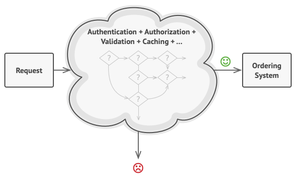
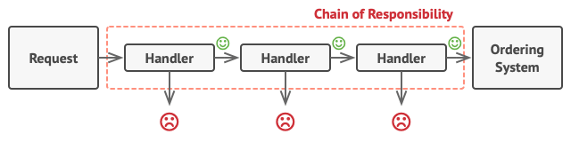
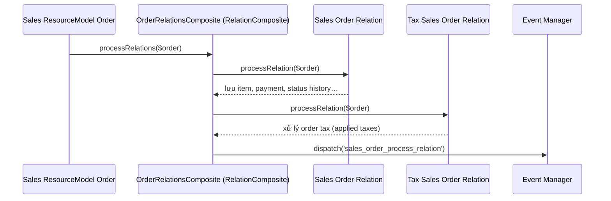

# Chain of Responsibility Pattern

> **Techstack:** Magento 2.4.x (Adobe Commerce / Magento Open Source)

## 1. Tổng quan

Chain of Responsibility là một behavioral design pattern



*Hình 1: Bài toán – mọi bước kiểm tra (authentication, authorization, validation, caching…) dồn vào một khối logic rối trước khi request tới Ordering System*



*Hình 2: Giải pháp Chain of Responsibility – mỗi Handler xử lý một bước, có thể dừng request hoặc chuyển cho handler kế tiếp*

Chain of Responsibility

Mẫu này khá phổ biến trong Magento, magento thường sử dụng handler như một processor

**Ví dụ – Sử dụng trong việc xử lý các phụ thuộc:**

```php
// Magento\Framework\Model\ResourceModel\Db\VersionControl\RelationComposite::processRelations()
foreach ($this->relationProcessors as $processor) {
    /**@var $processor RelationInterface*/
    $processor->processRelation($object);
}
```

tương tự

## 2. Cách thức hoạt động

Mục đích của nó là tạo ra một chuỗi các đối tượng xử lý (handler) mà mỗi đối tượng có cơ hội xử lý một yêu cầu. Nếu một đối tượng không thể xử lý yêu cầu, nó sẽ chuyển tiếp yêu cầu cho đối tượng tiếp theo trong chuỗi.

Cách thức hoạt động của Chain of Responsibility Pattern:

1. Client gửi một yêu cầu đến đối tượng xử lý đầu tiên trong chuỗi.
2. Mỗi Handler sẽ kiểm tra xem nó có thể xử lý yêu cầu hay không.
   - Nếu có, handler sẽ xử lý yêu cầu và có thể dừng chuỗi.
   - Nếu không, handler sẽ chuyển tiếp yêu cầu cho handler tiếp theo trong chuỗi.
3. Quá trình này tiếp tục cho đến khi có một handler xử lý được yêu cầu hoặc đến cuối chuỗi.

> [!NOTE]
> Refactoring.Guru mô tả hai biến thể: (1) mỗi handler xử lý rồi chuyển tiếp, request đi hết chuỗi; (2) biến thể "canonical" – handler nào xử lý được thì **dừng**, không chuyển tiếp nữa. Các ví dụ dạng `foreach` trong Magento (`RelationComposite::processRelations()`, `QuoteValidationComposite::validate()`) thuộc biến thể (1): handler được inject thành mảng qua `di.xml`, không có link "next", **mọi** handler đều chạy và không handler nào dừng được chuỗi (trừ khi throw exception). Biến thể (2) gần với chuỗi plugin `around` hơn: `Interceptor::___callPlugins()` truyền closure `$next` (`$proceed`) cho plugin, plugin không gọi `$proceed()` thì các plugin sau và method gốc bị bỏ qua.

### Ví dụ PHP – Chain of Responsibility (Refactoring.Guru)

Conceptual example của [Refactoring.Guru – Chain of Responsibility in PHP](https://refactoring.guru/design-patterns/chain-of-responsibility/php/example) (© Alexander Shvets, CC BY-NC-ND 4.0). Biến thể canonical: các handler được nối bằng `setNext()`; handler nào xử lý được request thì trả kết quả và **dừng**, không thì gọi `parent::handle()` để chuyển cho handler kế tiếp.

```php
<?php

namespace RefactoringGuru\ChainOfResponsibility\Conceptual;

/**
 * The Handler interface declares a method for building the chain of
 * handlers. It also declares a method for executing a request.
 */
interface Handler
{
    public function setNext(Handler $handler): Handler;

    public function handle(string $request): ?string;
}

/**
 * The default chaining behavior can be implemented inside a base handler
 * class.
 */
abstract class AbstractHandler implements Handler
{
    /**
     * @var Handler
     */
    private $nextHandler;

    public function setNext(Handler $handler): Handler
    {
        $this->nextHandler = $handler;
        // Returning a handler from here will let us link handlers in a
        // convenient way like this:
        // $monkey->setNext($squirrel)->setNext($dog);
        return $handler;
    }

    public function handle(string $request): ?string
    {
        if ($this->nextHandler) {
            return $this->nextHandler->handle($request);
        }

        return null;
    }
}

/**
 * All Concrete Handlers either handle a request or pass it to the next
 * handler in the chain.
 */
class MonkeyHandler extends AbstractHandler
{
    public function handle(string $request): ?string
    {
        if ($request === "Banana") {
            return "Monkey: I'll eat the " . $request . ".\n";
        } else {
            return parent::handle($request);
        }
    }
}

class SquirrelHandler extends AbstractHandler
{
    public function handle(string $request): ?string
    {
        if ($request === "Nut") {
            return "Squirrel: I'll eat the " . $request . ".\n";
        } else {
            return parent::handle($request);
        }
    }
}

class DogHandler extends AbstractHandler
{
    public function handle(string $request): ?string
    {
        if ($request === "MeatBall") {
            return "Dog: I'll eat the " . $request . ".\n";
        } else {
            return parent::handle($request);
        }
    }
}

/**
 * The client code is usually suited to work with a single handler. In most
 * cases, it is not even aware that the handler is part of a chain.
 */
function clientCode(Handler $handler)
{
    foreach (["Nut", "Banana", "Cup of coffee"] as $food) {
        echo "Client: Who wants a " . $food . "?\n";
        $result = $handler->handle($food);
        if ($result) {
            echo "  " . $result;
        } else {
            echo "  " . $food . " was left untouched.\n";
        }
    }
}

/**
 * The other part of the client code constructs the actual chain.
 */
$monkey = new MonkeyHandler();
$squirrel = new SquirrelHandler();
$dog = new DogHandler();

$monkey->setNext($squirrel)->setNext($dog);

/**
 * The client should be able to send a request to any handler, not just the
 * first one in the chain.
 */
echo "Chain: Monkey > Squirrel > Dog\n\n";
clientCode($monkey);
echo "\n";

echo "Subchain: Squirrel > Dog\n\n";
clientCode($squirrel);
```

## 3. Đặc điểm quan trọng

- **Tính linh hoạt:** Các handler có thể được thêm hoặc bớt một cách linh hoạt mà không ảnh hưởng đến các handler khác trong chuỗi.
- **Giảm sự phụ thuộc:** Client không cần biết handler nào sẽ xử lý yêu cầu, giúp giảm sự phụ thuộc giữa client và các handler cụ thể.
- **Trách nhiệm phân tán:** Mỗi handler chỉ tập trung vào một phần cụ thể của yêu cầu, giúp code dễ hiểu và bảo trì hơn.

## 4. Ứng dụng của Chain of Responsibility Pattern trong Magento

Mẫu thiết kế này khá phổ biến trong Magento, Magento thường sử dụng handler như một processor.

- **Xử lý các phụ thuộc:** Magento sử dụng Chain of Responsibility để lưu các entity phụ thuộc (child entity) của một model. Ví dụ, khi lưu một order, virtualType `OrderRelationsComposite` chạy lần lượt `Magento\Sales\Model\ResourceModel\Order\Relation` (lưu item, payment, status history, related objects, address) và `Magento\Tax\Model\ResourceModel\Sales\Order\Relation` (applied taxes). Gửi email xác nhận hay trừ kho **không** nằm trong chuỗi này – email được gửi bởi observer `Magento\Quote\Observer\SubmitObserver` trên event `sales_model_service_quote_submit_success`.
- **Validation:** Chain of Responsibility có thể được sử dụng để thực hiện một loạt các validation cho một đối tượng. Mỗi handler sẽ chịu trách nhiệm cho một loại validation cụ thể. Ví dụ trong `Magento\Quote\Model\ValidationRules\QuoteValidationComposite`, mỗi validationRule sẽ validate trên quote và trả về kết quả, nếu có bất kỳ validationRule nào không đúng, sẽ trả về kết quả lỗi.
- **Các Relation Processor:** Magento sử dụng Chain of Responsibility trong việc xử lý các relation giữa các đối tượng. Ví dụ:
  - Mỗi `RelationInterface` là một handler, chịu trách nhiệm xử lý một loại relation cụ thể.
- **Authentication, Authorization, Validation và Caching:** Mô hình này có thể được sử dụng để xử lý một chuỗi các tác vụ như xác thực, ủy quyền, kiểm tra dữ liệu và lưu cache.
- **Plugin Interceptors:** Mặc dù không phải là Chain of Responsibility thuần túy, plugin interceptor trong Magento cũng hoạt động theo một cách tương tự. Các plugin có thể can thiệp vào trước, sau hoặc xung quanh một method, tạo thành một chuỗi các hành động



*Hình 3: Khi save order, `VersionControl\AbstractDb` gọi `RelationComposite::processRelations()`; virtualType `OrderRelationsComposite` (di.xml của Magento_Sales và Magento_Tax) lần lượt chuyển `$order` qua từng `RelationInterface::processRelation()`*

## Tham khảo

**Tài liệu chính thức**
- [Plugins (Interceptors)](https://developer.adobe.com/commerce/php/development/components/plugins)
- [The di.xml file](https://developer.adobe.com/commerce/php/development/build/dependency-injection-file) – khai báo mảng handler qua `<argument xsi:type="array">`

**Source code**
- [`Magento\Framework\Model\ResourceModel\Db\VersionControl\RelationComposite`](https://github.com/magento/magento2/blob/2.4-develop/lib/internal/Magento/Framework/Model/ResourceModel/Db/VersionControl/RelationComposite.php)
- [`Magento\Framework\Model\ResourceModel\Db\VersionControl\RelationInterface`](https://github.com/magento/magento2/blob/2.4-develop/lib/internal/Magento/Framework/Model/ResourceModel/Db/VersionControl/RelationInterface.php)
- [`Magento\Sales\Model\ResourceModel\Order\Relation`](https://github.com/magento/magento2/blob/2.4-develop/app/code/Magento/Sales/Model/ResourceModel/Order/Relation.php)
- [`Magento\Quote\Model\ValidationRules\QuoteValidationComposite`](https://github.com/magento/magento2/blob/2.4-develop/app/code/Magento/Quote/Model/ValidationRules/QuoteValidationComposite.php)

**Bài viết khác**
- [Refactoring.Guru – Chain of Responsibility](https://refactoring.guru/design-patterns/chain-of-responsibility)

**Bài liên quan trong Knowledge Base**
- [Composite Pattern](Composite%20Pattern.md)
- [VersionControl](../DB%20%26%20Data%20Object/VersionControl.md)
- [So sánh overview về Event, Plugin & DI](../DI%20%26%20Interceptors/So%20s%C3%A1nh%20overview%20v%E1%BB%81%20Event%2C%20Plugin%20%26%20DI.md)
