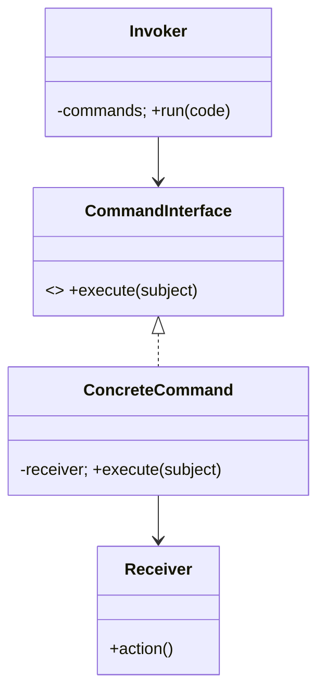
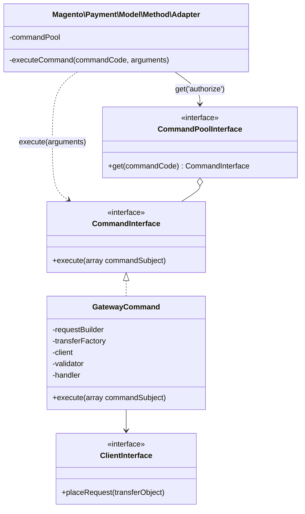
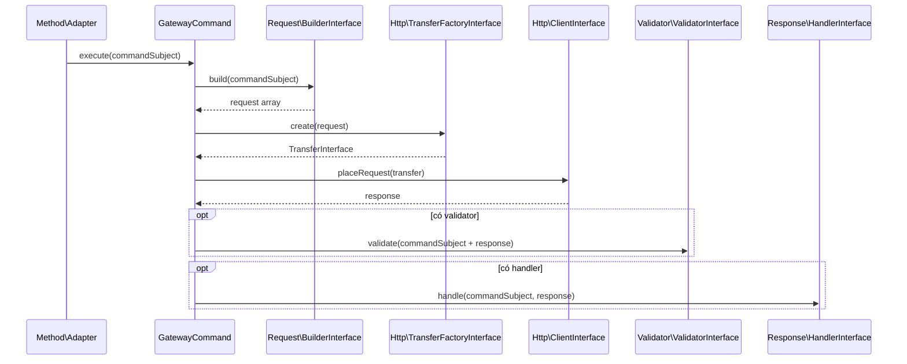

# Command Design Pattern

> **Techstack:** Magento 2.4.x (Adobe Commerce / Magento Open Source)

## 1. Định nghĩa

**Command** là behavioral design pattern **đóng gói một yêu cầu (request) thành một object** độc lập, chứa đủ thông tin để thực thi. Nhờ đó yêu cầu có thể được truyền như tham số, lưu trữ, xếp hàng (queue), log, retry hoặc undo.

Ý tưởng cốt lõi: tách **người phát lệnh** (Invoker) khỏi **người thực hiện** (Receiver) thông qua một interface chung, thường chỉ có một method `execute()`.

## 2. Khi nào dùng / vấn đề giải quyết

- Muốn tham số hoá object bằng hành động: cùng một Invoker chạy được nhiều loại lệnh khác nhau (authorize/capture/refund).
- Muốn đăng ký lệnh qua config thay vì `if/switch` (Open/Closed).
- Muốn đưa yêu cầu vào hàng đợi, chạy bất đồng bộ hoặc retry.
- Muốn undo/redo, audit log từng thao tác.

## 3. Cấu trúc



*Hình 1: Cấu trúc Command pattern (GoF)*

- **Command**: interface `execute()`.
- **ConcreteCommand**: cài đặt cụ thể, giữ tham chiếu tới Receiver.
- **Receiver**: object làm việc thật (HTTP client, repository…).
- **Invoker** (Sender): giữ tham chiếu tới command và **kích hoạt** `execute()` thay vì gọi thẳng Receiver. Trong Magento Invoker thường lấy command từ một *pool/registry* (`CommandPool`, `CommandList`) – pool chỉ là nơi tra cứu, không tự gọi `execute()`.
- **Client**: tạo và cấu hình command, gắn Receiver vào command (trong Magento: `di.xml` + ObjectManager).

### Ví dụ PHP – Command (Refactoring.Guru)

Conceptual example của [Refactoring.Guru – Command in PHP](https://refactoring.guru/design-patterns/command/php/example) (© Alexander Shvets, CC BY-NC-ND 4.0). `Invoker` chỉ giữ command (`setOnStart()`/`setOnFinish()`) và gọi `execute()`; `ComplexCommand` ủy thác việc thật cho `Receiver`; phần client code ở cuối tạo và gắn command – tương ứng vai trò của `di.xml` trong Magento.

```php
<?php

namespace RefactoringGuru\Command\Conceptual;

/**
 * The Command interface declares a method for executing a command.
 */
interface Command
{
    public function execute(): void;
}

/**
 * Some commands can implement simple operations on their own.
 */
class SimpleCommand implements Command
{
    private $payload;

    public function __construct(string $payload)
    {
        $this->payload = $payload;
    }

    public function execute(): void
    {
        echo "SimpleCommand: See, I can do simple things like printing (" . $this->payload . ")\n";
    }
}

/**
 * However, some commands can delegate more complex operations to other
 * objects, called "receivers."
 */
class ComplexCommand implements Command
{
    /**
     * @var Receiver
     */
    private $receiver;

    /**
     * Context data, required for launching the receiver's methods.
     */
    private $a;

    private $b;

    /**
     * Complex commands can accept one or several receiver objects along
     * with any context data via the constructor.
     */
    public function __construct(Receiver $receiver, string $a, string $b)
    {
        $this->receiver = $receiver;
        $this->a = $a;
        $this->b = $b;
    }

    /**
     * Commands can delegate to any methods of a receiver.
     */
    public function execute(): void
    {
        echo "ComplexCommand: Complex stuff should be done by a receiver object.\n";
        $this->receiver->doSomething($this->a);
        $this->receiver->doSomethingElse($this->b);
    }
}

/**
 * The Receiver classes contain some important business logic. They know how
 * to perform all kinds of operations, associated with carrying out a request.
 * In fact, any class may serve as a Receiver.
 */
class Receiver
{
    public function doSomething(string $a): void
    {
        echo "Receiver: Working on (" . $a . ".)\n";
    }

    public function doSomethingElse(string $b): void
    {
        echo "Receiver: Also working on (" . $b . ".)\n";
    }
}

/**
 * The Invoker is associated with one or several commands. It sends a
 * request to the command.
 */
class Invoker
{
    /**
     * @var Command
     */
    private $onStart;

    /**
     * @var Command
     */
    private $onFinish;

    /**
     * Initialize commands.
     */
    public function setOnStart(Command $command): void
    {
        $this->onStart = $command;
    }

    public function setOnFinish(Command $command): void
    {
        $this->onFinish = $command;
    }

    /**
     * The Invoker does not depend on concrete command or receiver classes.
     * The Invoker passes a request to a receiver indirectly, by executing a
     * command.
     */
    public function doSomethingImportant(): void
    {
        echo "Invoker: Does anybody want something done before I begin?\n";
        if ($this->onStart instanceof Command) {
            $this->onStart->execute();
        }

        echo "Invoker: ...doing something really important...\n";

        echo "Invoker: Does anybody want something done after I finish?\n";
        if ($this->onFinish instanceof Command) {
            $this->onFinish->execute();
        }
    }
}

/**
 * The client code can parameterize an invoker with any commands.
 */
$invoker = new Invoker();
$invoker->setOnStart(new SimpleCommand("Say Hi!"));
$receiver = new Receiver();
$invoker->setOnFinish(new ComplexCommand($receiver, "Send email", "Save report"));

$invoker->doSomethingImportant();
```

## 4. Áp dụng trong Magento 2

### 4.1. Payment Gateway (ví dụ rõ nhất)

| Vai trò | Class |
|---|---|
| Command interface | `Magento\Payment\Gateway\CommandInterface::execute(array $commandSubject)` |
| ConcreteCommand | `Magento\Payment\Gateway\Command\GatewayCommand` (request builder → transfer factory → client → validator → handler) |
| Command pool (registry) | `Magento\Payment\Gateway\Command\CommandPoolInterface::get($commandCode)`, impl `Magento\Payment\Gateway\Command\CommandPool` – chỉ trả command theo code, ném `NotFoundException` nếu không có |
| Invoker | `Magento\Payment\Model\Method\Adapter` – `authorize()`/`capture()`/`refund()`/`void()`… gọi private `executeCommand($commandCode, $arguments)` → `$this->commandPool->get($commandCode)->execute($arguments)` (hoặc `CommandManagerInterface::executeByCode()` nếu inject `commandExecutor`) |
| Client | `di.xml` (virtualType) + ObjectManager – tạo `GatewayCommand`, gắn builder/client/handler, đăng ký vào pool |
| Receiver | `Magento\Payment\Gateway\Http\ClientInterface::placeRequest()` |



*Hình 2: Command pattern trong Payment Gateway – `Adapter` (invoker) lấy command từ `CommandPool` (registry) theo code rồi gọi `execute()`*

`GatewayCommand::execute()` thực thi một lệnh theo đúng thứ tự: build request → tạo transfer object → gửi request → validate response → handle response:



*Hình 3: Luồng `Magento\Payment\Gateway\Command\GatewayCommand::execute()`*

Mỗi payment action là một command object được cấu hình hoàn toàn trong `di.xml` bằng `virtualType`.

**Ví dụ:** command pool + gateway command + payment facade cho module `Vendor_Payment`

```xml
<!-- app/code/Vendor/Payment/etc/di.xml -->
<virtualType name="VendorPaymentCommandPool" type="Magento\Payment\Gateway\Command\CommandPool">
    <arguments>
        <argument name="commands" xsi:type="array">
            <item name="authorize" xsi:type="string">VendorPaymentAuthorizeCommand</item>
            <item name="capture" xsi:type="string">VendorPaymentCaptureCommand</item>
        </argument>
    </arguments>
</virtualType>

<virtualType name="VendorPaymentAuthorizeCommand" type="Magento\Payment\Gateway\Command\GatewayCommand">
    <arguments>
        <argument name="requestBuilder" xsi:type="object">Vendor\Payment\Gateway\Request\AuthorizeRequest</argument>
        <argument name="transferFactory" xsi:type="object">Vendor\Payment\Gateway\Http\TransferFactory</argument>
        <argument name="client" xsi:type="object">Vendor\Payment\Gateway\Http\Client</argument>
        <argument name="validator" xsi:type="object">Vendor\Payment\Gateway\Validator\ResponseValidator</argument>
        <argument name="handler" xsi:type="object">Vendor\Payment\Gateway\Response\TxnIdHandler</argument>
    </arguments>
</virtualType>

<virtualType name="VendorPaymentFacade" type="Magento\Payment\Model\Method\Adapter">
    <arguments>
        <argument name="commandPool" xsi:type="object">VendorPaymentCommandPool</argument>
        <!-- code, formBlockType, infoBlockType, valueHandlerPool, validatorPool... -->
    </arguments>
</virtualType>
```

Ngoài ra, phía Sales cũng có `Magento\Sales\Model\Order\Payment\State\CommandInterface` (`execute(OrderPaymentInterface $payment, $amount, OrderInterface $order)`) cho việc cập nhật state/status đơn hàng theo từng action thanh toán.

### 4.2. Console command

- Mỗi CLI command là một object `Symfony\Component\Console\Command\Command` (`configure()` + `execute()`).
- Registry: `Magento\Framework\Console\CommandListInterface` (impl `Magento\Framework\Console\CommandList`), nhận mảng `commands` qua `di.xml`.
- Invoker: `Magento\Framework\Console\Cli` (extends Symfony `Console\Application`) – `getApplicationCommands()` lấy command từ `CommandListInterface::getCommands()`, sau đó Symfony Application chọn command theo tên và gọi `run()` → `execute()`.

**Ví dụ:** đăng ký console command

```xml
<!-- app/code/Vendor/Module/etc/di.xml -->
<type name="Magento\Framework\Console\CommandListInterface">
    <arguments>
        <argument name="commands" xsi:type="array">
            <item name="vendor_module_order_sync" xsi:type="object">Vendor\Module\Console\Command\OrderSync</item>
        </argument>
    </arguments>
</type>
```

### 4.3. Message queue / Bulk operations – command được "đông lạnh" thành message

- `Magento\Framework\MessageQueue\PublisherInterface::publish($topicName, $data)` → message là "lệnh" được serialize, consumer (`queue_consumer.xml`) thực thi sau.
- Bulk: `Magento\Framework\Bulk\BulkManagementInterface::scheduleBulk()` lưu danh sách operation (`Magento\AsynchronousOperations\Api\Data\OperationInterface`) kèm trạng thái → có thể theo dõi, retry từng lệnh. Async REST (`/rest/async/V1/...`) dùng cơ chế này.

### 4.4. Controller – `execute()` (phép so sánh)

`Magento\Framework\App\ActionInterface::execute()`: `FrontController` (Invoker) duyệt `RouterList`, router `match()` trả về action theo route, rồi FrontController gọi `execute()`. Mỗi controller = một request được đóng gói thành class. Đây là cách tổ chức *giống* Command (một class – một hành động – một method), không có queue/undo.

## 5. Ví dụ code – console command

**Ví dụ:** console command `vendor:order:sync` (Receiver là service `OrderSyncInterface`)

```php
<?php
// app/code/Vendor/Module/Console/Command/OrderSync.php
declare(strict_types=1);

namespace Vendor\Module\Console\Command;

use Magento\Framework\Console\Cli;
use Symfony\Component\Console\Command\Command;
use Symfony\Component\Console\Input\InputArgument;
use Symfony\Component\Console\Input\InputInterface;
use Symfony\Component\Console\Output\OutputInterface;
use Vendor\Module\Api\OrderSyncInterface;

class OrderSync extends Command
{
    private const ARG_INCREMENT_ID = 'increment_id';

    public function __construct(
        private readonly OrderSyncInterface $orderSync // Receiver
    ) {
        parent::__construct();
    }

    protected function configure(): void
    {
        $this->setName('vendor:order:sync')
            ->setDescription('Đồng bộ một đơn hàng sang ERP')
            ->addArgument(self::ARG_INCREMENT_ID, InputArgument::REQUIRED, 'Order increment ID');
        parent::configure();
    }

    protected function execute(InputInterface $input, OutputInterface $output): int
    {
        try {
            $this->orderSync->execute((string)$input->getArgument(self::ARG_INCREMENT_ID));
            $output->writeln('<info>Done</info>');
            return Cli::RETURN_SUCCESS;
        } catch (\Throwable $e) {
            $output->writeln('<error>' . $e->getMessage() . '</error>');
            return Cli::RETURN_FAILURE;
        }
    }
}
```

> [!TIP]
> Inject dependency nặng (repository, indexer…) qua **Proxy** trong `di.xml`, vì toàn bộ command được khởi tạo mỗi lần chạy `bin/magento` (kể cả `bin/magento list`).

## 6. Ưu / nhược điểm & lưu ý

**Ưu điểm**

- Single Responsibility: mỗi command một hành động.
- Open/Closed: thêm command mới bằng cách thêm `<item>` vào pool trong `di.xml`, không sửa Invoker.
- Dễ chuyển sang chạy async (queue), retry, log.
- Dễ test từng command độc lập.

**Nhược điểm**

- Nhiều class/virtualType → khó lần theo luồng (debug payment gateway phải đọc nhiều `di.xml`).
- `array $commandSubject` không typed → cần `Magento\Payment\Gateway\Helper\SubjectReader` để đọc an toàn.

**Lưu ý**

- Command nên idempotent nếu chạy qua queue (message có thể bị xử lý lại).
- Phân biệt với [CQRS](CQRS%20-%20Command%20and%20Query%20Responsibility%20Segregation_.md): "command" trong CQRS là *ý định thay đổi state*, còn Command pattern là *cách đóng gói một lời gọi* – hai khái niệm hay đi cùng nhau nhưng không đồng nhất.
- Pool + Command thường kết hợp với [Strategy Design Pattern](Strategy%20Design%20Pattern.md) (chọn hành vi theo code).

## Tham khảo

**Tài liệu chính thức**

- [Payment Gateway – Gateway Command](https://developer.adobe.com/commerce/php/development/payments-integrations/payment-gateway/gateway-command)
- [Payment Gateway – Command Pool](https://developer.adobe.com/commerce/php/development/payments-integrations/payment-gateway/command-pool)
- [Add CLI commands](https://developer.adobe.com/commerce/php/development/cli-commands/custom)
- [Bulk operations](https://developer.adobe.com/commerce/php/development/components/message-queues/bulk-operations)

**Source code**

- [`Magento\Payment\Gateway\Command\GatewayCommand`](https://github.com/magento/magento2/blob/2.4-develop/app/code/Magento/Payment/Gateway/Command/GatewayCommand.php)
- [`Magento\Payment\Gateway\Command\CommandPool`](https://github.com/magento/magento2/blob/2.4-develop/app/code/Magento/Payment/Gateway/Command/CommandPool.php)
- [`Magento\Framework\Console\CommandList`](https://github.com/magento/magento2/blob/2.4-develop/lib/internal/Magento/Framework/Console/CommandList.php)

**Bài viết khác**

- [Refactoring.Guru – Command](https://refactoring.guru/design-patterns/command)

**Bài liên quan trong Knowledge Base**

- [CQRS - Command and Query Responsibility Segregation](CQRS%20-%20Command%20and%20Query%20Responsibility%20Segregation_.md)
- [Strategy Design Pattern](Strategy%20Design%20Pattern.md)
- [Proxies](Proxies.md)
